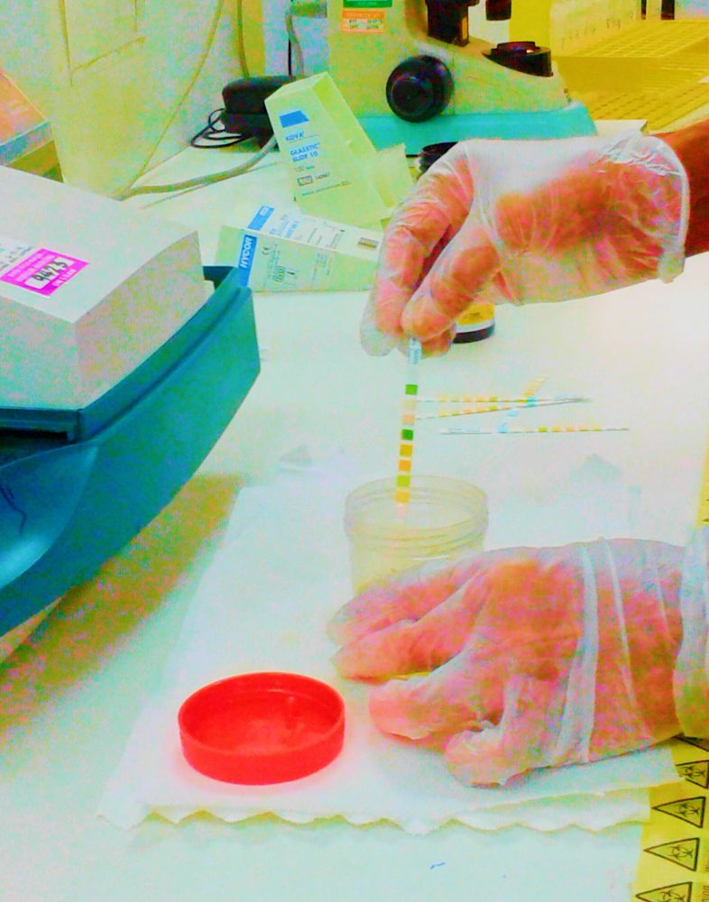
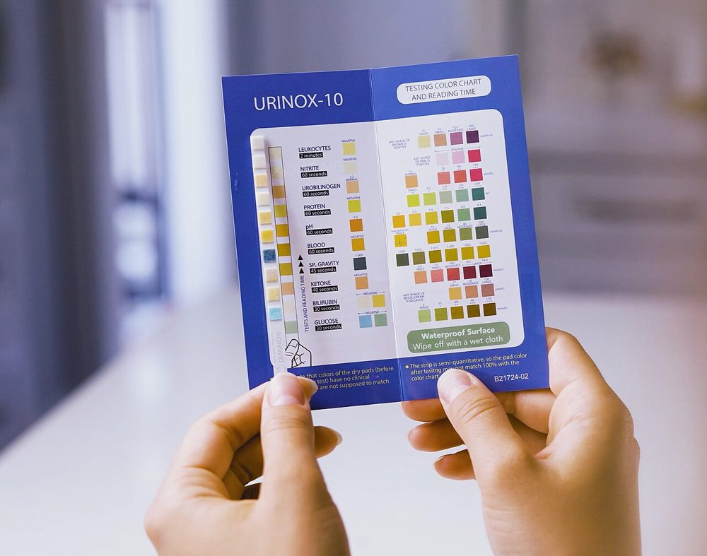
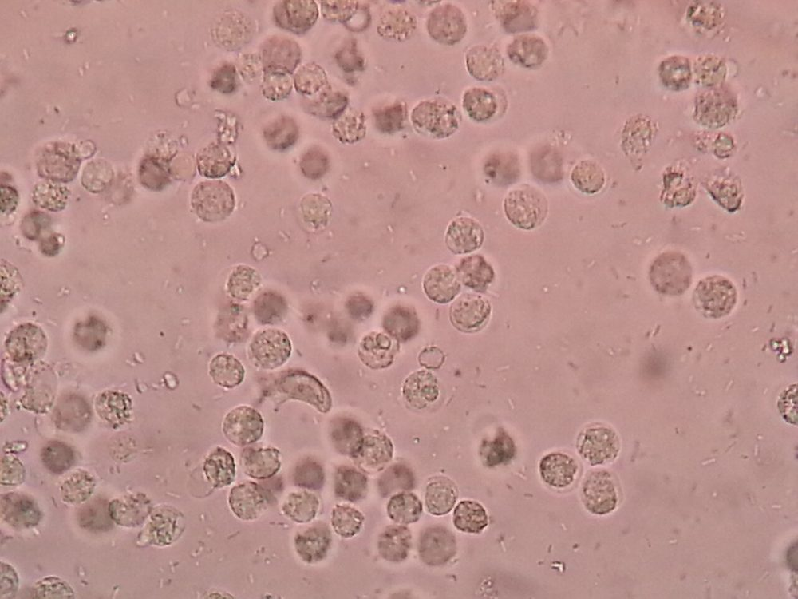
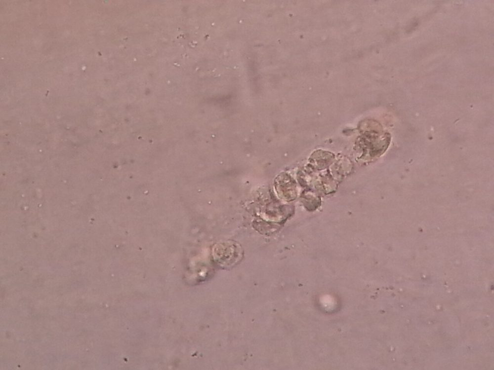
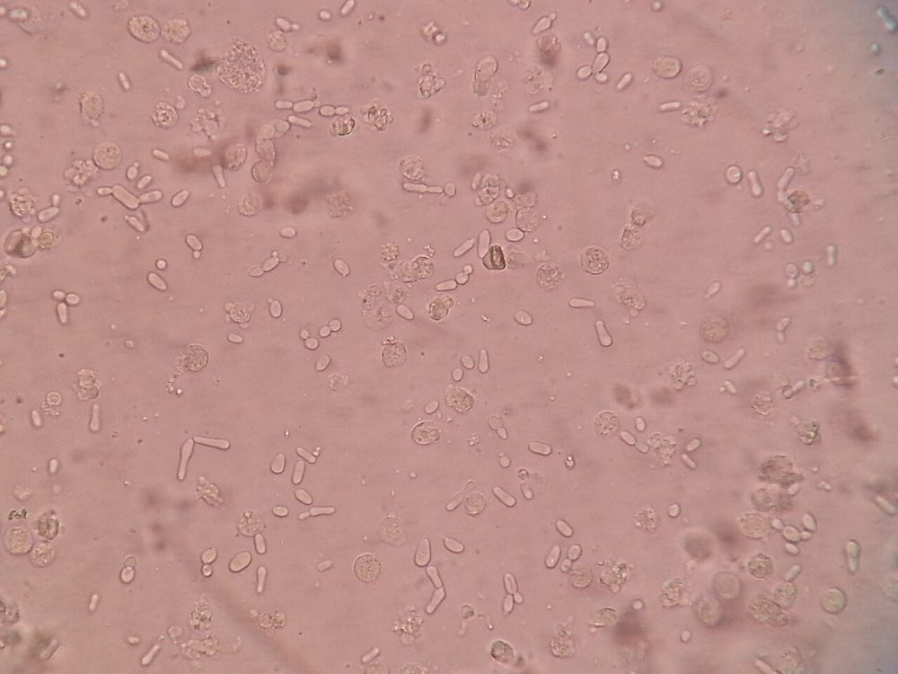

# پروتکل ۳: بررسی مستقیم و غربالگری ادرار

## ۱. هدف
- تخمین سریع احتمال UTI (پیوری و باکتریوری)
- ارزیابی کیفیت نمونه (آلودگی)
- تصمیم برای کشت (Reflex)
- راهنمایی درمان تجربی (گرم)

> 🔬 بررسی جامع رسوب (کست‌ها، کریستال‌ها، RBC دیسمورفیک) در حیطهٔ آزمایش کامل ادرار است. اینجا فقط عناصر مرتبط با عفونت آمده است.

## ۲. دیپ‌استیک

| پد | اصل | معنی | مثبت کاذب | منفی کاذب |
|---|---|---|---|---|
| **استراز لکوسیتی (LE)** | استراز نوتروفیل‌ها (حتی لیزشده) | **پیوری** | آلودگی واژینال، تریکوموناس، اکسیدان‌ها | گلوکز یا پروتئین بالا، وزن مخصوص بالا، سفالکسین، تتراسایکلین، اسید بوریک، نوتروپنی |
| **نیتریت** | احیای نیترات رژیمی به نیتریت توسط باکتری‌های گرم منفی | **باکتریوری گرم منفی** | آلودگی، نمونهٔ مانده در دمای اتاق، دارو (فنازوپیریدین) | **ارگانیسم بدون نیترات‌ردوکتاز** (انتروکوکوس، *S. saprophyticus*، GBS، *Acinetobacter*، کاندیدا؛ *Pseudomonas* اغلب ضعیف)، **ماندن کمتر از ۴ ساعت در مثانه**، رژیم بدون سبزی، ویتامین C، ادرار رقیق، شمارش کم |

| الگو | تفسیر |
|---|---|
| LE+ و نیتریت+ | احتمال UTI بالا (ارزش اخباری مثبت بالا) |
| LE+ و نیتریت– | UTI با ارگانیسم نیتریت منفی، ادرار رقیق، پیوری استریل، آلودگی |
| LE– و نیتریت+ | باکتریوری (گاه ASB، یا نمونهٔ مانده) |
| **LE– و نیتریت–** | **ارزش اخباری منفی بالا** در جمعیت کم‌خطر (برای رد UTI در غربالگری مفید)؛ ⚠️ نه در نوزاد، نوتروپنی، یا بیمار با ظن بالینی بالا |

- حساسیت ترکیب LE یا نیتریت برای UTI حدود ۷۵–۹۰٪؛ نیتریت به‌تنهایی اختصاصیت بیش از ۹۰٪ ولی حساسیت حدود ۴۵–۶۰٪.
- ⚠️ در **کودکان کمتر از ۲ سال** ادرار مدت کمی در مثانه می‌ماند؛ نیتریت اغلب منفی است.

**تصاویر:**

<table><tr><td align="center" width="50%"> <b>شکل ۲.۰۲.</b> آزمایش ادرار با نوار دیپ‌استیک در آزمایشگاه منبع: Iqbal Osman1 from singapore، <a href="https://commons.wikimedia.org/wiki/File:Urine_dipstick_reading_(14834996677).jpg">Wikimedia Commons</a>، <a href="https://creativecommons.org/licenses/by/2.0">CC BY 2.0</a></td><td align="center" width="50%"> <b>شکل ۲.۰۳.</b> خواندن چشمی نوار ادرار با مقایسهٔ رنگ پدها با جدول رنگ سازنده منبع: Hxa098020، <a href="https://commons.wikimedia.org/wiki/File:Visually_read_a_urine_test_strip_by_comparing_it_with_the_color_key_provided_by_the_manufacturer._Color_chart_from_Urinox-10_urine_test_strips_by_Diagnox_is_shown_in_this_image.jpg">Wikimedia Commons</a>، <a href="https://creativecommons.org/licenses/by-sa/4.0">CC BY-SA 4.0</a></td></tr></table>

## ۳. میکروسکوپی برای پیوری و باکتریوری

### ۳-۱) روش‌ها

| روش | آستانهٔ پیوری | نکته |
|---|---|---|
| **ادرار سانتریفیوژنشده در لام شمارش (هموسیتومتر)** | **≥ ۱۰ WBC/µL** | دقیق‌ترین تعریف پیوری (استاندارد پژوهشی) |
| رسوب سانتریفیوژشده (۱۰–۱۲ mL، ۴۰۰–۴۵۰ × g، ۵ دقیقه، باقیماندهٔ ۰٫۵ mL) | **≥ ۵–۱۰ WBC/HPF** | وابسته به استانداردسازی حجم و تکنیک |
| شمارنده/فلوسیتومتری ادرار (Sysmex UF، iQ200) | آستانه‌های اعتبارسنجی‌شدهٔ محلی (مثلاً WBC و باکتری/µL) | **غربالگری برای حذف کشت‌های منفی**؛ ارزش اخباری منفی بالا با آستانهٔ مناسب |

### ۳-۲) عناصر مرتبط با عفونت

| عنصر | معنی |
|---|---|
| WBC (و Glitter cells در ادرار رقیق) | التهاب |
| **کست WBC** | التهاب **کلیوی** (پیلونفریت، نفریت بینابینی) |
| باکتری فراوان | باکتریوری (با رنگ‌آمیزی نشده، باکتری‌ها به‌سادگی با ذرات اشتباه می‌شوند) |
| **سلول اپی‌تلیال سنگفرشی فراوان** (بیش از حدود ۱۰–۱۵/LPF) | **آلودگی واژینال/پوستی** |
| مخمر و هیف کاذب | کاندیدوری (آلودگی، کلونیزاسیون، عفونت) |
| تریکوموناس | ⚠️ متحرک فقط در نمونهٔ تازه |
| کریستال استروویت (درب تابوتی) در ادرار قلیایی | ارگانیسم اوره‌آز مثبت |
| اسپرم در ادرار زن | آلودگی |

**تصاویر:**

<table><tr><td align="center" width="50%"> <b>شکل ۲.۰۴.</b> میکروسکوپی ادرار در UTI باکتریایی: WBC (سلول چرکی) فراوان و باکتری منبع: Ajay Kumar Chaurasiya، <a href="https://commons.wikimedia.org/wiki/File:Bacterial_UTI_picture_of_urine_microscopy_showing_plenty_of_pus_cells_and_bacteria.jpg">Wikimedia Commons</a>، <a href="https://creativecommons.org/licenses/by-sa/4.0">CC BY-SA 4.0</a></td><td align="center" width="50%"> <b>شکل ۲.۰۵.</b> کست WBC در رسوب ادرار منبع: Ajay Kumar Chaurasiya، <a href="https://commons.wikimedia.org/wiki/File:WBC_cast_in_urine.jpg">Wikimedia Commons</a>، <a href="https://creativecommons.org/licenses/by-sa/4.0">CC BY-SA 4.0</a></td></tr><tr><td align="center" width="50%"> <b>شکل ۲.۰۶.</b> WBC و سلول‌های مخمری فراوان در میکروسکوپی ادرار منبع: Ajay Kumar Chaurasiya، <a href="https://commons.wikimedia.org/wiki/File:Numerous_pus_cells_and_yeast_cells_in_urine.jpg">Wikimedia Commons</a>، <a href="https://creativecommons.org/licenses/by-sa/4.0">CC BY-SA 4.0</a></td></tr></table>

## ۴. رنگ‌آمیزی گرم ادرار

### ۴-۱) روش
1. یک قطره (۱۰ µL) از ادرار **سانتریفیوژنشده و خوب مخلوط‌شده** را روی لام بگذارید **بدون پخش‌کردن**. خشک، فیکس و رنگ کنید.
2. بررسی با روغن (۱۰۰۰×)، حداقل ۲۰ میدان.

### ۴-۲) تفسیر
| یافته | معنی |
|---|---|
| **≥ ۱ باکتری در هر میدان روغنی** (لام سانتریفیوژنشده) | حدود **≥ ۱۰⁵ CFU/mL** (حساسیت حدود ۹۰٪) |
| باسیل گرم منفی + PMN | UTI با Enterobacterales محتمل |
| کوکسی گرم مثبت جفت/زنجیره | انتروکوکوس، GBS، *Aerococcus* |
| کوکسی گرم مثبت خوشه‌ای | *S. saprophyticus*، *S. aureus* |
| **مورفولوژی‌های متعدد + سلول سنگفرشی** | آلودگی |
| دیپلوکوک گرم **منفی** داخل‌سلولی در ادرار اول جریان مرد | ظن *N. gonorrhoeae* (اورتریت) ← NAAT/کشت اختصاصی |
| باسیل گرم مثبت دیفتروئیدی در ادرار قلیایی با کریستال | *C. urealyticum* ← کشت طولانی ۴۸ ساعت |

### ۴-۳) اندیکاسیون گرم
- **روتین نیست**. در پیلونفریت/اوروسپسیس برای راهنمایی درمان تجربی (پوشش انتروکوکوس در کوکسی گرم مثبت)، در کودک تب‌دار، و در بخش‌های ویژه.

## ۵. غربالگری خودکار و کشت بازتابی
- **فلوسیتومتری** شمارش WBC و باکتری را در دقایق ارائه می‌دهد و می‌تواند **۳۰–۶۰٪ کشت‌ها را حذف کند** (پیش‌بینی کشت منفی).
- هر آزمایشگاه باید آستانه‌ها را **در جمعیت خودش اعتبارسنجی** کند (هدف: ارزش اخباری منفی ≥ ۹۵–۹۸٪).
- **گروه‌های مستثنا** از حذف کشت: نوزاد و شیرخوار، نوتروپنی، بارداری، پیوند کلیه، پیش از جراحی اورولوژیک، درخواست صریح پزشک با علائم شدید.

## ۶. گزارش بررسی مستقیم
- «WBC: ۵۰–۱۰۰/HPF؛ باکتری: فراوان؛ سلول اپی‌تلیال سنگفرشی: کم/LPF.»
- «سلول اپی‌تلیال سنگفرشی فراوان: احتمال آلودگی نمونه.»
- گرم: «باسیل‌های گرم منفی فراوان (≥ ۱ در هر میدان روغنی) همراه با PMN.»

