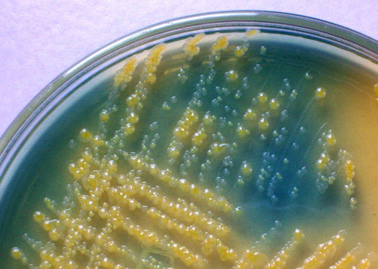
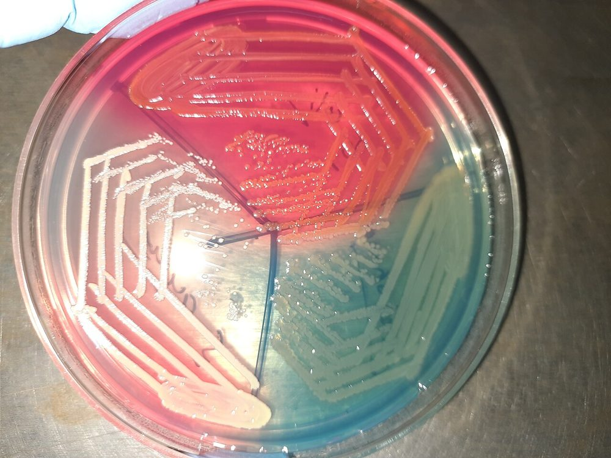
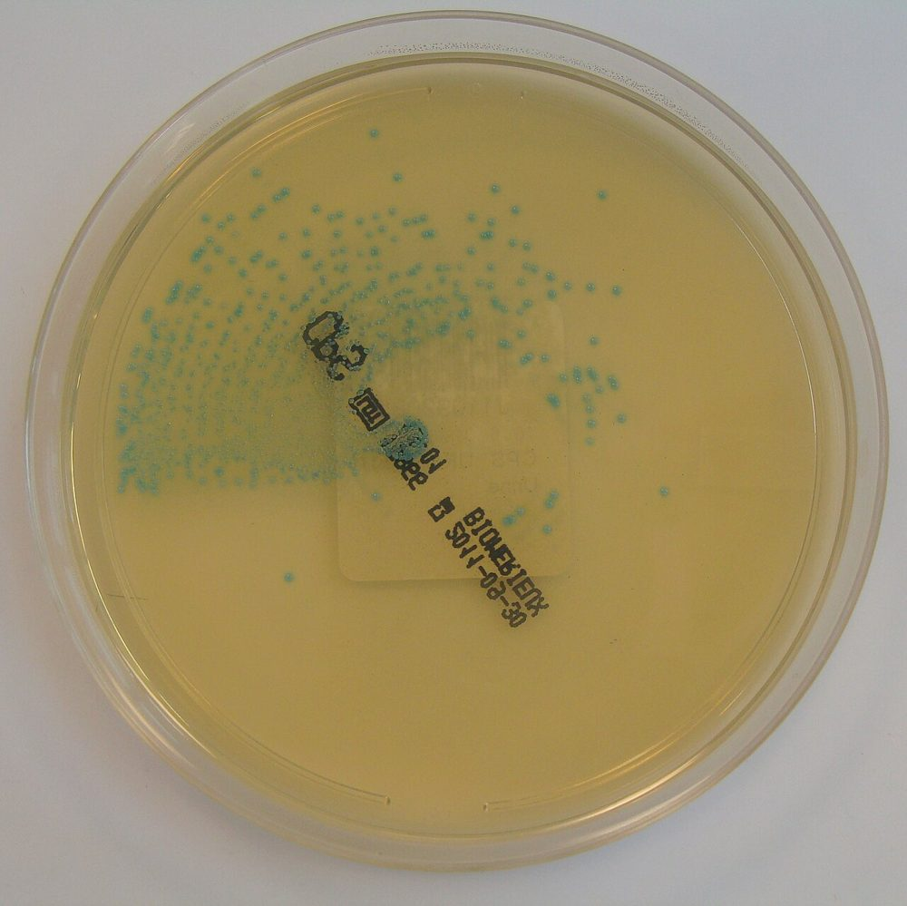
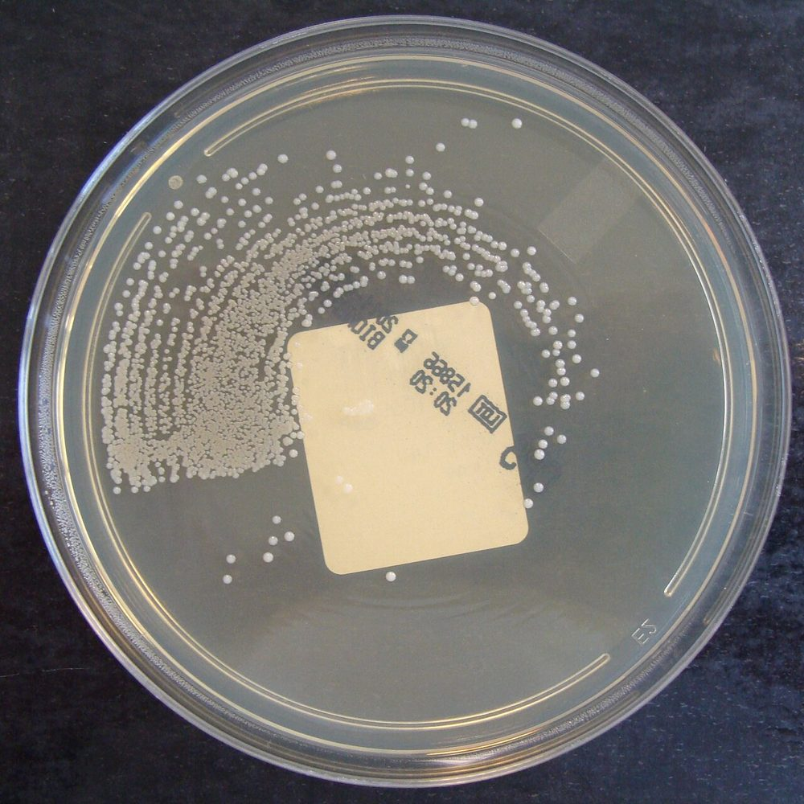
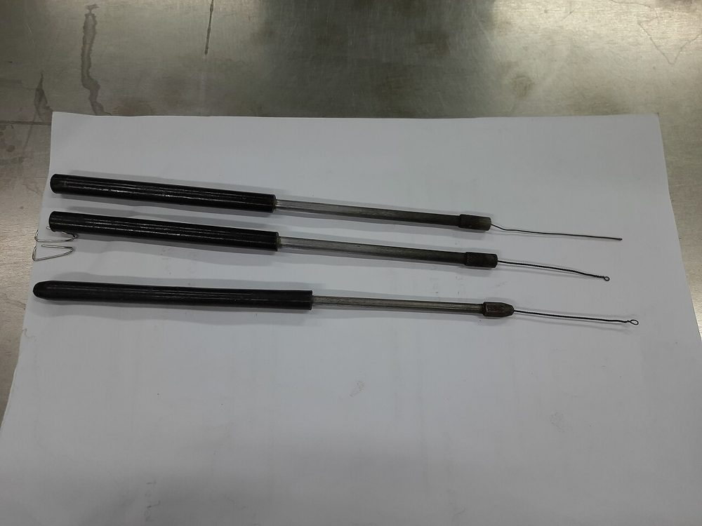
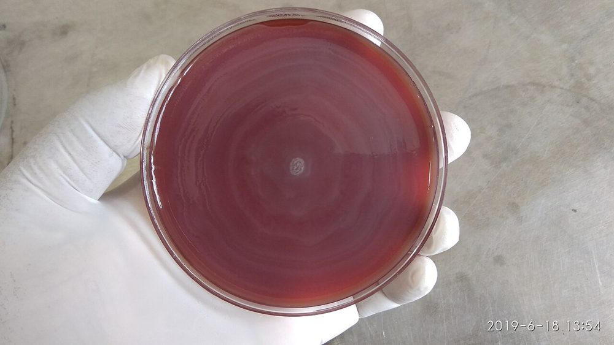
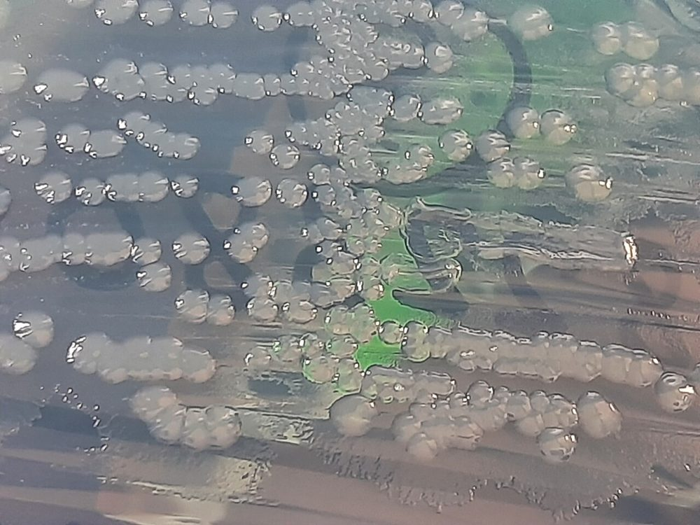

# پروتکل ۴: کشت کمّی ادرار و شناسایی

## ۱. محیط‌ها

| ترکیب | مزایا | معایب |
|---|---|---|
| **SBA + MAC** | استاندارد کلاسیک؛ همولیز، گرم مثبت و گرم منفی | *Proteus* روی SBA swarm می‌کند؛ دو پلیت |
| **CLED** (Cystine–Lactose–Electrolyte-Deficient) | **یک پلیت**؛ کمبود الکترولیت ← **مهار swarming *Proteus***؛ افتراق لاکتوز (زرد) از غیرلاکتوز (آبی)؛ رشد گرم مثبت‌ها | GBS و برخی سخت‌رشدها رشد ضعیف دارند؛ همولیز قابل ارزیابی نیست |
| **آگار کروموژنیک ادرار** (مثلاً CHROMagar Orientation، UTI Brilliance) | شناسایی احتمالی رنگی: *E. coli* (صورتی/بنفش)، KESC (آبی تیره)، *Enterococcus* (آبی فیروزه‌ای کوچک)، *Proteus* (قهوه‌ای هاله‌دار)؛ **تشخیص آسان کشت مخلوط** | گران‌تر؛ تأیید برخی رنگ‌ها لازم است |
| + **CNA/PEA** | نمونه‌های پیچیده/کاتتر برای جداسازی گرم مثبت‌ها از گرم منفی‌های پرتکثیر | |
| + **CA** | SPA، سیستوسکوپی، ظن ارگانیسم سخت‌رشد | |

**تصاویر:**

<table><tr><td align="center" width="50%"> <b>شکل ۲.۰۷.</b> CLED: کلنی‌های تخمیرکنندهٔ لاکتوز (زرد) و غیرتخمیرکننده (آبی) منبع: Microrao JJMMC, Davangere, Karnataka, India، <a href="https://commons.wikimedia.org/wiki/File:Lactose_non_lactose_fermenters_on_CLED_agar.jpg">Wikimedia Commons</a>، Public domain</td><td align="center" width="50%"> <b>شکل ۲.۰۸.</b> CLED با معرف آندراده (زمینهٔ صورتی): <i>E. coli</i> (قرمز)، <i>Pseudomonas aeruginosa</i> (سبز) و <i>Staphylococcus aureus</i> (زرد) منبع: Ajay Kumar Chaurasiya، <a href="https://commons.wikimedia.org/wiki/File:Various_bacterial_growth_on_CLED_agar-E._coli_(red),_Pseudomonas_aeruginosa_(green),_and_Staphylococcus_aureus_(yellow).jpg">Wikimedia Commons</a>، <a href="https://creativecommons.org/licenses/by-sa/4.0">CC BY-SA 4.0</a></td></tr><tr><td align="center" width="50%"> <b>شکل ۲.۰۹.</b> کلنی‌های ریز سبز–آبی <i>Enterococcus faecalis</i> روی آگار کروموژنیک ChromID CPS (ایزولهٔ ادراری) منبع: Nathan Reading from Halesowen, UK، <a href="https://commons.wikimedia.org/wiki/File:Enterococcus_faecalis_on_ChromID_CPS_chromogenic_agar.jpg">Wikimedia Commons</a>، <a href="https://creativecommons.org/licenses/by/2.0">CC BY 2.0</a></td><td align="center" width="50%"> <b>شکل ۲.۱۰.</b> کلنی‌های سفید–کرم <i>Staphylococcus aureus</i> روی آگار کروموژنیک ChromID CPS (ایزولهٔ ادراری) منبع: Nathan Reading from Halesowen, UK، <a href="https://commons.wikimedia.org/wiki/File:Staphylococcus_aureus_on_ChromID_CPS_chromogenic_agar.jpg">Wikimedia Commons</a>، <a href="https://creativecommons.org/licenses/by/2.0">CC BY 2.0</a></td></tr></table>

## ۲. لوپ کالیبره و تلقیح

| لوپ | حداقل قابل‌تشخیص (۱ کلنی) | کاربرد |
|---|---|---|
| **۱ µL (۰٫۰۰۱ mL)** | **۱۰³ CFU/mL** | MSU روتین |
| **۱۰ µL (۰٫۰۱ mL)** | **۱۰² CFU/mL** | **SPA، کاتتر، سیستوسکوپی، نفروستومی، شیرخوار**، زن علامت‌دار با ظن سیستیت و شمارش پایین (سیاست محلی)، بیمار تحت آنتی‌بیوتیک |

### روش (استریک کمّی)
1. ادرار را با **سر و ته کردن آرام ۸–۱۰ بار** یا ورتکس ملایم مخلوط کنید (باکتری‌ها ته‌نشین می‌شوند).
2. لوپ را **عمودی** و فقط تا عمق سطح مایع وارد کنید (لوپ زاویه‌دار یا عمیق‌تر حجم بیشتری برمی‌دارد).
3. لوپ را بیرون بیاورید. **فیلم مایع** باید کل حلقه را بپوشاند (بدون حباب).
4. روش رایج:
   - یک خط مستقیم از بالا به پایین وسط پلیت کشیده شود.
   - سپس خطوط عمود متراکم روی آن (یا طرح چهارناحیه‌ای برای جداسازی).
5. همان لوپ برای پلیت دوم (یا برداشت مجدد از ادرار طبق SOP).
6. انکوباسیون ۳۵ ± ۲ °C در **هوا** به مدت **۱۸–۲۴ ساعت**.
7. **۴۸ ساعت** برای:
   - SPA، کاتتر، سیستوسکوپی
   - نمونه با پیوری و بدون رشد در ۲۴ ساعت
   - کلنی‌های بسیار ریز
   - ظن *C. urealyticum*، *Aerococcus*، *Actinotignum schaalii* (۴۸ ساعت در CO₂ یا بی‌هوازی)
   - بیمار تحت آنتی‌بیوتیک

> 🔬 **دقت لوپ:** لوپ‌های پلاستیکی یک‌بارمصرف ±۵۰٪ خطا دارند. CFU تقریبی است و **دسته‌بندی لگاریتمی** (۱۰³، ۱۰⁴، ۱۰⁵) معنی‌دار است، نه عدد دقیق. لوپ‌های فلزی باید دوره‌ای کالیبره شوند.

**تصاویر:**

<table><tr><td align="center" width="50%"> <b>شکل ۲.۱۱.</b> لوپ‌ها و سوزن کشت فلزی؛ طبق منبع، لوپ کوچک برای کشت ادرار و لوپ بزرگ‌تر برای سایر نمونه‌ها و سوزن برای آزمون‌های بیوشیمیایی منبع: Ajay Kumar Chaurasiya، <a href="https://commons.wikimedia.org/wiki/File:Inoculating_loop_and_wire_used_in_Microbiology_Laboratory.jpg">Wikimedia Commons</a>، <a href="https://creativecommons.org/licenses/by-sa/4.0">CC BY-SA 4.0</a></td></tr></table>

## ۳. شمارش و محاسبه
**CFU/mL = تعداد کلنی × (۱ ÷ حجم لوپ به mL)**

| لوپ | ۱ کلنی | ۱۰ کلنی | ۱۰۰ کلنی | بیش از حدود ۳۰۰ (TNTC) |
|---|---|---|---|---|
| ۱ µL | ۱۰³ | ۱۰⁴ | ۱۰⁵ | > ۱۰⁵ |
| ۱۰ µL | ۱۰² | ۱۰³ | ۱۰⁴ | > ۱۰⁴ (اگر ≥ ۱۰⁵ مهم است ← لوپ ۱ µL یا رقت) |

- **روش گزارش:** دسته‌ها (مثلاً «۱۰⁴–۱۰⁵ CFU/mL»، «≥ ۱۰⁵ CFU/mL»).
- **هر نوع کلنی** جداگانه شمارش شود.
- مثال: لوپ ۱ µL، ۴۵ کلنی صورتی و ۳ کلنی کوچک آبی ← *E. coli* حدود ۴٫۵ × ۱۰⁴ و *Enterococcus* ۳ × ۱۰³ CFU/mL.

## ۴. شناسایی (پس از تصمیم تفسیری)

> شناسایی و AST فقط برای **ایزوله‌های معنی‌دار طبق جداول تفسیر** (فایل [06_Interpretation.md](06_Interpretation.md)).

| ارگانیسم | آزمون‌های کلیدی/سریع |
|---|---|
| ***E. coli*** | لاکتوز +، **اسپات ایندول +**، اکسیداز –، (± β-گلوکورونیداز + و PYR – برای شناسایی سریع)؛ کروموژنیک صورتی |
| *Klebsiella* | لاکتوز +، موکوئید، ایندول – (*K. oxytoca* ایندول +)، غیرمتحرک، اوره‌آز + |
| ***P. mirabilis*** | swarming، لاکتوز –، H₂S +، **ایندول –**، اوره‌آز + سریع، فنیل‌آلانین دآمیناز + (*P. vulgaris*: ایندول +) |
| *P. aeruginosa* | اکسیداز +، رنگدانهٔ سبز، بوی انگور |
| ***Enterococcus*** | کلنی کوچک گاما/آلفا، کاتالاز –، **PYR +**، بایل–اسکولین + |
| GBS | بتای باریک، CAMP +، لانسفیلد B |
| ***S. saprophyticus*** | کاتالاز +، کوآگولاز –، **مقاوم به نووبیوسین (۵ µg؛ هاله ≤ ۱۶ mm)**، اوره‌آز + |
| *S. aureus* | کوآگولاز + |
| *Aerococcus urinae* | کوکسی گرم مثبت خوشه‌ای/تتراد، آلفا، **کاتالاز –**، PYR –، LAP + (اغلب با استرپتوکوکوس یا استافیلوکوکوس اشتباه می‌شود؛ MALDI) |
| *C. urealyticum* | کلنی ریز پس از ۴۸ ساعت، **اوره‌آز بسیار سریع +**، چندمقاومتی |
| کاندیدا | خارج از دامنه؛ گزارش «مخمر» با شمارش |

- **MALDI-TOF** یا سیستم‌های خودکار برای شناسایی نهایی در صورت لزوم.
- **شناسایی محدود (Limited ID)** برای ارگانیسم‌های فلور بدون اهمیت: «فلور ادراری–تناسلی مخلوط» (بدون نام‌گذاری).

**تصاویر:**

<table><tr><td align="center" width="50%"> <b>شکل ۲.۱۲.</b> رشد swarming <i>Proteus</i> به‌صورت موج‌های هم‌مرکز روی آگار خون‌دار منبع: Ajay Kumar Chaurasiya، <a href="https://commons.wikimedia.org/wiki/File:Swarming_growth_of_Proteus_on_blood_agar.jpg">Wikimedia Commons</a>، <a href="https://creativecommons.org/licenses/by-sa/4.0">CC BY-SA 4.0</a></td><td align="center" width="50%"> <b>شکل ۲.۱۳.</b> <i>Proteus mirabilis</i> روی CLED: کلنی‌های جدا بدون swarming منبع: Ajay Kumar Chaurasiya، <a href="https://commons.wikimedia.org/wiki/File:Proteus_mirabilis_on_CLED_agar.jpg">Wikimedia Commons</a>، <a href="http://creativecommons.org/publicdomain/zero/1.0/deed.en">CC0</a></td></tr></table>

## ۵. کشت در موقعیت‌های خاص

| موقعیت | تغییر روش |
|---|---|
| **ظن سل ادراری** | [ماژول ۲۳](../../23_Mycobacteria/README.md) (مایکوباکتری): کل ادرار اول صبح ← سانتریفیوژ ← آلودگی‌زدایی ← MGIT + LJ؛ Xpert روی رسوب |
| ظن ***Salmonella*** در ادرار (کریرها، شیستوزومیازیس) | گزارش و ارسال به مرجع |
| ***Leptospira*** | خارج از کشت روتین ([ماژول ۲۴](../../24_Non_Culturable/README.md)) |
| ادرار پیش از جراحی اورولوژیک | آستانهٔ ASB؛ شناسایی و AST برای انتخاب پروفیلاکسی |
| *Ureaplasma*/*Mycoplasma* | روش‌های اختصاصی ([ماژول ۲۴](../../24_Non_Culturable/README.md)) |

