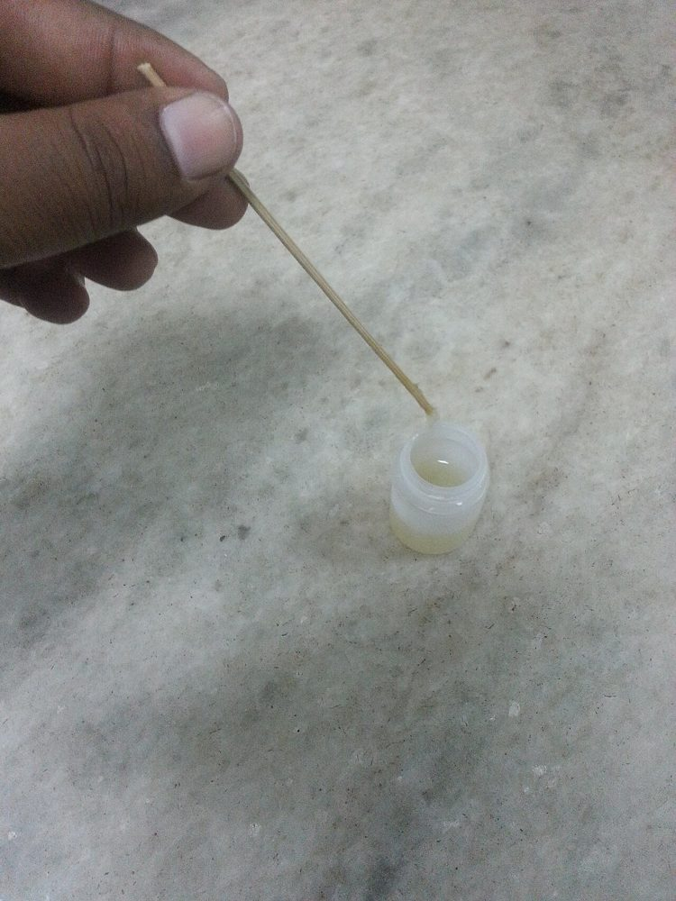
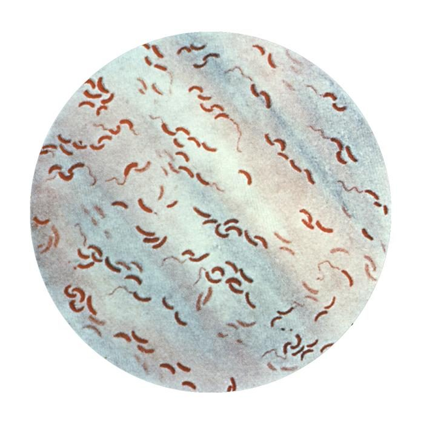
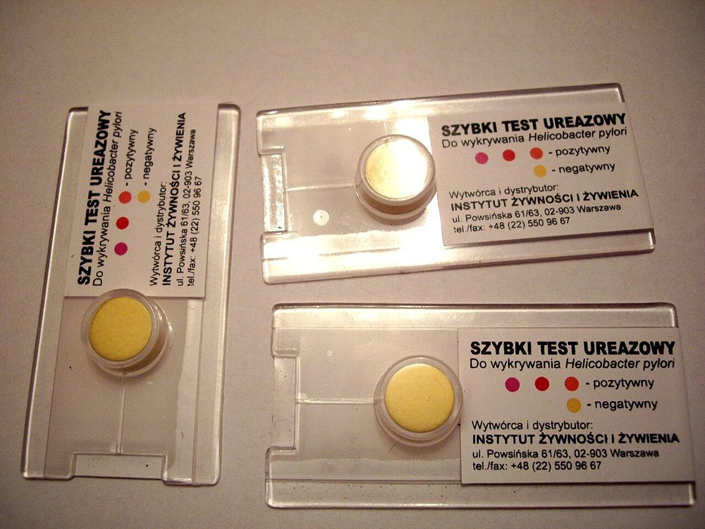
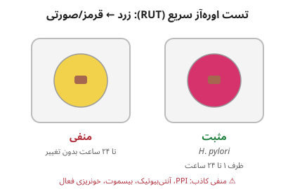

# پروتکل ۳: بررسی مستقیم نمونه‌های گوارشی

## ۱. ظاهر مدفوع
| ظاهر | تفسیر |
|---|---|
| آبکی، برنج‌آب، بی‌بو یا بوی ماهی | وبا، ETEC |
| خونی–موکوسی | اسهال التهابی (*Shigella*، *Campylobacter*، STEC، *E. histolytica*، *C. difficile*) |
| خون فراوان بدون تب | ⚠️ **STEC** |
| سبز، بدبو | *Salmonella* |
| شکل‌دار | برای CDI و کشت معمولاً نامناسب |

**تصاویر:**

<table><tr><td align="center" width="50%"> <b>شکل ۴.۰۲.</b> مدفوع «برنج‌آب» بیمار مبتلا به وبا منبع: Ajay Kumar Chaurasiya، <a href="https://commons.wikimedia.org/wiki/File:Cholera_patient_rice_water_stool.jpg">Wikimedia Commons</a>، <a href="https://creativecommons.org/licenses/by-sa/4.0">CC BY-SA 4.0</a></td></tr></table>

## ۲. نشانگرهای التهاب

| آزمایش | اصل | تفسیر | محدودیت |
|---|---|---|---|
| **لکوسیت مدفوع** (رنگ متیلن‌بلو یا گرم) | مشاهدهٔ PMN | PMN فراوان: اسهال تهاجمی | حساسیت و اختصاصیت متوسط؛ لیز سلول‌ها با تأخیر؛ IDSA آن را برای تصمیم درمان توصیه نمی‌کند |
| **لاکتوفرین مدفوع** (لاتکس/ایمنی) | پروتئین گرانول نوتروفیل (پایدار) | مثبت: التهاب | در شیرخوار شیر مادرخوار مثبت کاذب |
| **کالپروتکتین مدفوع** | پروتئین نوتروفیل | افتراق IBD از IBS؛ بالا در عفونت باکتریایی | غیراختصاصی برای عفونت |
| خون مخفی | | | غیراختصاصی |

## ۳. رنگ‌آمیزی گرم مدفوع
- **روتین نیست.** کاربرد محدود:
  - ***Campylobacter*:** باسیل‌های گرم منفی **خمیده/S-شکل/بال مرغ دریایی** (حساسیت حدود ۵۰–۷۵٪ در دست تجربه‌دیده؛ رنگ‌آمیزی با **کاربول فوشین** به‌جای سافرانین)
  - **انتروکولیت استافیلوکوکی** (نادر): کوکسی گرم مثبت خوشه‌ای فراوان + PMN، با کاهش فلور گرم منفی
  - ⛔ برای *C. difficile* بی‌ارزش (باسیل‌های گرم مثبت اسپوردار در فلور نرمال هم هستند)

## ۴. میکروسکوپ زمینهٔ تاریک / فازکنتراست (ظن وبا)
- نمونهٔ تازهٔ آبکی (یا APW ۶ ساعته)
- **حرکت «تیرمانند» (Darting/Shooting-star)** باسیل‌های خمیده
- **مهار حرکت با آنتی‌سرم O1** (یا O139) ← تأیید احتمالی سریع
- حساسیت محدود؛ تأیید با کشت

**تصاویر:**

<table><tr><td align="center" width="50%"> <b>شکل ۴.۰۳.</b> باسیل‌های گرم منفی خمیده (ویرگولی) <i>Vibrio cholerae</i> در رنگ‌آمیزی گرم منبع: CDC، <a href="https://commons.wikimedia.org/wiki/File:Vibrio_cholerae_gram_stain_CDC.jpg">Wikimedia Commons</a>، Public domain</td></tr></table>

## ۵. آزمون‌های آنتی‌ژنی/توکسینی مستقیم

| آزمون | هدف | جایگاه |
|---|---|---|
| ***C. difficile* GDH** (گلوتامات دهیدروژناز) | آنتی‌ژن مشترک سویه‌های توکسیژنیک و غیرتوکسیژنیک | **غربالگری حساس** (ارزش اخباری منفی بالا)، نه اختصاصی برای توکسین |
| ***C. difficile* توکسین A/B (EIA)** | توکسین آزاد | **اختصاصی** برای بیماری فعال؛ حساسیت متوسط (حدود ۵۰–۸۰٪) |
| **شیگاتوکسین (Stx1/Stx2) EIA** | روی مدفوع یا ترجیحاً **براث غنی‌شدهٔ شبانه (GN/MAC broth)** | تشخیص همهٔ سروتیپ‌های STEC (O157 و غیر O157) |
| **آنتی‌ژن *H. pylori* مدفوع** (EIA مونوکلونال) | | تشخیص اولیه و **تأیید ریشه‌کنی** (≥ ۴ هفته پس از درمان) |
| تست سریع وبا (RDT، dipstick O1/O139) | آنتی‌ژن LPS | غربالگری شیوع؛ تأیید با کشت/PCR |
| **آنتی‌ژن *Campylobacter* (EIA)** | | ⚠️ ارزش اخباری مثبت پایین در شیوع کم؛ مثبت‌ها با کشت/PCR تأیید شوند |
| آنتی‌ژن روتاویروس/آدنوویروس | خارج از دامنه | |

## ۶. تست اوره‌آز سریع (RUT) روی بیوپسی معده
- بیوپسی در محیط اوره + شناساگر pH (مثلاً CLOtest)
- *H. pylori* اوره‌آز قوی ← قلیایی ← تغییر رنگ (زرد به قرمز/صورتی) **ظرف ۱ تا ۲۴ ساعت**
- حساسیت حدود ۹۰٪؛ ⚠️ منفی کاذب با PPI، آنتی‌بیوتیک، بیسموت، خونریزی گوارشی فعال

**تصاویر:**

<table><tr><td align="center" width="50%"> <b>شکل ۴.۰۴.</b> کیت تست اوره‌آز سریع برای <i>Helicobacter pylori</i>؛ راهنمای رنگ روی کیت: زرد = منفی، قرمز = مثبت منبع: Louve.pl، <a href="https://commons.wikimedia.org/wiki/File:Rapid_urease_test.JPG">Wikimedia Commons</a>، <a href="https://creativecommons.org/licenses/by-sa/4.0">CC BY-SA 4.0</a></td></tr></table>

> **شکل ۴.۰۵.** خواندن تست اوره‌آز سریع (RUT) روی بیوپسی معده: تغییر رنگ زرد به قرمز/صورتی ظرف ۱ تا ۲۴ ساعت = *H. pylori* مثبت — منبع: رسم آموزشی همین مخزن (شماتیک؛ مقیاس واقعی نیست)

## ۷. گزارش
- «لاکتوفرین مدفوع: مثبت.»
- «*C. difficile*: GDH مثبت، توکسین A/B منفی؛ آزمایش تکمیلی (NAAT) در جریان.»
- «شیگاتوکسین: **مثبت** (Stx2). کشت برای جداسازی STEC در جریان است. ⚠️ آنتی‌بیوتیک و داروهای ضدحرکت روده توصیه نمی‌شوند. بیماری واجب‌الگزارش.» 📞

