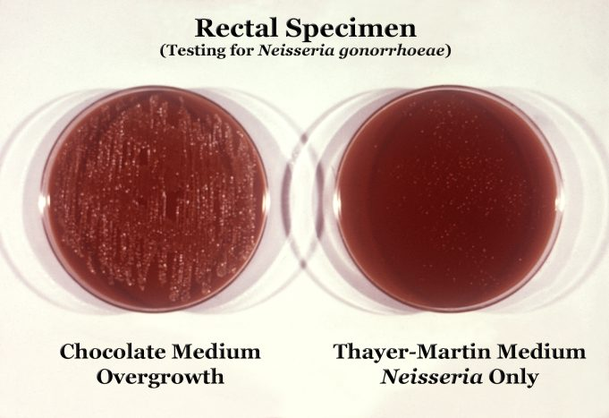
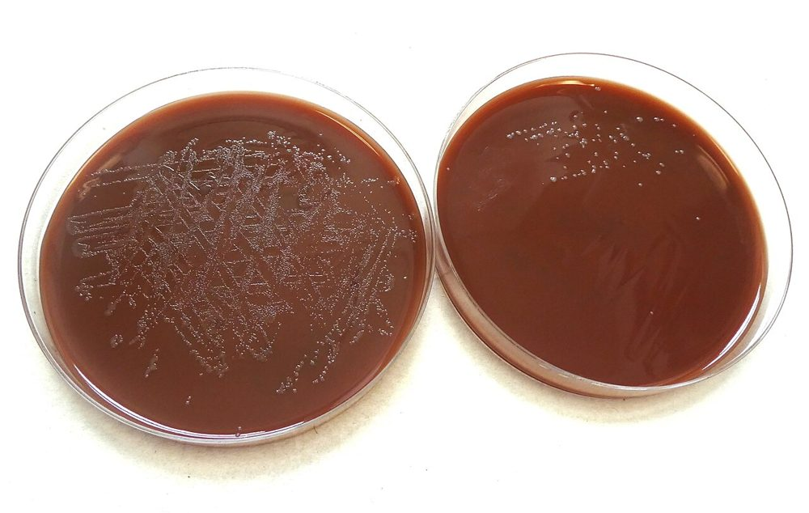
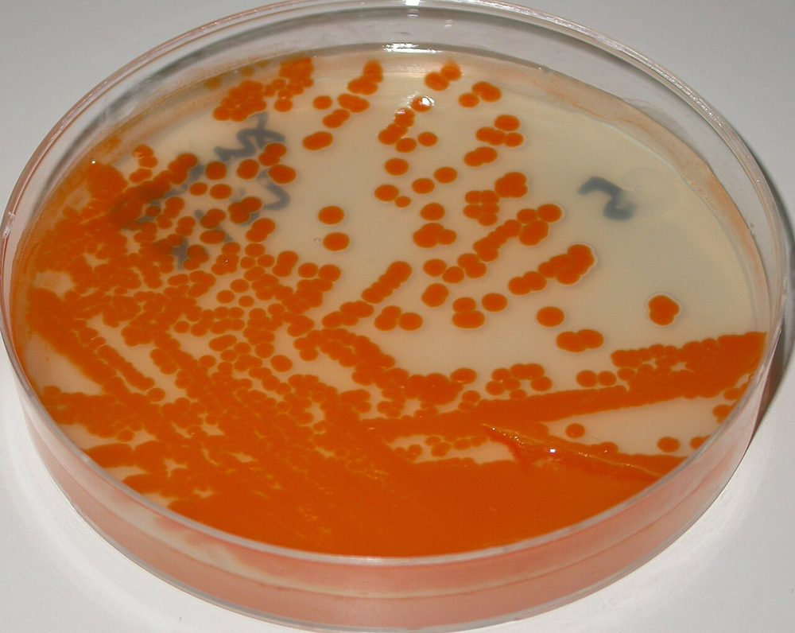
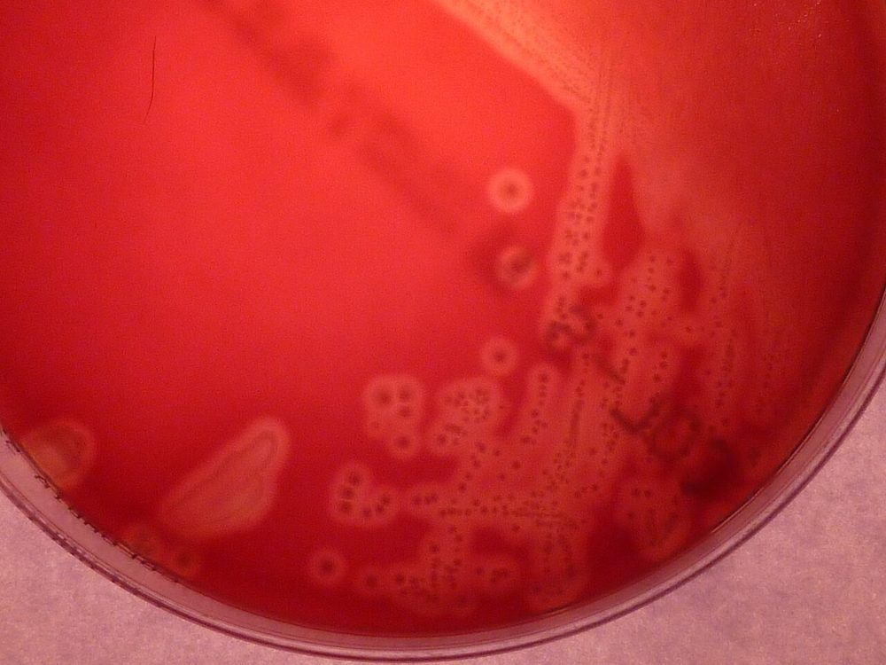
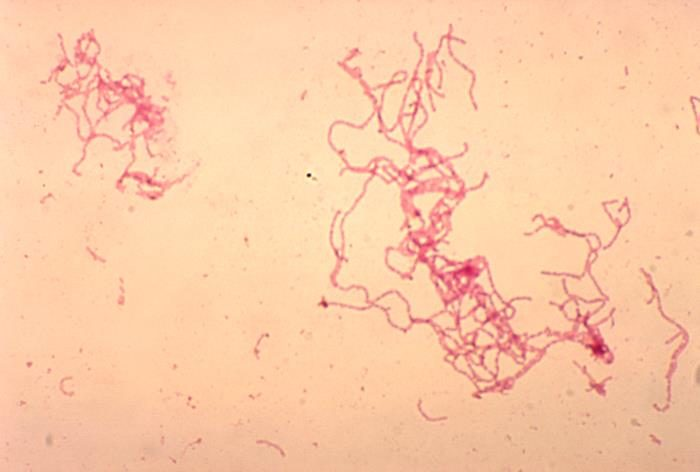
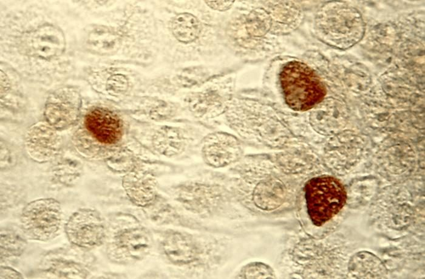

# پروتکل ۴: کشت و شناسایی — نمونه‌های تناسلی

## ۱. *Neisseria gonorrhoeae*

### ۱-۱) محیط و انکوباسیون
| مورد | استاندارد |
|---|---|
| محیط انتخابی | **Modified Thayer–Martin (MTM)**، **Martin–Lewis (ML)**، **New York City (NYC)**، GC-Lect (حاوی ونکومایسین، کولیستین، نیستاتین/آنیزومایسین، تری‌متوپریم) |
| محیط غیرانتخابی | **CA** (برای نمونه‌های استریل، یا سویه‌های حساس به ونکومایسین — حدود ۳–۱۰٪ سویه‌ها) |
| پیش‌گرم‌کردن | پلیت‌ها به **دمای اتاق** برسند |
| اتمسفر | **CO₂ ۳–۷٪**، **رطوبت بالا** |
| دما | ۳۵–۳۶٫۵ °C (⚠️ بالای ۳۷ °C ← رشد ضعیف) |
| مدت | بررسی روزانه تا **۷۲ ساعت** |

**تصاویر:**

<table><tr><td align="center" width="50%"> <b>شکل ۵.۰۷.</b> نمونهٔ رکتال برای گونوکوکوس: رشد بیش از حد فلور روی آگار شکلات (چپ) در برابر رشد فقط <i>Neisseria</i> روی محیط Thayer–Martin (راست) منبع: Wikimedia Commons، <a href="https://commons.wikimedia.org/wiki/File:Neisseria_gonorrhoeae_01.png">Wikimedia Commons</a>، Public domain</td><td align="center" width="50%"> <b>شکل ۵.۰۸.</b> کلنی‌های <i>Neisseria gonorrhoeae</i> روی پلیت‌های کشت منبع: Graham Beards، <a href="https://commons.wikimedia.org/wiki/File:GC_Culture.jpg">Wikimedia Commons</a>، <a href="https://creativecommons.org/licenses/by-sa/4.0">CC BY-SA 4.0</a></td></tr></table>

### ۱-۲) شناسایی
| آزمون | نتیجه |
|---|---|
| کلنی | کوچک، خاکستری–قهوه‌ای، براق، (۱–۲ mm در ۴۸ ساعت) |
| گرم | دیپلوکوک گرم منفی (لوبیایی) |
| **اکسیداز** | **+** |
| **کاتالاز** | **+ (قوی/انفجاری با H₂O₂ ۳۰٪: «سوپراکسول»)** |
| **قندها** (CTA یا روش‌های سریع آنزیمی) | **فقط گلوکز +** (مالتوز، لاکتوز، سوکروز –) |
| آنزیم‌ها (کیت‌ها) | پرولیل‌آمینوپپتیداز + (گونوکوکوس)؛ GGT – (مننگوکوکوس +) |
| **MALDI-TOF** | ⚠️ با *N. meningitidis* و برخی *Neisseria* مشابه (مثلاً *N. polysaccharea*) ممکن است اشتباه شود؛ کتابخانهٔ به‌روز و تأیید |
| تأیید (پزشکی قانونی/محل‌های غیرمعمول) | **دو روش مستقل** (مثلاً بیوشیمی + آنتی‌بادی مونوکلونال فلورسنت یا MALDI + NAAT) |

### ۱-۳) افتراق از سایر *Neisseria* و شبه‌نایسریاها
| ارگانیسم | گلوکز | مالتوز | لاکتوز | سوکروز | رشد روی SBA/نوترینت ۲۲ °C |
|---|---|---|---|---|---|
| *N. gonorrhoeae* | + | – | – | – | – |
| *N. meningitidis* | + | + | – | – | – |
| *N. lactamica* | + | + | **+** | – | ± |
| *N. sicca*/*subflava* | + | + | – | ± | + |
| *M. catarrhalis* | – | – | – | – | + (DNase +، بوتیرات استراز +) |
| *Kingella denitrificans* | + | – | – | – | (کاتالاز –، رشد روی TM) |

## ۲. استرپتوکوکوس گروه B (غربالگری بارداری)

### روش (CDC 2010 / ASM 2020)
1. سواب واژینال–رکتال ← **براث غنی‌سازی انتخابی** (LIM: Todd-Hewitt + کولیستین + نالیدیکسیک اسید؛ یا **Carrot broth/Strep B Carrot** کروموژنیک)
2. انکوباسیون **۱۸–۲۴ ساعت**، ۳۵–۳۷ °C، هوا یا CO₂
3. ساب‌کالچر روی **SBA** (یا CNA یا **آگار کروموژنیک GBS**) ← ۱۸–۲۴ ساعت (تا ۴۸ ساعت اگر منفی)
   - یا **NAAT روی براث غنی‌شده** (حساسیت بالاتر)
   - Carrot broth: تغییر رنگ نارنجی/قرمز = GBS بتا همولیتیک (⚠️ GBS غیرهمولیتیک رنگ تولید نمی‌کند ← ساب‌کالچر براث‌های بدون تغییر رنگ)
4. شناسایی کلنی: کاتالاز –، **CAMP +** یا آگلوتیناسیون لاتکس گروه B، یا MALDI
5. **اگر آلرژی پرخطر به پنی‌سیلین:** **کلیندامایسین + D-test** (اریترومایسین فقط برای D-test)

> ⚠️ **حدود ۵–۱۰٪ GBS ها غیرهمولیتیک‌اند.** در SBA کلنی‌های مشکوک غیرهمولیتیک را هم بررسی کنید.

**تصاویر:**

<table><tr><td align="center" width="50%"> <b>شکل ۵.۰۹.</b> کلنی‌های نارنجی <i>Streptococcus agalactiae</i> (GBS) روی آگار Granada (انکوباسیون بی‌هوازی) منبع: 43trevenque، <a href="https://commons.wikimedia.org/wiki/File:Streptococcus_agalactiae_on_Granada_medium.jpg">Wikimedia Commons</a>، <a href="https://creativecommons.org/licenses/by-sa/4.0">CC BY-SA 4.0</a></td><td align="center" width="50%"> <b>شکل ۵.۱۰.</b> کلنی‌های بتاهمولیتیک <i>Streptococcus agalactiae</i> (GBS) روی آگار خون‌دار منبع: 43trevenque، <a href="https://commons.wikimedia.org/wiki/File:Streptococcus_agalactiae_on_blood_agar.JPG">Wikimedia Commons</a>، <a href="https://creativecommons.org/licenses/by-sa/4.0">CC BY-SA 4.0</a></td></tr></table>

## ۳. *Haemophilus ducreyi* (شانکروئید)
- محیط: **GC آگار + ۱–۲٪ هموگلوبین + ۵٪ سرم جنین گاو + IsoVitaleX + ونکومایسین ۳ µg/mL** (و/یا Mueller–Hinton شکلاتی با سرم اسب)
- **۳۳ °C**، CO₂ ۵٪، **رطوبت بالا**، ۲–۵ روز
- کلنی‌های کوچک زرد–خاکستری که **به‌صورت یکپارچه روی آگار هل داده می‌شوند**
- حساسیت کشت کمتر از ۸۰٪ ← PCR ارجح (در مراکز مرجع)

**تصاویر:**

<table><tr><td align="center" width="50%"> <b>شکل ۵.۱۱.</b> باسیل‌های گرم منفی <i>Haemophilus ducreyi</i> در زنجیره‌های بلند (رنگ‌آمیزی گرم، کشت خون خرگوش) منبع: CDC/ Dr. Greg Hammond، <a href="https://commons.wikimedia.org/wiki/File:2775_lores.jpg">Wikimedia Commons</a>، <a href="http://creativecommons.org/publicdomain/zero/1.0/deed.en">CC0</a></td></tr></table>

## ۴. *Ureaplasma* و *Mycoplasma hominis*
- کشت در محیط‌های اختصاصی (A8 آگار، براث 10B/SP4)؛ *U. urealyticum*: کلنی‌های ریز قهوه‌ای (اوره‌آز)؛ *M. hominis*: «تخم‌مرغ نیمرو»
- 🔬 اهمیت در دستگاه تناسلی تحتانی بحث‌برانگیز (کلونیزاسیون شایع)؛ مهم در **مایع آمنیوتیک، نوزاد، پیوند، عفونت‌های خارج‌تناسلی**
- جزئیات: [ماژول ۲۴](../../24_Non_Culturable/README.md)

## ۵. نمونه‌های آندومتر، جفت، آمنیوتیک، آبسهٔ لگن
| محیط | |
|---|---|
| SBA، CA، MAC | هوازی/CO₂ |
| **آگار خون‌دار بی‌هوازی** (± KV-LB، PEA) + براث (تیوگلیکولات) | بی‌هوازی ۵ روز |
| (مایع آمنیوتیک) *Ureaplasma*/*Mycoplasma* | |

| یافته | اقدام |
|---|---|
| **استرپتوکوکوس گروه A** | 📞 **فوری** (سپسیس نفاسی؛ خطر خوشهٔ بیمارستانی) + **کنترل عفونت** |
| ***C. sordellii*/*C. perfringens*** پس از سقط/زایمان | 📞 فوری (شوک توکسیک، مرگ‌ومیر بالا) |
| GBS، *E. coli*، بی‌هوازی‌ها | گزارش؛ AST |
| *Listeria* (جفت/نوزاد) | 📞 |
| *S. aureus* (TSS) | گزارش؛ ± تست TSST-1 (مرجع) |

## ۶. کشت‌های بی‌اندیکاسیون ⛔
- «کشت روتین سواب واژینال» (فلور نرمال شامل استرپتوکوکوس‌ها، انتروکوکوس، *E. coli*، *S. aureus*، *Gardnerella*، بی‌هوازی‌ها)
- کشت *Gardnerella* برای BV
- کشت *Candida* برای واژینیت ساده (لام کافی است؛ کشت فقط در عود/مقاومت)

## ۷. *C. trachomatis* و *M. genitalium*
- **کشت سلولی** *C. trachomatis* (McCoy/HeLa) فقط در مراکز مرجع و پزشکی قانونی؛ **NAAT** روش استاندارد است.
- *M. genitalium*: کشت عملاً غیرممکن (هفته‌ها تا ماه‌ها) ← فقط NAAT.

**تصاویر:**

<table><tr><td align="center" width="50%"> <b>شکل ۵.۱۲.</b> اجسام انکلوزیونی <i>Chlamydia trachomatis</i> (قهوه‌ای) در کشت سلول McCoy منبع: User Marcus007 on de.wikipedia، <a href="https://commons.wikimedia.org/wiki/File:ChlamydiaTrachomatisEinschlussk%C3%B6rperchen.jpg">Wikimedia Commons</a>، Public domain</td></tr></table>

