

# پروتکل ۴: کشت و شناسایی — نمونه‌های تنفسی

## ۱. کشت روتین خلط/ETA (پنومونی)

| محیط | هدف | انکوباسیون |
|---|---|---|
| **SBA** | *S. pneumoniae*، *S. aureus*، استرپتوکوکوس‌ها، گرم منفی‌ها | ۳۵ °C، **CO₂ ۵٪**، ۴۸ ساعت |
| **CA** | ***H. influenzae***، *M. catarrhalis* | ۳۵ °C، CO₂، ۴۸ ساعت |
| **MAC** | باسیل‌های گرم منفی | ۳۵ °C، هوا، ۴۸ ساعت |
| (اختیاری) CNA/PEA | جداسازی گرم مثبت‌ها | |

### روش نیمه‌کمّی (چهارناحیه‌ای)
- رشد فقط در ناحیهٔ ۱ = **کم (1+)**؛ تا ناحیهٔ ۲ = **متوسط (2+)**؛ ناحیهٔ ۳–۴ = **فراوان (3+ تا 4+)**

### روش کمّی (BAL، PSB، ETA کمّی)
1. نمونه را **ورتکس** کنید (BAL موکوئید: هموژنیزه/رقیق‌سازی با DTT در برخی مراکز).
2. **لوپ ۱ µL و ۱۰ µL** (یا رقت‌های سریالی ۱:۱۰ و ۱:۱۰۰ در سالین + ۱۰۰ µL روی پلیت).
3. شمارش ← CFU/mL؛ مقایسه با آستانه (BAL ≥ ۱۰⁴، PSB ≥ ۱۰³، ETA ≥ ۱۰⁵–۱۰⁶).

## ۲. شناسایی پاتوژن‌های اصلی

| ارگانیسم | ویژگی‌ها |
|---|---|
| *S. pneumoniae* | آلفا، مرکز فرورفته/موکوئید (سروتیپ ۳)، اپتوچین S، صفرا + |
| *H. influenzae* | فقط CA، هِمین + NAD، پورفیرین –، (*H. parainfluenzae*: فقط NAD)؛ ⚠️ «*H. haemolyticus*» (همولیتیک، کلونیزه‌کنندهٔ غیرپاتوژن) با MALDI اشتباه می‌شود |
| *M. catarrhalis* | کلنی خاکستری که مانند **«ژتون هاکی»** روی آگار سُر می‌خورد، اکسیداز +، **DNase +**، **بوتیرات استراز +**، نیترات +؛ **بتالاکتاماز +** (بیش از ۹۰٪) |
| *S. aureus* | کوآگولاز + |
| *K. pneumoniae* | موکوئید، **String test +** (≥ ۵ mm: فنوتیپ **هایپرویرولانت hvKp**) |
| *P. aeruginosa* | اکسیداز +، رنگدانه؛ **موکوئید** در CF |
| *A. baumannii* | اکسیداز –، کوکوباسیل |
| *S. maltophilia* | اکسیداز –، لیزین +، DNase +؛ کلنی زرد–سبز روی SBA با بوی آمونیاک |

**تصاویر:**

<table><tr><td align="center" width="50%">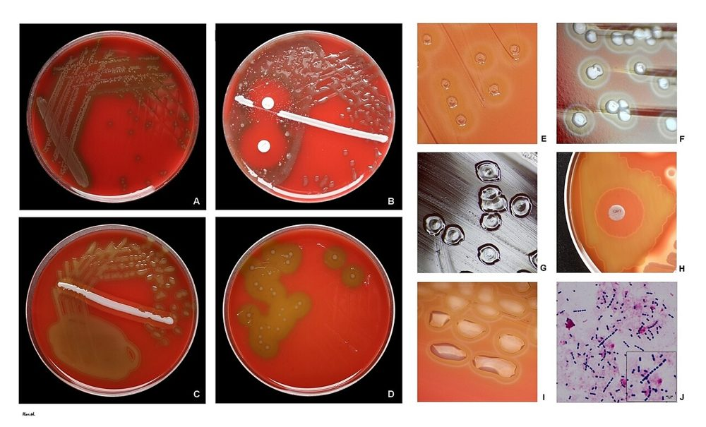 <b>شکل ۶.۰۳.</b> <i>Streptococcus pneumoniae</i> روی آگار خون گوسفند: کلنی‌های براق ۱–۲ mm با همولیز آلفا و فرورفتگی مرکزی منبع: HansN.، <a href="https://commons.wikimedia.org/wiki/File:Streptococcus_pneumoniae_on_agar_plates.jpg">Wikimedia Commons</a>، <a href="https://creativecommons.org/licenses/by-sa/4.0">CC BY-SA 4.0</a></td><td align="center" width="50%">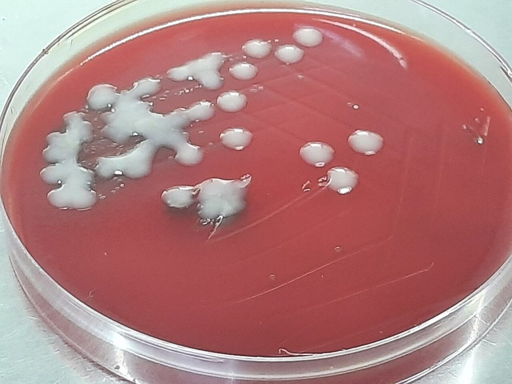 <b>شکل ۶.۰۴.</b> کشت مخلوط روی آگار خون‌دار: کلنی‌های موکوئید <i>Klebsiella pneumoniae</i> در کنار کلنی‌های آلفاهمولیتیک <i>Streptococcus pneumoniae</i> منبع: Ajay Kumar Chaurasiya، <a href="https://commons.wikimedia.org/wiki/File:Mixed_Pathogen_Growth_of_Streptococcus_pneumoniae_and_Klebsiella_pneumoniae_on_Blood_Agar.jpg">Wikimedia Commons</a>، <a href="http://creativecommons.org/publicdomain/zero/1.0/deed.en">CC0</a></td></tr><tr><td align="center" width="50%">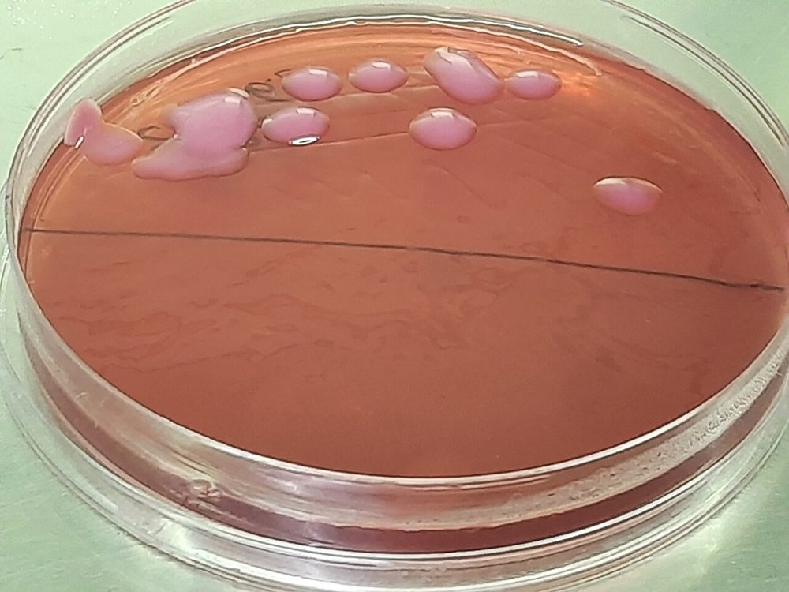 <b>شکل ۶.۰۵.</b> کلنی‌های موکوئید لاکتوز مثبت <i>Klebsiella pneumoniae</i> روی آگار مک‌کانکی (کشت BAL) منبع: Ajay Kumar Chaurasiya، <a href="https://commons.wikimedia.org/wiki/File:Mucoid_lactose-fermenting_(MLF)_colonies_of_Klebsiella_pneumoniae_on_MacConkey_agar.jpg">Wikimedia Commons</a>، <a href="http://creativecommons.org/publicdomain/zero/1.0/deed.en">CC0</a></td><td align="center" width="50%">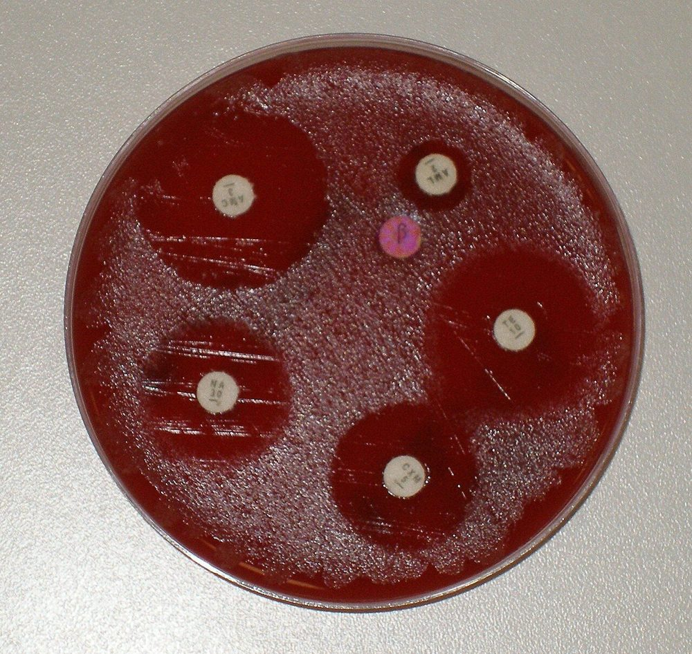 <b>شکل ۶.۰۶.</b> آنتی‌بیوگرام <i>Moraxella catarrhalis</i>: مقاومت به آمپی‌سیلین و رنگ قرمز دیسک نیتروسفین (بتالاکتاماز مثبت) منبع: Dr Graham Beards، <a href="https://commons.wikimedia.org/wiki/File:M._cat_BSAC.JPG">Wikimedia Commons</a>، <a href="https://creativecommons.org/licenses/by-sa/3.0">CC BY-SA 3.0</a></td></tr></table>

## ۳. GAS (سواب حلق)
| محیط | انکوباسیون | شناسایی |
|---|---|---|
| **SBA** (± SXT/ترکیب انتخابی) با **خراش (Stab) در آگار** (همولیز زیر سطح، استرپتولیزین O حساس به اکسیژن) | ۳۵ °C، **CO₂ یا بی‌هوازی** ۱۸–۲۴ ساعت، **منفی‌ها تا ۴۸ ساعت** | کلنی بتای کوچک با هالهٔ بزرگ، **PYR +**، (باسیتراسین S)، **لانسفیلد A** |
- گروه C/G (*S. dysgalactiae* subsp. *equisimilis*): کلنی بزرگ بتا، PYR –؛ گزارش در صورت درخواست/سیاست.
- *A. haemolyticum*: بتای باریک، CAMP **معکوس**، کاتالاز –، باسیل گرم مثبت.
- ***F. necrophorum***: کشت **بی‌هوازی** (یا PCR) در نوجوان/جوان با فارنژیت شدید/لمیر.

**تصاویر:**

<table><tr><td align="center" width="50%">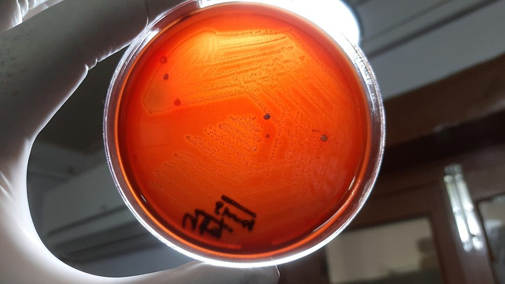 <b>شکل ۶.۰۷.</b> کلنی‌های بتاهمولیتیک <i>Streptococcus pyogenes</i> روی آگار خون گوسفند ۵٪ (۴۸ ساعت) منبع: Ajay Kumar Chaurasiya، <a href="https://commons.wikimedia.org/wiki/File:Streptococcus_pyogenes_beta-haemolytic_colonies.jpg">Wikimedia Commons</a>، <a href="https://creativecommons.org/licenses/by-sa/4.0">CC BY-SA 4.0</a></td></tr></table>

## ۴. *Corynebacterium diphtheriae* ☣️
| مرحله | روش |
|---|---|
| محیط انتخابی | **Tinsdale** یا **سیستئین–تلوریت آگار (CTBA)**: کلنی **سیاه** (احیای تلوریت) با **هالهٔ قهوه‌ای** (سیستیناز، روی Tinsdale) |
| محیط غیرانتخابی | SBA (کلنی کوچک، ± بتا) |
| غنی‌سازی | **لوفلر سرم** (مورفولوژی و گرانول‌های متاکروماتیک) |
| انکوباسیون | ۳۵ °C، CO₂ یا هوا، **۴۸ ساعت** |
| شناسایی | کاتالاز +، **پیرازینامیداز –**، **سیستیناز +**، اوره‌آز – (*C. ulcerans* و *C. pseudotuberculosis*: اوره‌آز +)، نیترات +؛ بیوتایپ‌ها (gravis، mitis، intermedius، belfanti)؛ MALDI |
| **آزمون توکسین** | **Elek** (ایمونودیفیوژن) یا **PCR *tox*** (⚠️ PCR وجود ژن را نشان می‌دهد؛ سویه‌های **NTTB** (حامل ژن غیربیان‌شده) ← Elek تأیید) |
| 📞 | **فوری** به پزشک و بهداشت؛ ایزوله به **آزمایشگاه مرجع** |

**تصاویر:**

<table><tr><td align="center" width="50%">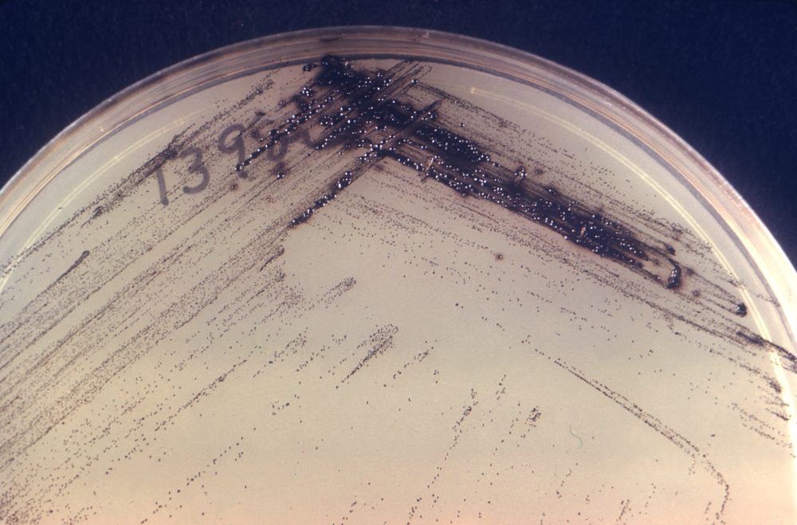 <b>شکل ۶.۰۸.</b> کلنی‌های قهوه‌ای تیره تا سیاه با هالهٔ تیره روی محیط Tinsdale (کشت سواب حلق) منبع: Unknown author Unknown author، <a href="https://commons.wikimedia.org/wiki/File:CDC_16561_(1970).png">Wikimedia Commons</a>، Public domain</td></tr></table>

## ۵. *Bordetella pertussis*
| مورد | روش |
|---|---|
| محیط | **Regan–Lowe** (آگار ذغال + خون اسب + سفالکسین) یا **Bordet–Gengou** |
| انکوباسیون | ۳۵–۳۷ °C، **هوای مرطوب** (بدون CO₂ اضافی)، **۷–۱۲ روز** (بررسی روزانه) |
| کلنی | **قطرات جیوه** (کوچک، براق، گنبدی) |
| شناسایی | کوکوباسیل گرم منفی ریز، اکسیداز +، اوره‌آز – (*B. parapertussis*: اوره‌آز +، اکسیداز –)، آگلوتیناسیون/DFA، MALDI |
| حساسیت کشت | **پایین** (۱۰–۶۰٪؛ پس از ۲ هفته سرفه یا واکسینه/درمان‌شده کمتر) ← **PCR ارجح** |

**تصاویر:**

<table><tr><td align="center" width="50%">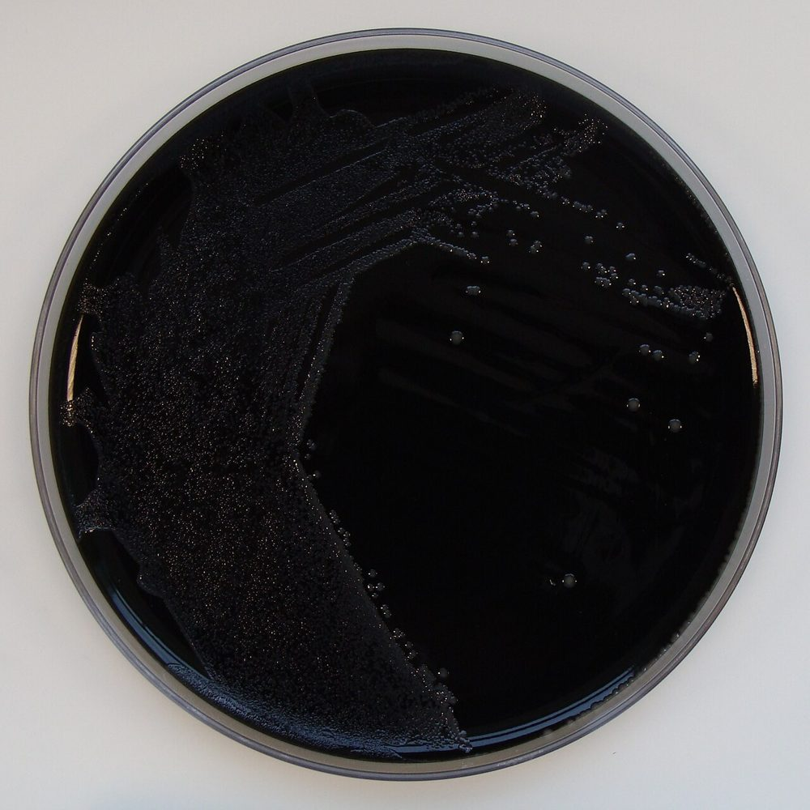 <b>شکل ۶.۰۹.</b> <i>Bordetella pertussis</i> روی آگار ذغال‌دار حاوی سفالکسین (۷ روز) منبع: Nathan Reading from Halesowen, UK، <a href="https://commons.wikimedia.org/wiki/File:Bordetella_pertussis_on_Charcoal_Agar_supplemented_with_Cephalexin.jpg">Wikimedia Commons</a>، <a href="https://creativecommons.org/licenses/by/2.0">CC BY 2.0</a></td><td align="center" width="50%">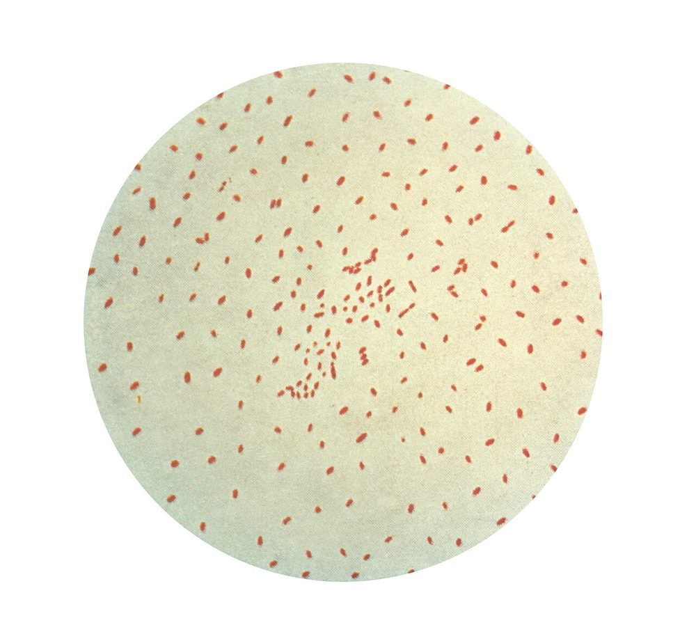 <b>شکل ۶.۱۰.</b> کوکوباسیل‌های گرم منفی ریز <i>Bordetella pertussis</i> در رنگ‌آمیزی گرم منبع: CDC Public Health Image Library، <a href="https://commons.wikimedia.org/wiki/File:Bordetella_pertussis.jpg">Wikimedia Commons</a>، Public domain</td></tr></table>

## ۶. *Legionella*
| مورد | روش |
|---|---|
| محیط | **BCYE-α** (ذغال، عصارهٔ مخمر، **L-سیستئین**، آهن، بافر ACES، α-کتوگلوتارات) ± انتخابی (پلی‌میکسین، آنیزومایسین، ونکومایسین) |
| پیش‌تیمار | **اسید** (HCl–KCl، pH ۲٫۲، ۴ دقیقه) یا حرارت برای نمونه‌های پرفلور |
| انکوباسیون | ۳۵ °C، هوای مرطوب، **۵–۷ روز** (کلنی‌ها پس از ۳–۵ روز) |
| کلنی | خاکستری–سفید، **ظاهر شیشهٔ بریده** (ground-glass) زیر استریومیکروسکوپ |
| شناسایی | **نیاز به L-سیستئین**: رشد روی BCYE و **عدم رشد روی BCYE بدون سیستئین یا SBA**؛ آگلوتیناسیون/DFA؛ MALDI |

**تصاویر:**

<table><tr><td align="center" width="50%">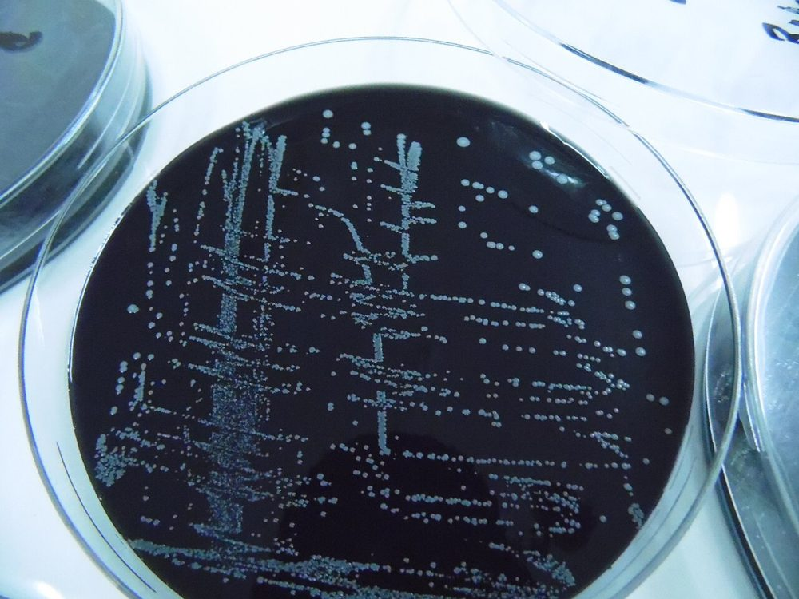 <b>شکل ۶.۱۱.</b> کلنی‌های <i>Legionella pneumophila</i> روی آگار BCYE منبع: Turasayb، <a href="https://commons.wikimedia.org/wiki/File:BCYE.jpg">Wikimedia Commons</a>، <a href="https://creativecommons.org/licenses/by-sa/4.0">CC BY-SA 4.0</a></td><td align="center" width="50%">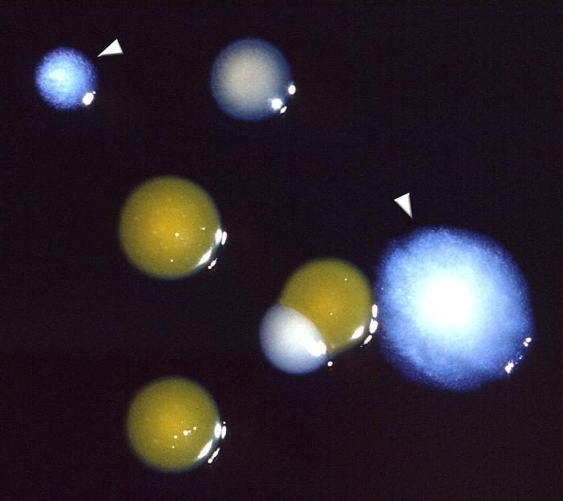 <b>شکل ۶.۱۲.</b> کلنی‌های <i>Legionella pneumophila</i> (با پیکان مشخص شده‌اند) در کنار کلنی‌های دیگر منبع: CDC-PHIL، <a href="https://commons.wikimedia.org/wiki/File:LegionellaPneumophila_Kolonie.jpg">Wikimedia Commons</a>، Public domain</td></tr></table>

## ۷. فیبروز کیستیک
| محیط | هدف |
|---|---|
| SBA، CA | پاتوژن‌های روتین |
| MAC | گرم منفی‌ها |
| **مانیتول سالت آگار** | *S. aureus* (± SCV: کلنی‌های بسیار کوچک؛ انکوباسیون **۴۸–۷۲ ساعت**) |
| **BCSA** (یا OFPBL، PCA) | ***Burkholderia cepacia* complex**؛ **۳ تا ۵ روز** |
| (اختیاری) آگار انتخابی NTM (RGM) | *M. abscessus* |
- **شناسایی دقیق** غیرتخمیری‌ها (BCC، *Achromobacter*، *Stenotrophomonas*، *Ralstonia*، *Pandoraea*) با **MALDI** و در موارد اولیهٔ BCC **تأیید مرجع** (پیامد پیوند ریه، *B. cenocepacia*).
- *P. aeruginosa* موکوئید: کلنی‌های متعدد (موروتیپ‌ها) ← AST برای هر موروتیپ متفاوت (یا ترکیب).

**تصاویر:**

<table><tr><td align="center" width="50%">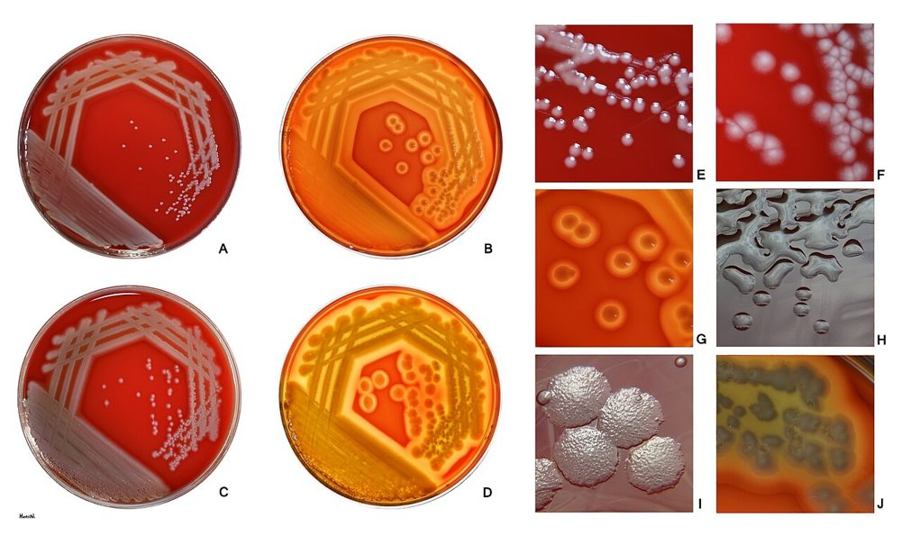 <b>شکل ۶.۱۳.</b> ریخت‌های گوناگون کلنی <i>Pseudomonas aeruginosa</i> روی آگار خون گوسفند (۲۴ و ۴۸ ساعت) منبع: HansN.، <a href="https://commons.wikimedia.org/wiki/File:Pseudomonas_aeruginosa_on_blood_agar.jpg">Wikimedia Commons</a>، <a href="https://creativecommons.org/licenses/by-sa/4.0">CC BY-SA 4.0</a></td></tr></table>

## ۸. *Nocardia*
- SBA، CA، **BCYE** (رشد خوب)، Sabouraud؛ **انکوباسیون ۵–۷ روز** (تا ۲–۳ هفته)
- کلنی **گچی/خشک، چسبیده به آگار**، بوی خاک؛ اسیدفست اصلاح‌شده +
- شناسایی گونه: **MALDI** (با استخراج) یا توالی‌یابی 16S (مرجع)؛ AST در مرجع (TMP-SMX، لینزولید، آمیکاسین، ایمی‌پنم)

**تصاویر:**

<table><tr><td align="center" width="50%">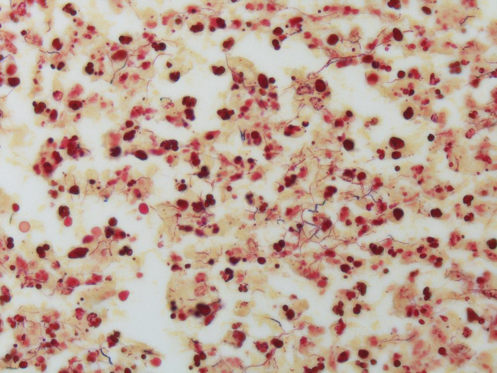 <b>شکل ۶.۱۴.</b> رشته‌های بلند، نازک و گرم مثبت <i>Nocardia</i> در رنگ‌آمیزی گرم بافت منبع: Yale Rosen from USA، <a href="https://commons.wikimedia.org/wiki/File:Nocardiosis_-_Gram_stain_Case_149_(5286067518).jpg">Wikimedia Commons</a>، <a href="https://creativecommons.org/licenses/by-sa/2.0">CC BY-SA 2.0</a></td></tr></table>

## ۹. کشت بی‌هوازی
- فقط از **نمونه‌های بدون آلودگی دهانی**: PSB، آسپیرهٔ ترانس‌تراشه‌ای/ریه، مایع پلور، آبسه.

## ۱۰. ☣️ عوامل بیوتروریسم (آزمایشگاه نگهبان، ASM)
| ارگانیسم | سرنخ در کشت | اقدام |
|---|---|---|
| *Bacillus anthracis* | باسیل گرم مثبت درشت، کلنی **سر مدوزا**، **غیرهمولیتیک، غیرمتحرک**، چسبنده | فقط BSC؛ ⛔ ادامهٔ کار؛ 📞 مرجع |
| *Yersinia pestis* | کوکوباسیل گرم منفی **سنجاق‌قفلی (دوقطبی)**، رشد آهسته، کلنی «تخم‌مرغ نیمرو»/«بشقاب چکش‌خورده» | همان |
| *Francisella tularensis* | کوکوباسیل ریز، رشد روی CA (نه SBA معمول)، ۴۸–۷۲ ساعت | همان |
| *Burkholderia mallei/pseudomallei* | گرم منفی، کلنی چروکیده، بوی خاک | همان |
| *Brucella* | (ماژول ۰۱) | همان |

> قانون: **«Rule out or refer»** — آزمایشگاه بالینی فقط آزمون‌های ساده را در BSC انجام می‌دهد و ⛔ از سیستم‌های خودکار استفاده نمی‌کند.

