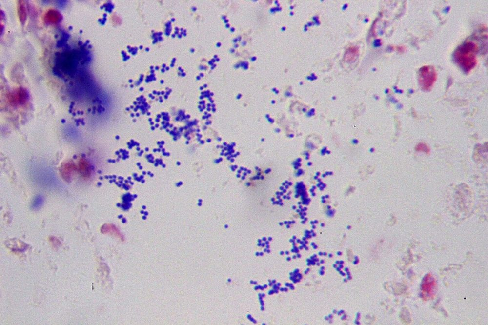
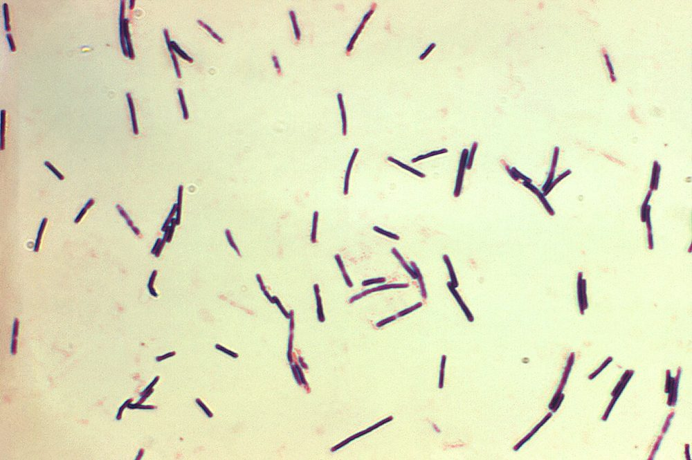
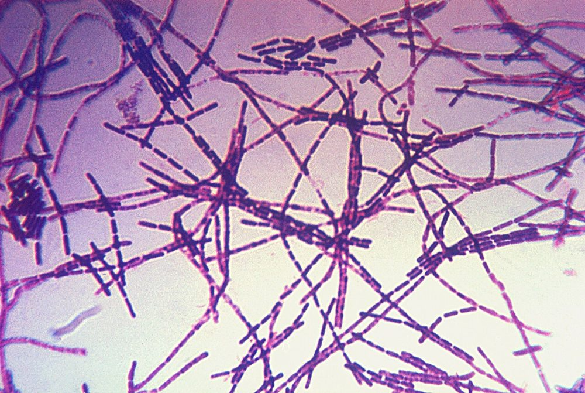
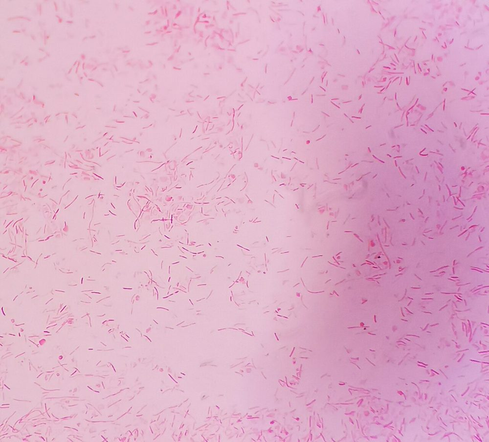
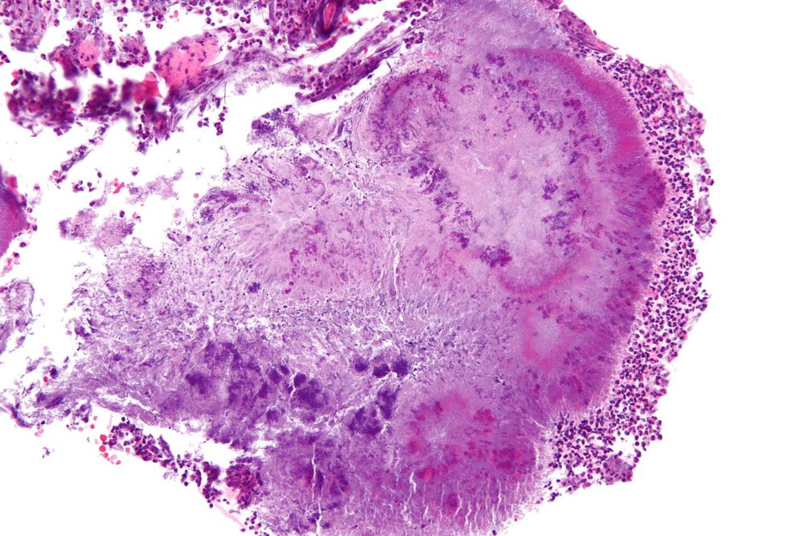

# پروتکل ۳: بررسی مستقیم — پوست و بافت نرم

## ۱. گرم
- **همیشه** برای آسپیره و بافت؛ برای سواب‌ها برای ارزیابی کیفیت و راهنمای کشت.
- بافت: **له‌کردن (Touch prep) یا هموژنیزه** ← لام.

## ۲. تفسیر و یافته‌های بحرانی

| یافته | تفسیر | اقدام |
|---|---|---|
| PMN فراوان + **کوکسی گرم مثبت خوشه‌ای** | *S. aureus* محتمل | گزارش؛ (MRSA PCR در صورت دسترسی) |
| PMN + **کوکسی گرم مثبت زنجیره‌ای** در بافت عمقی | **GAS** (فاشئیت نوع II) | 📞 **فوری** |
| **باسیل‌های گرم مثبت درشت جعبه‌ای، بدون اسپور، با PMN کم** | ***C. perfringens*** (گانگرن گازی) | 📞 **فوری** |
| باسیل گرم مثبت درشت با اسپور انتهایی/زیرانتهایی | *C. septicum*، *C. sordellii* | 📞 |
| **فلور مخلوط** (GPC، GNB، GPB) در بافت عمقی | فاشئیت نوع I (چندمیکروبی) | 📞 |
| باسیل‌های گرم منفی خمیده در عفونت نکروزان پس از تماس با آب شور | *V. vulnificus* | 📞 |
| **باسیل‌های گرم مثبت درشت در زنجیره (بامبو/واگن)** در مایع وزیکول یا اسکار، با **کپسول** (رنگ M'Fadyean پلی‌کروم متیلن‌بلو: کپسول صورتی) | ☣️ ***B. anthracis*** | 📞 **فوری**؛ BSC؛ مرجع |
| کوکوباسیل گرم منفی کوچک دوقطبی (گاز حیوان) | *Pasteurella* | |
| باسیل گرم منفی دوکی‌شکل/خمیده (گاز سگ، آسپلنی) | *Capnocytophaga* | |
| PMN فراوان، **بدون ارگانیسم** در آبسه | آنتی‌بیوتیک قبلی، بی‌هوازی‌ها (کم‌رنگ)، *Nocardia*، مایکوباکتری، استریل (آبسهٔ استریل تزریقی) | رنگ‌آمیزی‌های اضافی |
| **سلول‌های سنگفرشی فراوان، بدون PMN**، فلور مخلوط | سواب سطحی (کلونیزاسیون/آلودگی) | جملهٔ کیفیت |
| باسیل‌های گرم مثبت منشعب | *Nocardia*/*Actinomyces* | اسیدفست اصلاح‌شده |
| گرانول‌های گوگردی (Sulfur granules) | *Actinomyces* (± *Nocardia*/مایستوما) | له‌کردن گرانول و گرم |

**تصاویر:**

<table><tr><td align="center" width="50%"> <b>شکل ۷.۰۲.</b> گرم التهاب چرکی پوست (بیمار دیابتی): کوکسی گرم مثبت خوشه‌ای در کنار سلول‌های التهابی منبع: Patho، <a href="https://commons.wikimedia.org/wiki/File:Purulent_inflammation,_Gram_stain_3.jpg">Wikimedia Commons</a>، <a href="https://creativecommons.org/licenses/by-sa/3.0">CC BY-SA 3.0</a></td><td align="center" width="50%"> <b>شکل ۷.۰۳.</b> باسیل‌های گرم مثبت درشت و جعبه‌ای <i>Clostridium perfringens</i> (کشت در براث Schaedler) منبع: Content Providers(s): CDC/Don Stalons، <a href="https://commons.wikimedia.org/wiki/File:Clostridium_perfringens.jpg">Wikimedia Commons</a>، Public domain</td></tr><tr><td align="center" width="50%"> <b>شکل ۷.۰۴.</b> باسیل‌های گرم مثبت درشت در زنجیره‌های بلند (<i>Bacillus anthracis</i>) منبع: CDC، <a href="https://commons.wikimedia.org/wiki/File:Bacillus_anthracis_Gram.jpg">Wikimedia Commons</a>، Public domain</td><td align="center" width="50%"> <b>شکل ۷.۰۵.</b> باسیل‌های گرم منفی باریک و دوکی <i>Capnocytophaga canimorsus</i> (از کشت) منبع: Suryabrata Banerjee (microregistrar.com)، <a href="https://commons.wikimedia.org/wiki/File:Capnocytophaga_canimorsus_gram_stain.jpg">Wikimedia Commons</a>، <a href="https://creativecommons.org/licenses/by-sa/4.0">CC BY-SA 4.0</a></td></tr><tr><td align="center" width="50%"> <b>شکل ۷.۰۶.</b> گرانول گوگردی <i>Actinomyces</i> در بافت (رنگ‌آمیزی H&E، فک پایین) منبع: Nephron، <a href="https://commons.wikimedia.org/wiki/File:Actinomyces_-_high_mag.jpg">Wikimedia Commons</a>، <a href="https://creativecommons.org/licenses/by-sa/3.0">CC BY-SA 3.0</a></td></tr></table>

## ۳. ارزیابی کیفیت سواب زخم (Q-score؛ برخی آزمایشگاه‌ها)
- **سلول‌های سنگفرشی زیاد و PMN کم** ← نمونهٔ سطحی ← کشت محدود (مثلاً فقط *S. aureus*، GAS، *P. aeruginosa*) با جملهٔ کیفیت.

## ۴. سایر بررسی‌ها
| روش | کاربرد |
|---|---|
| اسیدفست (ZN/اورامین) بافت | NTM، سل پوستی (حساسیت پایین) |
| اسیدفست اصلاح‌شده | *Nocardia* |
| KOH/کالکوفلور (افتراقی) | قارچ‌ها |
| رنگ M'Fadyean | کپسول *B. anthracis* |
| نور وود (بالینی) | اریتراسما (فلورسانس مرجانی) |

## ۵. گزارش
- «گرم بافت فاسیا: PMN متوسط؛ **کوکسی گرم مثبت زنجیره‌ای** فراوان.» 📞
- «گرم: **باسیل‌های گرم مثبت درشت، جعبه‌ای، بدون اسپور**؛ PMN نادر؛ سازگار با *Clostridium perfringens*.» 📞

