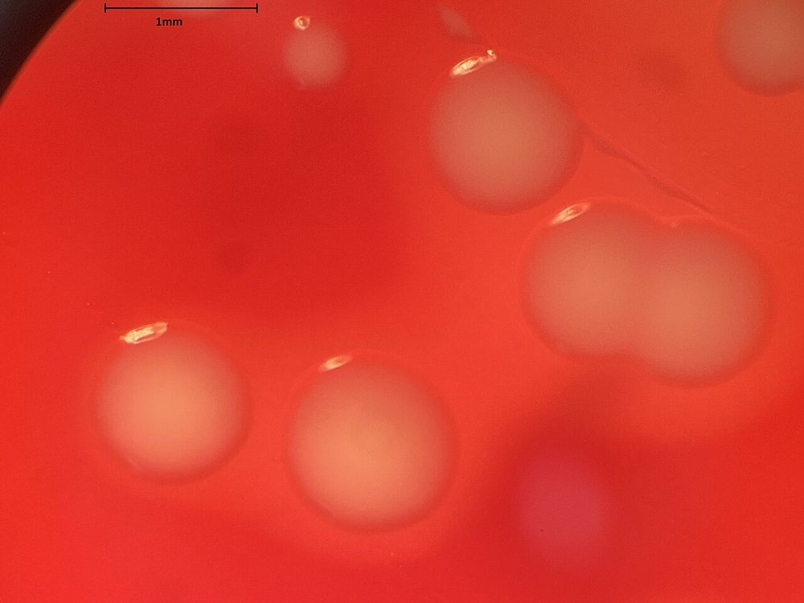
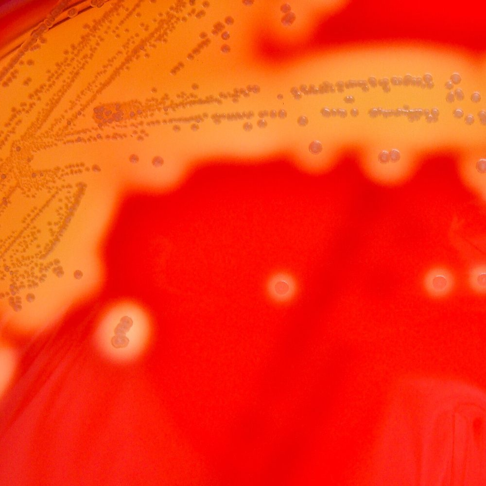
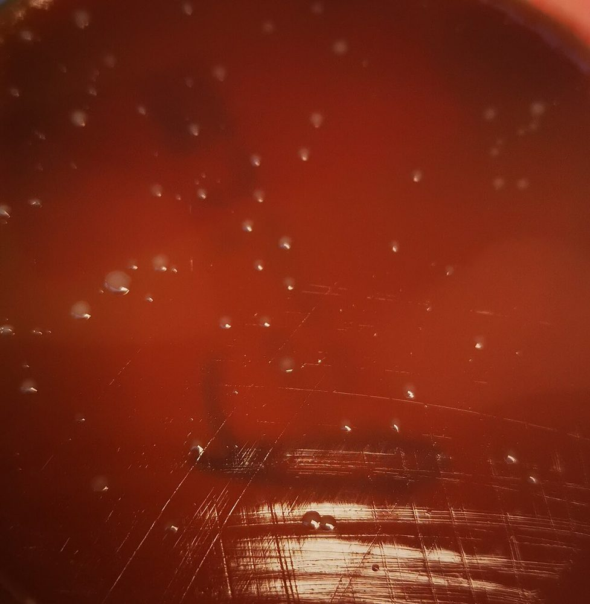
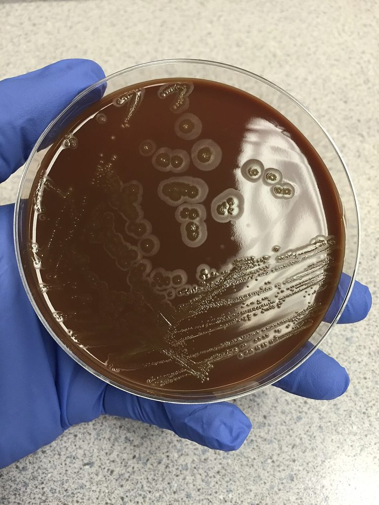
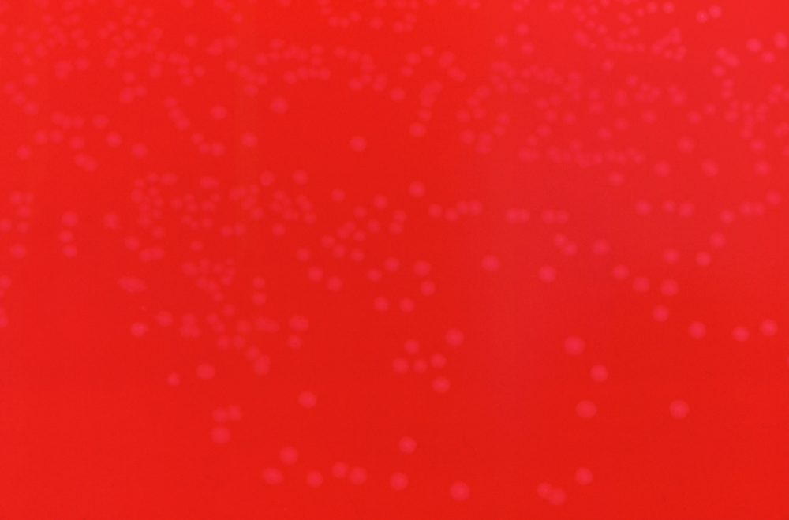
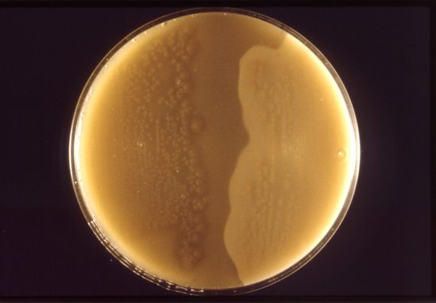
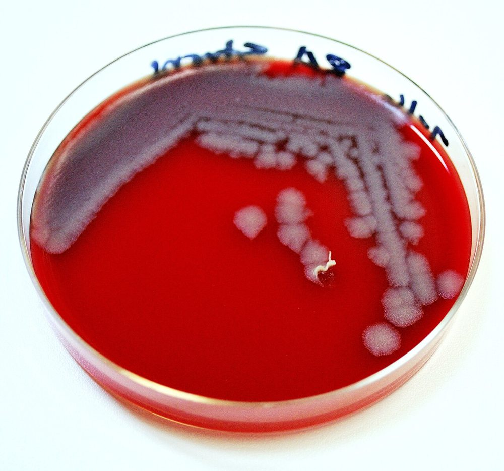
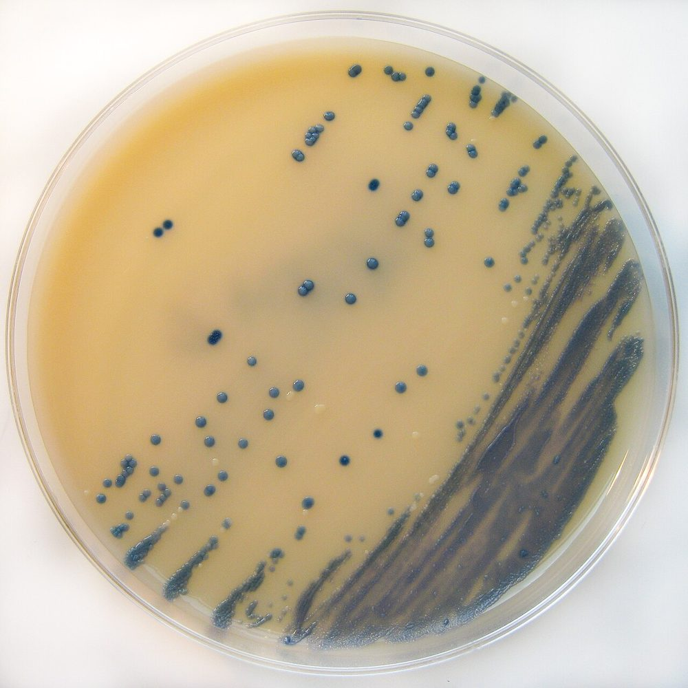

# پروتکل ۴: کشت و شناسایی — پوست و بافت نرم

## ۱. پنل محیط‌ها

| نمونه | SBA | CA | MAC | CNA/PEA | بی‌هوازی (BA + KV-LB/PEA) + براث | سایر |
|---|---|---|---|---|---|---|
| آسپیرهٔ آبسه | ✅ | ✅ | ✅ | ± | ✅ | |
| بافت عمقی/نکروزان | ✅ | ✅ | ✅ | ✅ | ✅ (+ **آگار تخم‌مرغ** برای لسیتیناز/لیپاز) | |
| سواب زخم/زرد زخم | ✅ | ± | ✅ | | (فقط ESwab) | |
| گازگرفتگی | ✅ | **✅** (*Pasteurella*، *Capnocytophaga*، *Eikenella*) | ✅ | | ✅ | |
| تماس با آب | ✅ | ✅ | ✅ | | ± | **TCBS** (*Vibrio*)؛ AFB در **۳۰ °C** (*M. marinum*) |
| سیاه‌زخم | ✅ | | ✅ (عدم رشد) | | | **PLET** (انتخابی، مرجع) |
| ضایعهٔ مزمن | ✅ | ✅ | ✅ | | ✅ | AFB (۳۰ و ۳۷ °C)، قارچ، BCYE/*Nocardia* (۲–۳ هفته) |

- **انکوباسیون:** هوازی ۳۵ °C (CO₂ برای SBA/CA) **۴۸ ساعت**؛ بی‌هوازی **۵ روز**؛ براث ۵ روز.
- گازگرفتگی: CA تا **۷۲ ساعت** (*Capnocytophaga*، *Eikenella* کندرشد).

**تصاویر:**

<table><tr><td align="center" width="50%"> <b>شکل ۷.۰۷.</b> <i>Staphylococcus aureus</i> روی آگار خون‌دار؛ تابش نور از پشت پلیت همولیز بتا را نشان می‌دهد منبع: Mikael Häggström , M.D. Author info - Reusing images - Conflicts of in، <a href="https://commons.wikimedia.org/wiki/File:Staphylococcus_aureus_on_blood_agar,_mildly_backlit.jpg">Wikimedia Commons</a>، <a href="http://creativecommons.org/publicdomain/zero/1.0/deed.en">CC0</a></td><td align="center" width="50%"> <b>شکل ۷.۰۸.</b> همولیز بتا اطراف کلنی‌های <i>Streptococcus pyogenes</i> (گروه A لانسفیلد) روی آگار خون اسب کلمبیا منبع: Nathan Reading from Halesowen, UK، <a href="https://commons.wikimedia.org/wiki/File:Streptococcus_pyogenes_(Lancefield_Group_A)_on_Columbia_Horse_Blood_Agar_-_Detail.jpg">Wikimedia Commons</a>، <a href="https://creativecommons.org/licenses/by/2.0">CC BY 2.0</a></td></tr></table>

## ۲. شناسایی ارگانیسم‌های کلیدی

| ارگانیسم | ویژگی‌ها |
|---|---|
| *S. aureus* | کوآگولاز +، DNase +؛ (CA-MRSA: اغلب PVL +) |
| GAS | بتا، PYR +، لانسفیلد A |
| استرپتوکوکوس گروه C/G | بتا (کلنی بزرگ)، PYR – |
| ***Pasteurella multocida*** | کوکوباسیل گرم منفی کوچک، **اکسیداز +، کاتالاز +، ایندول +**، **عدم رشد روی MAC**، بوی «موشی»، حساس به پنی‌سیلین |
| ***Capnocytophaga canimorsus*** | باسیل گرم منفی دوکی، **رشد کند در CO₂** (۲–۴ روز)، **اکسیداز + و کاتالاز +** (برخلاف گونه‌های دهانی انسان)، حرکت سُرخوردن (gliding) |
| ***Eikenella corrodens*** | باسیل گرم منفی، **کلنی‌های فرورفته (pitting) در آگار**، **بوی کلر/سفیدکننده**، اکسیداز +، کاتالاز –، نیاز به CO₂؛ ⚠️ **ذاتاً مقاوم به کلیندامایسین و مترونیدازول** |
| *Erysipelothrix rhusiopathiae* | باسیل گرم مثبت، **H₂S + در TSI** (منحصربه‌فرد میان گرم مثبت‌های کاتالاز منفی)، غیرمتحرک، «برس لوله‌پاک‌کن» در ژلاتین؛ ⚠️ **ذاتاً مقاوم به ونکومایسین** |
| *V. vulnificus* | اکسیداز +، لاکتوز + (تأخیری)، **سبز روی TCBS**، هالوفیل |
| *Aeromonas* | اکسیداز +، بتا همولیتیک، رشد بدون نمک (ماژول ۰۴) |
| *C. perfringens* | **همولیز دوگانه** (هالهٔ داخلی کامل، خارجی ناقص) روی آگار خون بی‌هوازی؛ **لسیتیناز + (ناگلر)**؛ غیرمتحرک؛ رشد سریع |
| *C. septicum* | **swarming** روی آگار بی‌هوازی؛ همولیتیک |
| ***B. anthracis*** ☣️ | کلنی **خاکستری–سفید بزرگ، مسطح، لبهٔ نامنظم «سر مدوزا»**، **چسبنده (وقتی با لوپ کشیده می‌شود مانند سفیدهٔ تخم‌مرغ می‌ایستد)**، **غیرهمولیتیک**، **غیرمتحرک**، کاتالاز +؛ ⛔ ادامهٔ کار ← مرجع |
| *B. cereus* (افتراق) | **بتا همولیتیک**، **متحرک**، (پنی‌سیلین R) |
| *Nocardia* | ماژول ۰۶ |
| *M. marinum* | AFB؛ ۳۰ °C؛ فتوکروموژن ([ماژول ۲۳](../../23_Mycobacteria/README.md)) |

**تصاویر:**

<table><tr><td align="center" width="50%"> <b>شکل ۷.۰۹.</b> کلنی‌های <i>Capnocytophaga canimorsus</i> روی آگار خون‌دار منبع: Suryabrata Banerjee (microregistrar.com)، <a href="https://commons.wikimedia.org/wiki/File:Capnocytophaga_canimorsus_colony_on_blood_agar.jpg">Wikimedia Commons</a>، <a href="https://creativecommons.org/licenses/by-sa/4.0">CC BY-SA 4.0</a></td><td align="center" width="50%"> <b>شکل ۷.۱۰.</b> کلنی‌های <i>Eikenella corrodens</i> روی آگار شکلات پس از ۳۶ ساعت؛ کلنی‌ها در آگار فرورفتگی (pitting) ایجاد کرده‌اند منبع: Deminorwood، <a href="https://commons.wikimedia.org/wiki/File:Eikenella_corrodens.jpg">Wikimedia Commons</a>، <a href="https://creativecommons.org/licenses/by-sa/4.0">CC BY-SA 4.0</a></td></tr><tr><td align="center" width="50%"> <b>شکل ۷.۱۱.</b> کلنی‌های ریز <i>Erysipelothrix rhusiopathiae</i> روی آگار خون‌دار منبع: Content Providers(s): CDC/Dr. W.A. Clark، <a href="https://commons.wikimedia.org/wiki/File:Erysipelothrix_rhusiopathiae_01.png">Wikimedia Commons</a>، Public domain</td><td align="center" width="50%"> <b>شکل ۷.۱۲.</b> <i>C. perfringens</i> روی پلیت نیم‌آنتی‌توکسین (ناگلر): کدورت لسیتیناز فقط در یک نیمه مشاهده می‌شود منبع: CDC/Dr. Stuart E. Starr، <a href="https://commons.wikimedia.org/wiki/File:Clostridium_perfringens_01.png">Wikimedia Commons</a>، Public domain</td></tr><tr><td align="center" width="50%"> <b>شکل ۷.۱۳.</b> کلنی‌های خاکستری–سفید <i>Bacillus anthracis</i> روی آگار خون گوسفند منبع: Megan Mathias and J. Todd Parker, USCDCP، <a href="https://commons.wikimedia.org/wiki/File:Bacillus_anthracis_plate.jpg">Wikimedia Commons</a>، <a href="http://creativecommons.org/publicdomain/zero/1.0/deed.en">CC0</a></td></tr></table>

## ۳. غربالگری MRSA (کلونیزاسیون)
- **آگار کروموژنیک MRSA** (۱۸–۴۸ ساعت) یا **PCR** مستقیم سواب بینی.
- مثبت ← کنترل عفونت/بی‌کلونیزاسیون (موپیروسین/کلرهگزیدین) طبق سیاست.

**تصاویر:**

<table><tr><td align="center" width="50%"> <b>شکل ۷.۱۴.</b> کلنی‌های MRSA روی آگار کروموژنیک انتخابی MRSA (Brilliance) منبع: Nathan Reading on Flickr Nathan R. on twitter، <a href="https://commons.wikimedia.org/wiki/File:MRSA_on_Brilliance_MRSA_Chromogenic_Agar.jpg">Wikimedia Commons</a>، <a href="https://creativecommons.org/licenses/by/2.0">CC BY 2.0</a></td></tr></table>

## ۴. سطح شناسایی (Workup)
| نمونه | سطح |
|---|---|
| **بافت/آسپیرهٔ عمیق** | شناسایی کامل همهٔ ارگانیسم‌ها (حداکثر ۳–۴ نوع؛ بیشتر ← «فلور مخلوط» + پاتوژن‌های کلیدی) |
| سواب سطحی | فقط **پاتوژن‌های کلیدی** (*S. aureus*، GAS، *P. aeruginosa*) و ارگانیسم‌های غالب؛ فلور پوست (CoNS، دیفتروئید، *Micrococcus*، *Bacillus*) نام برده نشود |
| بی‌هوازی‌ها | شناسایی تا حد گروه («بی‌هوازی‌های گرم منفی مخلوط») مگر *C. perfringens*/*septicum*، *B. fragilis* گروه، یا کشت خالص |

