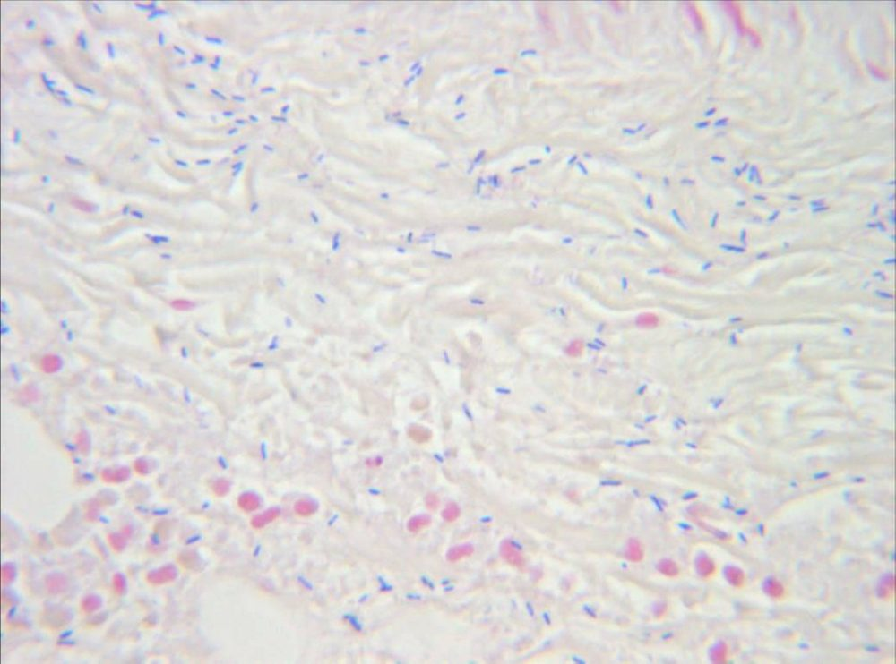
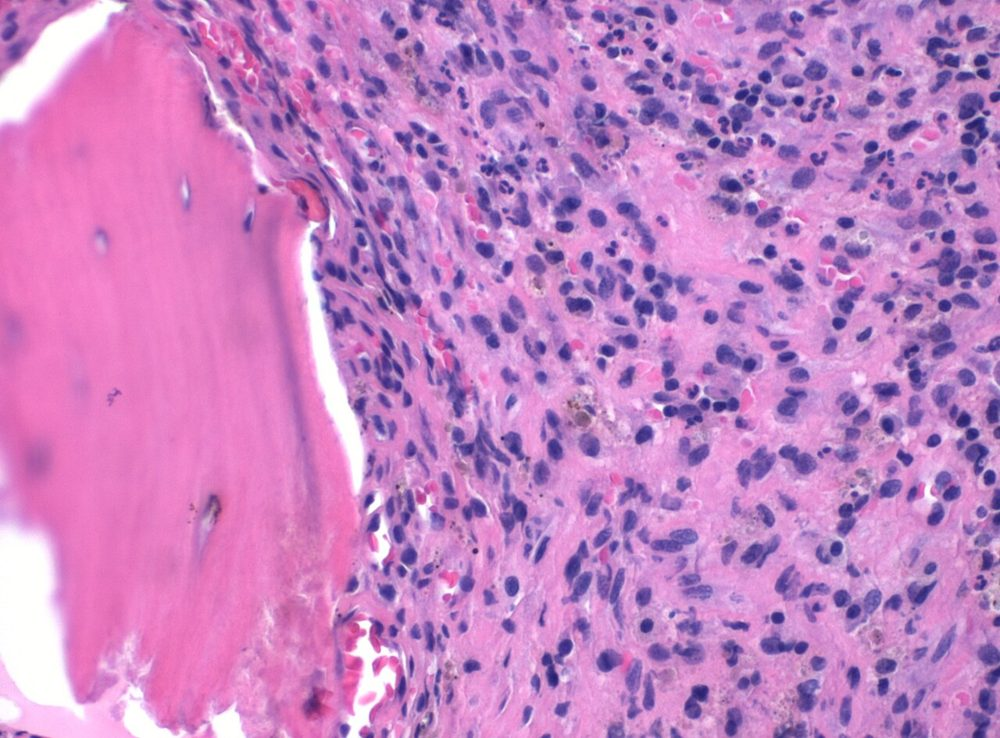

# پروتکل ۳: بررسی مستقیم — زخم، بافت، استخوان، ایمپلنت

## ۱. گرم بافت
- **روش:** له‌کردن قطعهٔ کوچک بین دو لام (Touch/Squash) یا از هموژنیزه. استخوان: از مایع/بافت نرم مجاور یا هموژنیزه.
- **حساسیت:** در PJI و استئومیلیت **پایین** (حدود ۱۰–۳۰٪). **اختصاصیت بالا**. ⇒ گرم منفی، عفونت را رد نمی‌کند. برخی راهنماها گرم روتین PJI را توصیه نمی‌کنند (ارزش کم)، ولی در عفونت حاد یا پرحدت مفید است.

| یافته | تفسیر |
|---|---|
| PMN + کوکسی گرم مثبت خوشه‌ای | *S. aureus*/CoNS |
| PMN + باسیل گرم منفی | گرم منفی‌ها |
| مورفولوژی‌های متعدد | چندمیکروبی (پای دیابتی، زخم فشاری) |
| باسیل گرم مثبت درشت (زخم تروماتیک) | *Clostridium* ← 📞 |
| بدون ارگانیسم و PMN زیاد | آنتی‌بیوتیک، ارگانیسم کم‌تعداد، مایکوباکتری، بروسلا |

**تصاویر:**

<table><tr><td align="center" width="50%"> <b>شکل ۸.۰۱.</b> گرم بافت عضلهٔ برداشته‌شده در جراحی: باسیل‌های گرم مثبت درشت، سازگار با <i>Clostridium perfringens</i> منبع: Engelbert Schröpfer, Stephan Rauthe and Thomas Meyer.، <a href="https://commons.wikimedia.org/wiki/File:Clostridium_perfringens_gas_gangrene.jpg">Wikimedia Commons</a>، <a href="https://creativecommons.org/licenses/by/2.0">CC BY 2.0</a></td></tr></table>

## ۲. رنگ‌آمیزی‌های ویژه
| رنگ | اندیکاسیون |
|---|---|
| **AFB (اورامین/ZN)** | استئومیلیت مهره‌ای (پات)، زخم‌های مزمن، PJI کشت‌منفی؛ حساسیت پایین |
| اسیدفست اصلاح‌شده | *Nocardia* |
| کالکوفلور/KOH | قارچ (زخم جنگی/سوختگی: موکورمایکوز ← 📞) |

## ۳. بافت‌شناسی (پاتولوژی؛ برای تطبیق)
| یافته | معنی |
|---|---|
| **PJI:** **≥ ۵ نوتروفیل در هر HPF** (در ≥ ۵ میدان؛ معیار Feldman) | عفونت محتمل |
| استئومیلیت: التهاب حاد/مزمن، نکروز، سکستروم | تأیید |
| گرانولوم کازئوز | TB/بروسلا (غیرکازئوز)، قارچ |
| سوختگی: ارگانیسم در **بافت زنده** | **عفونت مهاجم** (استاندارد طلایی) |

**تصاویر:**

<table><tr><td align="center" width="50%"> <b>شکل ۸.۰۲.</b> بافت‌شناسی استئومیلیت حاد (H&E): نوتروفیل‌های متعدد در استرومای کنار ترابکول استخوانی (کشت: <i>Staphylococcus aureus</i>) منبع: Mikael Häggström , M.D. Author info - Reusing images - Conflicts of in، <a href="https://commons.wikimedia.org/wiki/File:Histopathology_of_acute_osteomyelitis.jpg">Wikimedia Commons</a>، <a href="http://creativecommons.org/publicdomain/zero/1.0/deed.en">CC0</a></td></tr></table>

## ۴. سونیکیشن (پیش‌نیاز کشت)
- مایع سونیکیشن را می‌توان برای **گرم** سانتریفیوژ کرد (حساسیت محدود).

## ۵. گزارش
- «گرم بافت (نمونهٔ ۲ از ۵): PMN متوسط؛ ارگانیسمی مشاهده نشد.»
- «گرم بافت زخم پای دیابتی: PMN فراوان؛ کوکسی گرم مثبت، باسیل گرم منفی و باسیل گرم مثبت (فلور مخلوط).»

