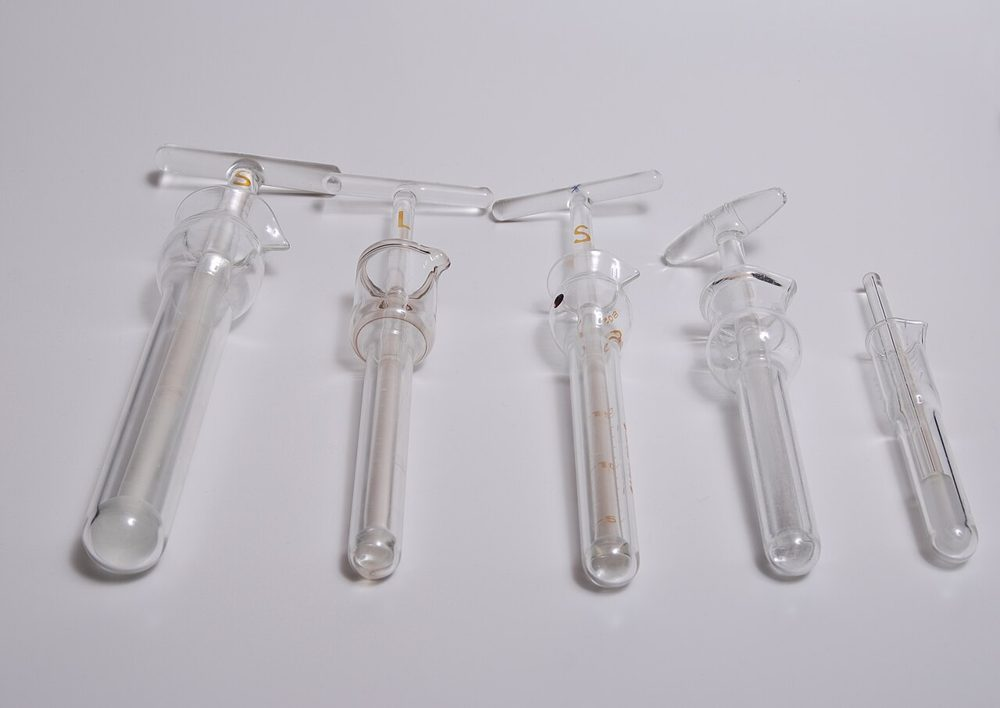
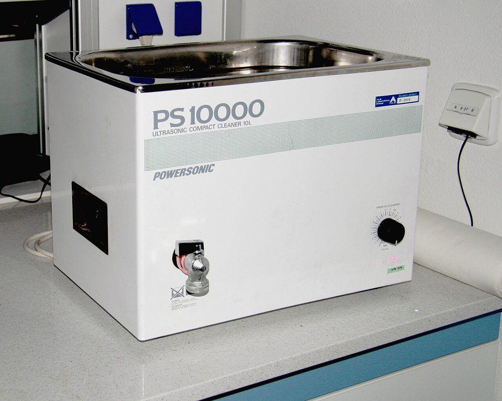
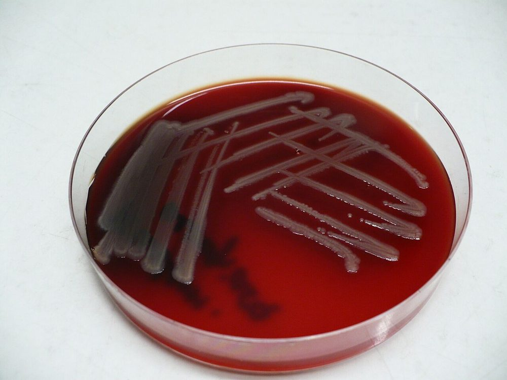
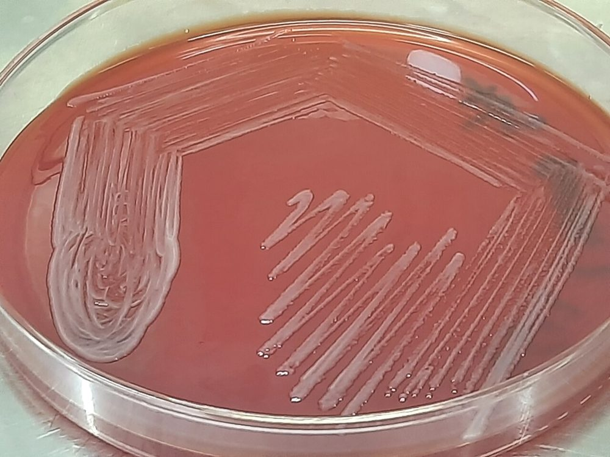
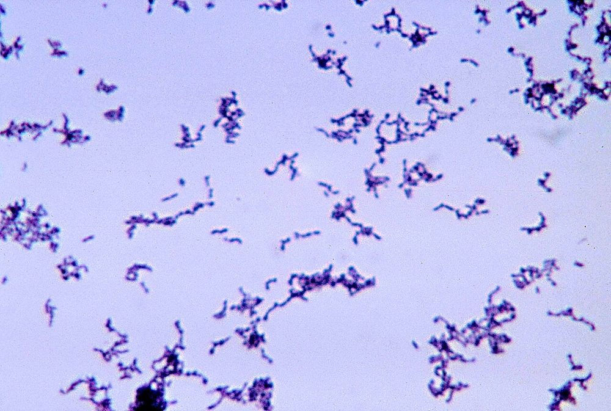
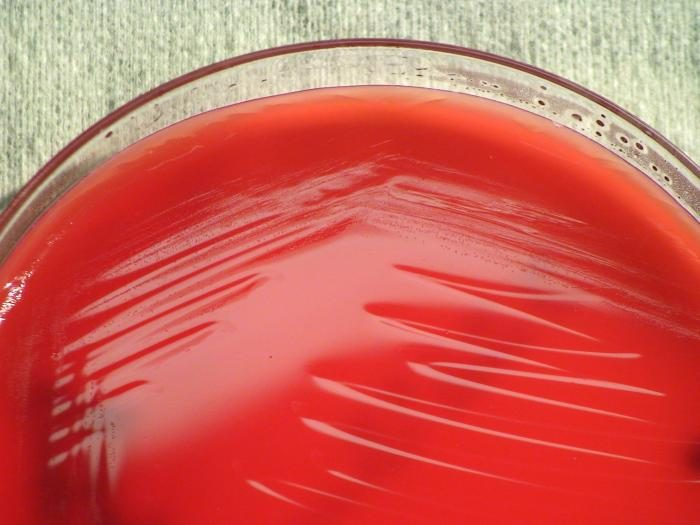
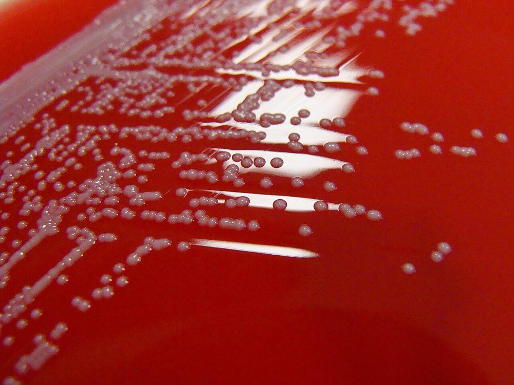
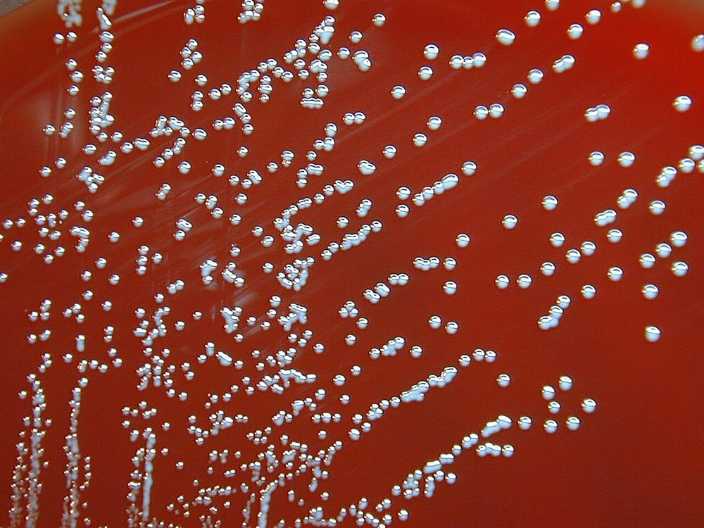

# پروتکل ۴: کشت و شناسایی — زخم، بافت، استخوان، ایمپلنت

## ۱. پردازش بافت و استخوان

### ۱-۱) هموژنیزه‌کردن بافت
1. زیر BSC، بافت را با قیچی/اسکالپل استریل به قطعات کوچک خرد کنید.
2. با **۱–۳ mL براث یا سالین استریل**، با **هموژنایزر** (Stomacher، بیدهای استریل در ورتکس، یا هاون استریل) له کنید.
3. ⚠️ **هموژنیزه‌کردن شدید** ممکن است بی‌هوازی‌ها را در معرض اکسیژن قرار دهد ← سریع کار کنید. **اسپورهای کپک‌های موکورال** با له‌کردن شدید آسیب می‌بینند (برای قارچ، خرد کنید نه له).
4. **استخوان:** خرد کنید (قیچی استخوان/ساینده استریل) یا قطعات کوچک را مستقیم در براث قرار دهید؛ ± دکلسیفیه نکنید (برای کشت).

**تصاویر:**

<table><tr><td align="center" width="50%"> <b>شکل ۸.۰۳.</b> هموژنایزرهای شیشه‌ای دستی (Dounce) در اندازه‌های مختلف منبع: Lilly_M، <a href="https://commons.wikimedia.org/wiki/File:Tissue_glass_Dounce_homogenizer-08.jpg">Wikimedia Commons</a>، <a href="https://creativecommons.org/licenses/by-sa/3.0">CC BY-SA 3.0</a></td></tr></table>

### ۱-۲) تلقیح هموژنیزه

| محیط | انکوباسیون |
|---|---|
| SBA، CA | ۳۵ °C، CO₂، ۵ روز (PJI: **۷–۱۴ روز**) |
| MAC | ۳۵ °C، هوا، ۴۸ ساعت |
| آگار خون‌دار بی‌هوازی (± KV-LB، PEA) | بی‌هوازی، **۷ روز** (PJI: **۱۴ روز**) |
| **براث غنی‌کننده** (تیوگلیکولات یا BHI) | ۱۰–۱۴ روز؛ ساب‌کالچر اگر کدر و در پایان (طبق پروتکل) |
| **بطری‌های کشت خون (BCB)** هوازی + بی‌هوازی (۱–۳ mL هموژنیزه هرکدام) | **۷–۱۴ روز** در دستگاه خودکار؛ ⇒ **افزایش حساسیت** و **کاهش زمان** در PJI (مطالعات Peel و همکاران) |
| AFB (MGIT + LJ)، قارچ، بروسلا (BCB طولانی) | بر اساس درخواست |

> 🔬 **مدت انکوباسیون PJI:** **۱۴ روز** برای پوشش *C. acnes* و ارگانیسم‌های کندرشد (به‌ویژه **شانه**). بیشتر پاتوژن‌ها ظرف ۷ روز رشد می‌کنند. برخی مراکز فقط بی‌هوازی و براث را ۱۴ روز نگه می‌دارند.

## ۲. سونیکیشن ایمپلنت (Trampuz و همکاران، ۲۰۰۷)
1. ایمپلنت را در **ظرف سخت استریل** با **رینگر/سالین استریل** (به‌اندازهٔ پوشاندن، مثلاً ۴۰۰ mL برای اجزای بزرگ یا ۵۰–۲۰۰ mL) قرار دهید.
2. **ورتکس ۳۰ ثانیه**.
3. **سونیکیشن ۵ دقیقه** (حمام اولتراسونیک حدود ۴۰ kHz، چگالی توان تعریف‌شده).
4. **ورتکس ۳۰ ثانیه**.
5. **۰٫۱ mL مایع** روی پلیت‌های هوازی و بی‌هوازی (± سانتریفیوژ برای تغلیظ ۱۰۰ برابر)؛ و/یا **تلقیح در BCB**.
6. انکوباسیون مانند بافت (هوازی ۵–۷ روز، بی‌هوازی ۱۴ روز).
7. **شمارش کلنی** ← CFU/mL مایع سونیکیشن (آستانه در فایل تفسیر).

> ☣️ ⚠️ ظرف کاملاً **دربسته** (آئروسل)؛ کیسه‌های پلاستیکی در صورت نشت خطرناک‌اند. ظرف‌های سخت با درپوش پیچی ارجح‌اند.

**تصاویر:**

<table><tr><td align="center" width="50%"> <b>شکل ۸.۰۴.</b> حمام اولتراسونیک آزمایشگاهی منبع: Karelj، <a href="https://commons.wikimedia.org/wiki/File:Ultrasonic_bath_1.jpg">Wikimedia Commons</a>، Public domain</td></tr></table>

## ۳. کشت کمّی بافت (سوختگی و موارد خاص)
1. بافت را **وزن کنید** (g).
2. هموژنیزه در حجم مشخص سالین (مثلاً ۱ mL).
3. **رقت‌های سریالی** (۱:۱۰ تا ۱:۱۰۰۰۰) ← ۰٫۱ mL روی پلیت‌ها.
4. شمارش ← **CFU/g بافت** = (تعداد کلنی × فاکتور رقت × حجم هموژنیزه ÷ ۰٫۱) ÷ وزن بافت.

## ۴. زخم‌ها و سواب‌ها
- SBA، CA، MAC، (CNA/PEA)، بی‌هوازی (فقط اگر ESwab/محیط مناسب)؛ ۴۸ ساعت هوازی، ۵ روز بی‌هوازی.
- **سطح شناسایی:** پاتوژن‌های اصلی و غالب (ماژول ۰۷).

**تصاویر:**

<table><tr><td align="center" width="50%"> <b>شکل ۸.۰۵.</b> کشت <i>Pseudomonas aeruginosa</i> روی آگار خون‌دار منبع: Pavel Dušek, vyfotografováno s laskavým svolením zaměstnanců Ústavu im، <a href="https://commons.wikimedia.org/wiki/File:Pseudomonas_aeruginosa-blood_agar.jpg">Wikimedia Commons</a>، <a href="https://creativecommons.org/licenses/by/3.0">CC BY 3.0</a></td><td align="center" width="50%"> <b>شکل ۸.۰۶.</b> کلنی‌های صاف، کدر، خاکستری–سفید و غیرهمولیتیک کمپلکس <i>Acinetobacter baumannii</i> روی آگار خون‌دار منبع: Ajay Kumar Chaurasiya، <a href="https://commons.wikimedia.org/wiki/File:Acinetobacter_baumannii_Complex_on_Blood_Agar_from_Sputum_Culture.jpg">Wikimedia Commons</a>، <a href="http://creativecommons.org/publicdomain/zero/1.0/deed.en">CC0</a></td></tr></table>

## ۵. شناسایی ارگانیسم‌های کلیدی
| ارگانیسم | نکته |
|---|---|
| CoNS | **شناسایی تا حد گونه** (MALDI) و **AST هر ایزوله** در PJI/استئومیلیت (برای مقایسهٔ ایزوله‌های نمونه‌های مختلف)؛ *S. lugdunensis* پرحدت |
| ***C. acnes*** | باسیل گرم مثبت پلئومورف، بی‌هوازی تحمل‌کننده، **کلنی پس از ۳–۷ روز (تا ۱۴)**، کاتالاز +، **ایندول +**، نیترات + |
| *S. aureus* SCV | کلنی‌های بسیار کوچک، غیرهمولیتیک، رشد کند (۴۸–۷۲ ساعت)، کوآگولاز ضعیف/تأخیری؛ ⚠️ با CoNS اشتباه می‌شوند (MALDI) |
| ***K. kingae*** | رشد ضعیف روی SBA (همولیز باریک)، **بهتر در BCB**؛ کوکوباسیل گرم منفی، اکسیداز +، کاتالاز –؛ **PCR** حساس‌تر |
| ***Brucella*** ☣️ | کشت بیوپسی در BCB طولانی (ماژول ۰۱)؛ **BSC** |
| *P. aeruginosa*، *A. baumannii* (سوختگی/جنگ) | AST کامل؛ کنترل عفونت |
| *Corynebacterium striatum* | PJI/زخم مزمن؛ MDR؛ معنی‌دار در نمونه‌های متعدد |
| *Cutibacterium*، *Finegoldia*، *Peptoniphilus* | بی‌هوازی‌های گرم مثبت در PJI/پای دیابتی |

**تصاویر:**

<table><tr><td align="center" width="50%"> <b>شکل ۸.۰۷.</b> گرم <i>Cutibacterium acnes</i> (نام قبلی <i>Propionibacterium acnes</i>) از کشت تیوگلیکولات: باسیل‌های گرم مثبت پلئومورف منبع: CDC/Bobby Strong، <a href="https://commons.wikimedia.org/wiki/File:Propionibacterium_acnes.jpg">Wikimedia Commons</a>، Public domain</td><td align="center" width="50%"> <b>شکل ۸.۰۸.</b> کلنی‌های <i>Kingella kingae</i> روی آگار خون گوسفند پس از ۲۴ ساعت منبع: CDC/ Amanda Moore, MT; Todd Parker, PhD; Audra Marsh، <a href="https://commons.wikimedia.org/wiki/File:Kingella_kingae_PHIL12451.jpg">Wikimedia Commons</a>، Public domain</td></tr><tr><td align="center" width="50%"> <b>شکل ۸.۰۹.</b> کلنی‌های <i>Corynebacterium striatum</i> روی آگار خون اسب کلمبیا (ایزوله از کشت خون) منبع: Nathan Reading from Halesowen, UK، <a href="https://commons.wikimedia.org/wiki/File:Corynebacterium_striatum_on_Columbia_Horse_Blood_Agar_-_Detail.jpg">Wikimedia Commons</a>، <a href="https://creativecommons.org/licenses/by/2.0">CC BY 2.0</a></td><td align="center" width="50%"> <b>شکل ۸.۱۰.</b> کلنی‌های <i>Brucella melitensis</i> روی آگار خون‌دار منبع: This media comes from the Centers for Disease Control and Pr، <a href="https://commons.wikimedia.org/wiki/File:BrucellaMelitensis.jpg">Wikimedia Commons</a>، Public domain</td></tr></table>

## ۶. نگهداری ایزوله‌ها
- ایزوله‌های PJI و استئومیلیت را **حداقل ۳ ماه** (منجمد) نگه دارید (عود، مقایسه، AST اضافی).

