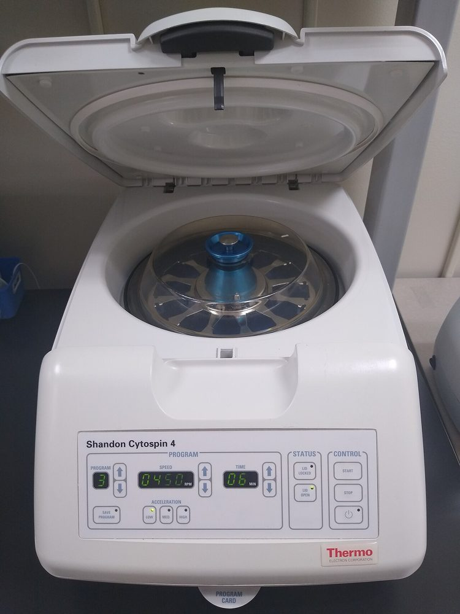
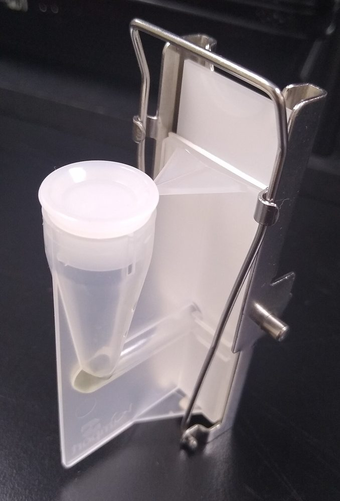
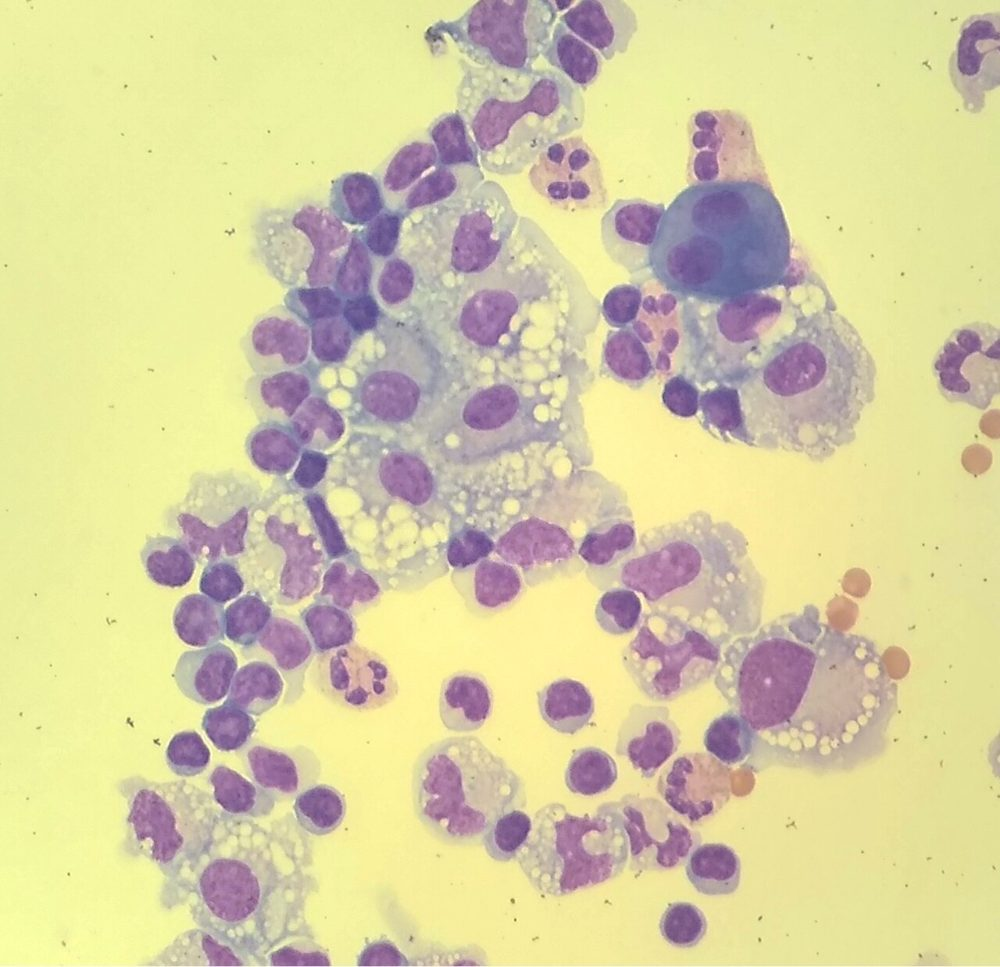
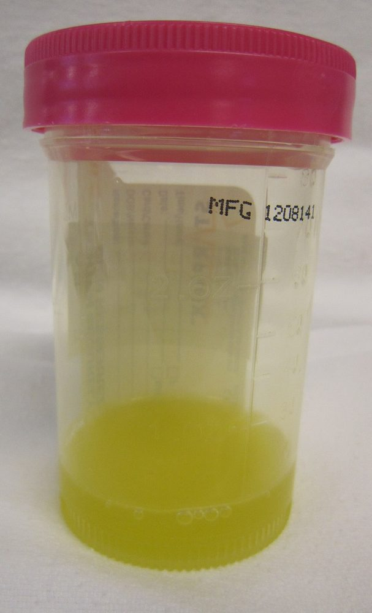
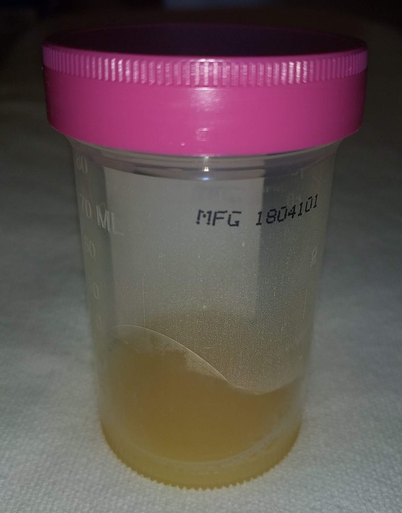
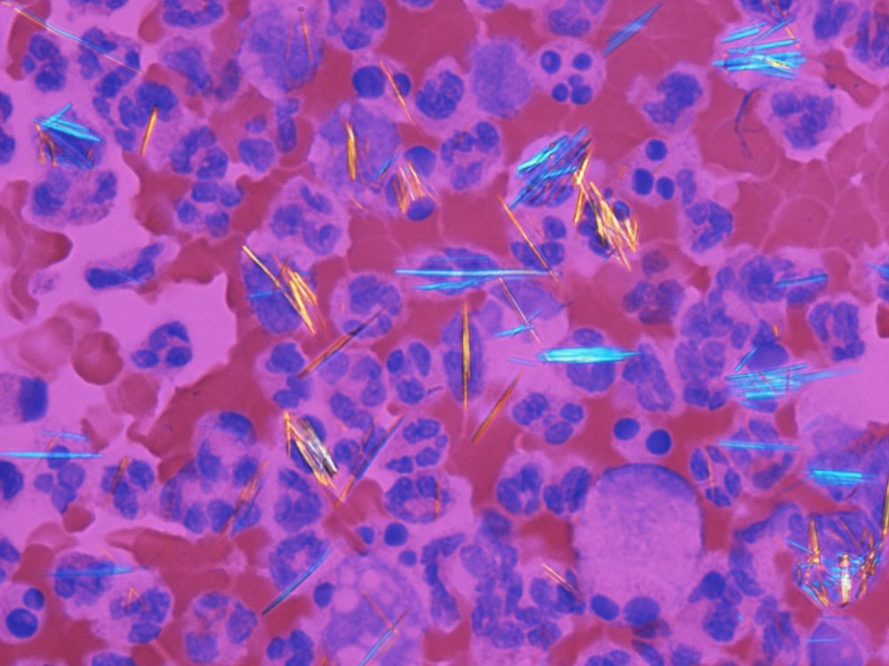
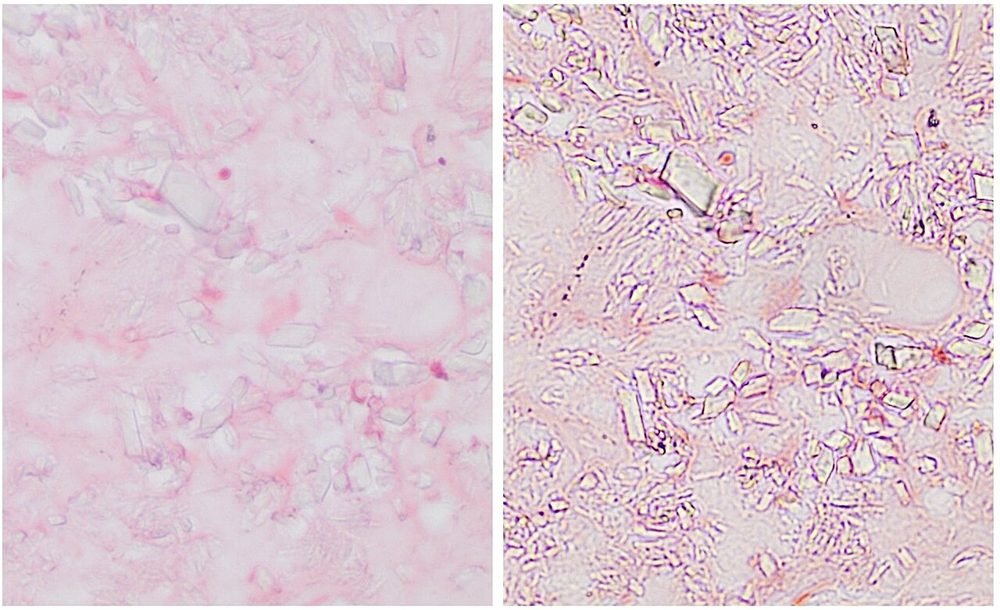
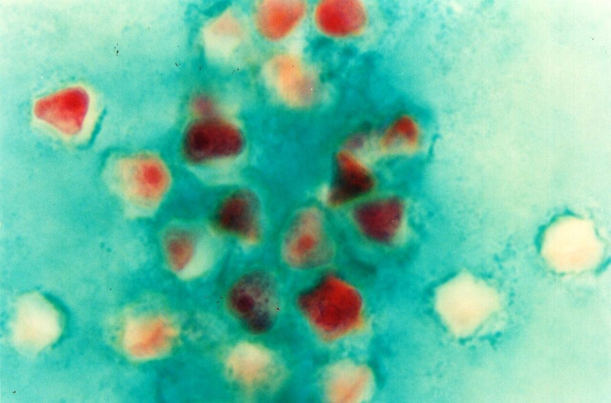

# پروتکل ۳: بررسی مستقیم — مایعات، چشم، گوش

## ۱. پردازش مایعات برای گرم
- مایع **شفاف**: **سیتوسانتریفیوژ** (بهترین) یا سانتریفیوژ ۱۵۰۰ × g، ۱۵ دقیقه، لام از رسوب.
- مایع **چرکی**: لام مستقیم.
- **حساسیت گرم:**

| مایع | حساسیت گرم |
|---|---|
| مفصل (آرتریت سپتیک غیرگونوکوکی) | حدود ۵۰٪ (گونوکوکی کمتر از ۲۵٪) |
| SBP | **حدود ۱۰٪** (تعداد کم) |
| پریتونیت ثانویه | بالا (چندمیکروبی) |
| PD | حدود ۱۰–۴۰٪ (کمک به تشخیص کاندیدا) |
| آمپیم | متوسط |
| ویتره/قرنیه | ۴۰–۷۰٪ |

> **گرم منفی، عفونت را رد نمی‌کند.** **گرم مثبت با «فلور مخلوط» در مایع صفاق** ← **پرفوراسیون/پریتونیت ثانویه** (نه SBP) ← 📞 جراحی.

**تصاویر:**

<table><tr><td align="center" width="50%"> <b>شکل ۹.۰۱.</b> سیتوسانتریفیوژ برای تهیهٔ لام از مایعات منبع: SpicyMilkBoy، <a href="https://commons.wikimedia.org/wiki/File:Cytospin_cytocentrifuge.jpg">Wikimedia Commons</a>، <a href="https://creativecommons.org/licenses/by-sa/4.0">CC BY-SA 4.0</a></td><td align="center" width="50%"> <b>شکل ۹.۰۲.</b> مجموعهٔ قیف و گیرهٔ سیتوسانتریفیوژ (قیف، کاغذ صافی و لام) منبع: SpicyMilkBoy، <a href="https://commons.wikimedia.org/wiki/File:Cytocentrifuge_funnel_assembly_with_clip.jpg">Wikimedia Commons</a>، <a href="https://creativecommons.org/licenses/by-sa/4.0">CC BY-SA 4.0</a></td></tr><tr><td align="center" width="50%"> <b>شکل ۹.۰۳.</b> لام سیتواسپین مایع صفاق (رایت–گیمسا): مونوسیت، لنفوسیت، نوتروفیل و سلول‌های مزوتلیال منبع: SpicyMilkBoy، <a href="https://commons.wikimedia.org/wiki/File:Cytospin_slide_of_peritoneal_fluid_(Wright_Giemsa_stain).jpg">Wikimedia Commons</a>، <a href="https://creativecommons.org/licenses/by-sa/4.0">CC BY-SA 4.0</a></td></tr></table>

## ۲. شمارش سلولی و بیوشیمی (تطبیق؛ جزئیات در فایل تفسیر)
| مایع | آستانه‌های کلیدی |
|---|---|
| آسیت | **PMN ≥ ۲۵۰/µL = SBP** |
| PD | **WBC بیش از ۱۰۰/µL و PMN بیش از ۵۰٪** |
| مفصل | WBC بیش از ۵۰٬۰۰۰ (به‌ویژه بیش از ۱۰۰٬۰۰۰) و PMN بیش از ۹۰٪ ← آرتریت سپتیک محتمل؛ PJI: آستانه‌های پایین‌تر |
| پلور | pH کمتر از ۷٫۲، گلوکز کمتر از ۶۰ mg/dL، LDH بیش از ۱۰۰۰ ← آمپیم/پیچیده؛ **چرک = آمپیم** |

**تصاویر:**

<table><tr><td align="center" width="50%"> <b>شکل ۹.۰۴.</b> مایع مفصل طبیعی: زرد کم‌رنگ و شفاف منبع: James Heilman, MD، <a href="https://commons.wikimedia.org/wiki/File:Joint_Fluid.JPG">Wikimedia Commons</a>، <a href="https://creativecommons.org/licenses/by-sa/3.0">CC BY-SA 3.0</a></td><td align="center" width="50%"> <b>شکل ۹.۰۵.</b> مایع مفصل زانو در آرتریت سپتیک: کدر منبع: James Heilman, MD، <a href="https://commons.wikimedia.org/wiki/File:SepticJointFluid.jpg">Wikimedia Commons</a>، <a href="https://creativecommons.org/licenses/by-sa/4.0">CC BY-SA 4.0</a></td></tr></table>

## ۳. کریستال‌ها (مایع مفصل؛ میکروسکوپ پلاریزه)
| کریستال | شکل | دوشکستی |
|---|---|---|
| **اورات مونوسدیم (نقرس)** | سوزنی | **منفی قوی** (زرد موازی محور جبران‌کننده) |
| **CPPD (کاذب‌نقرس)** | میله‌ای/لوزی | **مثبت ضعیف** (آبی موازی) |

- ⚠️ **کریستال و عفونت می‌توانند هم‌زمان باشند** ← کشت همیشه.

**تصاویر:**

<table><tr><td align="center" width="50%"> <b>شکل ۹.۰۶.</b> بلورهای سوزنی اورات مونوسدیم (نقرس) زیر نور پلاریزه با جبران‌کنندهٔ قرمز منبع: Gabriel Caponetti، <a href="https://commons.wikimedia.org/wiki/File:Gout_-_monosodium_urate_crystals_(20X,_polarized,_red_compensator).jpg">Wikimedia Commons</a>، <a href="https://creativecommons.org/licenses/by-sa/3.0">CC BY-SA 3.0</a></td><td align="center" width="50%"> <b>شکل ۹.۰۷.</b> بلورهای میله‌ای و لوزی CPPD در بافت (H&E؛ چپ: بدون کندانسور، راست: با کندانسور) منبع: Mikael Häggström , M.D. Author info - Reusing images - Conflicts of in، <a href="https://commons.wikimedia.org/wiki/File:Calcium_pyrophosphate_dihydrate_crystals_without_and_with_condenser.jpg">Wikimedia Commons</a>، <a href="http://creativecommons.org/publicdomain/zero/1.0/deed.en">CC0</a></td></tr></table>

## ۴. چشم
| رنگ | یافته |
|---|---|
| **گرم** (خراش قرنیه/ملتحمه) | PMN + ارگانیسم؛ در نوزاد: **دیپلوکوک گرم منفی داخل‌سلولی** ← 📞 گونوکوکوس |
| **گیمسا** (ملتحمه نوزاد) | **اجسام انکلوزیون** داخل‌سیتوپلاسمی (*C. trachomatis*؛ حساسیت پایین) |
| کالکوفلور سفید (افتراقی) | هیف قارچی، کیست *Acanthamoeba* |
| گرم ویتره | کوکسی گرم مثبت (CoNS/استرپتوکوکوس)؛ **باسیل گرم مثبت درشت (*B. cereus*)** ← 📞 |

**تصاویر:**

<table><tr><td align="center" width="50%"> <b>شکل ۹.۰۸.</b> کیست‌های <i>Acanthamoeba</i> منبع: Punlop Anusonpornperm، <a href="https://commons.wikimedia.org/wiki/File:Acanthamoeba_spp_(Cyst).jpg">Wikimedia Commons</a>، <a href="https://creativecommons.org/licenses/by/4.0">CC BY 4.0</a></td></tr></table>

## ۵. گوش
- گرم ترشح گوش میانی: دیپلوکوک گرم مثبت (پنوموکوکوس)، کوکوباسیل گرم منفی (هموفیلوس).
- اوتیت خارجی: باسیل گرم منفی (*Pseudomonas*)؛ هیف/مخمر (قارچی).

## ۶. AFB و ADA (سل)
- لام AFB مایع پلور/صفاق/پریکارد **حساسیت بسیار پایین** (کمتر از ۵–۱۰٪) دارد.
- **ADA** (آدنوزین دآمیناز) در پلور بیش از حدود ۴۰ U/L (لنفوسیتی) ← سل پلور محتمل (در مناطق با شیوع بالا).
- **بیوپسی پلور/صفاق** (گرانولوم + کشت) حساس‌تر است.

## ۷. گزارش
- «مایع آسیت (سیتواسپین): PMN کم؛ ارگانیسمی مشاهده نشد.»
- «مایع آسیت: **ارگانیسم‌های متعدد** (باسیل گرم منفی، کوکسی گرم مثبت، باسیل گرم مثبت)؛ مطرح‌کنندهٔ پریتونیت ثانویه.» 📞
- «خراش قرنیه: PMN فراوان؛ **باسیل‌های گرم منفی**.» 📞
- «مایع مفصل: کریستال‌های سوزنی با دوشکستی منفی (اورات)؛ گرم: ارگانیسمی مشاهده نشد؛ کشت در جریان.»

