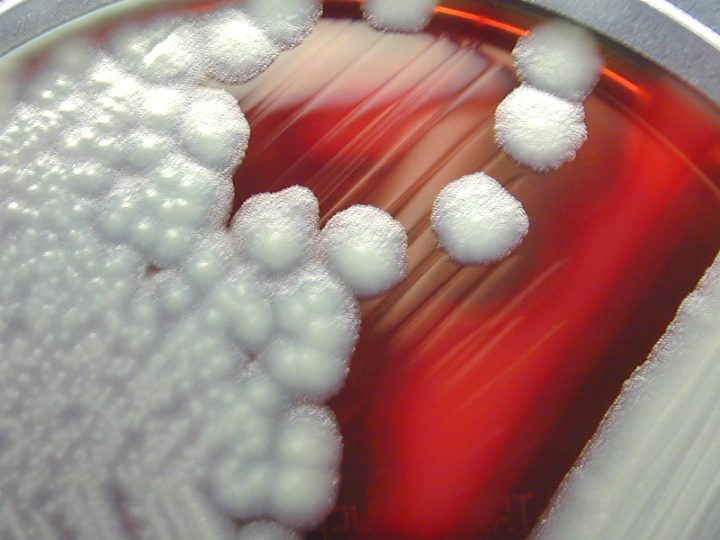
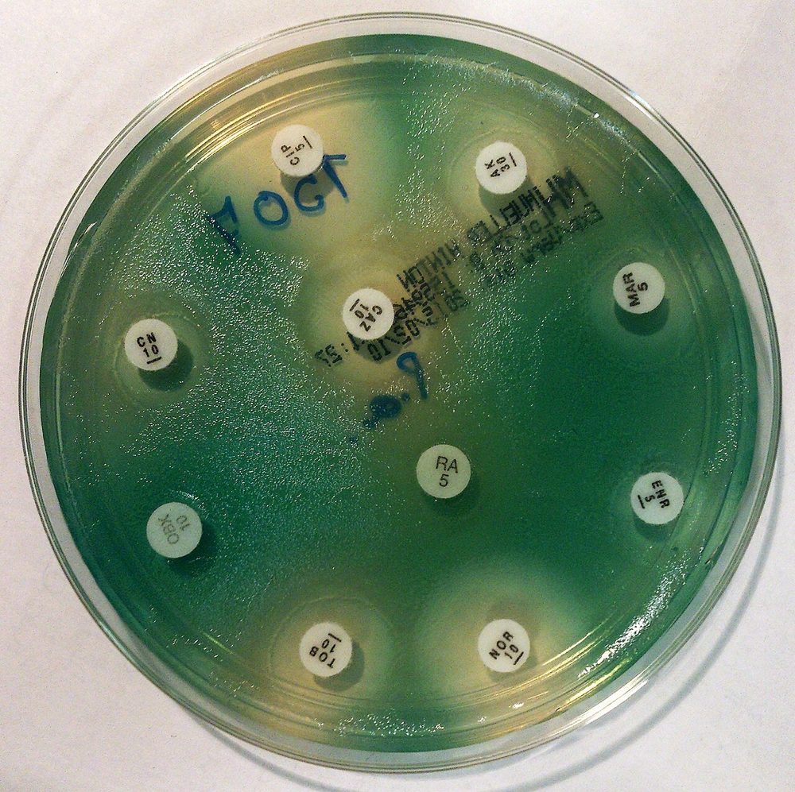

# پروتکل ۴: کشت و شناسایی — مایعات، چشم، گوش، مغز استخوان

## ۱. مایعات استریل

| نمونه | محیط‌ها | انکوباسیون |
|---|---|---|
| **BCB** (هوازی/بی‌هوازی) | — | ۵ روز (PJI: ۱۴ روز؛ بروسلا: ۷–۱۰ روز + ساب‌کالچر کور) |
| مایع مستقیم/رسوب | SBA، CA، MAC، + **آگار خون‌دار بی‌هوازی** (پلور، صفاق ثانویه، صفرا) | هوازی ۳–۵ روز؛ بی‌هوازی ۵ روز |
| براث (اختیاری؛ تیوگلیکولات) | | ۵ روز |
| مفصل (کودک) | + **BCB** (*K. kingae*) | |
| مفصل (ظن گونوکوکوس) | + **CA/MTM**، CO₂ (± کشت مخاطی: سرویکس/اورترا/حلق/رکتوم که حساس‌ترند) | ۷۲ ساعت |
| PD | **BCB** (یا رسوب ۵۰ mL) + SBA، CA، MAC | ۵ روز (منفی ← تا ۷ روز) |
| AFB، قارچ | بر اساس درخواست | |

> ⚠️ **SBP و PD:** شمارش کم ارگانیسم (حدود ۱ CFU/mL در آسیت) ← **فقط BCB** حساسیت قابل‌قبول دارد.

## ۲. چشم

| نمونه | محیط‌ها | انکوباسیون |
|---|---|---|
| ملتحمه | SBA، CA | ۳۵ °C، CO₂، ۴۸ ساعت |
| ملتحمه نوزاد | + **MTM/CA** (گونوکوکوس)؛ NAAT/کشت سلولی کلامیدیا | ۷۲ ساعت |
| **قرنیه** (تلقیح مستقیم) | **SBA، CA**، (+ تیوگلیکولات/BHI)، (سابورو؛ آگار غیرمغذی با *E. coli* برای *Acanthamoeba*) | SBA/CA: ۵–۷ روز؛ براث: ۷ روز؛ سابورو: ۲ هفته |
| **ویتره/زلالیه** | SBA، CA، **آگار بی‌هوازی**، تیوگلیکولات/BHI، **BCB اطفال**، (سابورو) | هوازی ۵–۷ روز؛ **بی‌هوازی ۷–۱۴ روز** (*C. acnes* در اندوفتالمیت مزمن) |

- **کشت «C»‌های** قرنیه: فقط کلنی‌هایی که **روی خطوط تلقیح** رشد کرده‌اند معنی‌دارند (کلنی خارج از خط = آلودگی).

## ۳. گوش
| نمونه | محیط‌ها |
|---|---|
| تمپانوسنتز | SBA، CA، (MAC)، ± بی‌هوازی (مزمن) |
| کانال خارجی/ترشح | SBA، CA، MAC، (سابورو) |
| اوتیت خارجی بدخیم (بافت) | SBA، CA، MAC، بی‌هوازی، سابورو، (AFB) |

## ۴. مغز استخوان
- **BCB** (هوازی/اطفال) با انکوباسیون طولانی (بروسلا ۷–۱۰ روز + ساب‌کالچر کور در BSC)
- AFB: بطری مایکوباکتری/ایزولاتور، ۴۲ روز
- شناسایی: ماژول ۰۱ (*Brucella*، *S.* Typhi)

## ۵. شناسایی ارگانیسم‌های ویژه
| ارگانیسم | نکته |
|---|---|
| گروه *S. anginosus* (*milleri*) | کلنی‌های کوچک (اغلب «بوی کارامل/کره»)، آلفا/بتا/گاما، لانسفیلد F/C/G/A یا غیرقابل‌گروه‌بندی، **آبسه‌ساز** (پلور، کبد، مغز)؛ MALDI |
| *B. cereus* (ویتره) | بتا همولیتیک، متحرک، لسیتیناز + |
| *P. aeruginosa* (قرنیه، گوش) | اکسیداز +، رنگدانه |
| *M. catarrhalis*، *H. influenzae* | ماژول ۰۶ |
| *K. kingae* | ماژول ۰۸؛ ماژول خانواده [۲۰](../../20_Fastidious_GNB/README.md) |
| *N. gonorrhoeae* | ماژول ۰۵؛ ماژول خانواده [۱۶](../../16_Gram_Negative_Cocci/README.md) |

**تصاویر:**

<table><tr><td align="center" width="50%"> <b>شکل ۹.۰۹.</b> کلنی‌های <i>Bacillus cereus</i> با همولیز روی آگار خون گوسفند منبع: CDC/ Courtesy of Larry Stauffer, Oregon State Public Health Laboratory، <a href="https://commons.wikimedia.org/wiki/File:Bacillus_cereus_01.png">Wikimedia Commons</a>، Public domain</td><td align="center" width="50%"> <b>شکل ۹.۱۰.</b> رنگدانهٔ سبز منتشر <i>Pseudomonas aeruginosa</i> در آگار مولر–هینتون (پلیت آنتی‌بیوگرام) منبع: Stefan Walkowski، <a href="https://commons.wikimedia.org/wiki/File:Pseudomonas_aeruginosa_antibiogram.jpg">Wikimedia Commons</a>، <a href="https://creativecommons.org/licenses/by-sa/4.0">CC BY-SA 4.0</a></td></tr></table>

