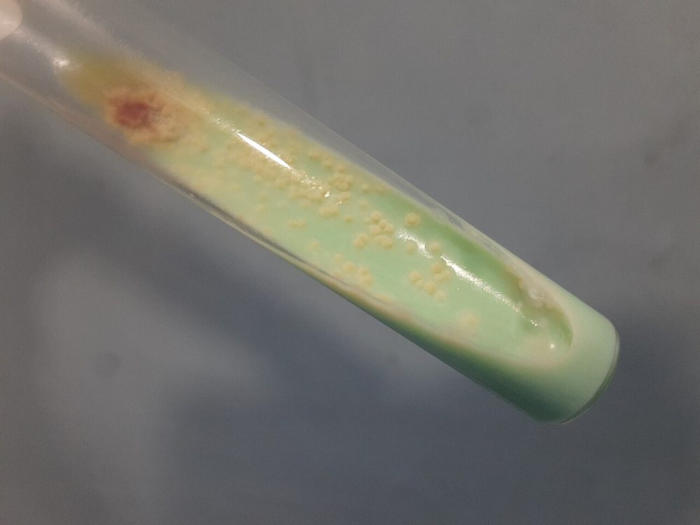
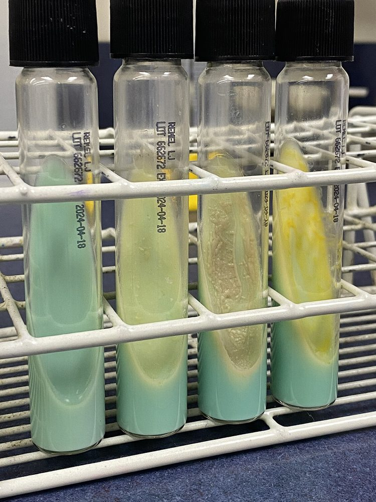
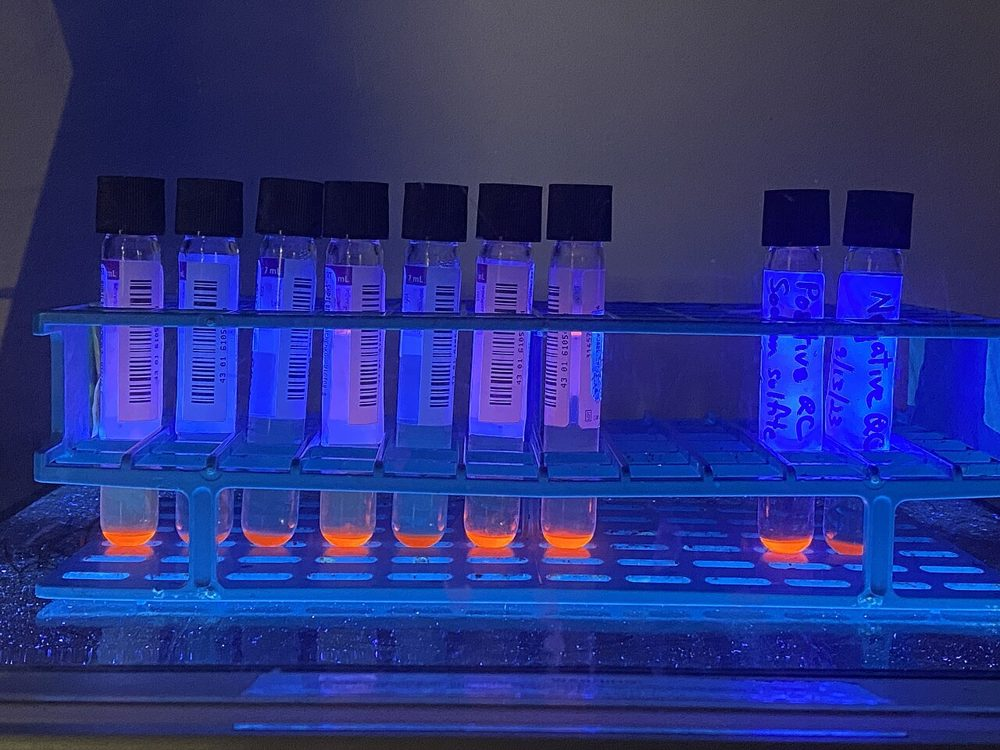
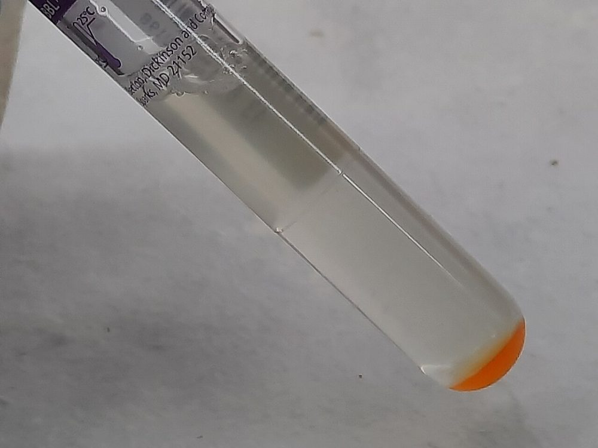

# گروه ۷: محیط‌های مایکوباکتری

> کشت مایکوباکتری **استاندارد طلایی** تشخیص سل است: حساس‌تر از اسمیر، امکان **شناسایی گونه** و **AST**. همیشه **یک محیط مایع + یک محیط جامد** (CLSI M48، WHO).
> ⚠️ **ایمنی:** دست‌کاری کشت *M. tuberculosis* در **BSL-3** (یا BSL-2 با روش‌های BSL-3)، **BSC کلاس II**، سانتریفیوژ با درپوش ایمنی.

## پیش‌پردازش (برای نمونه‌های غیراستریل)
**هضم و آلودگی‌زدایی (Digestion–Decontamination):** **NALC–NaOH** (N-استیل-L-سیستئین ۰٫۵٪ + NaOH ۱–۲٪؛ غلظت نهایی NaOH حدود ۱–۱٫۵٪)، **۱۵ دقیقه** (حداکثر ۲۰) ← خنثی‌سازی با **بافر فسفات pH ۶٫۸** ← سانتریفیوژ **۳۰۰۰ × g، ۱۵–۲۰ دقیقه** ← رسوب برای اسمیر و کشت.
- نمونه‌های **CF** (پر از *Pseudomonas*): + **اسید اگزالیک ۵٪** یا **کلرهگزیدین ۱٪**.
- نمونه‌های **استریل** (CSF، بافت): بدون آلودگی‌زدایی.
- **میزان آلودگی قابل‌قبول:** **۲–۵٪** کشت‌ها (کمتر از ۲٪ ← آلودگی‌زدایی بیش از حد و کشتن مایکوباکتری؛ بیشتر از ۵٪ ← ناکافی).

---

## ۷.۱ لوونشتاین–جنسن (Löwenstein–Jensen, LJ)
| ویژگی | توضیح |
|---|---|
| **نوع** | جامد **تخم‌مرغی** (لخته‌شده با حرارت: **inspissation**، ۸۵°C) |
| **ترکیب** | **تخم‌مرغ کامل** (فسفولیپید، پروتئین)، **گلیسرول** (منبع کربن؛ ⚠️ ***M. bovis*** را مهار می‌کند)، آسپاراژین، نمک‌ها، **مالاشیت گرین** (مهار نسبی آلودگی) |
| **انواع** | **LJ با پیروات** (به‌جای گلیسرول) ← ***M. bovis***؛ **LJ با آهن** (افتراق)؛ **Gruft** (+ پنی‌سیلین و نالیدیکسیک اسید)؛ **Stonebrink** |
| **انکوباسیون** | **۳۵–۳۷°C**، **۵–۱۰٪ CO₂** در ۱–۲ هفتهٔ اول، **۸ هفته**؛ درپوش‌ها شل در هفتهٔ اول (تبخیر) سپس سفت؛ بررسی **هفتگی** |
| **دمای ویژه** | پوست/مفاصل: **۳۰°C** هم (*M. marinum*، *M. haemophilum*، *M. ulcerans*)؛ **۴۲°C** (*M. xenopi*) |
| **تفسیر** | *M. tuberculosis*: **خشن، زرد-کرم، «گل‌کلمی» (rough, buff, tough)**؛ پیدایش در **۲–۴ هفته**. *M. avium*: صاف، کرم. سریع‌رشدها: **کمتر از ۷ روز** |
| **مزایا** | ارزان؛ مورفولوژی کلنی؛ رشد خوب MTB؛ حفظ ایزوله؛ **AST قدیمی (روش تناسبی)** |
| **محدودیت** | کند؛ آلودگی‌پذیر؛ **مخلوط** را خوب نشان نمی‌دهد؛ برای AST داروهای جدید **توصیه نمی‌شود** (WHO) |

**تصاویر:**

<table><tr><td align="center" width="50%"> <b>شکل ۱۱.۳۶.</b> کلنی‌های خشن و کرم‌رنگ <i>M. tuberculosis</i> روی لوونشتاین–جنسن پس از ۴ هفته منبع: Ajay Kumar Chaurasiya، <a href="https://commons.wikimedia.org/wiki/File:Mycobacterium_tuberculosis_growth_on_L-J_medium.jpg">Wikimedia Commons</a>، <a href="http://creativecommons.org/publicdomain/zero/1.0/deed.en">CC0</a></td><td align="center" width="50%"> <b>شکل ۱۱.۳۷.</b> لوله‌های LJ، از چپ: شاهد منفی، <i>M. tuberculosis</i> (کلنی خشک)، کمپلکس <i>M. avium</i> (کلنی مرطوب)، <i>M. gordonae</i> (کلنی زرد) منبع: Mikael Häggström , M.D. Author info - Reusing images - Conflicts of in، <a href="https://commons.wikimedia.org/wiki/File:Slant_tubes_of_L%C3%B6wenstein-Jensen_medium_with_control,_M_tuberculosis,_M_avium_and_M_gordonae.jpg">Wikimedia Commons</a>، <a href="http://creativecommons.org/publicdomain/zero/1.0/deed.en">CC0</a></td></tr></table>

## ۷.۲ میدل‌بروک 7H10 و 7H11
| ویژگی | توضیح |
|---|---|
| **نوع** | جامد **آگاری شفاف** (تعریف‌شده) |
| **ترکیب** | نمک‌ها، ویتامین‌ها، گلیسرول، مالاشیت گرین (کم) + مکمل **OADC** (اولئیک اسید، آلبومین، دکستروز، کاتالاز) |
| **7H11** | 7H10 + **هیدرولیزات کازئین ۰٫۱٪** ← بهبود رشد سویه‌های **مقاوم به INH** |
| **7H11 انتخابی (Mitchison)** | + پلی‌میکسین B، کاربنی‌سیلین، آمفوتریسین، تری‌متوپریم |
| **انکوباسیون** | ۳۵–۳۷°C، **۵–۱۰٪ CO₂** (ضروری)، **تاریکی** (نور ← تجزیه به فرمالدئید)، ۶–۸ هفته |
| **مزایا** | شفافیت ← **مشاهدهٔ میکروکلنی‌ها با استریومیکروسکوپ در ۱۰–۱۲ روز**؛ **کورد** (طناب‌سازی)؛ تشخیص **کشت مخلوط**؛ **روش تناسبی AST** (CLSI مرجع تاریخی؛ غلظت‌های بحرانی WHO) |
| **محدودیت** | عمر کوتاه‌تر (۴ هفته در ۲–۸°C، تاریکی) |

## ۷.۳ MGIT (Mycobacteria Growth Indicator Tube; BACTEC MGIT 960)
| ویژگی | توضیح |
|---|---|
| **نوع** | **مایع** (7H9 اصلاح‌شده) + مکمل **OADC** + **PANTA** (پلی‌میکسین، آمفوتریسین، نالیدیکسیک اسید، تری‌متوپریم، آزلوسیلین) |
| **اساس** | **ترکیب فلورسنت حساس به O₂** (روتنیوم) در کف لوله؛ مصرف O₂ توسط باکتری‌ها ← **فلورسانس** ← دستگاه پایش هر ۶۰ دقیقه |
| **زمان** | میانگین زمان مثبت شدن MTB **۱۰–۱۴ روز** (اسمیر مثبت: ۷–۱۰)؛ پایش تا **۴۲ روز** (۶ هفته) |
| **اقدام بر مثبت** | **رنگ‌آمیزی اسیدفست (ZN)** ← (۱) **آزمون آنتی‌ژن MPT64** (ایمونوکروماتوگرافی؛ MTBC +) یا **PCR/LPA** برای شناسایی؛ (۲) **ساب‌کالچر روی آگار خون** (بررسی آلودگی) و LJ/7H11 |
| **مزایا** | سریع‌ترین کشت؛ حساس‌ترین؛ خودکار؛ **AST** (SIRE، PZA، داروهای خط دوم، بداکیلین، لینزولید) ← [AST/06_Mycobacteria](../AST/06_Mycobacteria/01_Mycobacteria_AST.md) |
| **محدودیت** | گران؛ **آلودگی** بیشتر از محیط جامد؛ مورفولوژی کلنی ندارد؛ **کشت مخلوط** مشاهده نمی‌شود؛ برخی گونه‌ها (*M. haemophilum*: نیاز به هِمین؛ *M. genavense*) رشد ضعیف |
| **دام** | **مثبت کاذب دستگاه** (بدون باکتری در اسمیر) ← ادامهٔ انکوباسیون؛ **MPT64 منفی** در جهش‌های *mpt64* (نادر) و برخی *M. bovis* BCG |

**تصاویر:**

<table><tr><td align="center" width="50%"> <b>شکل ۱۱.۳۸.</b> لوله‌های MGIT زیر نور UV؛ فلورسانس نارنجی نشانهٔ رشد مایکوباکتری است منبع: Mikael Häggström , M.D. Author info - Reusing images - Conflicts of in، <a href="https://commons.wikimedia.org/wiki/File:Mycobacteria_Growth_Indicator_Tube_(MGIT)_samples_in_ultraviolet_light.jpg">Wikimedia Commons</a>، <a href="http://creativecommons.org/publicdomain/zero/1.0/deed.en">CC0</a></td><td align="center" width="50%"> <b>شکل ۱۱.۳۹.</b> رشد کدر <i>M. fortuitum</i> در لولهٔ MGIT؛ حسگر فلورسنت نارنجی در کف لوله منبع: Ajay Kumar Chaurasiya، <a href="https://commons.wikimedia.org/wiki/File:Turbid_growth_of_Mycobacterium_fortuitum_in_a_Mycobacteria_Growth_Indicator_Tube_(MGIT).jpg">Wikimedia Commons</a>، <a href="http://creativecommons.org/publicdomain/zero/1.0/deed.en">CC0</a></td></tr></table>

## ۷.۴ نیازهای ویژهٔ گونه‌ها

| گونه | نیاز ویژه |
|---|---|
| ***M. haemophilum*** | **هِمین (فاکتور X)** یا آمونیوم سیترات آهن: آگار شکلات یا دیسک هِمین روی 7H11؛ **۳۰°C** |
| ***M. marinum***، *M. ulcerans* | **۲۸–۳۰°C** |
| ***M. xenopi*** | **۴۲°C** (گرمادوست) |
| ***M. genavense*** | MGIT طولانی (۸–۱۲ هفته)؛ اسیدی کردن محیط |
| ***M. bovis*** | **پیروات** (LJ پیروات)؛ گلیسرول مهارکننده |
| ***M. leprae*** | **غیرقابل‌کشت** در محیط مصنوعی (پنجهٔ موش، آرمادیلو) |

## ۷.۵ QC
| سویه | انتظار |
|---|---|
| *M. tuberculosis* **H37Ra ATCC 25177** (غیربیماری‌زا) | رشد (LJ، 7H10/11، MGIT) |
| *M. kansasii* ATCC 12478 | رشد |
| *M. fortuitum* ATCC 6841 | رشد سریع (کمتر از ۷ روز) |
| *E. coli* ATCC 25922 | مهار (LJ با مالاشیت گرین، 7H11 انتخابی، MGIT با PANTA) |
| *M. intracellulare* ATCC 13950 | رشد (در برخی برنامه‌ها) |

## ۷.۶ جدول مقایسه

| ویژگی | LJ | 7H10/7H11 | MGIT |
|---|---|---|---|
| نوع | جامد تخم‌مرغی | جامد آگاری | مایع |
| زمان تا مثبت شدن MTB | ۳–۴ هفته | ۲–۳ هفته (میکروکلنی ۱۰–۱۲ روز) | **۱–۲ هفته** |
| مورفولوژی کلنی | ✓ | ✓✓ (شفاف) | ✗ |
| کشت مخلوط | متوسط | ✓ | ✗ |
| آلودگی | کم | متوسط | بیشتر |
| AST | تناسبی (قدیمی) | **تناسبی** | **مرجع عملی** |
| هزینه | کم | متوسط | زیاد |

