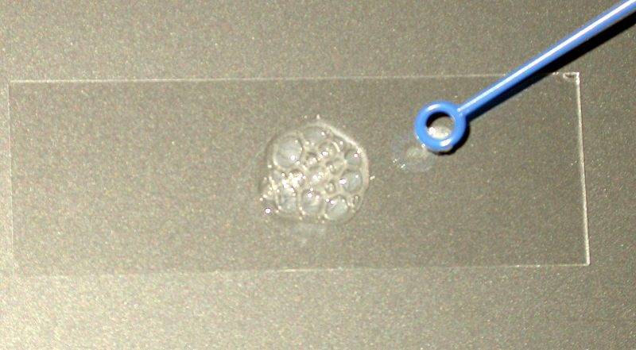
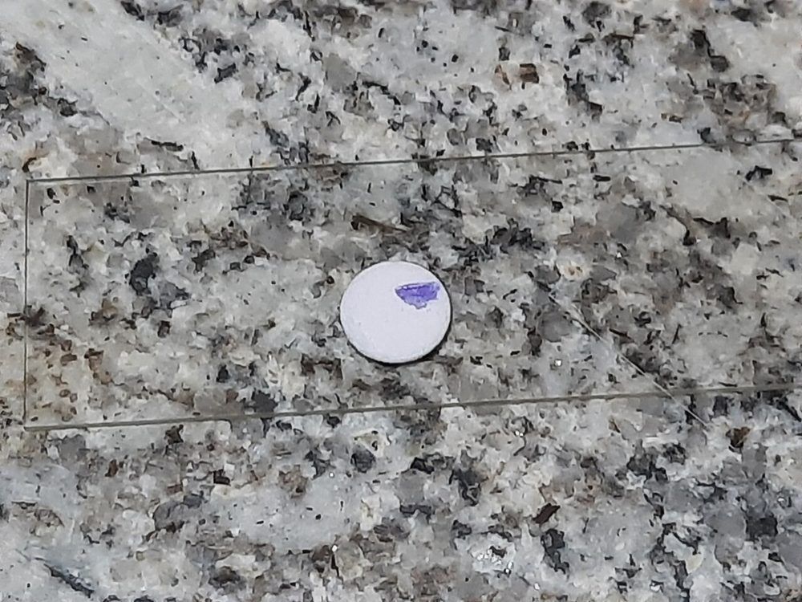
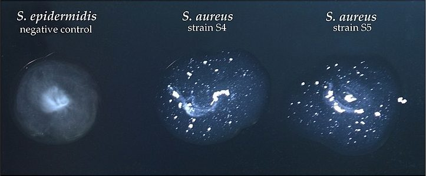
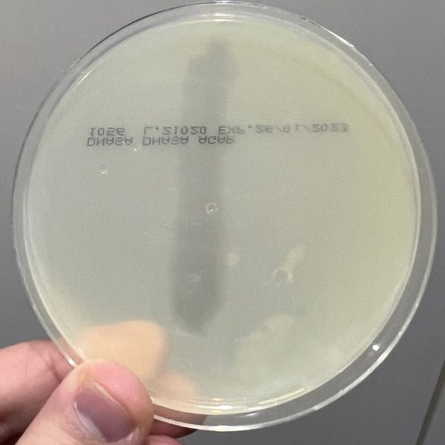

# تست‌های سریع و نقطه‌ای (Spot / Rapid Tests)

> نخستین تست‌ها پس از رنگ‌آمیزی گرم؛ چند ثانیه تا چند ساعت. **کلنی ۱۸–۲۴ ساعته** از محیط **غیرانتخابی** (آگار خون، TSA، شکلات) مگر خلاف آن ذکر شود.

## ⚠️ قواعد عمومی (منشأ بیشتر خطاها)
| قاعده | دلیل |
|---|---|
| **کاتالاز از آگار خون ← با احتیاط** (بالای کلنی، بدون برداشتن آگار) | RBC خودشان کاتالاز (پراکسیداز) دارند ← **مثبت کاذب** ضعیف |
| **اکسیداز از مک‌کانکی، EMB، TCBS، XLD ممنوع** | اسید/رنگ محیط ← منفی یا مثبت کاذب |
| **اکسیداز با لوپ نیکروم ممنوع** (پلاتین، پلاستیکی، چوبی) | اکسیداسیون معرف با فلز ← مثبت کاذب |
| **ایندول اسپات از مک‌کانکی ممنوع** | رنگدانه و نبود تریپتوفان کافی |
| کشت **کهنه** (بیش از ۴۸ ساعت) | آنزیم‌ها و رنگ‌پذیری تغییر می‌کنند |
| **کنترل مثبت و منفی** هم‌زمان با هر بچ/روز معرف | |

---

## ۲.۱ کاتالاز
- **اساس:** 2H₂O₂ ← 2H₂O + O₂ (**حباب**).
- **روش لام:** کلنی روی لام تمیز + **یک قطره H₂O₂ ۳٪** ← حباب فوری = مثبت. (روش معکوس: قطره روی کلنی در پلیت بدون خون؛ یا لوله.)
- **غلظت‌ها:** **۳٪** (روتین)؛ **۱۵٪** (بی‌هوازی‌ها، کاتالاز ضعیف)؛ **۳۰٪ (سوپراکسول)** (*Neisseria*، ← ۲.۱۰).
- **کاتالاز نیمه‌کمّی/حرارت‌پایدار (۶۸°C)**: مایکوباکتری‌ها (← ماژول مایکوباکتری‌ها).

| مثبت | منفی |
|---|---|
| **استافیلوکوکوس**، *Micrococcus*، *Rothia* (متغیر) | **استرپتوکوکوس**، **انتروکوکوس** (گاه **«شبه‌کاتالاز» ضعیف**)، *Aerococcus*، *Abiotrophia* |
| *Listeria*، *Corynebacterium*، *Bacillus*، *Nocardia* | *Erysipelothrix*، *Arcanobacterium*، *Lactobacillus*، *Gardnerella*، *Actinomyces* (اکثر) |
| Enterobacterales، *Pseudomonas*، *Neisseria*، *Moraxella* | *Kingella*، *Eikenella*، *Cardiobacterium*، *Streptobacillus* |
| *Campylobacter* (اکثر)، *Helicobacter* | |

- **QC:** *S. aureus* ATCC 25923 (+)؛ *E. faecalis* ATCC 29212 (−).
- **دام‌ها:** آگار خون (RBC)؛ H₂O₂ کهنه (منفی کاذب)؛ لوپ آهنی (مثبت کاذب)؛ آئروسل حباب (ایمنی؛ ترجیحاً در لوله یا داخل کابینت ایمنی زیستی).

---

**تصاویر:**

<table><tr><td align="center" width="50%"> <b>شکل ۱۲.۱۳.</b> کاتالاز مثبت روی لام: حباب فوری پس از افزودن H₂O₂ ۳٪ منبع: Nase، <a href="https://commons.wikimedia.org/wiki/File:Catalase_reaction.jpg">Wikimedia Commons</a>، <a href="http://creativecommons.org/licenses/by-sa/3.0/">CC BY-SA 3.0</a></td></tr></table>

## ۲.۲ اکسیداز (سیتوکروم c اکسیداز)
- **اساس:** سیتوکروم c اکسیداز ← اکسیداسیون **تترامتیل-p-فنیلن‌دی‌آمین (TMPD؛ معرف کواکس ۱٪)** ← **ارغوانی تیره (ایندوفنل)**.
- **روش:** کاغذ صافی مرطوب با معرف (یا سواب/دیسک تجاری)؛ مالیدن کلنی با چوب/پلاستیک ← **ارغوانی در ۱۰ ثانیه** = مثبت (مثبت دیرتر از ۱۰–۶۰ ثانیه ← منفی یا ضعیف؛ طبق IFU).

| مثبت | منفی |
|---|---|
| ***Pseudomonas***، *Burkholderia*، *Achromobacter* | **Enterobacterales** (به‌جز *Plesiomonas*) |
| ***Vibrio***، ***Aeromonas***، ***Plesiomonas*** | ***Acinetobacter*** (کلید شناسایی!) |
| ***Neisseria***، ***Moraxella***، *Kingella* | ***Stenotrophomonas*** (اکثر) |
| *Campylobacter*، *Helicobacter*، *Pasteurella*، *Eikenella*، *Cardiobacterium* | *Bordetella parapertussis* |
| *Bordetella pertussis*، *Brucella*، *Legionella* (ضعیف) | |

- **QC:** *P. aeruginosa* ATCC 27853 (+)؛ *E. coli* ATCC 25922 (−).
- **دام‌ها:** محیط‌های قندی/رنگی؛ لوپ فلزی؛ معرف **اکسیدشده** (آبی/ارغوانی در بطری)؛ برخی گرم منفی‌ها روی محیط‌های حاوی **نیترات یا گلوکز بالا** منفی کاذب.

---

**تصاویر:**

<table><tr><td align="center" width="50%"> <b>شکل ۱۲.۱۴.</b> اکسیداز مثبت: رنگ ارغوانی تیره روی دیسک/کاغذ صافی در ۱۰ ثانیه منبع: Ajay Kumar Chaurasiya، <a href="https://commons.wikimedia.org/wiki/File:Oxidase_Test_Positive.jpg">Wikimedia Commons</a>، <a href="https://creativecommons.org/licenses/by-sa/4.0">CC BY-SA 4.0</a></td></tr></table>

## ۲.۳ کوآگولاز (استافیلوکوکوس)

### دو سازوکار متفاوت (با هم اشتباه نشوند)
| ویژگی | **کوآگولاز متصل (Clumping factor، ClfA)** | **کوآگولاز آزاد (Free coagulase)** |
|---|---|---|
| محل | **سطح سلول** | **خارج سلول** (ترشحی) |
| سازوکار | اتصال مستقیم به **فیبرینوژن** ← پل بین سلول‌ها ← **آگلوتیناسیون** | اتصال به **پروترومبین** پلاسما ← **استافیلوترومبین** ← فیبرینوژن ← **فیبرین (لخته)** |
| آزمون | **لام** (اسلاید)؛ **لاتکس** | **لوله** |
| زمان | ۱۰–۲۰ ثانیه | ۴ ساعت (± ۲۴ ساعت) |

### روش لام (Slide)
- سوسپانسیون سنگین در قطرهٔ سالین (**کنترل: عدم خودآگلوتیناسیون**) + یک قطره **پلاسمای خرگوش EDTA** ← **کلامپ در ۱۰ ثانیه** = مثبت.
- منفی ← **حتماً تست لوله**.

### روش لوله (Tube) — **مرجع**
- **۰٫۵ mL پلاسمای خرگوش EDTA** + کلنی سنگین ← **۳۵–۳۷°C**؛ خوانش در **۴ ساعت** (کج کردن آرام لوله)؛ اگر منفی ← **دمای اتاق تا ۲۴ ساعت**.
- **هر درجه لخته** = مثبت.
- ⚠️ **فیبرینولیزین (استافیلوکیناز)** برخی سویه‌ها لخته را پس از تشکیل **حل می‌کند** ← خوانش ۴ ساعته را از دست ندهید.

### لاتکس و آگلوتیناسیون غیرفعال
- ذرات پوشیده با **فیبرینوژن + IgG** (پروتئین A) ± آنتی‌بادی **پلی‌ساکارید کپسولی** (کیت‌های نسل جدید برای MRSA کم‌بیان ClfA).
- سریع؛ ولی **مثبت کاذب** با *S. lugdunensis*، *S. schleiferi*، *S. saprophyticus* (گاه) و **منفی کاذب** با برخی MRSA.

| گونه | لام (ClfA) | لوله |
|---|---|---|
| ***S. aureus*** | + | **+** |
| *S. argenteus*، *S. schweitzeri* (*S. aureus* complex) | + | + (MALDI-TOF/مولکولی برای افتراق) |
| ***S. lugdunensis*** | **+** (اغلب) | **−** |
| *S. schleiferi* subsp. *schleiferi* | + | − |
| *S. pseudintermedius*، *S. intermedius* (حیوانی؛ گاز گرفتگی سگ) | v | **+** |
| *S. hyicus* (حیوانی) | − | v |
| CoNS (*S. epidermidis*…) | − | − |

- **QC:** *S. aureus* ATCC 25923 (+)؛ *S. epidermidis* ATCC 12228 (−).
- **دام‌ها:**
  - **پلاسمای سیتراته** + ارگانیسم مصرف‌کنندهٔ سیترات (*Enterococcus*، *Pseudomonas*) ← **لختهٔ کاذب** ← همیشه **EDTA**.
  - پلاسمای **انسانی** ممنوع (آنتی‌بادی، فاکتورها متغیر).
  - کلنی از **MSA** ← لاتکس نادرست.
  - **رنگ‌آمیزی گرم را تأیید کنید**: کوآگولاز روی گرم منفی بی‌معنی است.

---

**تصاویر:**

<table><tr><td align="center" width="50%"> <b>شکل ۱۲.۱۵.</b> کوآگولاز لام: لخته‌شدن <i>S. aureus</i> (وسط و راست)؛ <i>S. epidermidis</i> منفی (چپ) منبع: New HanseN.، <a href="https://commons.wikimedia.org/wiki/File:Coagulase_test_in_S._aureus_and_S._epidermidis.jpg">Wikimedia Commons</a>، <a href="https://creativecommons.org/licenses/by-sa/4.0">CC BY-SA 4.0</a></td></tr></table>

## ۲.۴ PYR (L-پیرولیدونیل آریل‌آمیداز)
- **اساس:** **L-پیرولیدونیل-β-نفتیل‌آمید** ← **β-نفتیل‌آمین** + معرف **p-دی‌متیل‌آمینوسینامالدهید (DMACA)** ← **قرمز گیلاسی** در **۱ دقیقه** = مثبت.
- **روش:** دیسک/کاغذ مرطوب (نه خیس)؛ کلنی سنگین؛ **۲ دقیقه** دمای اتاق؛ معرف ← خوانش ۱ دقیقه.

| مثبت | منفی |
|---|---|
| ***S. pyogenes*** (GAS) | سایر استرپتوکوکوس‌های بتا (B، C، G) |
| ***Enterococcus*** | **گروه *S. bovis*/*gallolyticus*** |
| ***Abiotrophia*/*Granulicatella***، *Gemella*، *Aerococcus viridans* | *Aerococcus urinae*، *Leuconostoc*، *Pediococcus* |
| ***S. lugdunensis***، *S. haemolyticus*، *S. schleiferi* | *S. aureus*، *S. epidermidis* (اکثر) |
| *Arcanobacterium haemolyticum* (v)، *Corynebacterium* (برخی) | |
| Enterobacterales: *Citrobacter*، *Klebsiella*، *Enterobacter*، *Serratia* | ***E. coli*** (منفی)، *Salmonella*، *Proteus* |

- **QC:** *E. faecalis* ATCC 29212 (+)؛ *S. agalactiae* ATCC 13813 (−).
- **دام:** کلنی از **آگار خون** با خون زیاد ← مثبت ضعیف/کاذب؛ خوانش دیر (بعد از ۱ دقیقه) ← کاذب.

---

## ۲.۵ LAP (لوسین آمینوپپتیداز)
- **اساس:** **لوسین-β-نفتیل‌آمید** ← β-نفتیل‌آمین + **DMACA** ← **قرمز** (مانند PYR).
- **کاربرد:** کوکسی‌های گرم مثبت **کاتالاز منفی**، به‌ویژه همراه PYR:

| ارگانیسم | PYR | LAP |
|---|---|---|
| *Streptococcus*، *Enterococcus* | v / + | **+** |
| ***Aerococcus viridans*** | + | **−** |
| ***Aerococcus urinae*** | − | **+** |
| ***Leuconostoc*** (ونکومایسین R) | − | **−** |
| *Pediococcus* (ونکومایسین R) | − | + |
| *Gemella* | + | v |
| *Abiotrophia*/*Granulicatella* | + | + |

- **QC:** *E. faecalis* ATCC 29212 (+)؛ *A. viridans* (−).

---

## ۲.۶ ایندول اسپات (Spot Indole)
- **اساس:** تریپتوفاناز ← **ایندول** + معرف **DMACA ۱٪** ← **آبی-سبز** (مثبت)؛ **صورتی/بی‌رنگ** (منفی). (معرف کواکس هم قابل‌استفاده: قرمز.)
- **روش:** کلنی از **آگار خون یا شکلات** (حاوی تریپتوفان) روی کاغذ صافی مرطوب با معرف.
- **مثبت:** ***E. coli*** (≈ ۹۹٪؛ شناسایی احتمالی سریع *E. coli*: گرم منفی، اکسیداز −، ایندول +، همولیز β یا لاکتوز +)، *P. vulgaris*، *Morganella*، *Providencia*، *K. oxytoca*، *Aeromonas*، *Vibrio*، *Pasteurella multocida*، *Haemophilus* (برخی بیوتیپ‌ها)، ***Porphyromonas***، *F. nucleatum*، *C. sordellii*، *Cutibacterium acnes* (نام قدیم *Propionibacterium acnes*). **منفی:** *P. mirabilis*، *K. pneumoniae*، *Salmonella*، *Enterobacter*، *Pseudomonas*.
- **QC:** *E. coli* ATCC 25922 (+)؛ *K. pneumoniae* ATCC 13883 (−).
- **دام:** کلنی‌های **مخلوط** (*E. coli* در کنار) ← مثبت کاذب؛ پلیت‌های **کم‌تریپتوفان** (مک‌کانکی) ← منفی کاذب.

---

## ۲.۷ حلالیت در صفرا (Bile Solubility) — *S. pneumoniae*
- **اساس:** **سدیم دزوکسی‌کولات** ← فعال‌سازی **اتولیزین (LytA)** پنوموکوکوس ← **لیز سلول**.
- **روش پلیت:** یک قطره **دزوکسی‌کولات ۱۰٪** روی کلنی؛ ۳۵°C، **۱۵–۳۰ دقیقه** (پلیت افقی) ← **ناپدید/صاف شدن کلنی** = مثبت.
- **روش لوله (مرجع):** سوسپانسیون سنگین (≈ ۰٫۵–۱ مک‌فارلند) ۰٫۵ mL + **۰٫۵ mL دزوکسی‌کولات ۲٪** (و لولهٔ کنترل با سالین)؛ ۳۵°C تا **۳ ساعت** ← **شفاف شدن** = مثبت.
- **QC:** *S. pneumoniae* ATCC 49619 (+)؛ *E. faecalis* ATCC 29212 (−).
- **دام‌ها:** شستن کلنی با قطرهٔ زیاد (جابه‌جایی ≠ حل‌شدن)؛ pH محیط پایین؛ **پنوموکوکوس‌های غیرکپسول‌دار/بیلی-مقاوم** (نادر)؛ ***S. pseudopneumoniae*** و برخی *S. mitis* (مثبت ضعیف) ← MALDI-TOF ممکن است اشتباه کند (← [05_Identification_Systems.md](05_Identification_Systems.md)).

---

## ۲.۸ هیپورات (Hippurate Hydrolysis)
- **اساس:** هیپوریکاز ← **بنزوات + گلیسین** ← **نین‌هیدرین** با گلیسین ← **ارغوانی تیره** (روش سریع ۲ ساعته).
- **روش:** سوسپانسیون سنگین در **۰٫۴ mL سدیم هیپورات ۱٪**؛ ۳۵°C، **۲ ساعت**؛ + **۰٫۲ mL نین‌هیدرین** ← ۱۰ دقیقه دیگر ← **بنفش تیره** = مثبت (آبی کمرنگ = منفی).
- **مثبت:** ***S. agalactiae*** (GBS)، ***Campylobacter jejuni*** (*C. coli* و *C. lari* منفی)، *Gardnerella vaginalis*، *L. monocytogenes*، *Legionella pneumophila*.
- **QC:** *S. agalactiae* ATCC 13813 (+)؛ *S. pyogenes* ATCC 19615 (−).
- **دام:** **تلقیح کم** ← منفی کاذب؛ ⚠️ **محیط حاوی پپتون/اسیدآمینه** (انتقال آگار) ← مثبت کاذب با نین‌هیدرین؛ ***C. jejuni* هیپورات منفی** (≈ ۵–۱۰٪) ← MALDI-TOF/PCR.

---

## ۲.۹ بوتیرات استراز (Tributyrin / Indoxyl Butyrate)
- **اساس:** استراز ← **ایندوکسیل بوتیرات** ← **ایندوکسیل** ← **آبی-سبز**.
- **روش:** دیسک/قرص؛ کلنی؛ ۵ دقیقه (طبق IFU).
- **کاربرد:** ***M. catarrhalis*** (**+**) در برابر *Neisseria* (−).
- **QC:** *M. catarrhalis* ATCC 25238 (+)؛ *N. gonorrhoeae* ATCC 43069 (−).

---

## ۲.۱۰ سوپراکسول (H₂O₂ ۳۰٪)
- قطره روی کلنی ← **حباب فوری و شدید («انفجاری»)** = قوی مثبت.
- ***N. gonorrhoeae*: ۴+ (قوی)**؛ *N. meningitidis*: ضعیف تا متوسط؛ *M. catarrhalis*: قوی؛ *Kingella*: منفی (کاتالاز −).
- **غربالگری** است، **نه تأیید** ← تست‌های تأییدی (قند، آنزیم، MALDI-TOF).
- ⚠️ H₂O₂ ۳۰٪ **سوزاننده** است؛ دستکش و عینک.

---

## ۲.۱۱ DNase
- **محیط:** **DNase آگار** با **متیل گرین** (DNA پلیمر سبز ← هیدرولیز ← **هالهٔ شفاف/بی‌رنگ**) یا **تولوئیدین بلو** (هالهٔ **صورتی**)؛ یا روش **HCl ۱N** روی آگار بدون رنگ (هالهٔ شفاف).
- ۳۵°C، ۱۸–۲۴ ساعت.
- **مثبت:** ***S. aureus***، ***Serratia marcescens***، ***M. catarrhalis***، *S. pyogenes* (DNase B؛ پایهٔ تست anti-DNase B)، *S. schleiferi*، *Aeromonas*، *S. maltophilia*. **منفی:** CoNS (اکثر)، *Enterobacter*، *Neisseria* (اکثر).
- **QC:** *S. aureus* ATCC 25923 (+)؛ *S. epidermidis* ATCC 12228 (−).
- **ترمونوکلئاز (TNase)**: پایدار به حرارت (جوشاندن ۱۵ دقیقه) ← **اختصاصی‌تر** برای *S. aureus* (و *S. schleiferi*، *S. intermedius*).

---

**تصاویر:**

<table><tr><td align="center" width="50%"> <b>شکل ۱۲.۱۶.</b> DNase مثبت: هالهٔ شفاف اطراف رشد پس از افزودن HCl منبع: JORDI PRAT FONT، <a href="https://commons.wikimedia.org/wiki/File:Positive_DNAse_test_on_a_suspected_S._aureus_sample.jpg">Wikimedia Commons</a>، <a href="https://creativecommons.org/licenses/by-sa/4.0">CC BY-SA 4.0</a></td></tr></table>

## ۲.۱۲ ONPG (β-گالاکتوزیداز)
- **اساس:** **o-نیتروفنیل-β-D-گالاکتوپیرانوزید** ← **o-نیتروفنل زرد**.
- **کاربرد:** کشف **تخمیرکنندگان دیررس لاکتوز** (دارای β-گالاکتوزیداز ولی فاقد **پرمئاز**): *Citrobacter*، *Serratia*، *Hafnia*، ***S. sonnei*** (+؛ بیشتر *Shigella*های دیگر −، به‌جز برخی سروتیپ‌های *S. dysenteriae* و *S. boydii*)، *Salmonella* زیرگونهٔ III (arizonae) (+)؛ ***N. lactamica*** (+) در برابر *N. meningitidis* (−)؛ *Burkholderia* و *Vibrio*.
- **روش:** دیسک/براث ONPG؛ سوسپانسیون سنگین؛ ۳۵°C، **۱–۴ ساعت** (تا ۲۴) ← **زرد** = مثبت.
- **QC:** *E. coli* ATCC 25922 (+)؛ *P. mirabilis* ATCC 12453 یا *S.* Typhimurium ATCC 14028 (−).

---

## ۲.۱۳ اوره‌آز سریع
- قرص/براث اوره با بافر کم؛ سوسپانسیون **سنگین**؛ **۱۵ دقیقه تا ۴ ساعت** ← **صورتی** = مثبت.
- **کاربرد:** *Proteus*/*Morganella* (سریع)، ***Cryptococcus***، ***Brucella*** (سریع)، *B. bronchiseptica*، *C. urealyticum*، ***H. pylori*** (کلنی؛ و **تست اوره‌آز سریع بیوپسی: CLO-test**).
- محیط اوره کامل ← [11_Culture_Media/08](../11_Culture_Media/08_Biochemical_Tube_Media.md).

---

## ۲.۱۴ آزمون نخ (String Test) — *Vibrio*
- کلنی در قطرهٔ **سدیم دزوکسی‌کولات ۰٫۵٪** روی لام ← **۶۰ ثانیه** ← بالا کشیدن لوپ ← **نخ موکوئید ≥ ۲–۳ cm** = مثبت (لیز سلول و آزاد شدن DNA).
- **مثبت:** ***Vibrio*** (اکثر) ← افتراق از ***Aeromonas*** (منفی یا ضعیف) و *Plesiomonas* (منفی).
- **QC:** *V. parahaemolyticus* ATCC 17802 (+)؛ *A. hydrophila* ATCC 7966 (−).

---

## ۲.۱۵ هیدرولیز ایندوکسیل استات
- دیسک ایندوکسیل استات؛ کلنی؛ ۵–۳۰ دقیقه ← **آبی-سبز** (+).
- **کاربرد:** ***Campylobacter***: *C. jejuni* (+)، *C. coli* (+)، *C. upsaliensis* (+)، **_C. lari_ (−)**، *C. fetus* (−)؛ ***H. pylori* (−)**.
- **QC:** *C. jejuni* ATCC 33291 (+).

---

## ۲.۱۶ نیتروسفین (بتالاکتاماز)
← [AST/02_Beta_Lactamases/02_Staph_Penicillinase.md](../AST/02_Beta_Lactamases/02_Staph_Penicillinase.md) (*Haemophilus*، *Moraxella*، گونوکوکوس، بی‌هوازی‌ها، استافیلوکوکوس).

---

## جدول مرجع سریع

| تست | معرف/سوبسترا | مثبت | زمان | کاربرد کلیدی |
|---|---|---|---|---|
| کاتالاز | H₂O₂ ۳٪ | حباب | فوری | استافیلوکوکوس/استرپتوکوکوس؛ *Listeria*/*Erysipelothrix* |
| اکسیداز | TMPD ۱٪ | ارغوانی | ≤ ۱۰ ثانیه | Enterobacterales/غیرتخمیری‌ها؛ *Acinetobacter* (−) |
| کوآگولاز لام | پلاسمای خرگوش EDTA | کلامپ | ۱۰ ثانیه | *S. aureus*، *S. lugdunensis* |
| کوآگولاز لوله | پلاسمای خرگوش EDTA | لخته | ۴ (± ۲۴) ساعت | *S. aureus* |
| PYR | L-پیرولیدونیل-β-NA + DMACA | قرمز | ۲ + ۱ دقیقه | GAS، انتروکوکوس |
| LAP | لوسین-β-NA + DMACA | قرمز | ۵ دقیقه | *Aerococcus*، *Leuconostoc* |
| ایندول اسپات | DMACA | آبی-سبز | فوری | *E. coli* |
| حلالیت صفرا | دزوکسی‌کولات | لیز | ۱۵ دقیقه – ۳ ساعت | پنوموکوکوس |
| هیپورات | هیپورات + نین‌هیدرین | بنفش | ۲ ساعت | GBS، *C. jejuni* |
| بوتیرات | ایندوکسیل بوتیرات | آبی | ۵ دقیقه | *M. catarrhalis* |
| سوپراکسول | H₂O₂ ۳۰٪ | انفجاری | فوری | گونوکوکوس (غربالگری) |
| DNase | DNA + متیل گرین | هالهٔ شفاف | ۲۴ ساعت | *S. aureus*، *Serratia*، *Moraxella* |
| ONPG | ONPG | زرد | ۱–۴ ساعت | تخمیرکنندگان دیررس، *N. lactamica* |
| نخ | دزوکسی‌کولات ۰٫۵٪ | نخ | ۶۰ ثانیه | *Vibrio* |
| ایندوکسیل استات | ایندوکسیل استات | آبی | ۵–۳۰ دقیقه | *Campylobacter* |

