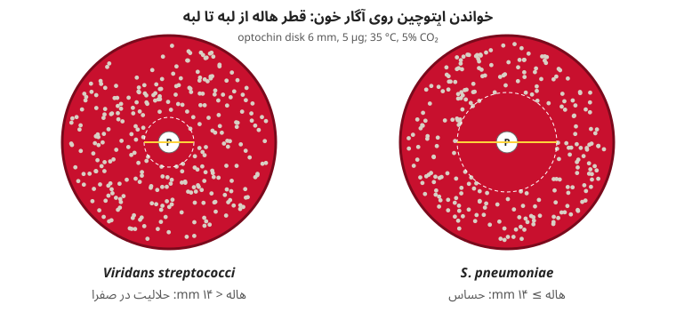
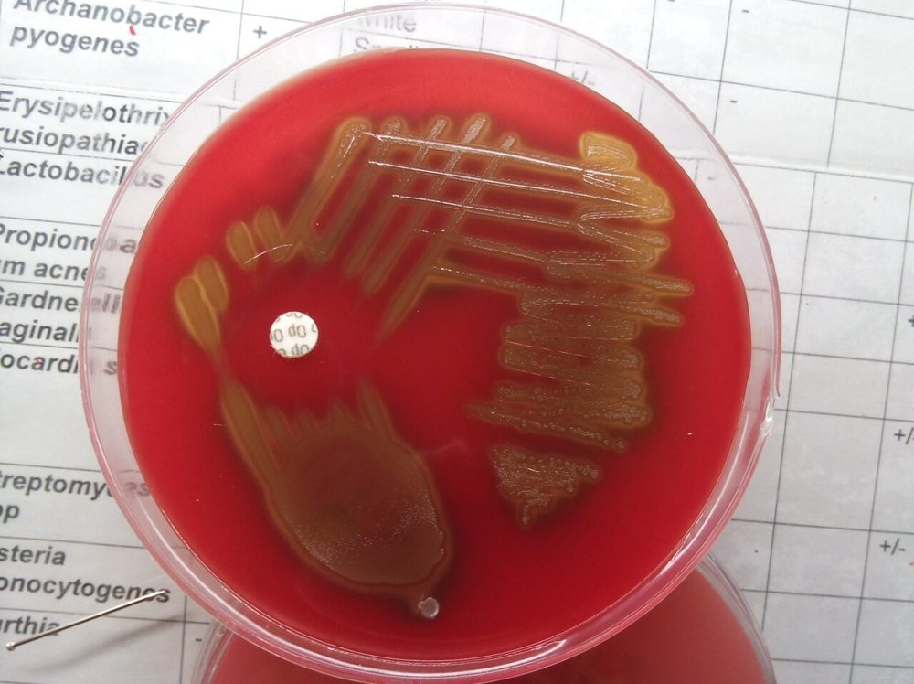
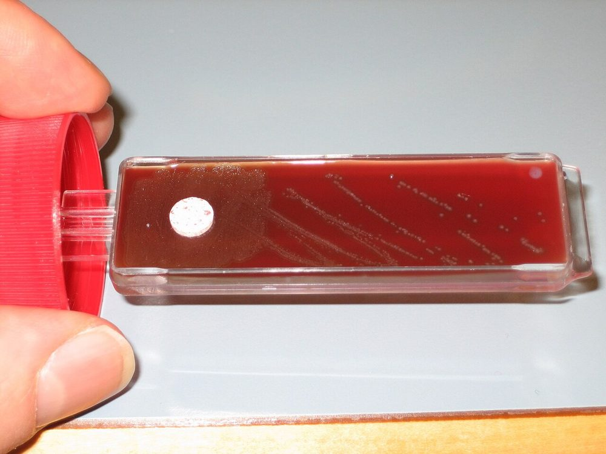
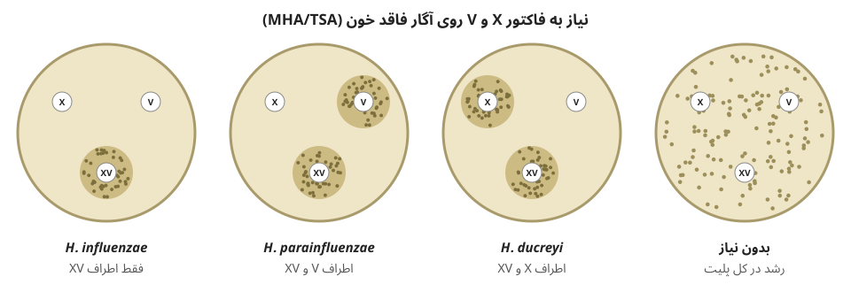
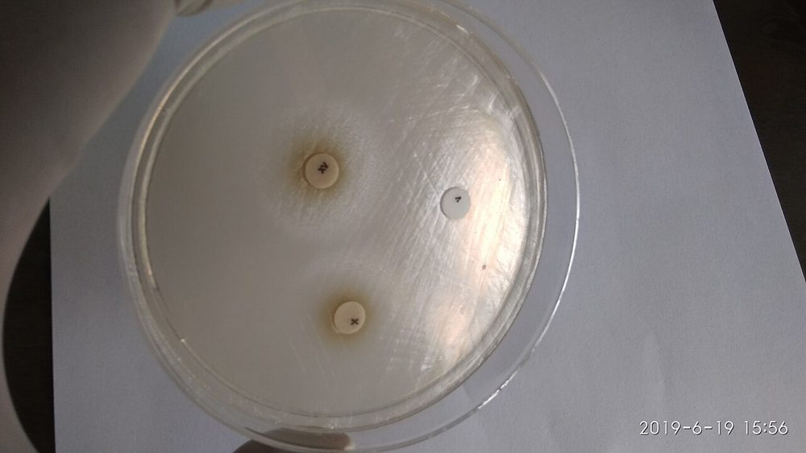
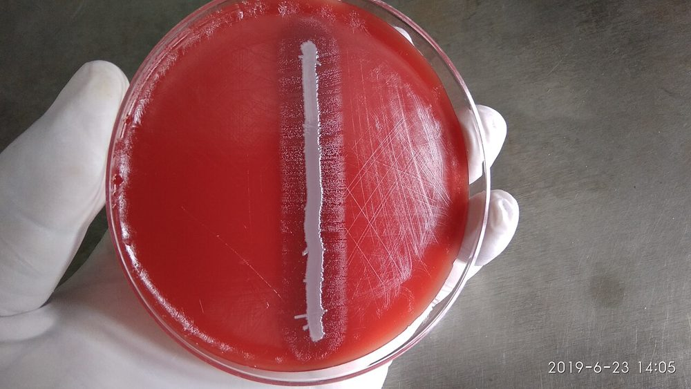
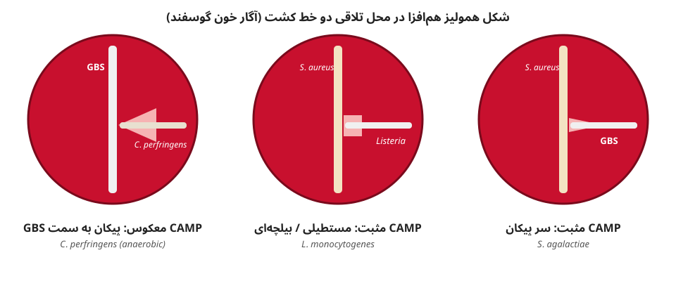
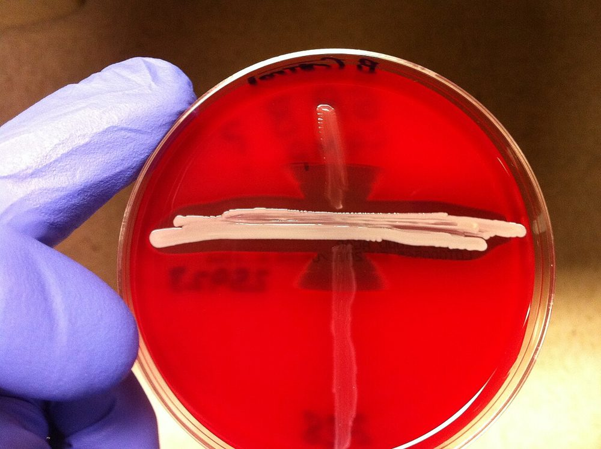
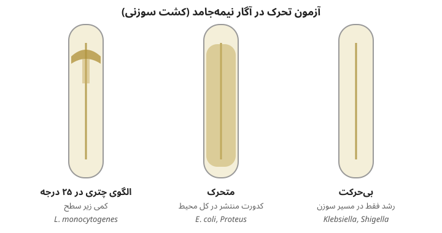

# تست‌های دیسکی، رشدی و فیزیولوژیک

> تست‌هایی که بر پایهٔ **حساسیت به یک ماده (دیسک)**، **نیاز رشدی**، **هم‌افزایی**، یا **شرایط رشد** (اکسیژن، دما، نمک) هستند. همه روی **کلنی خالص**.

---

## ۳.۱ اپتوچین (Optochin, Ethylhydrocupreine)
- **دیسک ۶ mm (۵ µg)** روی **آگار خون گوسفند**؛ کشت چمنی از ۳–۴ کلنی؛ ۳۵°C، **۵٪ CO₂**، ۱۸–۲۴ ساعت.
- **تفسیر:** هالهٔ **≥ ۱۴ mm** ← **حساس** ← ***S. pneumoniae*** (احتمالی). (دیسک ۱۰ mm: ≥ ۱۶ mm.)
- هالهٔ **کمتر از ۱۴ mm** ← **حلالیت در صفرا** (← [02_Spot_Rapid_Tests.md](02_Spot_Rapid_Tests.md) ۲.۷).
- **QC:** *S. pneumoniae* ATCC 49619 (حساس)؛ *E. faecalis* ATCC 29212 یا *S. mitis* (مقاوم).
- **دام‌ها:**
  - **CO₂** هاله را **کوچک‌تر** می‌کند (برخی پنوموکوکوس‌ها ۱۰–۱۳ mm) ← حلالیت صفرا.
  - **پنوموکوکوس‌های مقاوم به اپتوچین** (جهش *atpC/atpA*) گزارش شده‌اند.
  - برخی ***S. mitis*/*S. oralis*/*S. pseudopneumoniae*** هالهٔ مرزی (به‌ویژه در هوا) دارند.

**تصاویر:**

> **شکل ۱۲.۱۷.** خواندن آزمون اپتوچین — منبع: رسم آموزشی همین مخزن (شماتیک؛ مقیاس واقعی نیست)

<table><tr><td align="center" width="50%"> <b>شکل ۱۲.۱۸.</b> هالهٔ مهار اطراف دیسک اپتوچین (<i>S. pneumoniae</i>، آگار خون) منبع: Gsbhalla، <a href="https://commons.wikimedia.org/wiki/File:S._pneumoniae.jpg">Wikimedia Commons</a>، <a href="https://creativecommons.org/licenses/by-sa/4.0">CC BY-SA 4.0</a></td></tr></table>

## ۳.۲ باسیتراسین (۰٫۰۴ واحد، Taxo A)
- آگار خون، کشت چمنی؛ ۳۵°C، ۱۸–۲۴ ساعت.
- **استرپتوکوکوس بتا:** **هر هالهٔ مهار** = حساس ← ***S. pyogenes*** (احتمالی). ⚠️ ۵–۱۵٪ استرپتوکوکوس‌های گروه C و G هم حساس‌اند و برخی GAS مقاوم ← **PYR** یا **لانسفیلد** ارجح است.
- **استافیلوکوکوس در برابر *Micrococcus***: *Micrococcus* **حساس** (≥ ۱۰ mm)؛ استافیلوکوکوس **مقاوم** (کمتر از ۱۰ mm). (همراه **فورازولیدون ۱۰۰ µg**: استافیلوکوکوس حساس، *Micrococcus* مقاوم؛ و **اکسیداز اصلاح‌شده**: *Micrococcus* +.)
- **QC:** *S. pyogenes* ATCC 19615 (حساس)؛ *S. agalactiae* ATCC 13813 (مقاوم).

**تصاویر:**

<table><tr><td align="center" width="50%"> <b>شکل ۱۲.۱۹.</b> دیسک باسیتراسین روی کشت استرپتوکوکوس بتاهمولیتیک (آگار خون کلمبیا) منبع: Pöllö، <a href="https://commons.wikimedia.org/wiki/File:Columbia_blood_agar_plate_to_test_betahemolytic_streptococci.jpg">Wikimedia Commons</a>، <a href="https://creativecommons.org/licenses/by/3.0">CC BY 3.0</a></td></tr></table>

## ۳.۳ نووبیوسین (۵ µg)
- **MHA یا آگار خون**؛ هالهٔ **≤ ۱۶ mm** = **مقاوم** ← ***S. saprophyticus*** (در ایزولهٔ ادراری زن جوان). (*S. cohnii*، *S. xylosus* هم مقاوم‌اند.)
- **QC:** *S. saprophyticus* ATCC 15305 (مقاوم)؛ *S. epidermidis* ATCC 12228 (حساس).

## ۳.۴ دیسک‌های ویژهٔ بی‌هوازی (Special-Potency Disks)
- روی **آگار خون بی‌هوازی** (بروسلا)؛ **ونکومایسین ۵ µg**، **کانامایسین ۱ mg**، **کولیستین ۱۰ µg**؛ بی‌هوازی، ۴۸ ساعت.
- **هالهٔ ≥ ۱۰ mm = حساس (S)**.
- **کاربرد:** (۱) **تأیید رنگ‌آمیزی گرم** (بی‌هوازی‌ها گاه گرم‌متغیرند)؛ (۲) **گروه‌بندی** گرم منفی‌ها.

| گروه | ونکومایسین ۵ | کانامایسین ۱۰۰۰ | کولیستین ۱۰ |
|---|---|---|---|
| **گرم مثبت‌ها** (حتی اگر گرم منفی دیده شوند؛ مثلاً *Enterocloster clostridioformis* (نام قدیم *C. clostridioforme*)، *Thomasclavelia ramosa* (نام قدیم *C. ramosum*)) | **S** | v | **R** |
| **گروه *B. fragilis*** | R | **R** | **R** |
| ***Porphyromonas*** | **S** | R | R |
| ***Prevotella*** | R | R | v |
| ***Fusobacterium*** | R | **S** | **S** |
| ***Veillonella*** (کوکسی گرم منفی) | R | S | S |
| *Bilophila* | R | S | S |

- **SPS (سدیم پلی‌آنتول سولفونات ۵٪)**: ***Peptostreptococcus anaerobius*** **حساس** (≥ ۱۲ mm) ← افتراق از سایر کوکسی‌های گرم مثبت بی‌هوازی.
- **QC:** *B. fragilis* ATCC 25285 (R/R/R)؛ *C. perfringens* ATCC 13124 (S/S/R)؛ *F. necrophorum* ATCC 25286 (R/S/S).

## ۳.۵ فاکتورهای X و V، و آزمون پورفیرین (*Haemophilus*)
### X و V (دیسک یا نوار)
- سوسپانسیون در سالین (بدون انتقال آگار) ← کشت چمنی روی **MHA یا TSA** (فاقد X و V) ← دیسک‌های **X**، **V** و **XV** با فاصلهٔ ۱–۲ cm؛ ۳۵°C، CO₂، ۱۸–۲۴ ساعت ← **رشد فقط اطراف** دیسک(ها).

| گونه | X | V | همولیز (خون اسب) | پورفیرین |
|---|---|---|---|---|
| ***H. influenzae*** | **+** | **+** | − | **−** |
| *H. haemolyticus* | + | + | **+** | − |
| ***H. parainfluenzae*** | **−** | **+** | − | **+** |
| *H. parahaemolyticus* | − | + | + | + |
| ***H. ducreyi*** | **+** | − | − | − |
| *Aggregatibacter aphrophilus* | − | − | − | + |

### آزمون پورفیرین (ALA؛ δ-آمینولوولینیک اسید)
- **اساس:** ارگانیسمی که **همین را خودش می‌سازد** (نیاز به X **ندارد**) ALA را به **پورفوبیلینوژن و پورفیرین‌ها** تبدیل می‌کند.
- سوسپانسیون سنگین در **ALA**؛ ۳۵°C، **۴ ساعت** ← **فلورسانس قرمز** زیر **UV ۳۶۰ nm** یا **رنگ قرمز با معرف کواکس** = **مثبت** (نیاز X ندارد).
- ✓ **قابل‌اعتمادتر از دیسک X** (انتقال همین از آگار شکلات ← رشد کاذب اطراف دیسک V ← اشتباه *H. influenzae* با *H. parainfluenzae*).
- **QC:** *H. influenzae* ATCC 49247 یا 10211 (منفی؛ X+V)؛ *H. parainfluenzae* ATCC 7901 (مثبت؛ فقط V).

### اقمار (Satellitism)
- خط کشت ***S. aureus*** روی **آگار خون گوسفند** که با ارگانیسم مشکوک چمن شده ← رشد **فقط اطراف خط *S. aureus*** (آزاد شدن V با همولیز + NAD از استافیلوکوکوس).
- **مثبت:** *H. influenzae*، *H. parainfluenzae*، ***Abiotrophia*/*Granulicatella*** (نیاز به **پیریدوکسال**).

**تصاویر:**

> **شکل ۱۲.۲۰.** الگوهای رشد اطراف دیسک‌های X، V و XV — منبع: رسم آموزشی همین مخزن (شماتیک؛ مقیاس واقعی نیست)

<table><tr><td align="center" width="50%"> <b>شکل ۱۲.۲۱.</b> رشد <i>H. influenzae</i> فقط اطراف دیسک XV منبع: Ajay Kumar Chaurasiya، <a href="https://commons.wikimedia.org/wiki/File:Haemophilus_influenzae_growth_around_XV_growth_factor_disk.jpg">Wikimedia Commons</a>، <a href="https://creativecommons.org/licenses/by-sa/4.0">CC BY-SA 4.0</a></td><td align="center" width="50%"> <b>شکل ۱۲.۲۲.</b> اقمار: رشد <i>H. influenzae</i> فقط در کنار خط <i>S. aureus</i> منبع: Ajay Kumar Chaurasiya، <a href="https://commons.wikimedia.org/wiki/File:Satellitism_test_-positive_Haemophilus_influenzae.jpg">Wikimedia Commons</a>، <a href="https://creativecommons.org/licenses/by-sa/4.0">CC BY-SA 4.0</a></td></tr></table>

## ۳.۶ آزمون CAMP و CAMP معکوس
### CAMP
- آگار خون گوسفند؛ **خط عمودی *S. aureus* تولیدکنندهٔ β-لیزین** (طبق SOP؛ مثلاً ATCC 25923) ← ارگانیسم مشکوک **عمود** بر آن، با فاصلهٔ **۲–۳ mm** (بدون تماس)؛ ۳۵°C، **هوا** (CO₂ ← مثبت کاذب برای GAS)، ۱۸–۲۴ ساعت.
- **عامل CAMP** + **β-لیزین (اسفنگومیلیناز)** ← همولیز هم‌افزا.

| ظاهر | ارگانیسم |
|---|---|
| **سر پیکان (arrowhead)** | ***S. agalactiae*** (GBS) |
| **بیلچه/مستطیلی (shovel/block)** | ***Listeria monocytogenes*** |
| همولیز هم‌افزا | *Rhodococcus equi* (با *S. aureus*)، *Cutibacterium*، برخی *Corynebacterium* (*C. ulcerans*: معکوس) |

- **CAMP سریع (۵–۱۵ دقیقه):** دیسک/قطرهٔ **β-لیزین** روی کلنی.
- **QC:** *S. agalactiae* ATCC 13813 (+)؛ *S. pyogenes* ATCC 19615 (−).

### CAMP معکوس (Reverse CAMP)
- خط ***S. agalactiae*** + ارگانیسم مشکوک عمود ← همولیز به شکل **پیکان به سمت خط GBS** (عامل CAMP GBS با لسیتیناز *C. perfringens*).
- **مثبت:** ***C. perfringens*** (بی‌هوازی)؛ ***Arcanobacterium haemolyticum*** (فسفولیپاز D **مهار** همولیز β-لیزین *S. aureus* = **CAMP مهاری**)؛ *C. pseudotuberculosis* و *C. ulcerans* (فسفولیپاز D، مهار با *S. aureus*).

**تصاویر:**

> **شکل ۱۲.۲۳.** CAMP و CAMP معکوس — منبع: رسم آموزشی همین مخزن (شماتیک؛ مقیاس واقعی نیست)

<table><tr><td align="center" width="50%"> <b>شکل ۱۲.۲۴.</b> CAMP مثبت: همولیز هم‌افزا که به سمت خط <i>S. aureus</i> پهن می‌شود (<i>S. agalactiae</i>) منبع: Blueiridium، <a href="https://commons.wikimedia.org/wiki/File:CAMP_test.JPG">Wikimedia Commons</a>، <a href="http://creativecommons.org/publicdomain/zero/1.0/deed.en">CC0</a></td></tr></table>

## ۳.۷ آزمون ناگلر (Nagler)
- **آگار زردهٔ تخم‌مرغ**؛ نیمی از پلیت با **آنتی‌توکسین α (فسفولیپاز C) *C. perfringens*** پوشانده؛ ارگانیسم روی هر دو نیمه؛ بی‌هوازی ۲۴–۴۸ ساعت.
- **لسیتیناز در نیمهٔ بدون آنتی‌توکسین، مهار در نیمهٔ دارای آنتی‌توکسین** = ***C. perfringens*** (و *C. bifermentans*، *C. sordellii*، *C. baratii* که لسیتیناز آن‌ها را آنتی‌توکسین مهار می‌کند).
- محیط: ← [11_Culture_Media/06_Anaerobic.md](../11_Culture_Media/06_Anaerobic.md) بخش ۶.۶.

## ۳.۸ هوازی‌تحملی (Aerotolerance)
- هر مورفوتیپ از پلیت بی‌هوازی ← ساب‌کالچر روی: (۱) **آگار خون/شکلات + CO₂** (هوازی)، (۲) **آگار خون بی‌هوازی**.

| رشد هوازی (CO₂) | رشد بی‌هوازی | تفسیر |
|---|---|---|
| − | + | **بی‌هوازی اجباری** |
| + | + | **بی‌هوازی اختیاری** (یا هوازی) |
| + (فقط CO₂، نه هوا) | + | **کپنوفیل**/میکروآئروفیل (*Actinomyces*، *Capnocytophaga*، *Eikenella*) |

- ⚠️ ***C. tertium*، *C. carnis*، *C. histolyticum*** هوازی‌تحمل‌اند (رشد هوازی **بدون اسپور**)؛ *Actinomyces* و *Cutibacterium* اغلب در CO₂ رشد می‌کنند.

## ۳.۹ تحرک (Motility)
| روش | توضیح |
|---|---|
| **لام مرطوب / قطرهٔ آویزان** | براث جوان (۲–۴ ساعته) یا کلنی تازه در آب؛ تحرک **واقعی** (جابه‌جایی جهت‌دار) در برابر **براونی** (لرزش درجا) |
| **آگار نیمه‌جامد** (SIM، MIO، Motility Test Medium ± TTC) | رشد منتشر از خط کشت (← [11_Culture_Media/08](../11_Culture_Media/08_Biochemical_Tube_Media.md)) |

| الگو | ارگانیسم |
|---|---|
| **غلتان (tumbling)** در لام؛ **چتری (umbrella)** زیر سطح در ۲۵°C | ***Listeria monocytogenes*** |
| متحرک **۲۵°C**، بی‌حرکت **۳۷°C** | ***Yersinia enterocolitica***، *Listeria* |
| **تیرمانند (darting)** | ***Campylobacter***، ***Vibrio*** |
| **پیچ‌پیچی/فنری (corkscrew)** | ***Campylobacter***، اسپیروکت‌ها (میدان تاریک) |
| بی‌حرکت | *Klebsiella*، *Shigella*، *Acinetobacter*، *Pasteurella*، *B. anthracis* (برخلاف *B. cereus*) |

- **رنگ‌آمیزی تاژک (Leifson/Ryu)**: آرایش تاژک (قطبی، پری‌تریش) در غیرتخمیری‌ها.

**تصاویر:**

> **شکل ۱۲.۲۵.** الگوهای تحرک در آگار نیمه‌جامد — منبع: رسم آموزشی همین مخزن (شماتیک؛ مقیاس واقعی نیست)

## ۳.۱۰ رشد در دما و نمک
| آزمون | مثبت | منفی | کاربرد |
|---|---|---|---|
| **۴۲°C** | ***P. aeruginosa***، ***C. jejuni/coli***، *A. baumannii* | *P. fluorescens*، *P. putida*، *C. fetus* | غیرتخمیری‌ها، کمپیلوباکتر |
| **۲۵°C** (۴۸ ساعت) | *C. fetus* | *C. jejuni* | کمپیلوباکتر |
| **۴°C** (غنی‌سازی سرد) | *Listeria*، *Yersinia* | | جداسازی از نمونه‌های پرفلور |
| **NaCl ۰٪** (براث پپتون بدون نمک) | ***V. cholerae***، *V. mimicus*، *Aeromonas*، *Plesiomonas* | *Vibrio*های **هالوفیل** (*V. parahaemolyticus*، *V. vulnificus*، *V. alginolyticus*) | *Vibrio* |
| **NaCl ۶–۸٪** | *V. parahaemolyticus*، *V. alginolyticus* (۱۰٪ هم) | *V. cholerae*، *Aeromonas* | |
| **NaCl ۶٫۵٪** | انتروکوکوس، استافیلوکوکوس | *S. bovis*، ویریدانس | ← [11_Culture_Media/08](../11_Culture_Media/08_Biochemical_Tube_Media.md) |

## ۳.۱۱ اسپور
- **مشاهدهٔ مستقیم:** رنگ‌آمیزی **شفر–فولتون (مالاشیت گرین)**: اسپور **سبز**، سلول **قرمز**؛ یا جاهای **روشن (ghost)** در رنگ‌آمیزی گرم. محل: **انتهایی گرد** (*C. tetani*: **چوب‌طبل**)، **زیرانتهایی** (*C. sporogenes*، *C. botulinum*)، **مرکزی**.
- **شوک حرارتی** (۸۰°C، ۱۰ دقیقه) یا **الکلی** (اتانول ۹۵٪ هم‌حجم نمونه، ۱ ساعت) ← کشت ← **رشد = اسپوردار**.
- ⚠️ ***C. perfringens*** و ***T. ramosa*** و *E. clostridioformis* **به‌ندرت در محیط کشت اسپور می‌سازند**.
- *Bacillus* (هوازی) و *Clostridium* (بی‌هوازی؛ به‌جز گونه‌های هوازی‌تحمل).

## ۳.۱۲ ایمنی زیستی (یادآوری مهم)
اگر کلنی **کوچک، کندرشد، گرم منفی کوکوباسیل، اکسیداز/اوره‌آز مثبت سریع** (*Brucella*)، یا **فقط روی شکلات/BCYE با سیستئین** (*Francisella*)، یا **باسیل گرم مثبت بزرگ بی‌حرکت، غیرهمولیتیک، «سر مدوسا»** (*B. anthracis*) است:
- **کار روی میز باز (کاتالاز، اکسیداز، MALDI-TOF) را متوقف کنید** ← **BSC**؛ اطلاع به مسئول ایمنی؛ ارجاع به آزمایشگاه مرجع (پروتکل‌های **ASM Sentinel Level**).

