

# جدول‌های افتراقی: کوکسی گرم مثبت کاتالاز مثبت

> نمادها: **+** (≥ ۹۰٪)، **−** (≥ ۹۰٪ منفی)، **v** متغیر، **w** ضعیف. شرح هر تست: [02_Spot_Rapid_Tests](../12_Identification_Tests/02_Spot_Rapid_Tests.md) و [03_Disk_and_Growth_Tests](../12_Identification_Tests/03_Disk_and_Growth_Tests.md).

## جدول ۱: *Staphylococcus* در برابر *Micrococcus*/*Kocuria* و *Rothia*

| ویژگی | *Staphylococcus* | *Micrococcus*/*Kocuria* | *Rothia mucilaginosa* |
|---|---|---|---|
| آرایش در رنگ گرم | **خوشه‌ای** (انگوری) | **تتراد** (چهارتایی)، کوکسی درشت‌تر | خوشه/جفت؛ گاه کوکوباسیل |
| کاتالاز | **+** | **+** | **w / −** |
| کلنی | کرمی، سفید یا طلایی | **زرد لیمویی** (*M. luteus*)، صورتی/نارنجی (*Kocuria*)، خشک | **چسبنده، موکوئید**، به آگار می‌چسبد |
| **اکسیداز اصلاح‌شده** (TMPD در DMSO) | **−** (به‌جز *S. sciuri* group، *Macrococcus*) | **+** | − |
| **باسیتراسین ۰٫۰۴ U** | **مقاوم** (هالهٔ کمتر از ۱۰ mm) | **حساس** (≥ ۱۰ mm) | حساس |
| **فورازولیدون ۱۰۰ µg** | **حساس** (≥ ۱۵ mm) | **مقاوم** | |
| **لیزواستافین** | **حساس** (لیز) | مقاوم | |
| تخمیر گلوکز (بی‌هوازی) | **+** | − (هوازی اجباری) | + |
| رشد در NaCl ۶٫۵٪ | + | + | **− / ضعیف** |

**تصاویر:**

<table><tr><td align="center" width="50%">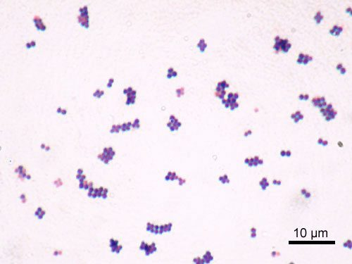 <b>شکل ۱۳.۰۱.</b> رنگ‌آمیزی گرم <i>Staphylococcus aureus</i> (ATCC 25923): کوکسی گرم مثبت با آرایش خوشه‌ای منبع: Y Tambe، <a href="https://commons.wikimedia.org/wiki/File:Staphylococcus_aureus_Gram.jpg">Wikimedia Commons</a>، <a href="http://creativecommons.org/licenses/by-sa/3.0/">CC BY-SA 3.0</a></td><td align="center" width="50%">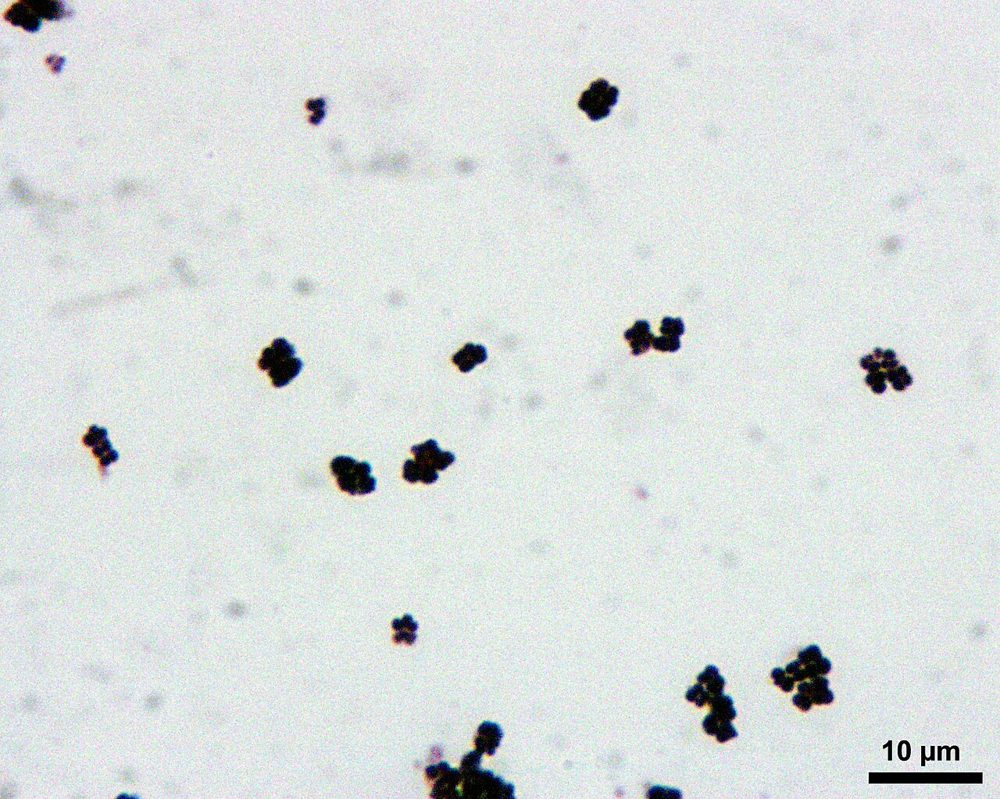 <b>شکل ۱۳.۰۲.</b> رنگ‌آمیزی گرم <i>Micrococcus luteus</i>: کوکسی گرم مثبت درشت در گروه‌های چهارتایی و خوشه‌های کوچک منبع: Alonnardi، <a href="https://commons.wikimedia.org/wiki/File:Gram-M.l.jpg">Wikimedia Commons</a>، <a href="https://creativecommons.org/licenses/by-sa/3.0">CC BY-SA 3.0</a></td></tr><tr><td align="center" width="50%">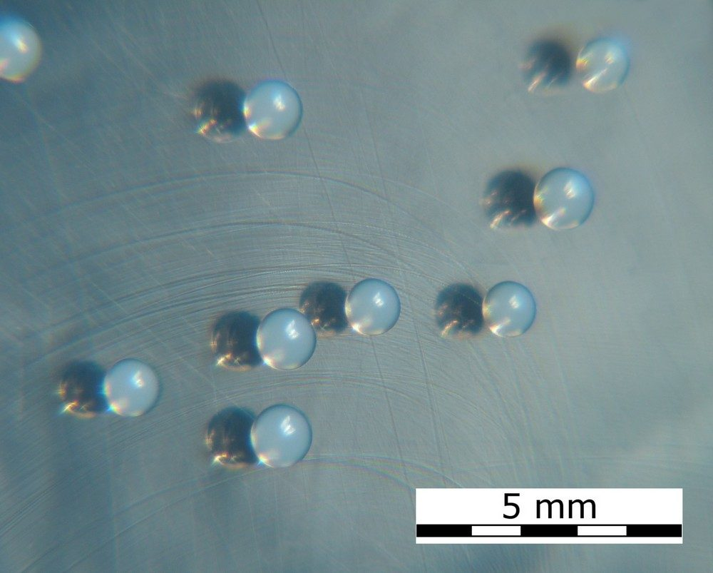 <b>شکل ۱۳.۰۳.</b> کلنی‌های سفید، براق و محدب <i>Staphylococcus epidermidis</i> روی آگار تریپتیک سوی (۲۴ ساعت، ۳۷°C) منبع: HansN.، <a href="https://commons.wikimedia.org/wiki/File:Staphylococcus_epidermidis_colonies_on_Tryptic_Soy_Agar.jpg">Wikimedia Commons</a>، <a href="https://creativecommons.org/licenses/by-sa/3.0">CC BY-SA 3.0</a></td><td align="center" width="50%">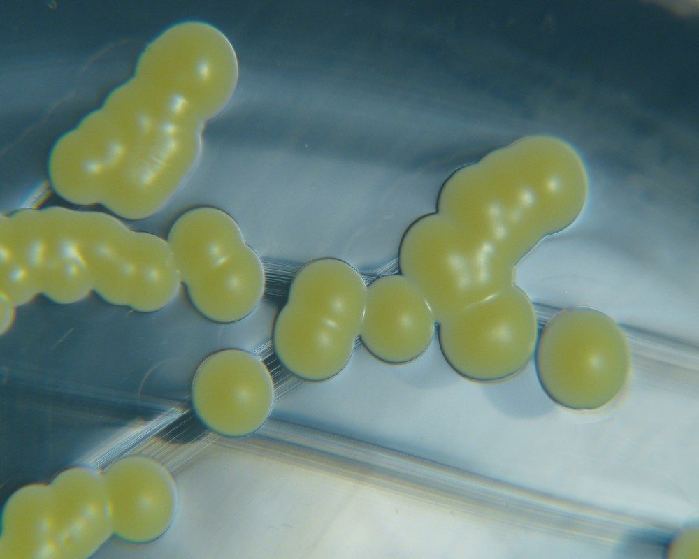 <b>شکل ۱۳.۰۴.</b> کلنی‌های زرد <i>Micrococcus luteus</i> روی آگار تریپتیک سوی (۴۸ ساعت، ۳۷°C) منبع: HansN.، <a href="https://commons.wikimedia.org/wiki/File:Micrococcus_luteus_colonies_on_TSA.jpg">Wikimedia Commons</a>، <a href="https://creativecommons.org/licenses/by-sa/3.0">CC BY-SA 3.0</a></td></tr></table>

## جدول ۲: گونه‌های مهم *Staphylococcus*

| گونه | کوآگولاز **لوله** | **لام** (ClfA)/لاتکس | **PYR** | **اورنیتین (ODC)** | **نووبیوسین** | اوره‌آز | **DNase/TNase** | همولیز | مانیتول | نکتهٔ کلیدی |
|---|---|---|---|---|---|---|---|---|---|---|
| ***S. aureus*** | **+** | **+** | − | − | S | v | **+** | **β** (اغلب) | **+** | کلنی طلایی-کرم؛ بزرگ |
| *S. argenteus* | + | + | − | − | S | v | + | v | + | **بدون رنگدانه (سفید)**؛ MALDI با پایگاه به‌روز |
| ***S. lugdunensis*** | **−** | **+ / v** | **+** | **+** | S | v | − | w (پس از ۴۸ ساعت) | v | **ODC + و PYR +** کلید شناسایی |
| *S. schleiferi* subsp. *schleiferi* | − | **+** | **+** | − | S | − | + | β | − | |
| *S. coagulans* (*S. schleiferi* subsp. *coagulans*) | **+** | v | + | − | S | + | + | β | v | حیوانی (سگ) |
| ***S. pseudintermedius*** / *S. intermedius* | **+** | v | **+** | − | S | + | + | β (دوگانه؛ خون گوسفند) | v | **گاز گرفتگی سگ**؛ VP − (*S. aureus* VP +) |
| ***S. epidermidis*** | − | − | − | v | **S** | **+** | − | − | − | شایع‌ترین CoNS؛ بیوفیلم |
| ***S. haemolyticus*** | − | − | **+** | − | S | − | − | **β** | v | **چندمقاوم**؛ کاهش حساسیت به گلیکوپپتیدها |
| ***S. saprophyticus*** | − | − (لاتکس گاه +) | − | − | **R** | **+** | − | − | v | **UTI زنان جوان** |
| *S. capitis* | − | − | − | − | S | − | − | − | v | عفونت NICU (*S. capitis* NRCS-A) |
| *S. hominis* | − | − | − | − | S | + | − | − | − | |
| *S. warneri* | − | − | − | − | S | + | − | v | v | |
| *S. cohnii*، *S. xylosus* | − | − | v | − | **R** | v | − | − | v | نووبیوسین R (با *S. saprophyticus* اشتباه نشوند) |

> ⚠️ تست‌های فنوتیپی برای بسیاری از CoNS **کافی نیستند**؛ **MALDI-TOF** روش ترجیحی است. ولی گزارش در سطح «CoNS» برای ایزوله‌های **احتمالاً آلودگی** قابل‌قبول است (CLSI M35)، به‌جز *S. lugdunensis* و *S. saprophyticus* (ادرار) که باید **تا گونه** شناسایی شوند.

**تصاویر:**

<table><tr><td align="center" width="50%">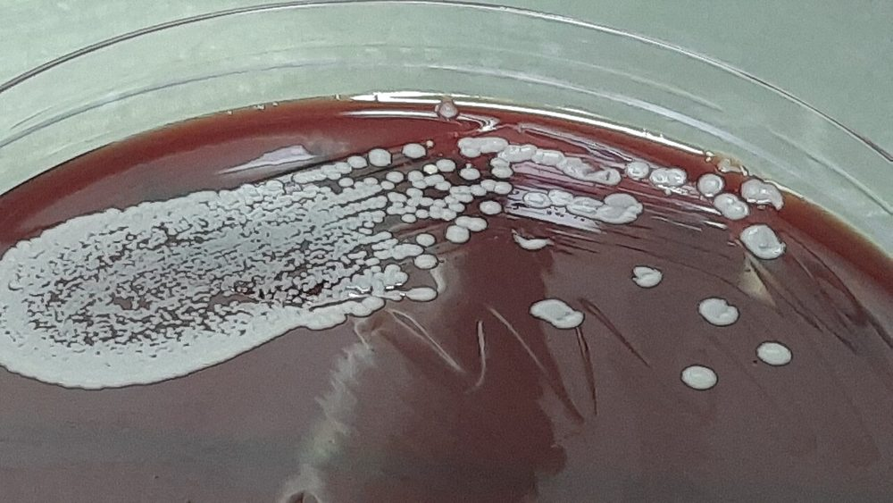 <b>شکل ۱۳.۰۵.</b> کلنی‌های کوچک، گرد و صاف <i>Staphylococcus haemolyticus</i> روی آگار خون‌دار منبع: Ajay Kumar Chaurasiya، <a href="https://commons.wikimedia.org/wiki/File:Staphylococcus_haemolyticus_on_Blood_Agar.jpg">Wikimedia Commons</a>، <a href="https://creativecommons.org/licenses/by/4.0">CC BY 4.0</a></td><td align="center" width="50%">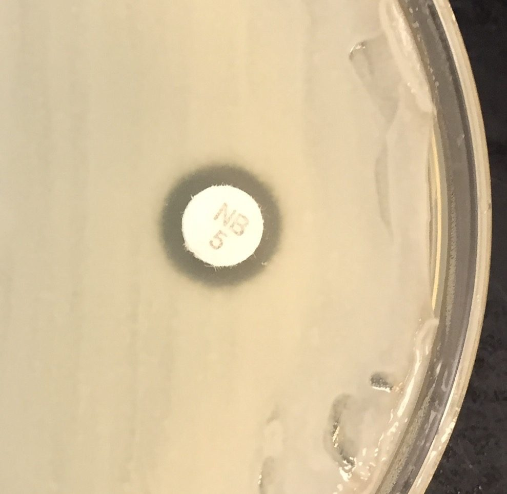 <b>شکل ۱۳.۰۶.</b> مقاومت <i>Staphylococcus saprophyticus</i> به دیسک نووبیوسین (۵ µg) روی مولر–هینتون آگار منبع: Deminorwood، <a href="https://commons.wikimedia.org/wiki/File:Ssaphrophyticus-Novobiocin.jpg">Wikimedia Commons</a>، <a href="https://creativecommons.org/licenses/by-sa/4.0">CC BY-SA 4.0</a></td></tr><tr><td align="center" width="50%">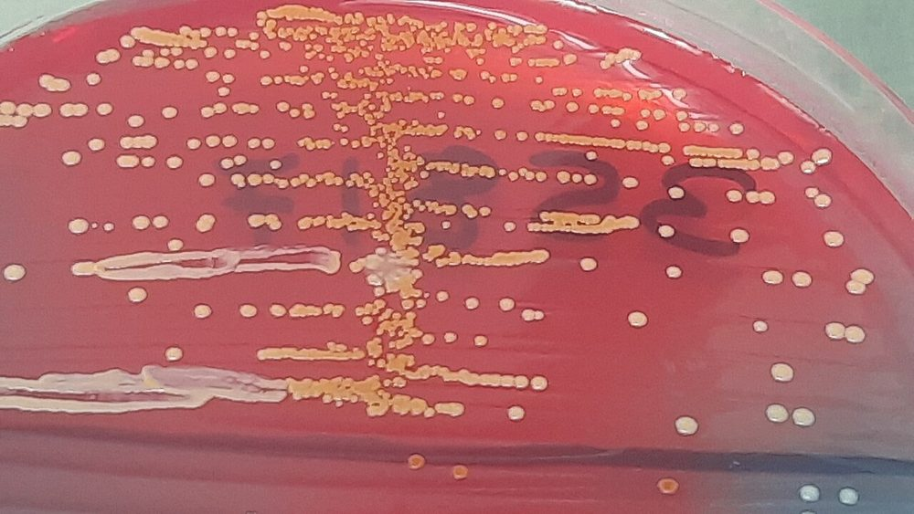 <b>شکل ۱۳.۰۷.</b> کلنی‌های <i>Staphylococcus saprophyticus</i> روی آگار CLED در کشت ادرار (۴۸ ساعت) منبع: Ajay Kumar Chaurasiya، <a href="https://commons.wikimedia.org/wiki/File:Staphylococcus_saprophyticus_on_CLED_agar.jpg">Wikimedia Commons</a>، <a href="http://creativecommons.org/publicdomain/zero/1.0/deed.en">CC0</a></td></tr></table>

## جدول ۳: محیط‌ها و ظاهر کلنی (خلاصه)

| محیط | *S. aureus* | CoNS | *Micrococcus* |
|---|---|---|---|
| آگار خون | کرم/طلایی، ۱–۳ mm، β (اغلب) | سفید، کوچک‌تر، γ (به‌جز *S. haemolyticus*، *S. lugdunensis*) | زرد لیمویی، خشک |
| MSA | **زرد** (مانیتول +) | اغلب **صورتی** (برخی زرد) | رشد ضعیف |
| CNA | رشد | رشد | رشد |
| کروموژنیک MRSA | **رنگ مشخص** (فقط MRSA) | مهار (اکثر) | مهار |

**تصاویر:**

<table><tr><td align="center" width="50%">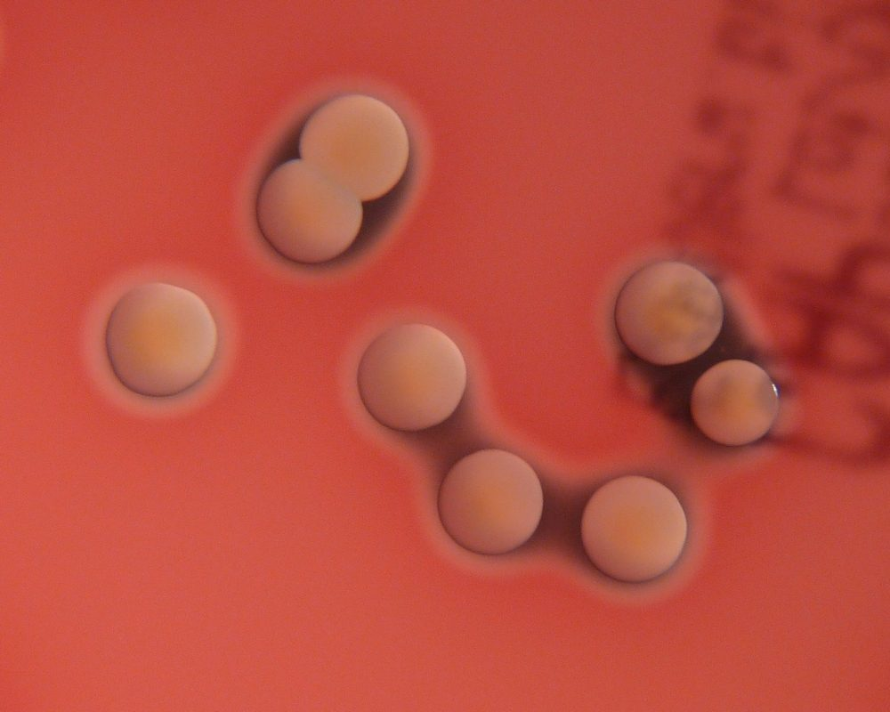 <b>شکل ۱۳.۰۸.</b> کلنی‌های <i>Staphylococcus aureus</i> با رنگدانهٔ زرد طلایی و همولیز β روی آگار خون‌دار کلمبیا (۴۸ ساعت) منبع: HansN.، <a href="https://commons.wikimedia.org/wiki/File:Staphylococcus_aureus_colonies_on_blood_agar.jpg">Wikimedia Commons</a>، <a href="https://creativecommons.org/licenses/by-sa/3.0">CC BY-SA 3.0</a></td><td align="center" width="50%">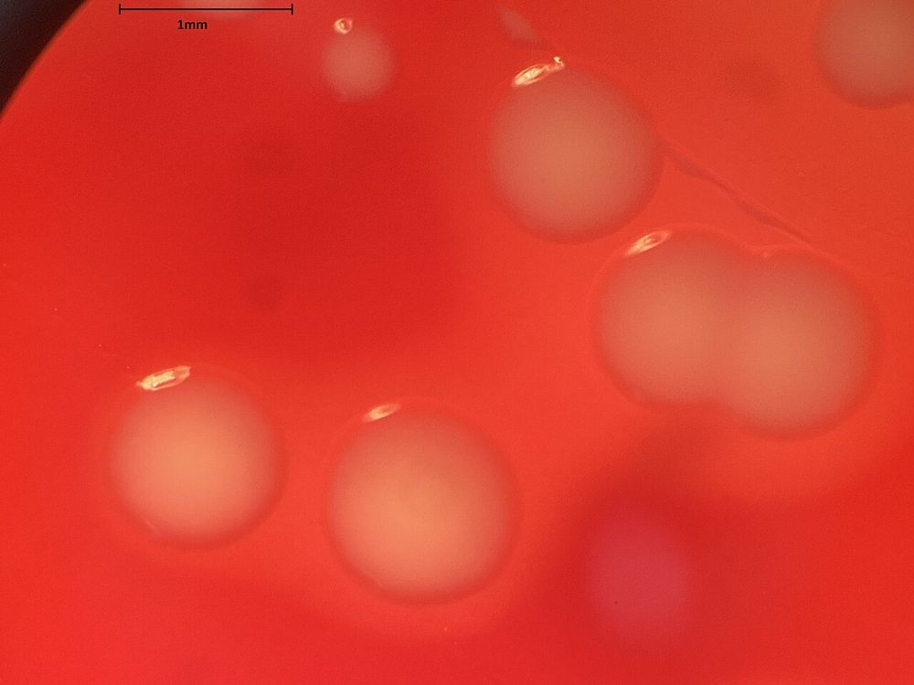 <b>شکل ۱۳.۰۹.</b> همولیز β اطراف کلنی‌های <i>Staphylococcus aureus</i> روی آگار خون‌دار در نور از پشت منبع: Mikael Häggström , M.D. Author info - Reusing images - Conflicts of in، <a href="https://commons.wikimedia.org/wiki/File:Staphylococcus_aureus_on_blood_agar,_mildly_backlit.jpg">Wikimedia Commons</a>، <a href="http://creativecommons.org/publicdomain/zero/1.0/deed.en">CC0</a></td></tr><tr><td align="center" width="50%">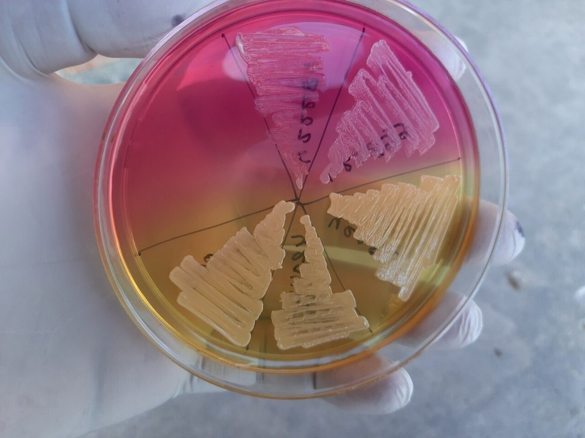 <b>شکل ۱۳.۱۰.</b> آگار مانیتول نمک (MSA): <i>Staphylococcus aureus</i> با کلنی و محیط زرد، و استافیلوکوکوس‌های کوآگولاز منفی با محیط صورتی منبع: Ajay Kumar Chaurasiya، <a href="https://commons.wikimedia.org/wiki/File:Staphylococcus_aureus_(yellow_colonies)_and_CoNS_(pink_colonies)_on_Mannitol_salt_agar_(MSA).jpg">Wikimedia Commons</a>، <a href="https://creativecommons.org/licenses/by-sa/4.0">CC BY-SA 4.0</a></td><td align="center" width="50%">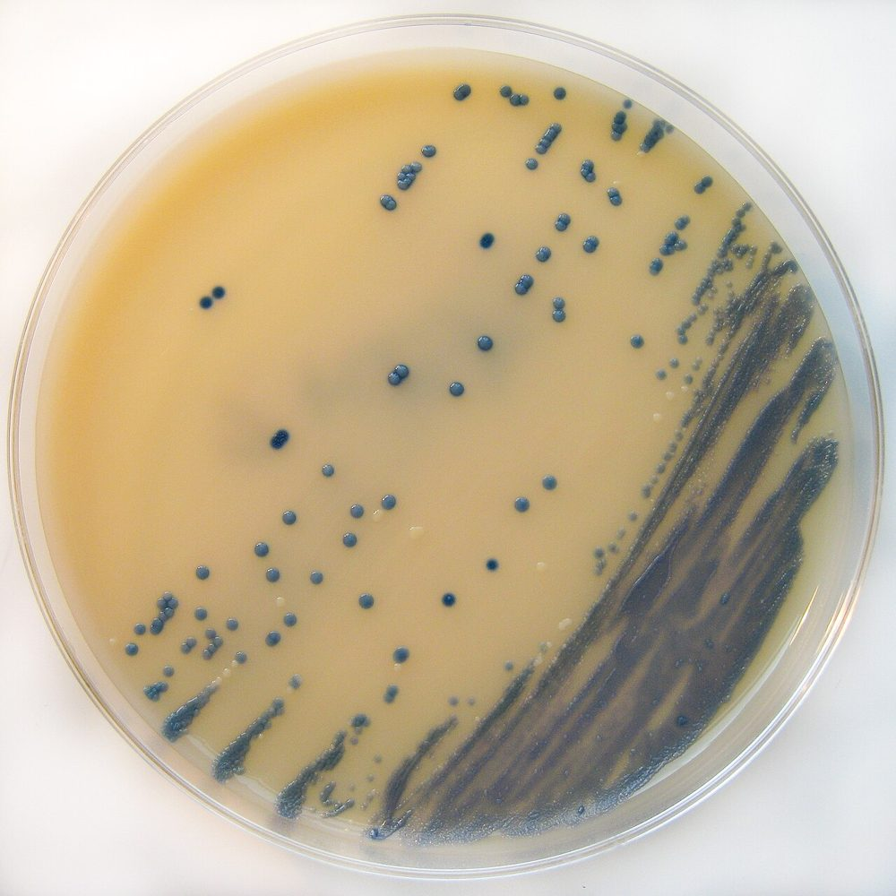 <b>شکل ۱۳.۱۱.</b> کلنی‌های آبی MRSA روی آگار کروموژنیک انتخابی MRSA (Brilliance) منبع: Nathan Reading on Flickr Nathan R. on twitter، <a href="https://commons.wikimedia.org/wiki/File:MRSA_on_Brilliance_MRSA_Chromogenic_Agar.jpg">Wikimedia Commons</a>، <a href="https://creativecommons.org/licenses/by/2.0">CC BY 2.0</a></td></tr></table>

