

# جدول‌های افتراقی: کوکسی گرم مثبت کاتالاز منفی

> نمادها: **+**، **−**، **v**، **w**. شرح تست‌ها: [02](../12_Identification_Tests/02_Spot_Rapid_Tests.md)، [03](../12_Identification_Tests/03_Disk_and_Growth_Tests.md)، [04](../12_Identification_Tests/04_Antigen_Serology.md)؛ BEA و NaCl ۶٫۵٪: [11_Culture_Media/08](../11_Culture_Media/08_Biochemical_Tube_Media.md).

## جدول ۱: استرپتوکوکوس‌های β-همولیتیک

| ارگانیسم | لانسفیلد | اندازهٔ کلنی | **PYR** | باسیتراسین ۰٫۰۴ U | **CAMP** | **هیپورات** | VP | نکته |
|---|---|---|---|---|---|---|---|---|
| ***S. pyogenes*** | **A** | بزرگ (> ۰٫۵ mm)، **هالهٔ β پهن** | **+** | **S** | − | − | − | تنها β با **PYR +** (در میان استرپتوکوکوس‌ها) |
| ***S. agalactiae*** | **B** | بزرگ، کرمی، **β باریک** (۱–۲٪ غیرهمولیتیک) | − | R | **+** | **+** | − | رنگدانهٔ نارنجی در محیط گرانادا |
| ***S. dysgalactiae* subsp. *equisimilis*** (SDSE) | **C یا G** (گاه A) | بزرگ، β پهن | − | R (گاه S) | − | − | − | شبیه GAS بالینی |
| *S. equi* subsp. *zooepidemicus* | C | بزرگ، موکوئید | − | R | − | − | − | تماس با اسب/شیر غیرپاستوریزه |
| ***S. anginosus* group** (*S. anginosus*، *S. intermedius*، *S. constellatus*) | A، C، F، G یا **بدون گروه** | **ریز** (کمتر از ۰٫۵ mm)، β/α/γ | − | R (گاه S) | − | − | **+** | **بوی کارامل/کره**؛ آبسه |

**تصاویر:**

<table><tr><td align="center" width="50%">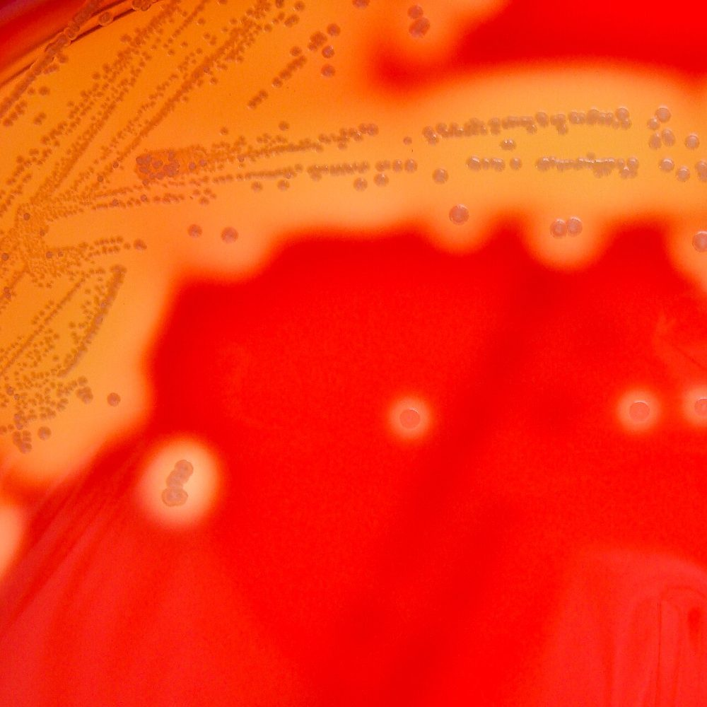 <b>شکل ۱۴.۰۱.</b> همولیز β کامل و روشن اطراف کلنی‌های ریز <i>Streptococcus pyogenes</i> (گروه A) روی آگار خون اسب کلمبیا منبع: Nathan Reading، <a href="https://commons.wikimedia.org/wiki/File:Streptococcus_pyogenes_(Lancefield_Group_A)_on_Columbia_Horse_Blood_Agar_-_Detail.jpg">Wikimedia Commons</a>، <a href="https://creativecommons.org/licenses/by/2.0">CC BY 2.0</a></td><td align="center" width="50%">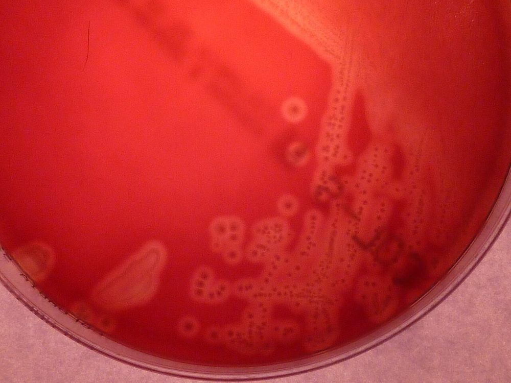 <b>شکل ۱۴.۰۲.</b> کلنی‌های <i>Streptococcus agalactiae</i> (گروه B) با هالهٔ باریک همولیز β روی آگار خون‌دار منبع: 43trevenque، <a href="https://commons.wikimedia.org/wiki/File:Streptococcus_agalactiae_on_blood_agar.JPG">Wikimedia Commons</a>، <a href="https://creativecommons.org/licenses/by-sa/4.0">CC BY-SA 4.0</a></td></tr><tr><td align="center" width="50%">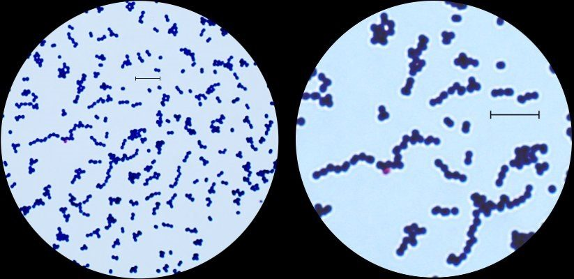 <b>شکل ۱۴.۰۳.</b> رنگ‌آمیزی گرم <i>Streptococcus agalactiae</i>: کوکسی گرم مثبت در جفت و زنجیره منبع: Karl-Erik Johansson &amp; Lise-Lotte Fernström، <a href="https://commons.wikimedia.org/wiki/File:Gram_stain_of_Streptococcus_agalactiae.jpg">Wikimedia Commons</a>، <a href="https://creativecommons.org/licenses/by/2.5/se/deed.en">CC BY 2.5 se</a></td></tr></table>

## جدول ۲: α و γ-همولیتیک‌ها (گروه‌بندی اصلی)

| ارگانیسم | **اپتوچین** | **حلالیت صفرا** | **BEA** | **NaCl ۶٫۵٪** | **PYR** | LAP | نکته |
|---|---|---|---|---|---|---|---|
| ***S. pneumoniae*** | **S (≥ ۱۴ mm)** | **+** | − | − | − | + | کلنی سکه‌ای/موکوئید؛ دیپلوکوک لانسه‌ای |
| **ویریدانس** (اکثر) | R | − | − (۱۰٪ w) | − | − | + | |
| ***S. gallolyticus*** | R | − | **+** | **−** | **−** | + | γ یا α |
| ***Enterococcus*** | R | − | **+** | **+** | **+** | + | γ (گاه α یا β)؛ زنجیره‌های کوتاه/جفت |

**تصاویر:**

<table><tr><td align="center" width="50%">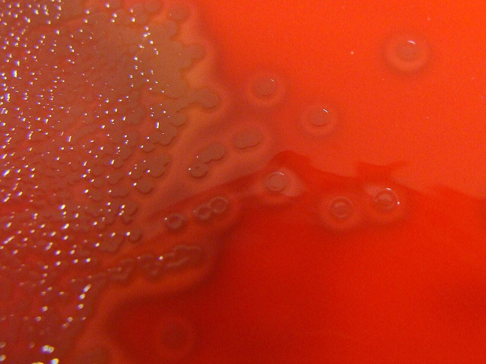 <b>شکل ۱۴.۰۴.</b> کلنی‌های <i>Streptococcus pneumoniae</i> با مرکز فرورفته (نمای «مهرهٔ دام») و همولیز α روی آگار خون اسب کلمبیا منبع: Nathan Reading، <a href="https://commons.wikimedia.org/wiki/File:Streptococcus_pneumoniae_on_Columbia_Horse_Blood_Agar.jpg">Wikimedia Commons</a>، <a href="https://creativecommons.org/licenses/by/2.0">CC BY 2.0</a></td><td align="center" width="50%">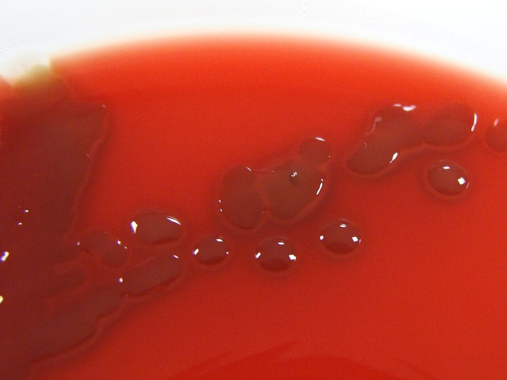 <b>شکل ۱۴.۰۵.</b> کلنی‌های موکوئید <i>Streptococcus pneumoniae</i> روی آگار خون اسب کلمبیا منبع: Nathan Reading، <a href="https://commons.wikimedia.org/wiki/File:Streptococcus_pneumoniae_on_Columbia_Horse_Blood_Agar_-_Detail.jpg">Wikimedia Commons</a>، <a href="https://creativecommons.org/licenses/by/2.0">CC BY 2.0</a></td></tr></table>

## جدول ۳: گروه‌های استرپتوکوکوس ویریدانس

| گروه | گونه‌های مهم | VP | **مانیتول/سوربیتول** | اوره | آرژینین | اسکولین | اهمیت بالینی |
|---|---|---|---|---|---|---|---|
| ***mitis*** | *S. mitis*، *S. oralis*، *S. pseudopneumoniae*، *S. infantis* | − | − | − | − (اکثر) | − | اندوکاردیت؛ **باکتریمی نوتروپنی** (موکوزیت، ARDS)؛ **مقاومت به پنی‌سیلین شایع** |
| ***sanguinis*** | *S. sanguinis*، *S. parasanguinis*، *S. gordonii* | − | − | − | **+** | + | **اندوکاردیت** |
| ***salivarius*** | *S. salivarius*، *S. vestibularis* | v | − | v | − | + | باکتریمی، مننژیت پس از LP |
| ***mutans*** | *S. mutans*، *S. sobrinus* | + | **+** | − | − | + | پوسیدگی دندان؛ اندوکاردیت |
| ***anginosus*** | *S. anginosus*، *S. intermedius*، *S. constellatus* | **+** | v | − | **+** | v | **آبسه** (مغز، کبد، ریه، پلور) |
| ***gallolyticus*** | *S. gallolyticus* subsp. *gallolyticus* (biotype I)، subsp. *pasteurianus* (II/2)، *S. infantarius* (II/1) | + | v | − | − | **+ (BEA)** | biotype I: **اندوکاردیت + سرطان کولون**؛ subsp. *pasteurianus*: مننژیت نوزادی |

> ⚠️ تمایز گونه‌های ویریدانس با تست‌های فنوتیپی **غیرقابل‌اعتماد** است؛ **MALDI-TOF** تا سطح گروه/گونه (با محدودیت در گروه *mitis*) یا **توالی‌یابی *sodA*/16S** در موارد مهم (اندوکاردیت).

**تصاویر:**

<table><tr><td align="center" width="50%">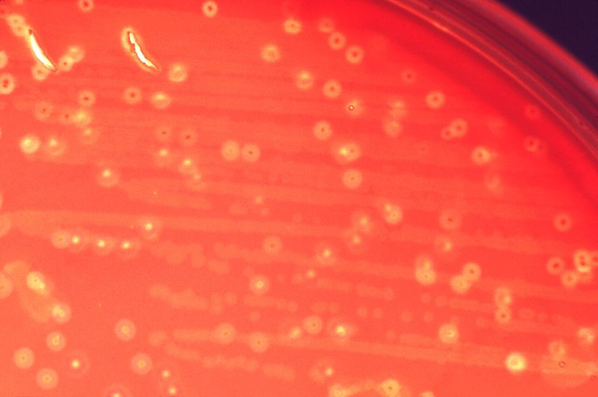 <b>شکل ۱۴.۰۶.</b> کلنی‌های بسیار ریز <i>Streptococcus anginosus</i> روی آگار خون‌دار منبع: CDC/ Richard R. Facklam, Ph.D.، <a href="https://commons.wikimedia.org/wiki/File:Streptococcus_anginosus.tif">Wikimedia Commons</a>، Public domain</td></tr></table>

## جدول ۴: گونه‌های *Enterococcus*

| ویژگی | ***E. faecalis*** | ***E. faecium*** | ***E. gallinarum*** | ***E. casseliflavus*** |
|---|---|---|---|---|
| **تحرک** | − | − | **+** | **+** |
| **رنگدانهٔ زرد** | − | − | − | **+** |
| **آرابینوز** | − | **+** | + | + |
| پیروات | + | − | − | v |
| تلوریت | + | − | − | − |
| مانیتول | + | + | + | + |
| ونکومایسین | S (یا VRE: *vanA/B*) | S (یا **VRE: *vanA***، شایع‌تر) | **سطح پایین ذاتی (*vanC1*؛ MIC ۸–۱۶)** | **سطح پایین ذاتی (*vanC2/3*)** |
| آمپی‌سیلین | **معمولاً S** | **معمولاً R** | S | S |
| کینوپریستین–دالفوپریستین | **R ذاتی** | S | | |

**تصاویر:**

<table><tr><td align="center" width="50%">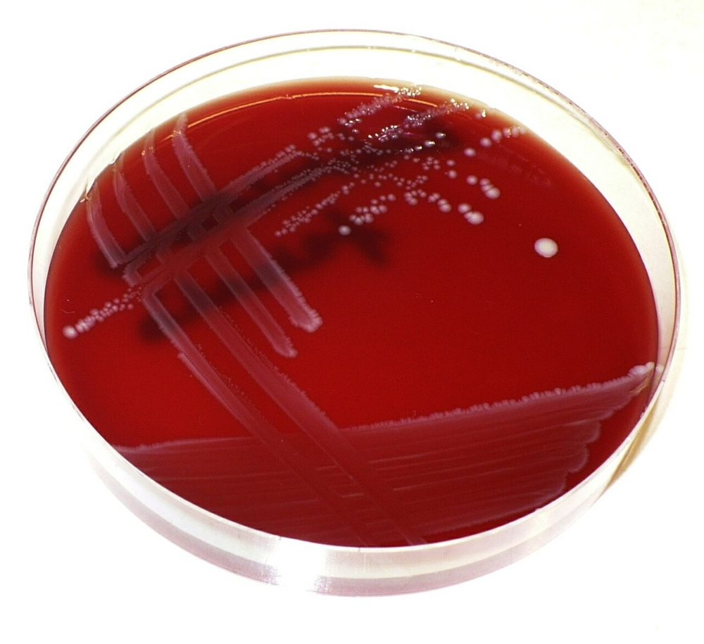 <b>شکل ۱۴.۰۷.</b> کلنی‌های <i>Enterococcus faecalis</i> روی آگار خون‌دار منبع: Pavel Dušek، <a href="https://commons.wikimedia.org/wiki/File:Enterococcus_faecalis-blood_agar.jpg">Wikimedia Commons</a>، <a href="https://creativecommons.org/licenses/by/3.0">CC BY 3.0</a></td><td align="center" width="50%">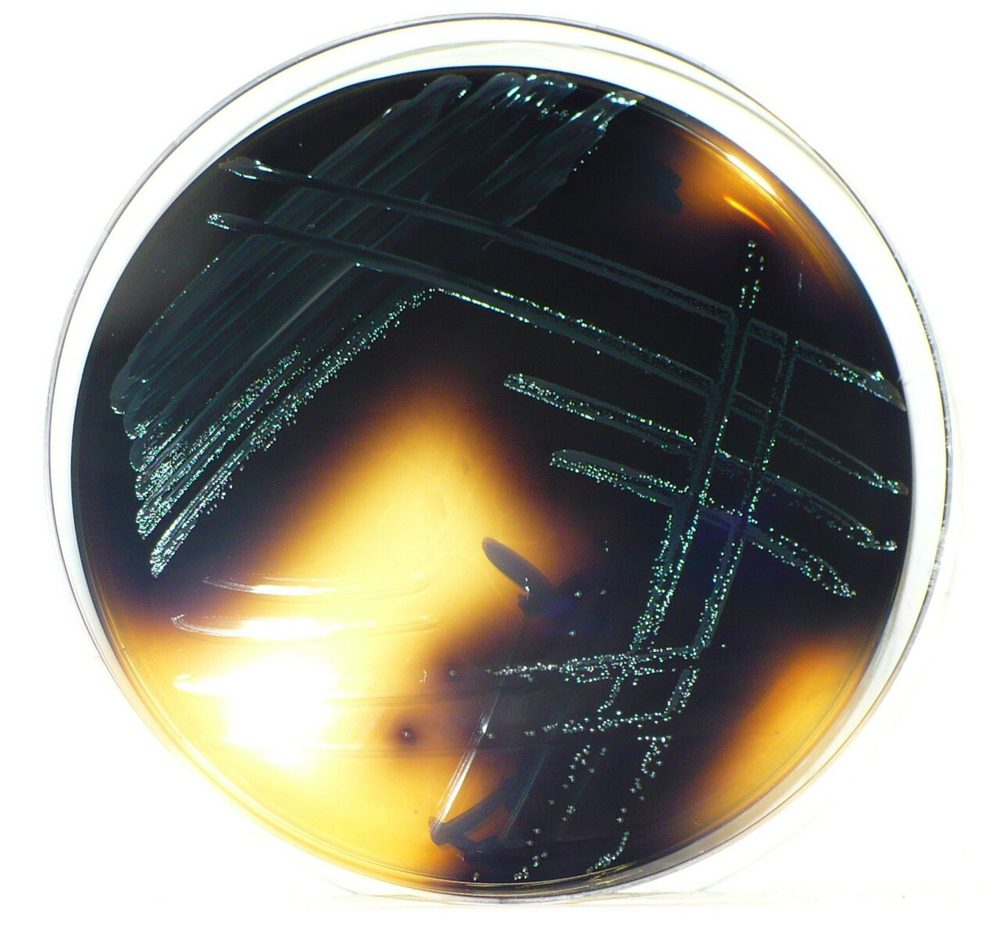 <b>شکل ۱۴.۰۸.</b> سیاه شدن آگار صفرا–اسکولین با رشد <i>Enterococcus faecalis</i> (هیدرولیز اسکولین) منبع: Pavel Dušek، <a href="https://commons.wikimedia.org/wiki/File:Enterococcus_faecalis-bile_esculin.jpg">Wikimedia Commons</a>، <a href="https://creativecommons.org/licenses/by/3.0">CC BY 3.0</a></td></tr><tr><td align="center" width="50%">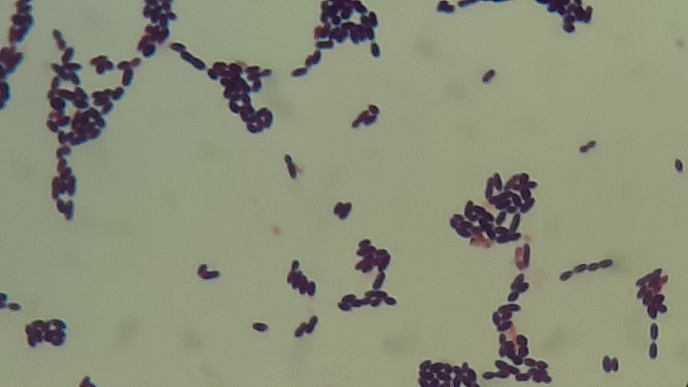 <b>شکل ۱۴.۰۹.</b> رنگ‌آمیزی گرم کشت <i>Enterococcus faecium</i>: کوکسی گرم مثبت بیضی در جفت و زنجیره‌های کوتاه منبع: Ajay Kumar Chaurasiya، <a href="https://commons.wikimedia.org/wiki/File:Enterococcus_faecium_in_Gram_Staining_of_culture.jpg">Wikimedia Commons</a>، <a href="http://creativecommons.org/publicdomain/zero/1.0/deed.en">CC0</a></td></tr></table>

## جدول ۵: سایر کوکسی گرم مثبت کاتالاز منفی

| جنس | آرایش | **ونکومایسین** | **PYR** | **LAP** | NaCl ۶٫۵٪ | BEA | سایر |
|---|---|---|---|---|---|---|---|
| ***Aerococcus viridans*** | **تتراد**/خوشه | S | **+** | **−** | + | v | α؛ آلودگی اغلب |
| ***Aerococcus urinae*** | خوشه | S | **−** | **+** | + | − | α؛ **UTI سالمندان** |
| ***Abiotrophia*/*Granulicatella*** (NVS) | زنجیره، پلئومورف | S | **+** | + | − | − | **اقمار** اطراف *S. aureus*؛ نیاز به **پیریدوکسال** |
| ***Gemella*** | جفت، **به‌آسانی رنگ‌بری** (گرم‌متغیر) | S | + | v | − | − | |
| ***Lactococcus*** | زنجیره | S | + | + | v | + | با انتروکوکوس اشتباه می‌شود (عدم رشد در ۴۵°C) |
| ***Leuconostoc*** | کوکوباسیل، جفت/زنجیره | **R** | **−** | **−** | v | v | **گاز از گلوکز** |
| ***Pediococcus*** | **تتراد** | **R** | − | **+** | v | + | |
| ***Weissella*** | کوکوباسیل | **R** | − | − | | | گاز +؛ شبیه *Leuconostoc* |
| ***Globicatella*** | زنجیره | S | + | **−** | + | v | |
| ***Lactobacillus*** sensu lato (اغلب کوکوباسیل؛ از ۲۰۲۰ در چند جنس جدید مانند *Lacticaseibacillus*، *Lactiplantibacillus*) | | **R** (اکثر) | − | v | | | |

**تصاویر:**

<table><tr><td align="center" width="50%">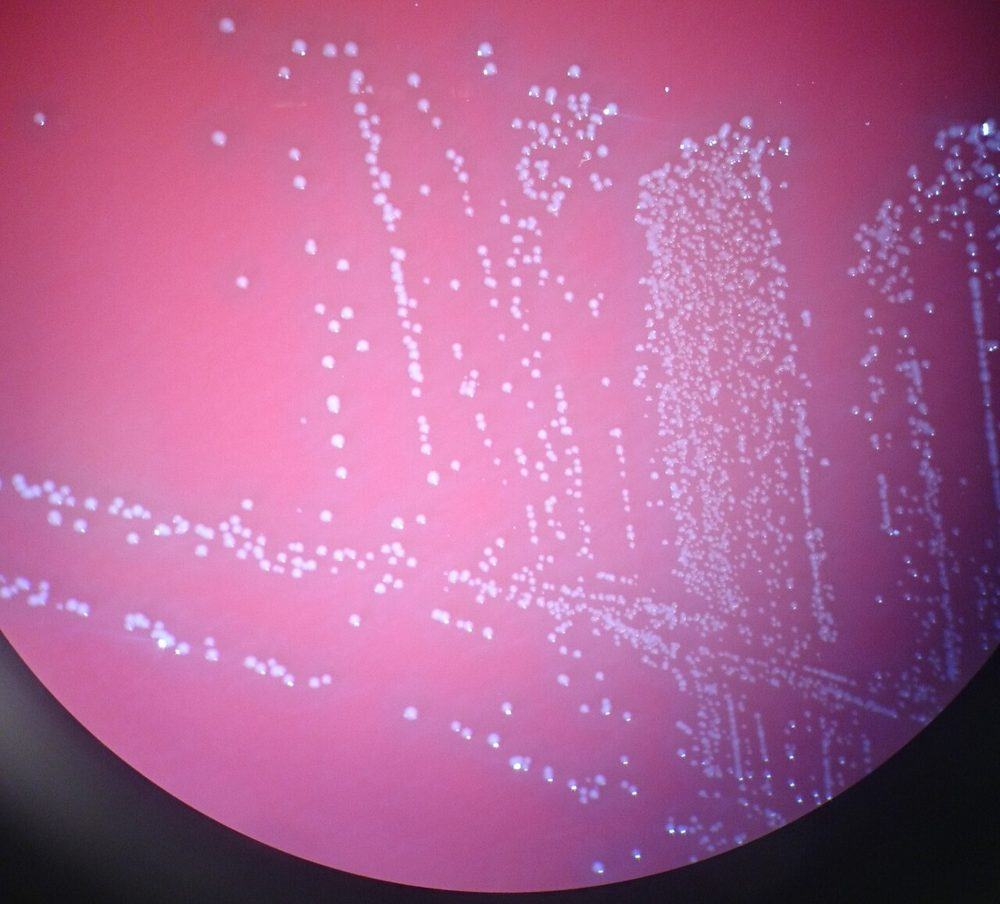 <b>شکل ۱۴.۱۰.</b> کلنی‌های ریز <i>Aerococcus urinae</i> با همولیز α روی آگار خون‌دار منبع: Mikael Häggström، <a href="https://commons.wikimedia.org/wiki/File:Aerococcus_urinae_-_colonies.jpg">Wikimedia Commons</a>، <a href="http://creativecommons.org/publicdomain/zero/1.0/deed.en">CC0</a></td><td align="center" width="50%">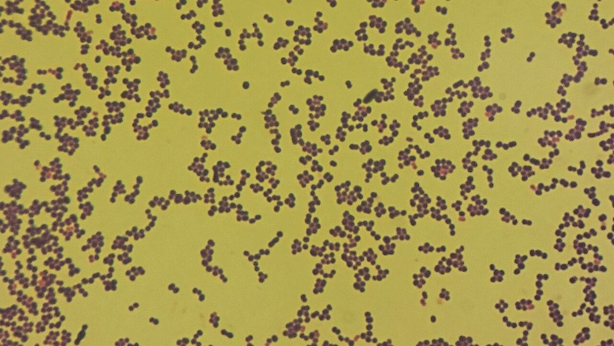 <b>شکل ۱۴.۱۱.</b> رنگ‌آمیزی گرم <i>Aerococcus urinae</i>: کوکسی گرم مثبت منبع: Mikael Häggström، <a href="https://commons.wikimedia.org/wiki/File:Aerococcus_urinae_-_microscopy.jpg">Wikimedia Commons</a>، <a href="http://creativecommons.org/publicdomain/zero/1.0/deed.en">CC0</a></td></tr></table>

