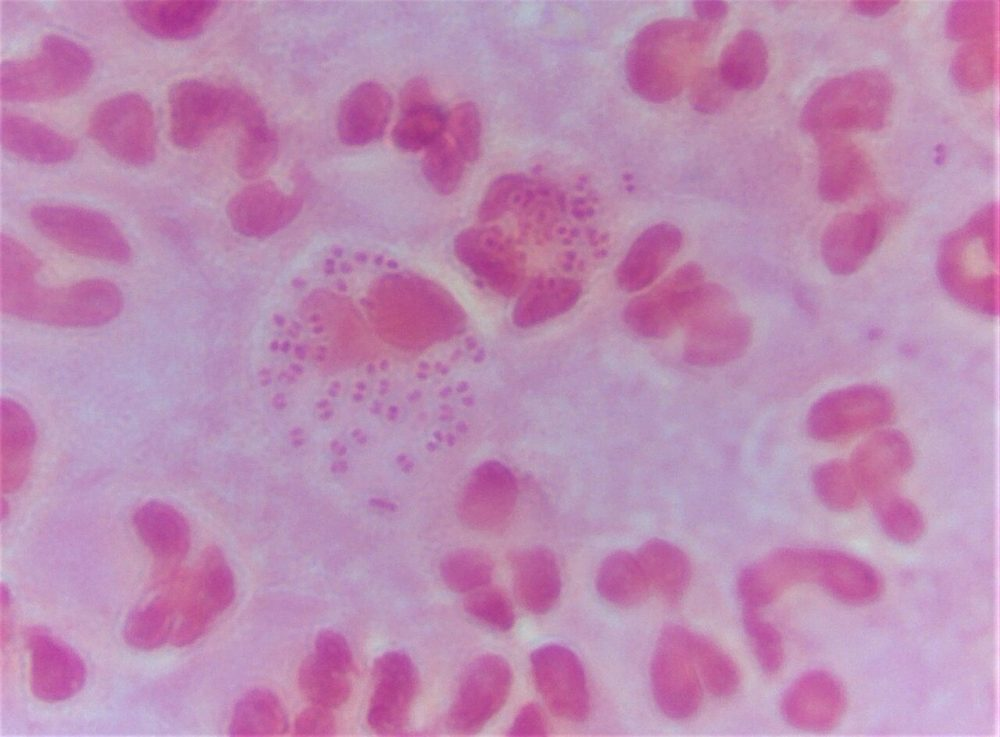
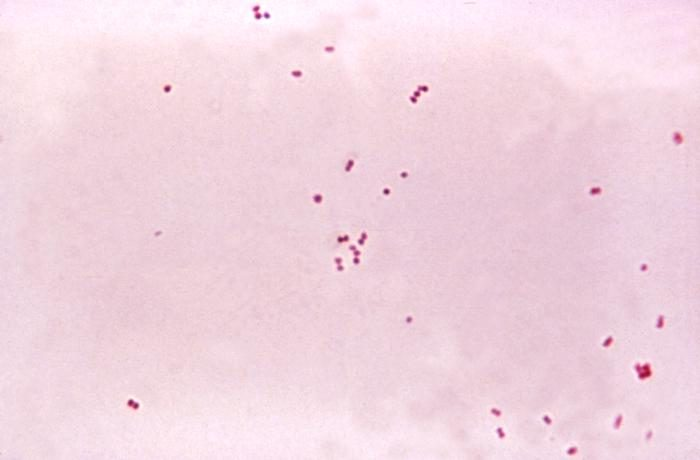
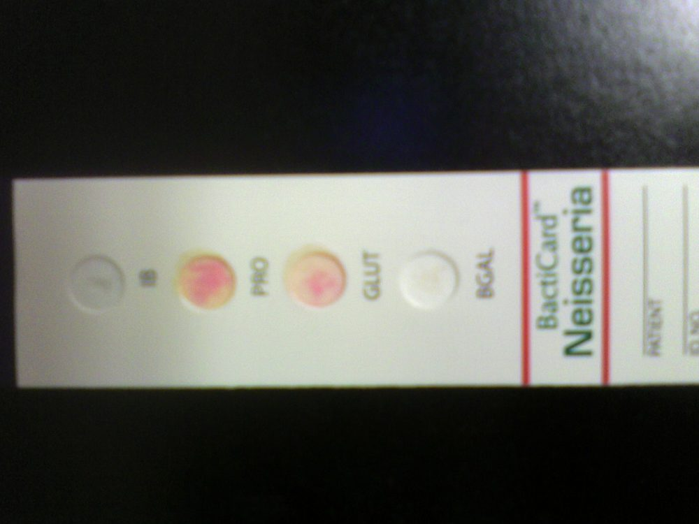
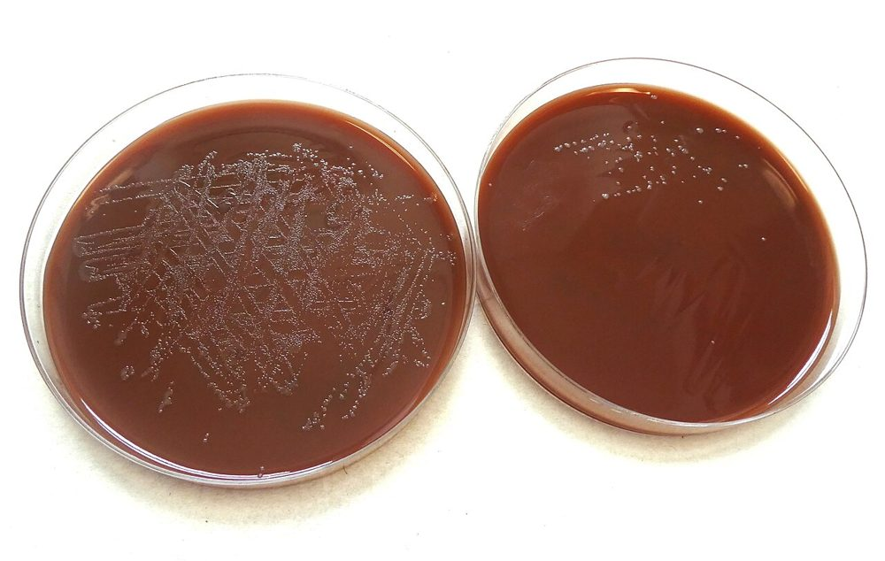
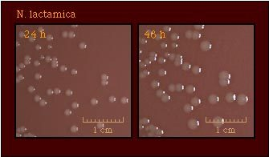

# جدول‌های افتراقی: کوکسی گرم منفی

> نمادها: **+** (≥ ۹۰٪)، **−** (≥ ۹۰٪ منفی)، **v** متغیر، **w** ضعیف. شرح تست‌ها: [02_Spot_Rapid_Tests](../12_Identification_Tests/02_Spot_Rapid_Tests.md)، [03_Disk_and_Growth_Tests](../12_Identification_Tests/03_Disk_and_Growth_Tests.md)؛ قندها: [11_Culture_Media/08 بخش ۸.۱۴](../11_Culture_Media/08_Biochemical_Tube_Media.md).

## جدول ۱: *Neisseria* و *Moraxella* در برابر شبیه‌ها

| ویژگی | *Neisseria* | *M. catarrhalis* | *Kingella* | *Acinetobacter* |
|---|---|---|---|---|
| رنگ گرم | دیپلوکوک **لوبیایی** (سطوح صاف رو‌به‌رو) | دیپلوکوک؛ گاه مقاوم به رنگ‌بری | کوکوباسیل در **جفت/زنجیرهٔ کوتاه** | کوکوباسیل چاق؛ گاه **گرم‌متغیر** |
| **اکسیداز** | **+** | **+** | **+** | **−** |
| **کاتالاز** | **+** (*N. elongata*: w/−) | **+** | **−** | **+** |
| قند گلوکز | v (بسته به گونه) | **−** | **+** | v (اکسیداتیو) |
| **بوتیرات استراز** | − | **+** | − | − |
| **DNase** | − | **+** | − | − |
| **نیترات ← نیتریت** | − (به‌جز *N. mucosa*) | **+** | v (*K. denitrificans* +) | − |
| رشد روی MacConkey | − | − | − | **+** |

**تصاویر:**

<table><tr><td align="center" width="50%"> <b>شکل ۱۶.۰۱.</b> دیپلوکوک‌های گرم منفی <i>Neisseria gonorrhoeae</i> داخل نوتروفیل (رنگ گرم) منبع: Dr Graham Beards، <a href="https://commons.wikimedia.org/wiki/File:Neisseria_gonorrhoeae_diplococci_inside_a_neutrophil.jpg">Wikimedia Commons</a>، <a href="https://creativecommons.org/licenses/by-sa/4.0">CC BY-SA 4.0</a></td><td align="center" width="50%"> <b>شکل ۱۶.۰۲.</b> دیپلوکوک‌های گرم منفی <i>Neisseria meningitidis</i> (رنگ گرم، ۱۱۵۰×) منبع: Dr. Brodsky، <a href="https://commons.wikimedia.org/wiki/File:Neisseria_meningitidis.jpg">Wikimedia Commons</a>، Public domain</td></tr></table>

## جدول ۲: گونه‌های *Neisseria* و *M. catarrhalis*

| گونه | رشد روی **آگار مغذی** ۳۵°C | رشد روی **MTM** | گلوکز | مالتوز | لاکتوز | ساکارز | **پلی‌ساکارید از ساکارز** | **نیترات** | **کولیستین ۱۰ µg** | سوپراکسول | رنگدانهٔ زرد |
|---|---|---|---|---|---|---|---|---|---|---|---|
| ***N. gonorrhoeae*** | **−** | + | **+** | − | − | − | − | − | **R** | **۴+** | − |
| ***N. meningitidis*** | v | + | **+** | **+** | − | − | − | − | **R** | w–۲+ | − |
| *N. lactamica* | + | + | + | + | **+** | − | − | − | R | w | v (زرد کم‌رنگ) |
| *N. cinerea* | + | v | **− (گاه w)** | − | − | − | − | − | **S** | w | − |
| *N. polysaccharea* | + | + | + | + | − | − | **+** | − | R | w | v |
| *N. sicca* | + | − | + | + | − | **+** | + | − | S | w | − |
| *N. mucosa* | + | − | + | + | − | **+** | + | **+** | S | w | v |
| *N. subflava* | + | v | + | + | − | v | v | − | S | w | **+** |
| *N. flavescens* | + | − | − | − | − | − | + | − | S | w | **+** |
| ***M. catarrhalis*** | + | v | **−** | − | − | − | − | **+** | v | ۴+ | − |

> نکات کلیدی:
> - **فقط گلوکز** ← گونوکوکوس؛ ولی *N. cinerea* (گلوکز − یا ضعیف، **کولیستین S**) و *K. denitrificans* (**کاتالاز −**، نیترات +) ممکن است اشتباه شوند.
> - **گلوکز + مالتوز** ← مننگوکوکوس؛ ولی ***N. polysaccharea*** هم همین الگو را دارد (تمایز: **پلی‌ساکارید از ساکارز** و **GGT**).
> - **لاکتوز / ONPG +** ← *N. lactamica* (حامل حلقی شایع در کودکان).
> - **هیچ قندی + بوتیرات + DNase + نیترات +** ← *M. catarrhalis*.

## جدول ۳: آنزیم‌های کروموژنیک (مانند Gonochek-II، RapID NH)

| آنزیم | *N. gonorrhoeae* | *N. meningitidis* | *N. lactamica* | *N. cinerea* | *M. catarrhalis* |
|---|---|---|---|---|---|
| **β-گالاکتوزیداز** (ONPG) | − | − | **+** | − | − |
| **γ-گلوتامیل آمینوپپتیداز** (GGT) | − | **+** | − | − | − |
| **پرولیل آمینوپپتیداز** (PRO) | **+** | v | v | **+** | − |

> ⚠️ *N. cinerea* و *K. denitrificans* هم **PRO +** هستند ← الگوی «فقط PRO +» به‌تنهایی **گونوکوکوس را ثابت نمی‌کند**؛ با قندها، کولیستین و کاتالاز ترکیب شود.

**تصاویر:**

<table><tr><td align="center" width="50%"> <b>شکل ۱۶.۰۳.</b> کارت کروموژنیک BactiCard Neisseria با چاهک‌های IB، PRO، GLUT و BGAL منبع: Niels Olson from New Orleans, United States، <a href="https://commons.wikimedia.org/wiki/File:Bacticard_Neisseria_(398901501).jpg">Wikimedia Commons</a>، <a href="https://creativecommons.org/licenses/by-sa/2.0">CC BY-SA 2.0</a></td></tr></table>

## جدول ۴: ریخت کلنی (۲۴–۴۸ ساعت، شکلات، CO₂)

| ارگانیسم | کلنی |
|---|---|
| *N. gonorrhoeae* | ریز (۰٫۵–۱ mm)، خاکستری-قهوه‌ای، براق؛ چند تیپ کلنی (پیلی‌دار/بی‌پیلی) |
| *N. meningitidis* | بزرگ‌تر (۱–۲ mm)، خاکستری، صاف؛ سویه‌های کپسول‌دار **موکوئید**؛ روی آگار خون هم رشد می‌کند |
| *M. catarrhalis* | خاکستری-صورتی، خشک؛ با لوپ **مانند «دیسک هاکی» روی آگار سُر می‌خورد**؛ در ۴۸ ساعت بزرگ‌تر |
| *N. subflava*، *N. flavescens* | **زرد**، گاه چسبنده |
| *N. sicca* | خشک، چروکیده، چسبنده به آگار |

**تصاویر:**

<table><tr><td align="center" width="50%"> <b>شکل ۱۶.۰۴.</b> کلنی‌های <i>N. gonorrhoeae</i> روی پلیت‌های آگار منبع: Graham Beards، <a href="https://commons.wikimedia.org/wiki/File:GC_Culture.jpg">Wikimedia Commons</a>، <a href="https://creativecommons.org/licenses/by-sa/4.0">CC BY-SA 4.0</a></td><td align="center" width="50%"> <b>شکل ۱۶.۰۵.</b> کلنی‌های <i>N. lactamica</i> در ۲۴ ساعت (چپ) و پس از انکوباسیون طولانی‌تر (راست) منبع: Content source: Division of STD Prevention, National Center for HIV/AI، <a href="https://commons.wikimedia.org/wiki/File:Neisseria_lactamica_culture.jpg">Wikimedia Commons</a>، Public domain</td></tr></table>

