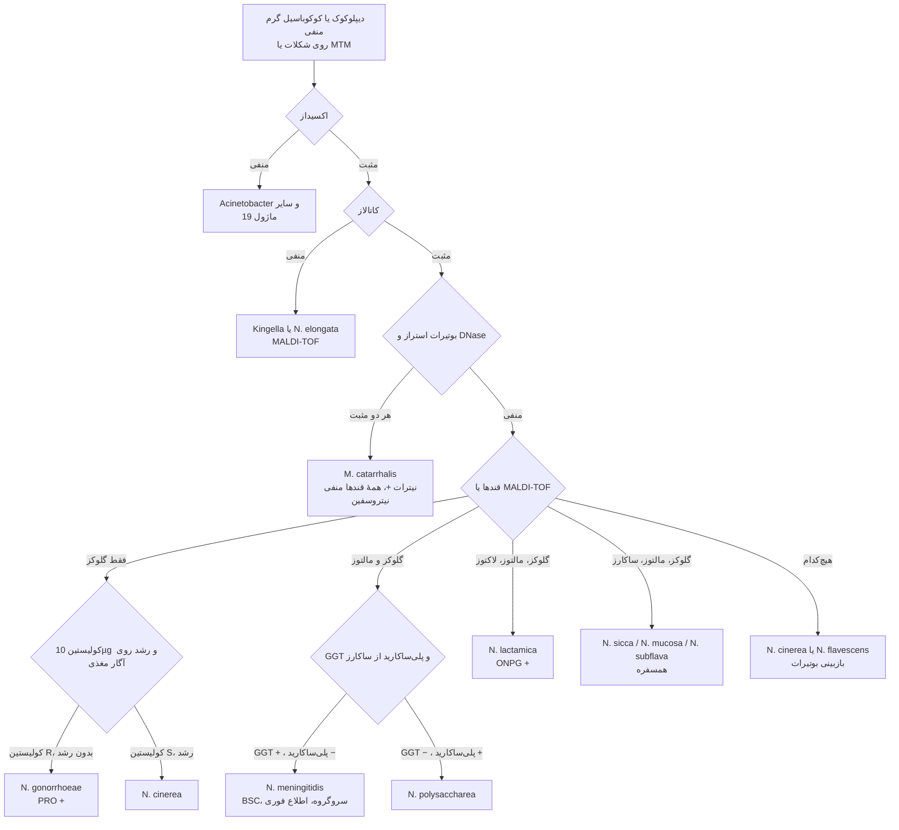
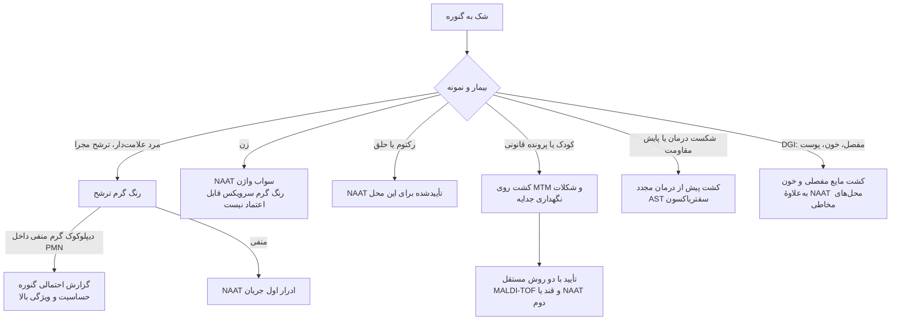
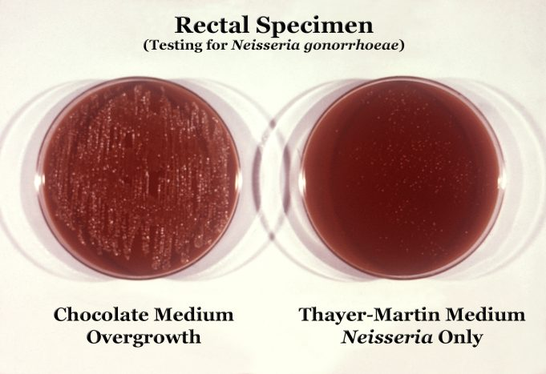
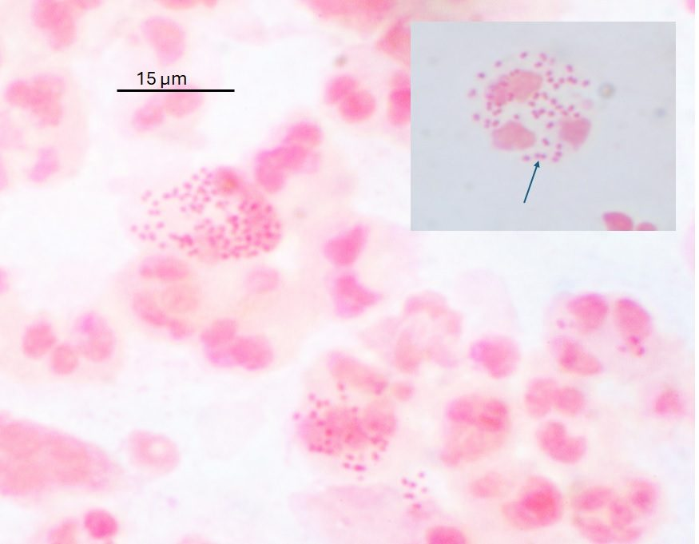
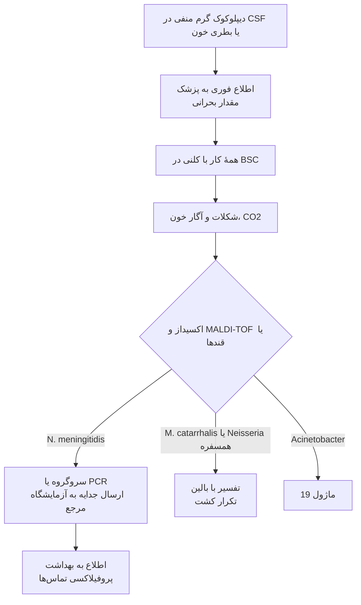
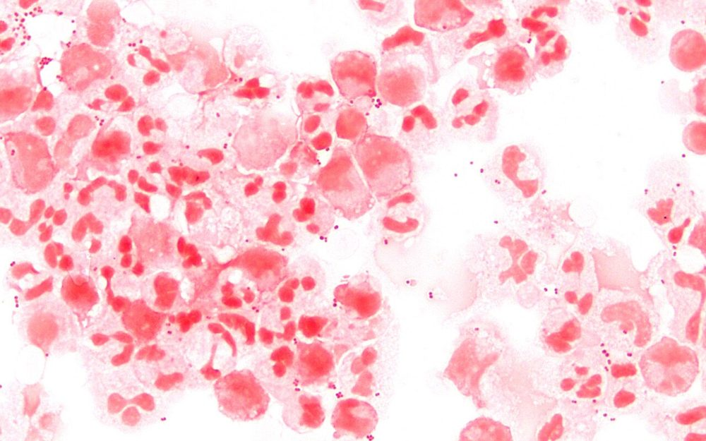

# فلوچارت‌های تشخیصی: کوکسی گرم منفی

## فلوچارت ۱: از دیپلوکوک گرم منفی تا گونه

### منطق شاخه‌ها
- **اکسیداز و کاتالاز اول:** دو شبیه مهم (*Acinetobacter* اکسیداز −؛ *Kingella* کاتالاز −) در همین دو گام حذف می‌شوند.
- **بوتیرات + DNase** سریع‌ترین راه شناسایی *M. catarrhalis* است (۵ دقیقه).
- **«فقط گلوکز» کافی نیست:** همیشه **کولیستین** و **رشد روی آگار مغذی** (یا MALDI-TOF) را اضافه کنید تا *N. cinerea* حذف شود.
- **مننگوکوکوس:** GGT تنها آنزیم اختصاصی است؛ *N. polysaccharea* روی محیط انتخابی رشد می‌کند و الگوی قندی یکسان دارد.

## فلوچارت ۲: تشخیص گونوکوکوس بر اساس نوع نمونه

**تصاویر:**

<table><tr><td align="center" width="50%"> <b>شکل ۱۶.۰۶.</b> نمونهٔ رکتوم برای <i>N. gonorrhoeae</i>: رشد بیش از حد فلور نرمال روی آگار شکلات (چپ) در برابر رشد فقط <i>Neisseria</i> روی محیط Thayer-Martin (راست) منبع: Wikimedia Commons، <a href="https://commons.wikimedia.org/wiki/File:Neisseria_gonorrhoeae_01.png">Wikimedia Commons</a>، Public domain</td><td align="center" width="50%"> <b>شکل ۱۶.۰۷.</b> رنگ گرم سواب واژن: گونوکوکوس‌های جفتی داخل PMN (پیکان) منبع: Graham Beards، <a href="https://commons.wikimedia.org/wiki/File:Neisseria_gonorrhoeae_and_pus_cells_in_a_vaginal_swab_(Gram_stain).jpg">Wikimedia Commons</a>، <a href="https://creativecommons.org/licenses/by-sa/4.0">CC BY-SA 4.0</a></td></tr></table>

## فلوچارت ۳: دیپلوکوک گرم منفی در CSF یا خون

**تصاویر:**

<table><tr><td align="center" width="50%"> <b>شکل ۱۶.۰۸.</b> رنگ گرم CSF (۱۰۰۰×): دیپلوکوک‌های گرم منفی همراه با PMN؛ از این نمونه <i>N. meningitidis</i> کشت شد منبع: Microman12345، <a href="https://commons.wikimedia.org/wiki/File:Neisseria_meningitidis_CSF_Gram_1000.jpg">Wikimedia Commons</a>، <a href="https://creativecommons.org/licenses/by-sa/4.0">CC BY-SA 4.0</a></td></tr></table>

