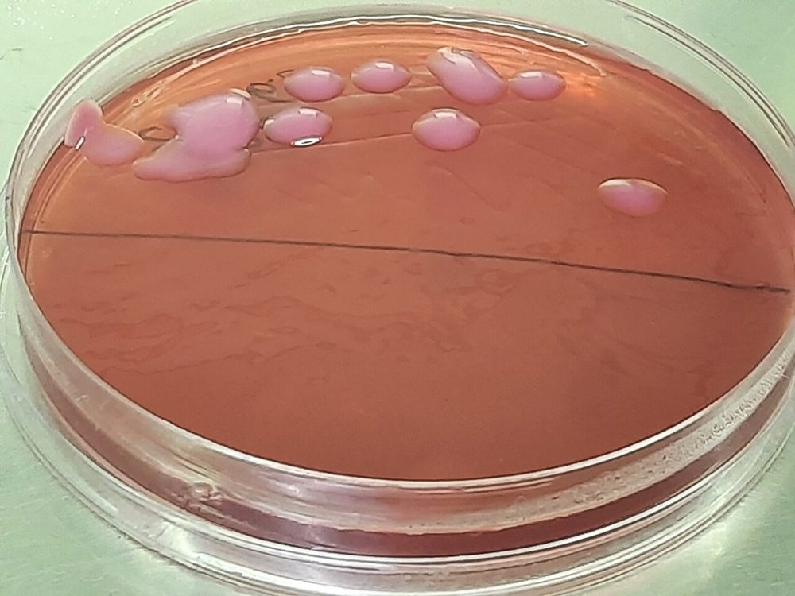
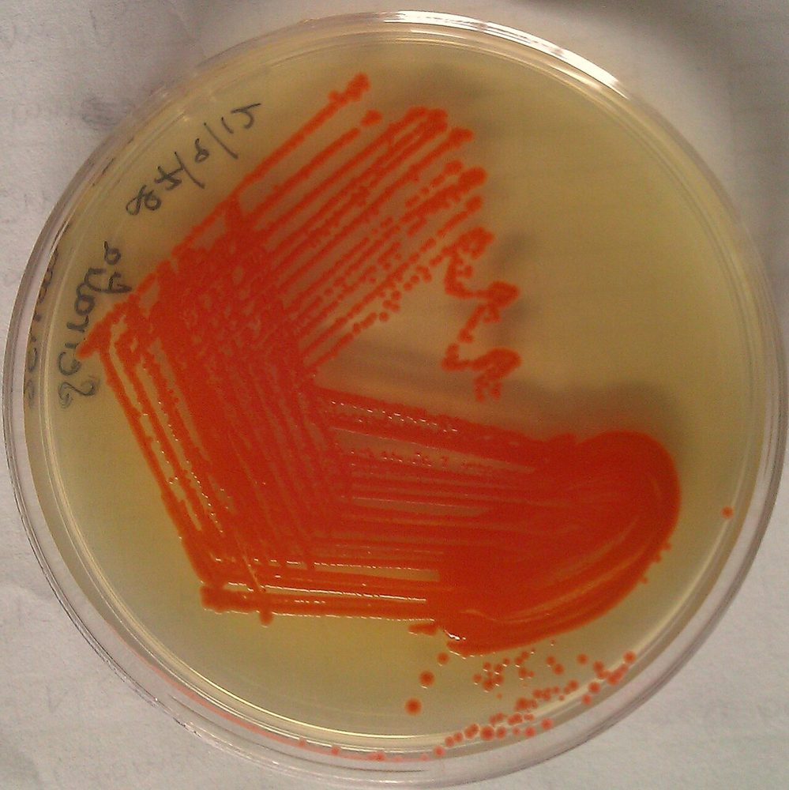
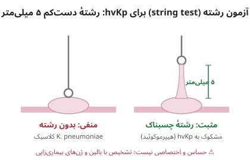
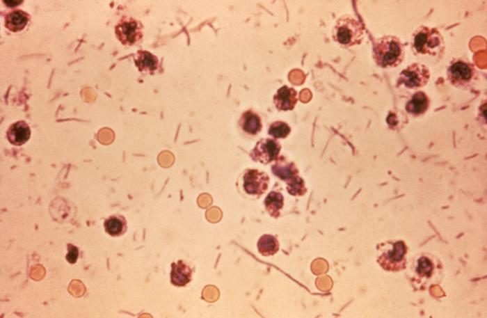
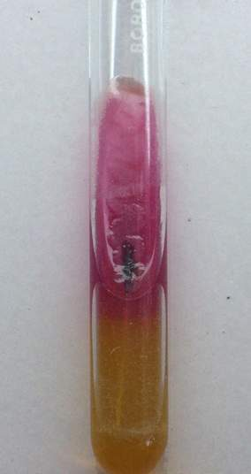
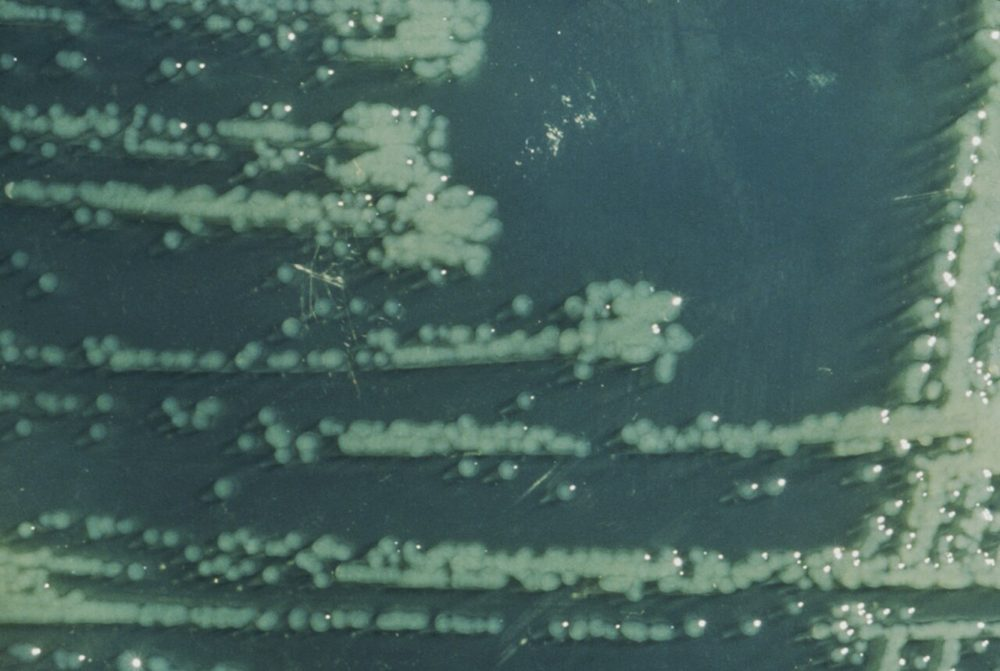
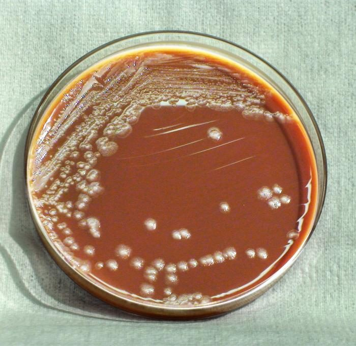
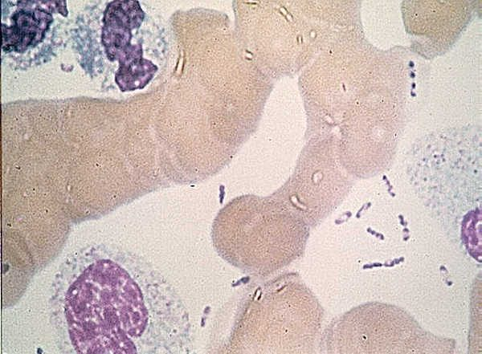
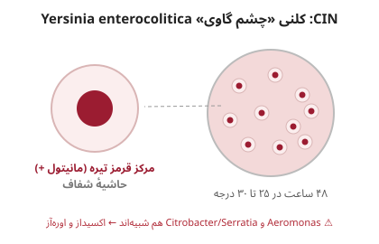

# جدول‌های افتراقی: Enterobacterales

> نمادها: **+** (≥ ۹۰٪)، **−** (≥ ۹۰٪ منفی)، **v** متغیر، **w** ضعیف، **L** دیررس. شرح تست‌ها: [11_Culture_Media/08](../11_Culture_Media/08_Biochemical_Tube_Media.md) (TSI، LIA، SIM/MIO، سیترات، اوره، MR-VP، دکربوکسیلازها، PAD، مالونات)؛ [12_Identification_Tests/02](../12_Identification_Tests/02_Spot_Rapid_Tests.md) (اکسیداز، ایندول اسپات، ONPG).

## جدول ۱: تعریف خانواده و شبیه‌ها

| ویژگی | Enterobacterales | *Plesiomonas* / *Aeromonas* / *Vibrio* | غیرتخمیری‌ها (*Pseudomonas*، *Acinetobacter*) |
|---|---|---|---|
| **اکسیداز** | **−** | **+** | + (*Pseudomonas*) / − (*Acinetobacter*، *Stenotrophomonas*) |
| تخمیر گلوکز (TSI عمق) | **+** (A) | + | **−** (K/K) |
| نیترات ← نیتریت | **+** (تقریباً همه) | + | v |
| MacConkey | + | + | + |

> ⚠️ ***Plesiomonas shigelloides*** از نظر ژنتیکی عضو Enterobacterales است ولی **اکسیداز +** است ← با *Shigella* (آنتی‌ژن مشترک با *S. sonnei*) اشتباه می‌شود ← [18](../18_Oxidase_Positive_Fermenters/README.md).

## جدول ۲: جنس‌ها و گونه‌های اصلی

| ارگانیسم | لاکتوز | ایندول | MR | VP | سیترات | H₂S (TSI) | اوره | تحرک | LDC | ODC | ADH | PAD |
|---|---|---|---|---|---|---|---|---|---|---|---|---|
| ***E. coli*** | **+** | **+** | + | − | **−** | − | − | + | + | v | v | − |
| ***Shigella*** A–C | − | v | + | − | − | − | − | **−** | − | − | − | − |
| ***S. sonnei*** | **L** | − | + | − | − | − | − | **−** | − | **+** | − | − |
| ***Salmonella*** (اکثر) | − | − | + | − | + | **+** | − | + | **+** | + | v | − |
| ***S.* Typhi** | − | − | + | − | **−** | **w** | − | + | + | **−** | v | − |
| ***Citrobacter freundii*** | v | − | + | − | + | **+** | w | + | **−** | v | v | − |
| ***C. koseri*** | v | **+** | + | − | + | − | v | + | − | + | v | − |
| ***K. pneumoniae*** | + | − | − | **+** | + | − | **w** | **−** | + | **−** | − | − |
| ***K. oxytoca*** | + | **+** | v | + | + | − | w | − | + | − | − | − |
| ***K. aerogenes*** | + | − | − | + | + | − | − | **+** | **+** | + | − | − |
| ***E. cloacae*** complex | + | − | − | + | + | − | v | + | **−** | + | **+** | − |
| ***Serratia marcescens*** | − (L) | − | v | + | + | − | − | + | + | + | − | − |
| ***Hafnia alvei*** | − | − | v | v (+ در ۲۵°C) | − | − | − | + | + | + | − | − |
| ***Proteus mirabilis*** | − | **−** | + | v | v | **+** | **+** | **+ (سوارم)** | − | **+** | − | **+** |
| ***P. vulgaris*** | − | **+** | + | − | v | **+** | **+** | + (سوارم) | − | **−** | − | **+** |
| ***Morganella morganii*** | − | + | + | − | **−** | − | **+** | + | − | **+** | − | **+** |
| ***Providencia*** | − | + | + | − | **+** | − | v (*P. rettgeri* +) | + | − | − | − | **+** |
| ***Y. enterocolitica*** | − | v | + | − (+ در ۲۵°C) | − | − | **+** | **− در ۳۵°C / + در ۲۵°C** | − | + | − | − |

> - **IMViC کلاسیک:** *E. coli* **++−−**؛ *K. pneumoniae* **−−++**.
> - **DNase +** و رنگدانهٔ قرمز (برخی سویه‌ها، در دمای اتاق) ← *Serratia*.
> - ***K. pneumoniae*:** کلنی **موکوئید**؛ **string test** (کشیدن رشته ≥ ۵ mm با لوپ) ← مشکوک به **hvKp**.

**تصاویر:**

<table><tr><td align="center" width="50%"> <b>شکل ۱۷.۰۱.</b> کلنی‌های موکوئید تخمیرکنندهٔ لاکتوز <i>Klebsiella pneumoniae</i> روی MacConkey (کشت BAL) منبع: Ajay Kumar Chaurasiya، <a href="https://commons.wikimedia.org/wiki/File:Mucoid_lactose-fermenting_(MLF)_colonies_of_Klebsiella_pneumoniae_on_MacConkey_agar.jpg">Wikimedia Commons</a>، <a href="http://creativecommons.org/publicdomain/zero/1.0/deed.en">CC0</a></td><td align="center" width="50%"> <b>شکل ۱۷.۰۲.</b> کلنی‌های رنگدانه‌دار (قرمز) <i>Serratia marcescens</i> روی آگار مغذی منبع: User:Microrao، <a href="https://commons.wikimedia.org/wiki/File:Serratia_marcescens_pigment_cropped_and_balanced.jpg">Wikimedia Commons</a>، <a href="https://creativecommons.org/licenses/by-sa/4.0">CC BY-SA 4.0</a></td></tr></table>

> **شکل ۱۷.۰۳.** آزمون رشته (string test) برای *K. pneumoniae* هیپرویرولانت: رشتهٔ دست‌کم ۵ میلی‌متر با لوپ — منبع: رسم آموزشی همین مخزن (شماتیک؛ مقیاس واقعی نیست)

## جدول ۳: *E. coli* در برابر *Shigella*

| ویژگی | *E. coli* | *E. coli* «غیرفعال» و EIEC | *Shigella* |
|---|---|---|---|
| لاکتوز | + | **− یا L** | − (*S. sonnei* L) |
| گاز از گلوکز | + | v | **−** (به‌جز برخی *S. flexneri* 6، *S. boydii*) |
| تحرک | + (اکثر) | **−** | **−** |
| لیزین دکربوکسیلاز | + (اغلب) | v | **−** |
| **استات** و **موکات** | + | **+ (اغلب)** | **−** |
| آگلوتیناسیون آنتی‌سرم *Shigella* | − | **گاه +** (واکنش متقاطع) | + |
| **MALDI-TOF** | ⚠️ **جدا نمی‌کند** | ⚠️ | ⚠️ ← بیوشیمی + سرولوژی |

## جدول ۴: سروگروه‌های *Shigella*

| سروگروه | گونه | مانیتول | ODC | ONPG | نکته |
|---|---|---|---|---|---|
| **A** | *S. dysenteriae* | **−** | − | v | تیپ ۱: **توکسین شیگا** ← HUS |
| **B** | *S. flexneri* | + | − | − | شایع در کشورهای در حال توسعه |
| **C** | *S. boydii* | + | − | − | |
| **D** | *S. sonnei* | + | **+** | **+** | شایع در کشورهای صنعتی؛ **XDR** |

**تصاویر:**

<table><tr><td align="center" width="50%"> <b>شکل ۱۷.۰۴.</b> اگزودای مدفوع در شیگلوز: لکوسیت‌ها و گلبول‌های قرمز فراوان مشاهده می‌شود منبع: Centers for Disease Control and Prevention Publich Health Image Librar، <a href="https://commons.wikimedia.org/wiki/File:Shigella_stool.jpg">Wikimedia Commons</a>، Public domain</td></tr></table>

## جدول ۵: *Salmonella*

| ویژگی | *S.* Typhi | *S.* Paratyphi A | *Salmonella* غیرتیفوئیدی |
|---|---|---|---|
| H₂S (TSI) | **ضعیف («یقهٔ سیاه»)** | **−** | **+** (قوی) |
| گاز | **−** | + | + |
| سیترات | **−** | − | + |
| ODC | **−** | + | + |
| LDC | + | **−** | + |
| سروگروه O | **D** (+ **Vi**) | **A** | B، C1، C2، D، E… |
| نمونهٔ اصلی | **خون** (هفتهٔ اول)، مغز استخوان | خون | **مدفوع** |

> **مالونات +** ← *Salmonella* زیرگونه‌های IIIa/IIIb (*arizonae*/*diarizonae*، خزندگان)؛ زیرگونهٔ I منفی است.

**تصاویر:**

<table><tr><td align="center" width="50%"> <b>شکل ۱۷.۰۵.</b> TSI در <i>S.</i> Typhi: ته اسیدی، شیب قلیایی و رگهٔ باریک H₂S در محل اتصال ته و شیب منبع: Microrao، <a href="https://commons.wikimedia.org/wiki/File:TSI_agar_S_typhi.jpg">Wikimedia Commons</a>، Public domain</td></tr></table>

## جدول ۶: *Yersinia*

| ویژگی | *Y. enterocolitica* | *Y. pseudotuberculosis* | *Y. pestis* ☣️ |
|---|---|---|---|
| تحرک ۲۵°C | **+** | **+** | **−** |
| اوره‌آز | + | + | **−** |
| ODC | **+** | − | − |
| ساکارز | **+** | − | − |
| ایندول | v | − | − |
| محیط | **CIN** («چشم گاو»)، غنی‌سازی سرد | CIN | آگار خون/MAC، رشد کند |
| رنگ گرم | کوکوباسیل | کوکوباسیل | **دوقطبی** («سنجاق قفلی») |

**تصاویر:**

<table><tr><td align="center" width="50%"> <b>شکل ۱۷.۰۶.</b> کلنی‌های لاکتوز منفی <i>Yersinia enterocolitica</i> روی آگار Hektoen منبع: CDC، <a href="https://commons.wikimedia.org/wiki/File:Yersinia_enterocolitica_colonies_Hektoen.jpg">Wikimedia Commons</a>، Public domain</td><td align="center" width="50%"> <b>شکل ۱۷.۰۷.</b> کلنی‌های <i>Yersinia pestis</i> روی آگار شکلات پس از ۷۲ ساعت در ۲۵°C منبع: Department of Health and Human Services، <a href="https://commons.wikimedia.org/wiki/File:Yersinia_pestis_HHS.jpg">Wikimedia Commons</a>، Public domain</td></tr><tr><td align="center" width="50%"> <b>شکل ۱۷.۰۸.</b> رنگ‌آمیزی Wayson: <i>Y. pestis</i> با نمای دوقطبی «سنجاق قفلی» منبع: U.S. Center for Disease Control، <a href="https://commons.wikimedia.org/wiki/File:Yersinia_pestis_wayson.jpg">Wikimedia Commons</a>، Public domain</td></tr></table>

> **شکل ۱۷.۰۹.** کلنی «چشم گاوی» *Yersinia enterocolitica* روی CIN: مرکز قرمز تیره و حاشیهٔ شفاف — منبع: رسم آموزشی همین مخزن (شماتیک؛ مقیاس واقعی نیست)

## جدول ۷: مقاومت ذاتی (CLSI M100-Ed36 Appendix B1)

> اگر تست شود، **R گزارش شود**. سفالوسپورین‌های نسل ۳، سفپیم، آزترئونام، پیپراسیلین–تازوباکتام، ترکیبات جدید (CZA، MEV، IMR) و کارباپنم‌ها در هیچ Enterobacterales مقاومت ذاتی ندارند.

| ارگانیسم | مقاومت ذاتی |
|---|---|
| ***Klebsiella*** (*pneumoniae*، *oxytoca*، *variicola*)، *Raoultella*، *C. koseri*، *E. hermannii* | آمپی‌سیلین، تیکارسیلین |
| ***E. cloacae*** complex، ***K. aerogenes*** | آمپی‌سیلین، آموکسی‌کلاو، آمپی‌سیلین–سولباکتام، سفالوسپورین نسل ۱، **سفامایسین‌ها** (سفوکسیتین) |
| ***Hafnia alvei*** | مانند *Enterobacter* + **کولیستین/پلی‌میکسین B** |
| ***C. freundii*** | آمپی‌سیلین، آموکسی‌کلاو، آمپی‌سیلین–سولباکتام، سفالوسپورین نسل ۱ و ۲، سفامایسین‌ها |
| ***Serratia marcescens*** | آمپی‌سیلین، آموکسی‌کلاو، آمپی‌سیلین–سولباکتام، سفالوسپورین نسل ۱ و ۲، سفامایسین‌ها، **نیتروفورانتوئین**، **کولیستین** |
| ***Y. enterocolitica*** | آمپی‌سیلین، آموکسی‌کلاو، تیکارسیلین، سفالوسپورین نسل ۱ |
| ***P. mirabilis*** | تتراسایکلین‌ها، **تیگسایکلین**، **نیتروفورانتوئین**، **کولیستین** (به پنی‌سیلین و سفالوسپورین‌ها مقاومت ذاتی **ندارد**) |
| ***P. vulgaris***، *P. penneri* | آمپی‌سیلین، سفالوسپورین نسل ۱ و ۲ + تتراسایکلین‌ها، تیگسایکلین، نیتروفورانتوئین، کولیستین |
| ***Morganella morganii*** | آمپی‌سیلین، آموکسی‌کلاو، سفالوسپورین نسل ۱ و ۲، تیگسایکلین، نیتروفورانتوئین، کولیستین |
| ***Providencia*** (*rettgeri*، *stuartii*) | آمپی‌سیلین، آموکسی‌کلاو، سفالوسپورین نسل ۱، تتراسایکلین‌ها، تیگسایکلین، نیتروفورانتوئین، کولیستین؛ ***P. stuartii***: + **جنتامایسین، توبرامایسین** (نه آمیکاسین) |
| ***E. coli***، ***Salmonella***، ***Shigella*** | بتالاکتام: **ندارد** |

> - **Proteeae** (*Proteus*، *Providencia*، *Morganella*) ممکن است **MIC ایمی‌پنم بالاتر** داشته باشند (سازوکار غیرکارباپنماز) ← اگر S بود، S گزارش شود.
> - ⚠️ ***Salmonella*/*Shigella*:** آمینوگلیکوزیدها، سفالوسپورین نسل ۱ و ۲ و سفامایسین‌ها **ممکن است در آزمایشگاه فعال به نظر برسند ولی بالینی مؤثر نیستند** ← **S گزارش نشوند**.
> - همهٔ Enterobacterales: کلیندامایسین، داپتومایسین، فوزیدیک اسید، گلیکوپپتیدها، لینزولید، ریفامپین و ماکرولیدها (به‌جز آزیترومایسین در *Salmonella*/*Shigella*).
> - EUCAST: «Expected Resistant Phenotypes» (فهرست مشابه با تفاوت‌های جزئی) ← [AST/00_Principles/02](../AST/00_Principles/02_CLSI_vs_EUCAST.md).

