

# فلوچارت‌های تشخیصی: Enterobacterales

## فلوچارت ۱: از باسیل گرم منفی تا گروه

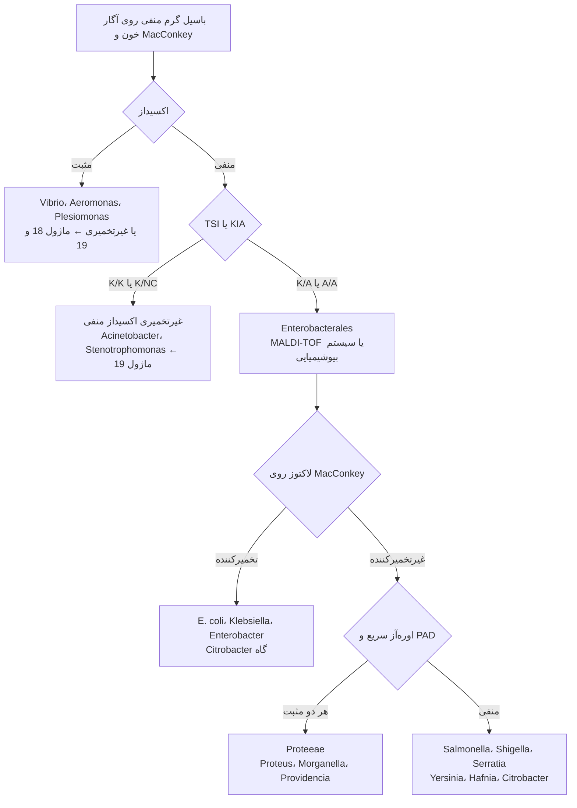

**تصاویر:**

<table><tr><td align="center" width="50%">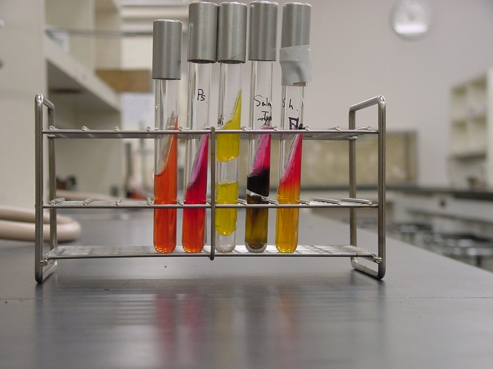 <b>شکل ۱۷.۰۸.</b> واکنش‌های TSI، از چپ: کنترل تلقیح‌نشده، <i>P. aeruginosa</i> (بدون تخمیر)، <i>E. coli</i> (اسید/اسید، گاز +)، <i>Salmonella</i> Typhimurium (H₂S +) و <i>Shigella</i> منبع: Y_tambe، <a href="https://commons.wikimedia.org/wiki/File:TSIagar.JPG">Wikimedia Commons</a>، <a href="https://creativecommons.org/licenses/by-sa/3.0">CC BY-SA 3.0</a></td></tr></table>

## فلوچارت ۲: تخمیرکنندگان لاکتوز

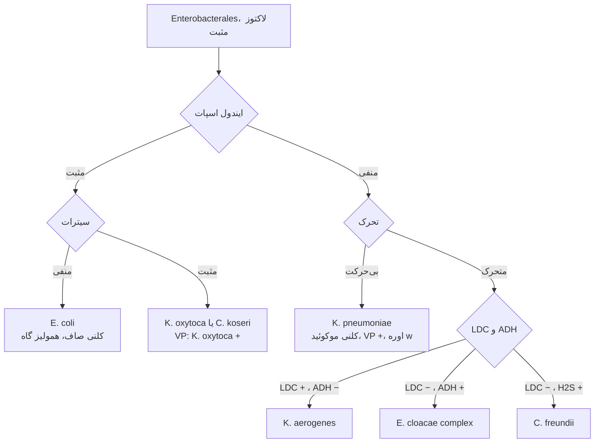

**تصاویر:**

<table><tr><td align="center" width="50%">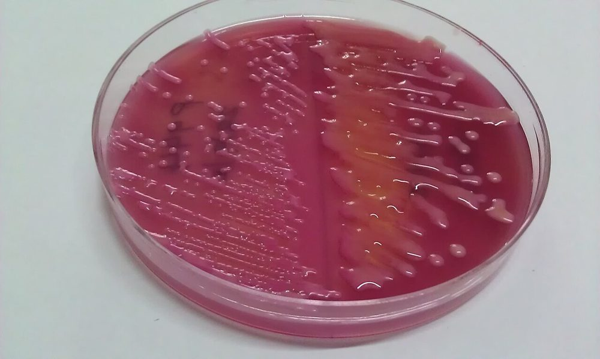 <b>شکل ۱۷.۰۹.</b> MacConkey: کلنی‌های صورتی تخمیرکنندهٔ لاکتوز؛ <i>E. coli</i> خشک و <i>K. pneumoniae</i> موکوئید منبع: Microrao، <a href="https://commons.wikimedia.org/wiki/File:E.coli_vs_K.pneumoniae.jpg">Wikimedia Commons</a>، <a href="https://creativecommons.org/licenses/by-sa/4.0">CC BY-SA 4.0</a></td><td align="center" width="50%">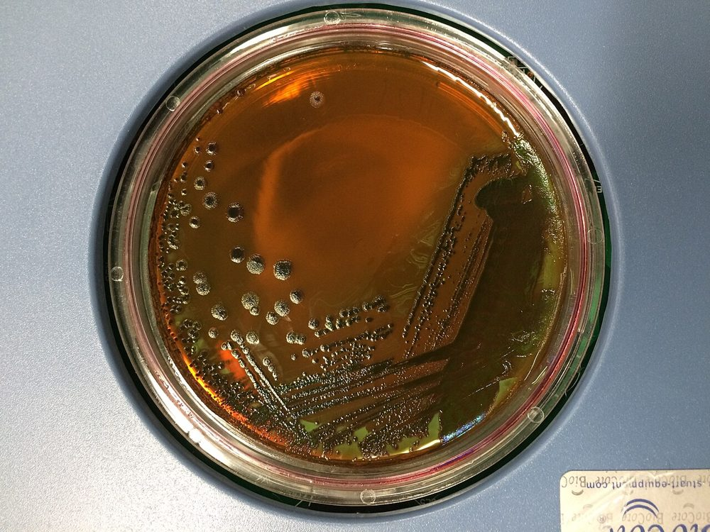 <b>شکل ۱۷.۱۰.</b> کشت چهاربخشی <i>E. coli</i> روی آگار EMB: کلنی‌های تیره با جلای فلزی سبز منبع: Eunice Laurent، <a href="https://commons.wikimedia.org/wiki/File:E_coli_on_EMB_plate.jpg">Wikimedia Commons</a>، <a href="https://creativecommons.org/licenses/by-sa/4.0">CC BY-SA 4.0</a></td></tr><tr><td align="center" width="50%">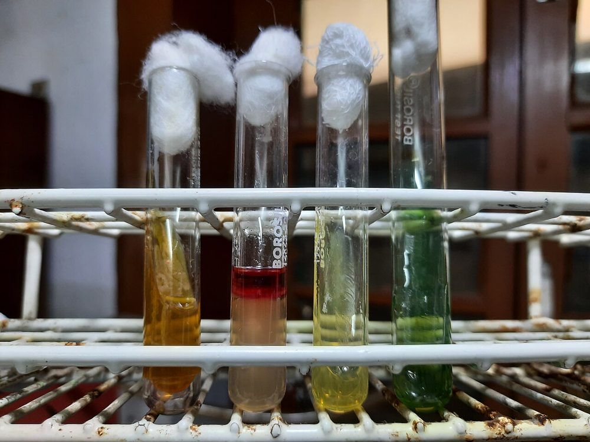 <b>شکل ۱۷.۱۱.</b> آزمون‌های بیوشیمیایی <i>E. coli</i>: TSI، SIM، سیترات و اوره منبع: Ajay Kumar Chaurasiya، <a href="https://commons.wikimedia.org/wiki/File:E._coli_Biochemical_Tests.jpg">Wikimedia Commons</a>، <a href="https://creativecommons.org/licenses/by-sa/4.0">CC BY-SA 4.0</a></td><td align="center" width="50%">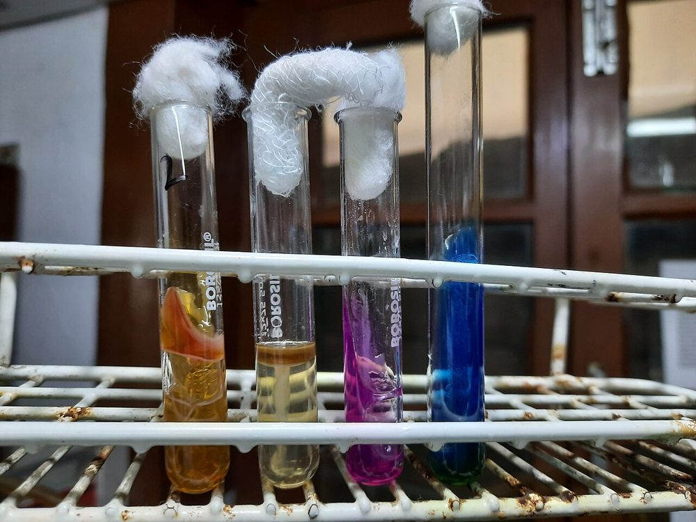 <b>شکل ۱۷.۱۲.</b> آزمون‌های بیوشیمیایی <i>K. pneumoniae</i>: TSI، SIM، سیترات و اوره منبع: Ajay Kumar Chaurasiya، <a href="https://commons.wikimedia.org/wiki/File:Klebsiella_pneumoniae_Biochemical_Tests.jpg">Wikimedia Commons</a>، <a href="https://creativecommons.org/licenses/by-sa/4.0">CC BY-SA 4.0</a></td></tr></table>

## فلوچارت ۳: غیرتخمیرکنندگان لاکتوز و پاتوژن‌های روده‌ای

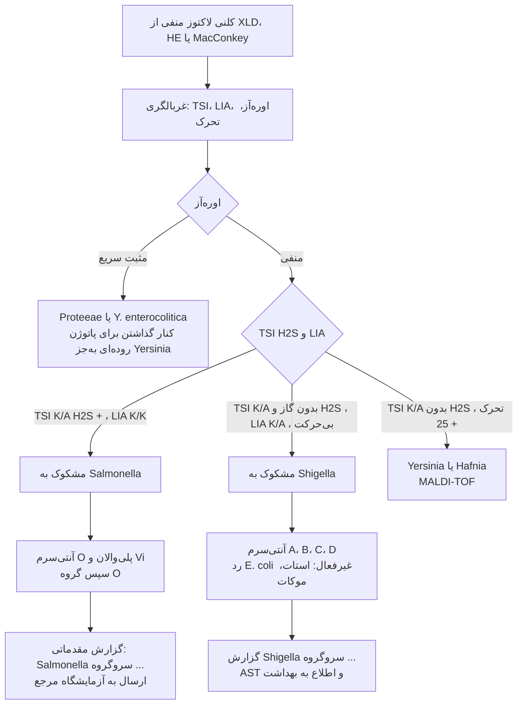

### منطق شاخه‌ها
- **اوره‌آز اول** در مدفوع: *Proteus* (کلنی H₂S + روی XLD/HE) شایع‌ترین «شبه‌*Salmonella*» است؛ اوره‌آز سریع آن را حذف می‌کند.
- **LIA:** *Salmonella* لیزین + (K/K) و *Proteus* دآمیناز + (R/A) است.
- **MALDI-TOF** *Salmonella* را تا جنس شناسایی می‌کند ولی **سروتیپ نمی‌دهد**؛ *Shigella* را از *E. coli* **جدا نمی‌کند**.
- سرولوژی **روی کلنی از محیط غیرانتخابی** (آگار خون یا TSI شیب) انجام شود.

**تصاویر:**

<table><tr><td align="center" width="50%">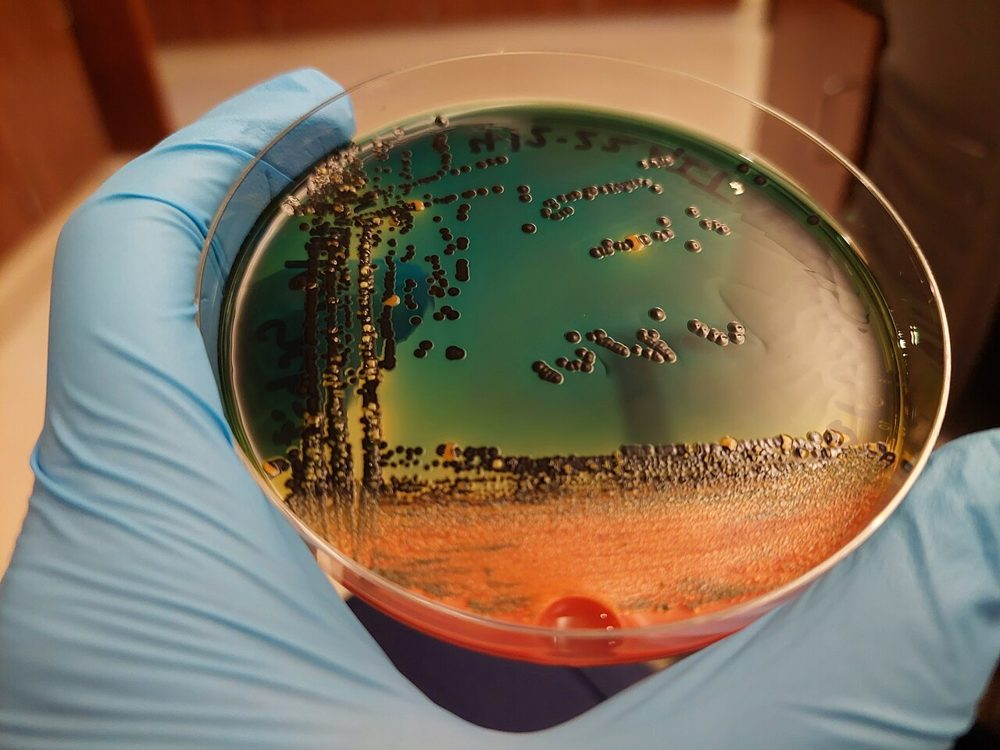 <b>شکل ۱۷.۱۳.</b> کشت مدفوع روی آگار Hektoen: کلنی‌های نارنجی (تخمیر لاکتوز) و کلنی‌های سیاه (تولید H₂S) منبع: Mediocreclementine، <a href="https://commons.wikimedia.org/wiki/File:Hektoen_enteric_agar_stool_culture.jpg">Wikimedia Commons</a>، <a href="http://creativecommons.org/publicdomain/zero/1.0/deed.en">CC0</a></td><td align="center" width="50%">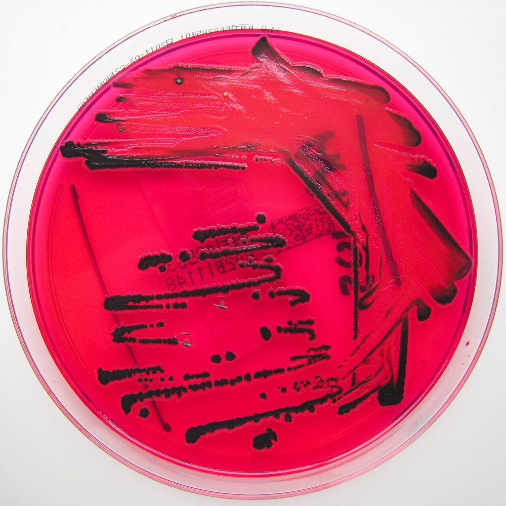 <b>شکل ۱۷.۱۴.</b> <i>Salmonella</i> روی آگار XLD: کلنی‌های با مرکز سیاه (تولید H₂S) منبع: Nathan Reading from Halesowen, UK، <a href="https://commons.wikimedia.org/wiki/File:Salmonella_species_growing_on_XLD_agar_-_Showing_H2S_production.jpg">Wikimedia Commons</a>، <a href="https://creativecommons.org/licenses/by/2.0">CC BY 2.0</a></td></tr><tr><td align="center" width="50%">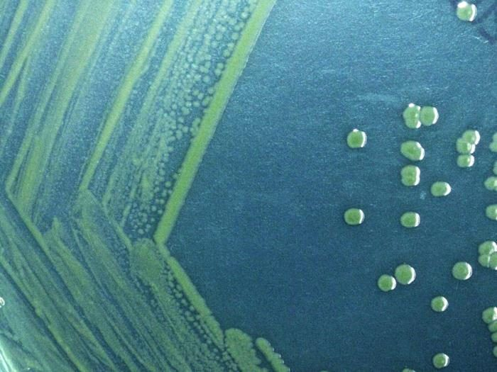 <b>شکل ۱۷.۱۵.</b> کلنی‌های <i>Shigella sonnei</i> روی آگار Hektoen پس از ۴۸ ساعت منبع: Todd Parker, Ph.D., Assoc Director for Laboratory Science, Div of Prep، <a href="https://commons.wikimedia.org/wiki/File:Gram_negative_Shigella_sonnei_bacteria_which_spent_48_hours_cultured_on_Hektoen_enteric_agar.jpg">Wikimedia Commons</a>، Public domain</td></tr></table>

## فلوچارت ۴: کشت خون یا ادرار با Enterobacterales ← مسیر AST

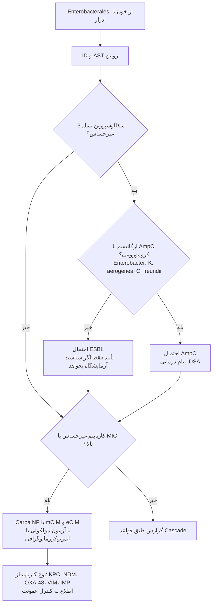

> جزئیات: [ESBL](../AST/02_Beta_Lactamases/03_ESBL.md) · [AmpC](../AST/02_Beta_Lactamases/04_AmpC.md) · [کارباپنمازها](../AST/02_Beta_Lactamases/05_Carbapenemases.md) · [انتخاب و گزارش](../AST/00_Principles/03_Selection_and_Reporting.md).

