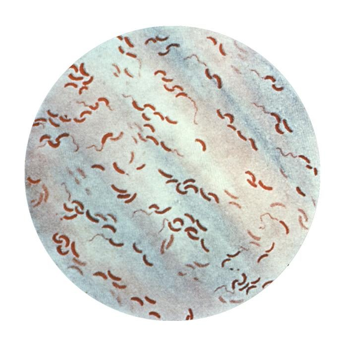
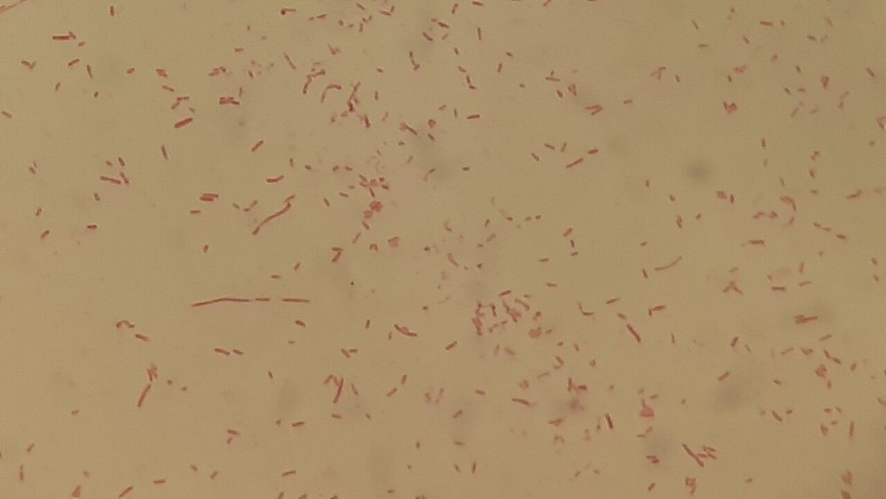
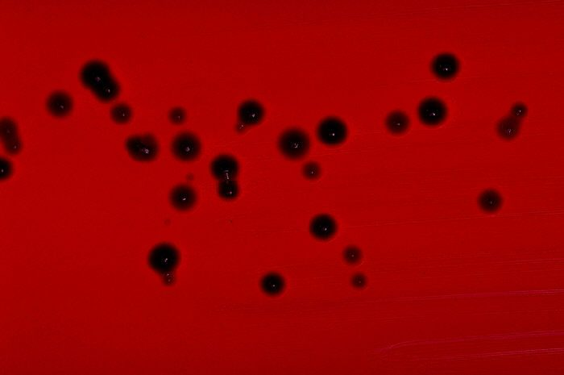
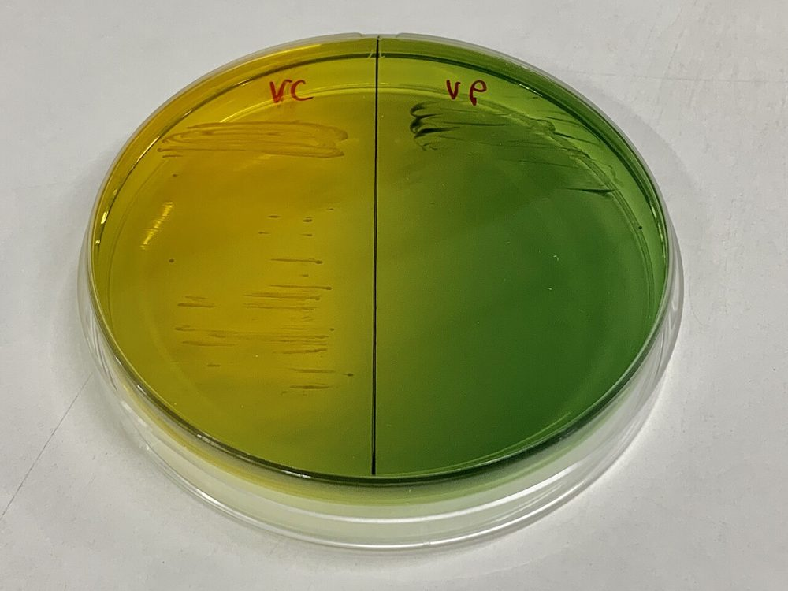
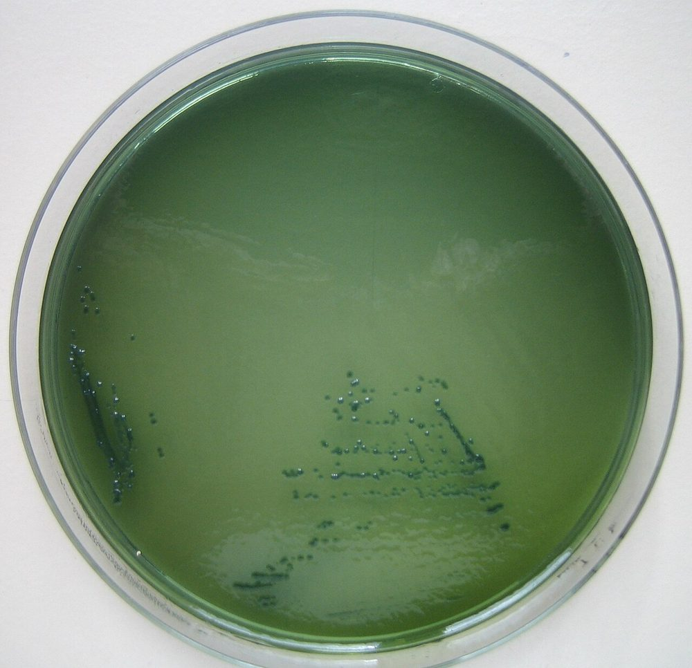
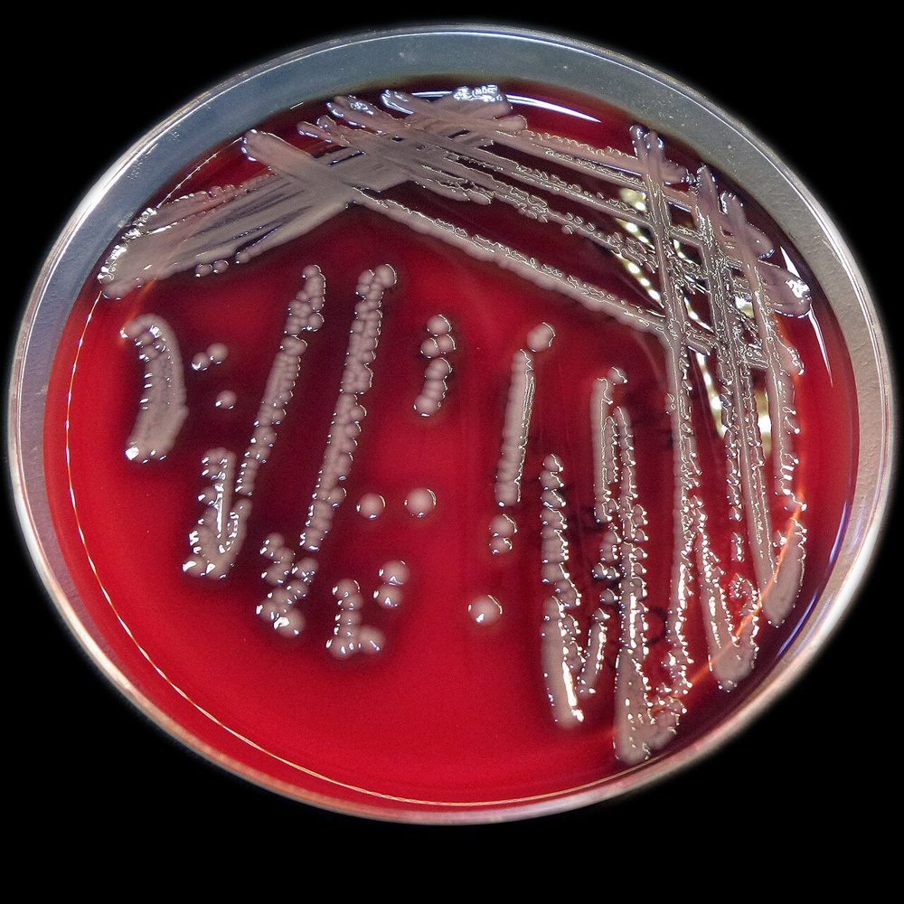
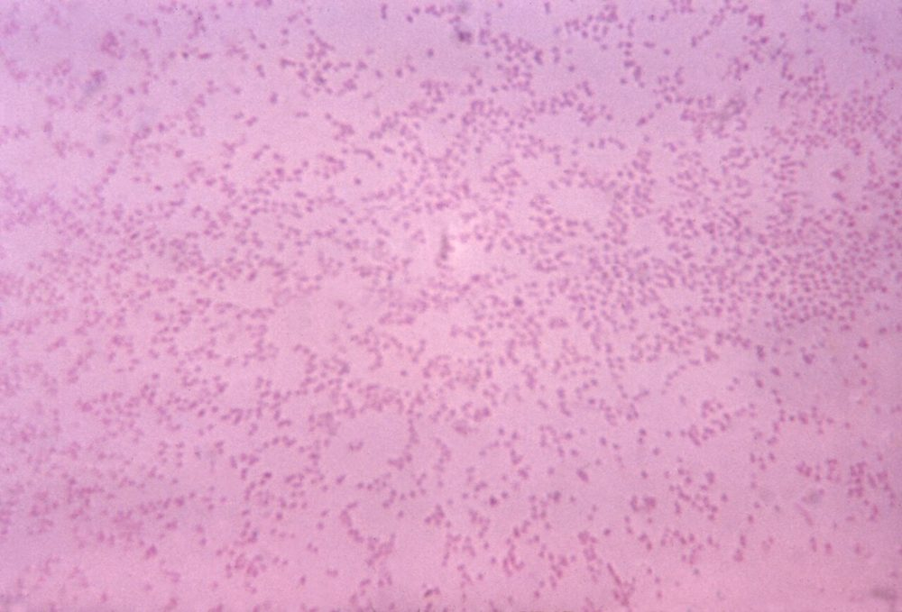

# جدول‌های افتراقی: باسیل‌های گرم منفی اکسیداز مثبت تخمیرکننده

> نمادها: **+** (≥ ۹۰٪)، **−** (≥ ۹۰٪ منفی)، **v** متغیر، **w** ضعیف. شرح تست‌ها: [12_Identification_Tests/02](../12_Identification_Tests/02_Spot_Rapid_Tests.md) (اکسیداز، نخ، ایندول، DNase، ONPG)، [03](../12_Identification_Tests/03_Disk_and_Growth_Tests.md) (تحرک، رشد در نمک)؛ دکربوکسیلازها و OF: [11_Culture_Media/08](../11_Culture_Media/08_Biochemical_Tube_Media.md).

## جدول ۱: چهار جنس در برابر شبیه‌ها

| ویژگی | *Vibrio* | *Aeromonas* | *Plesiomonas* | *Pasteurella* | Enterobacterales | *Shewanella* |
|---|---|---|---|---|---|---|
| **اکسیداز** | **+** | **+** | **+** | **+** (گاه w) | **−** | **+** |
| تخمیر گلوکز (OF) | F | F | F | F | F | **غیرواکنش‌گر/O** |
| **MacConkey** | + | + | + | **−** | + | + |
| **آزمون نخ** | **+** | − یا w | − | − | − | − |
| رشد در **NaCl ۰٪** | v (*V. cholerae*، *V. mimicus* +) | + | + | — | + | v |
| رشد در **NaCl ۶٪** | v (هالوفیل‌ها +) | − | − | — | v | v |
| β-همولیز (آگار خون) | v | **+** (اغلب، وسیع) | − | − | v | v |
| **LDC / ODC / ADH** | + / v / − | v / − / **+** | **+ / + / +** | − / + / − | متغیر | − / + / − |
| ایندول | + | + | + | **+** | v | − |
| **اینوزیتول** | − | − | **+** | − | v | − |
| DNase | + | + | **−** | − | v | + |
| H₂S (TSI) | − | − | − | − | v | **+** |
| حرکت | + (قطبی، «تیرمانند») | + | + | **−** | v | + |

> - **Plesiomonas = تنها عضو اکسیداز + Enterobacterales**؛ **هر سه** دکربوکسیلاز + و **اینوزیتول +**.
> - **دیسک O/129 (۱۵۰ µg)** قبلاً برای جدا کردن *Vibrio* (S) از *Aeromonas* (R) به کار می‌رفت؛ سویه‌های **مقاوم** *V. cholerae* (O139 و برخی O1) آن را **غیرقابل‌اعتماد** کرده‌اند ← آزمون نخ، رشد در نمک و MALDI-TOF.
> - ***Chromobacterium violaceum***: اکسیداز + (رنگدانه خوانش را سخت می‌کند)، تخمیری، کلنی **بنفش** (سویه‌های بی‌رنگ هم وجود دارد)، ایندول −، رشد روی MacConkey.

**تصاویر:**

<table><tr><td align="center" width="50%"> <b>شکل ۱۸.۰۱.</b> رنگ گرم <i>Vibrio cholerae</i>: باسیل‌های خمیدهٔ گرم منفی منبع: CDC، <a href="https://commons.wikimedia.org/wiki/File:Vibrio_cholerae_gram_stain_CDC.jpg">Wikimedia Commons</a>، Public domain</td><td align="center" width="50%"> <b>شکل ۱۸.۰۲.</b> رنگ گرم کشت <i>Aeromonas hydrophila</i>: باسیل‌های گرم منفی منبع: Ajay Kumar Chaurasiya، <a href="https://commons.wikimedia.org/wiki/File:Aeromonas_hydrophila_in_Gram_staining_of_Culture_Microscopy.jpg">Wikimedia Commons</a>، <a href="https://creativecommons.org/licenses/by/4.0">CC BY 4.0</a></td></tr><tr><td align="center" width="50%"> <b>شکل ۱۸.۰۳.</b> کلنی‌های بنفش تیرهٔ <i>Chromobacterium violaceum</i> روی آگار خون‌دار منبع: CDC/ Dr. W.A. Clark، <a href="https://commons.wikimedia.org/wiki/File:Chromobacterium_violaceum_blood_agar.jpg">Wikimedia Commons</a>، Public domain</td></tr></table>

## جدول ۲: گونه‌های *Vibrio*

| گونه | رنگ روی **TCBS** | NaCl ۰٪ | NaCl ۶٪ | NaCl ۸٪ | ساکارز | لاکتوز/ONPG | LDC | ODC | ADH | نکته |
|---|---|---|---|---|---|---|---|---|---|---|
| ***V. cholerae*** | **زرد** | **+** | v | − | **+** | − / **+** | + | + | − | آنتی‌سرم **O1/O139**؛ *ctxA* |
| *V. mimicus* | سبز | **+** | v | − | **−** | − / + | + | + | − | «*V. cholerae* بدون ساکارز» |
| ***V. parahaemolyticus*** | **سبز** | − | **+** | **+** | − | − / − | + | + | − | اسهال پس از غذای دریایی |
| ***V. vulnificus*** | **سبز** (اکثر) | − | + | − | − (اکثر) | **+ / +** | + | v | − | **لاکتوز +**؛ سالیسین + |
| *V. alginolyticus* | **زرد** | − | + | **+** (۱۰٪ هم) | + | − / − | + | v | − | **سوارم** روی آگار خون |
| *V. fluvialis* | زرد | − | + | v | + | − / − | **−** | − | **+** | ADH + مانند *Aeromonas* |

> **هالوفیل‌ها** (همه به‌جز *V. cholerae* و *V. mimicus*) در **براث بدون نمک رشد نمی‌کنند** ← سوسپانسیون تست‌ها و پانل‌های تجاری برای آن‌ها باید **۰٫۸۵–۱٪ NaCl** داشته باشد.

**تصاویر:**

<table><tr><td align="center" width="50%"> <b>شکل ۱۸.۰۴.</b> آگار TCBS: <i>V. cholerae</i> با کلنی‌های زرد (چپ) و <i>V. parahaemolyticus</i> با کلنی‌های سبز (راست) منبع: Chainwit.، <a href="https://commons.wikimedia.org/wiki/File:TCBS_agar_plate_of_Vibrio_Cholerae_and_vibrio_parahaemolyticus.jpg">Wikimedia Commons</a>، <a href="https://creativecommons.org/licenses/by-sa/4.0">CC BY-SA 4.0</a></td><td align="center" width="50%"> <b>شکل ۱۸.۰۵.</b> کلنی‌های سبز <i>V. parahaemolyticus</i> روی آگار TCBS منبع: Matthias M.، <a href="https://commons.wikimedia.org/wiki/File:Vibrio_parahaemolyticus_TCBS.jpg">Wikimedia Commons</a>، <a href="https://creativecommons.org/licenses/by-sa/4.0">CC BY-SA 4.0</a></td></tr></table>

## جدول ۳: *Aeromonas* و *Plesiomonas* در برابر *V. cholerae* و *Shigella*

| ویژگی | *Aeromonas* | *Plesiomonas* | *V. cholerae* | *Shigella* |
|---|---|---|---|---|
| اکسیداز | + | + | + | **−** |
| همولیز آگار خون | **β** | − | v | − |
| آزمون نخ | − یا w | − | **+** | − |
| ADH | **+** | **+** | − | − |
| LDC | v | **+** | + | − |
| ODC | − (به‌جز *A. veronii* bv. *veronii*) | **+** | + | − (*S. sonnei* +) |
| اینوزیتول | − | **+** | − | − |
| DNase | **+** | − | + | − |
| رشد روی TCBS | ضعیف/− | − | **زرد** | − |
| **آنتی‌سرم *S. sonnei*** | − | ⚠️ **گاه +** (آنتی‌ژن مشترک) | − | + |
| **MALDI-TOF** | فقط تا **کمپلکس** | خوب | خوب (سروگروه نه) | با *E. coli* اشتباه |

**تصاویر:**

<table><tr><td align="center" width="50%"> <b>شکل ۱۸.۰۶.</b> کلنی‌های <i>Aeromonas hydrophila</i> روی آگار خون‌دار (نور بازتابی) منبع: Stefan Walkowski، <a href="https://commons.wikimedia.org/wiki/File:Aeromonas_hydrophila_colonies_01.jpg">Wikimedia Commons</a>، <a href="https://creativecommons.org/licenses/by-sa/4.0">CC BY-SA 4.0</a></td></tr></table>

## جدول ۴: *Pasteurella*

| ویژگی | *P. multocida* | *P. canis* | *P. dagmatis* |
|---|---|---|---|
| منبع | گربه > سگ | سگ | سگ و گربه |
| ایندول | **+** | + (اغلب) | + |
| ODC | **+** | + | − |
| **اوره‌آز** | **−** | − | **+** |
| مانیتول | + | − | − |
| رشد روی MacConkey | **−** | − | − |
| کلنی (آگار خون/شکلات) | خاکستری، غیرهمولیتیک، گاه **موکوئید**، **بوی «موشی»** | مشابه | مشابه |
| رنگ گرم | کوکوباسیل کوچک، **رنگ‌پذیری دوقطبی** | | |

> شبیه‌ها در گازگرفتگی: *Capnocytophaga canimorsus* (اکسیداز +، کاتالاز +، رشد کند در CO₂؛ سپسیس در **اسپلنکتومی**)، *Neisseria* حیوانی، *Bergeyella* ← [20_Fastidious_GNB](../20_Fastidious_GNB/README.md).

**تصاویر:**

<table><tr><td align="center" width="50%"> <b>شکل ۱۸.۰۷.</b> رنگ گرم <i>Pasteurella multocida</i>: کوکوباسیل‌های کوچک گرم منفی (۱۱۲۵×) منبع: Centers for Disease Control and Prevention, Office of the Associate Di، <a href="https://commons.wikimedia.org/wiki/File:PHIL_3621.tif">Wikimedia Commons</a>، Public domain</td></tr></table>

