

# جدول‌های افتراقی: باسیل‌های گرم منفی غیرتخمیری

> نمادها: **+** (≥ ۹۰٪)، **−** (≥ ۹۰٪ منفی)، **v** متغیر، **w** ضعیف. شرح تست‌ها: [12_Identification_Tests/02](../12_Identification_Tests/02_Spot_Rapid_Tests.md) (اکسیداز، DNase، ایندول)، [03](../12_Identification_Tests/03_Disk_and_Growth_Tests.md) (تحرک، ۴۲°C)؛ OF و دکربوکسیلازها: [11_Culture_Media/08](../11_Culture_Media/08_Biochemical_Tube_Media.md).
>
> دو تست که فقط در این گروه کاربرد دارند: **استامید** (هیدرولیز استامید ← آمونیاک ← قلیایی، رنگ **ارغوانی/قرمز**؛ *P. aeruginosa* +، *Achromobacter* v) و **ژلاتیناز** (مایع شدن ژلاتین؛ *P. aeruginosa* و *P. fluorescens* +، *P. putida* −).

## جدول ۱: گروه‌بندی اولیه

| ویژگی | ***Acinetobacter*** | ***S. maltophilia*** | ***P. aeruginosa*** | **BCC** | ***Achromobacter*** | ***Alcaligenes faecalis*** |
|---|---|---|---|---|---|---|
| **اکسیداز** | **−** | **−** (گاه w) | **+** | **v / w** | **+** | **+** |
| رنگ گرم | **کوکوباسیل** چاق، گاه مقاوم به رنگ‌بری | باسیل مستقیم | باسیل مستقیم | باسیل | باسیل | کوکوباسیل |
| **تحرک** | **−** | **+** | **+** (قطبی، یک تاژک) | + | + (پری‌تریش) | + (پری‌تریش) |
| OF گلوکز | O (*A. baumannii*) / − (*A. lwoffii*) | O (ضعیف) | O | O | O (*A. xylosoxidans*) | **−** (غیرواکنش‌گر) |
| OF **مالتوز** | v | **+ (قوی)** | − | + | − | − |
| OF **لاکتوز** | v | v | − | **+** | − | − |
| **DNase** | − | **+** | − | − | − | − |
| **LDC** | − | **+** | − | **+** (اکثر) | − | − |
| نیترات ← نیتریت | **−** | v | + (تا **گاز N₂**) | v | + | − (نیتریت +) |
| رشد در ۴۲°C | + (*A. baumannii*؛ ۴۴°C هم) | v | **+** | v | + | v |
| مقاومت ذاتی به **کولیستین** | − | v | − | **+** | − | − |
| کلنی | صاف، کرمی؛ روی MacConkey **ارغوانی کم‌رنگ** | **اسطوخودوسی-سبز** روی آگار خون، بوی آمونیاک | رنگدانه، جلای فلزی، بوی **انگور/ذرت** | زرد گاه، کند | ریز، غیررنگدانه | لبهٔ پهن؛ **بوی میوه/سیب**؛ تغییر رنگ سبز آگار خون |

**تصاویر:**

<table><tr><td align="center" width="50%">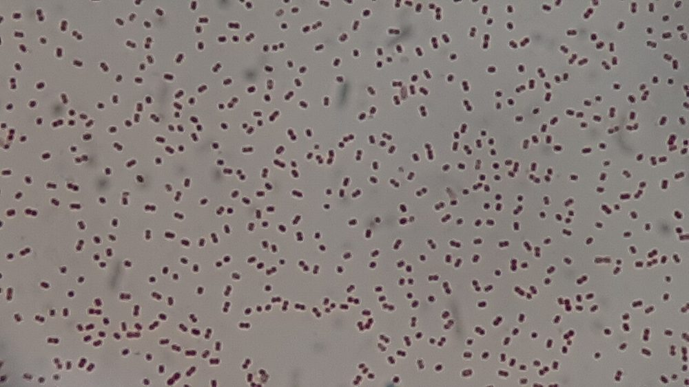 <b>شکل ۱۹.۰۱.</b> کوکوباسیل‌های گرم منفی <i>Acinetobacter baumannii</i> complex در رنگ‌آمیزی گرم منبع: Ajay Kumar Chaurasiya، <a href="https://commons.wikimedia.org/wiki/File:Gram_negative_cocobacilli_of_Acinetobacter_baumannii_complex.jpg">Wikimedia Commons</a>، <a href="https://creativecommons.org/licenses/by/4.0">CC BY 4.0</a></td><td align="center" width="50%">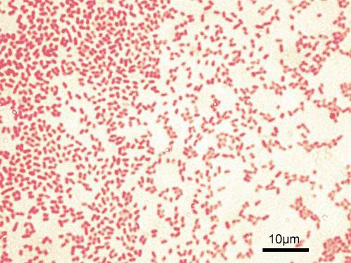 <b>شکل ۱۹.۰۲.</b> باسیل‌های گرم منفی <i>Pseudomonas aeruginosa</i> (ATCC 27853) در رنگ‌آمیزی گرم منبع: Y_tambe، <a href="https://commons.wikimedia.org/wiki/File:Pseudomonas_aeruginosa_Gram.jpg">Wikimedia Commons</a>، <a href="https://creativecommons.org/licenses/by-sa/3.0">CC BY-SA 3.0</a></td></tr><tr><td align="center" width="50%">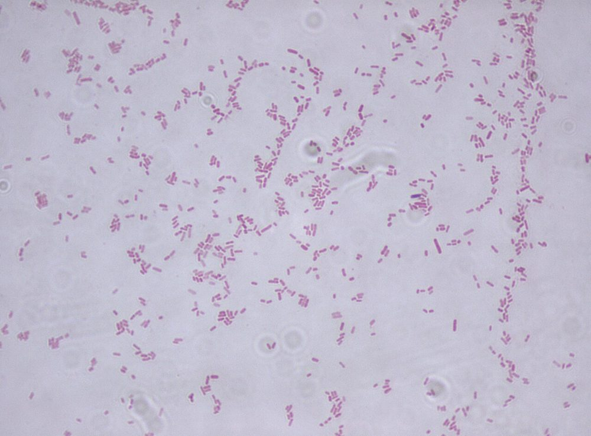 <b>شکل ۱۹.۰۳.</b> باسیل‌های گرم منفی <i>Stenotrophomonas maltophilia</i> در رنگ‌آمیزی گرم منبع: Riraq25، <a href="https://commons.wikimedia.org/wiki/File:Stenotrophomonas_maltophilia.jpg">Wikimedia Commons</a>، <a href="https://creativecommons.org/licenses/by-sa/3.0">CC BY-SA 3.0</a></td><td align="center" width="50%">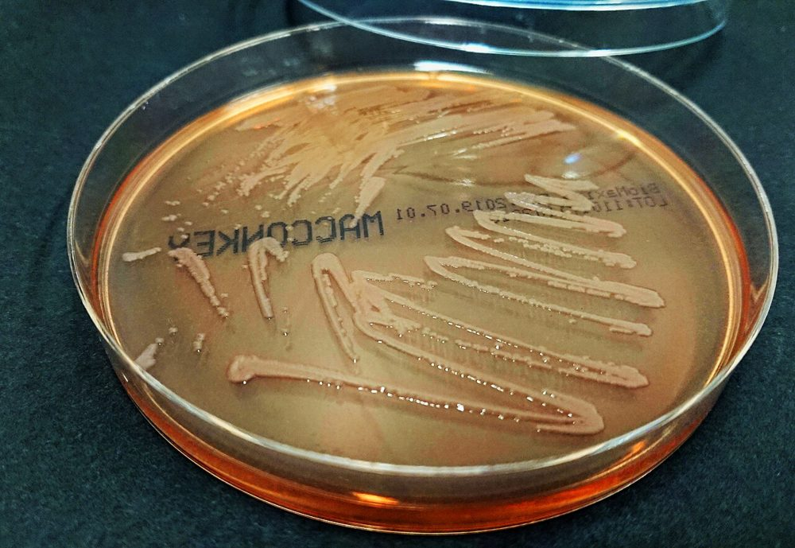 <b>شکل ۱۹.۰۴.</b> رشد جدایه‌های بالینی <i>S. maltophilia</i> روی MacConkey منبع: Dukas.ju، <a href="https://commons.wikimedia.org/wiki/File:DSC_0701_Steno.jpg">Wikimedia Commons</a>، <a href="https://creativecommons.org/licenses/by-sa/4.0">CC BY-SA 4.0</a></td></tr></table>

## جدول ۲: گونه‌های *Pseudomonas*

| ویژگی | ***P. aeruginosa*** | *P. fluorescens* | *P. putida* | *P. stutzeri* |
|---|---|---|---|---|
| **پیوسیانین** (آبی-سبز، محلول در کلروفرم) | **+** (اکثر) | − | − | − |
| **پیووردین** (فلورسانس زیر UV) | + | **+** | **+** | − |
| رشد در **۴۲°C** | **+** | − | − | + |
| رشد در **۴°C** | − | **+** | v | − |
| ژلاتیناز | + | **+** | **−** | − |
| استامید | **+** | − | − | − |
| ADH | + | + | + | **−** |
| نیترات ← N₂ | + | − | − | **+** |
| کلنی | β-همولیز، جلای فلزی، **موکوئید در CF** | | | **خشک، چروکیده، چسبنده**، قهوه‌ای روشن |

> **شناسایی سریع *P. aeruginosa*** (CLSI M35): باسیل گرم منفی، اکسیداز +، **بوی انگور** و **رنگدانهٔ آبی-سبز** یا جلای فلزی روی آگار خون.
> سویه‌های **موکوئید** و **غیررنگدانه** از CF و جدایه‌های **SCV** (کلنی کوتوله) ممکن است کند رشد کنند و در سیستم‌های خودکار اشتباه شوند.

**تصاویر:**

<table><tr><td align="center" width="50%">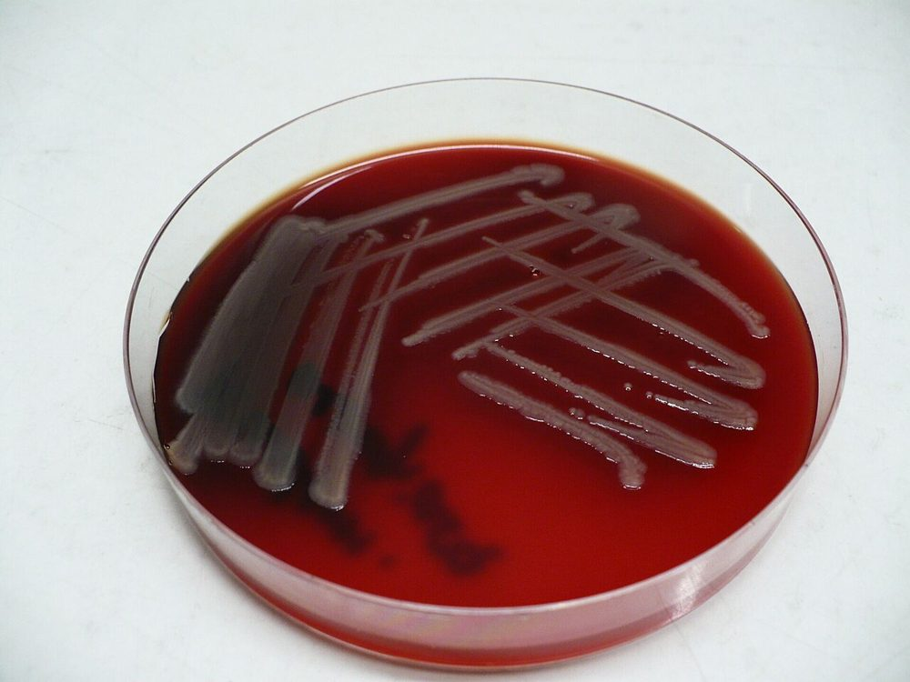 <b>شکل ۱۹.۰۵.</b> کشت <i>P. aeruginosa</i> روی آگار خون‌دار منبع: Pavel Dušek, vyfotografováno s laskavým svolením zaměstnanců Ústavu im، <a href="https://commons.wikimedia.org/wiki/File:Pseudomonas_aeruginosa-blood_agar.jpg">Wikimedia Commons</a>، <a href="https://creativecommons.org/licenses/by/3.0">CC BY 3.0</a></td><td align="center" width="50%">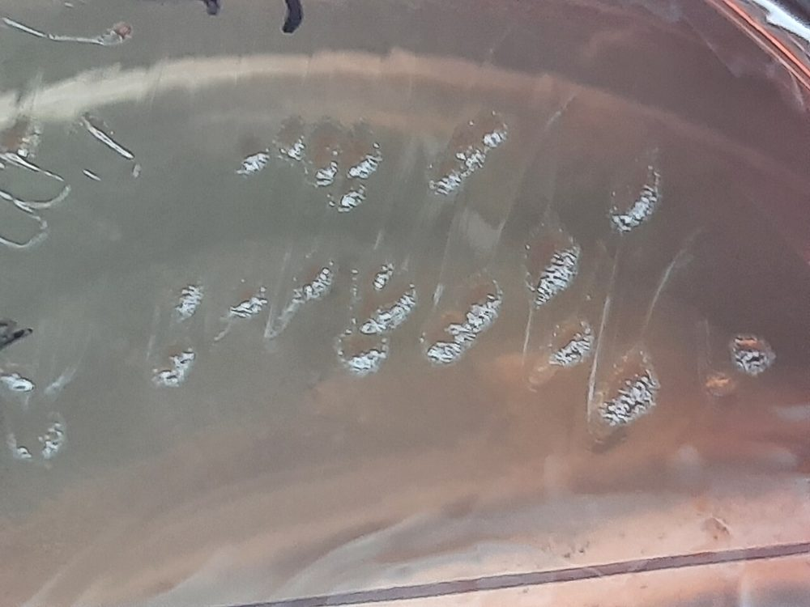 <b>شکل ۱۹.۰۶.</b> کلنی‌های لاکتوز منفی (بی‌رنگ) <i>P. aeruginosa</i> روی MacConkey منبع: Ajay Kumar Chaurasiya، <a href="https://commons.wikimedia.org/wiki/File:Pseudomonas_aeruginosa_colony_morphology_on_MacConkey_agar.jpg">Wikimedia Commons</a>، <a href="https://creativecommons.org/licenses/by/4.0">CC BY 4.0</a></td></tr><tr><td align="center" width="50%">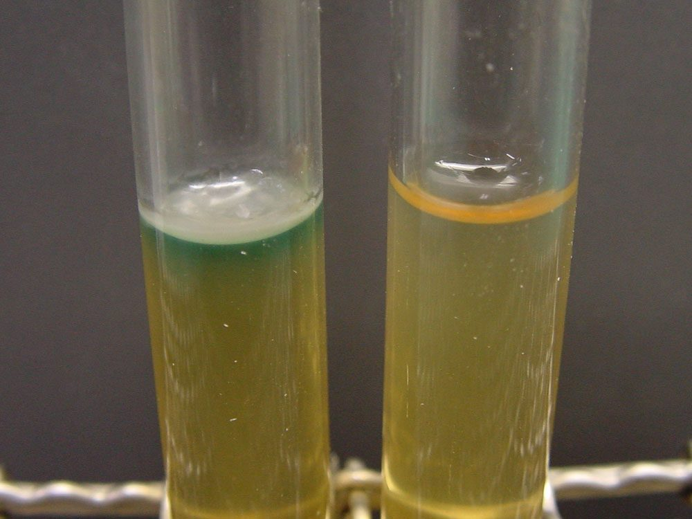 <b>شکل ۱۹.۰۷.</b> پیوسیانین: رنگدانهٔ سبز محلول در آب که از رشد سطحی <i>P. aeruginosa</i> در محیط نیمه‌جامد به پایین منتشر شده است (لولهٔ چپ) منبع: Y tambe، <a href="https://commons.wikimedia.org/wiki/File:Pseudomonas_aeruginosa_pyocyanin.jpg">Wikimedia Commons</a>، <a href="http://creativecommons.org/licenses/by-sa/3.0/">CC BY-SA 3.0</a></td><td align="center" width="50%">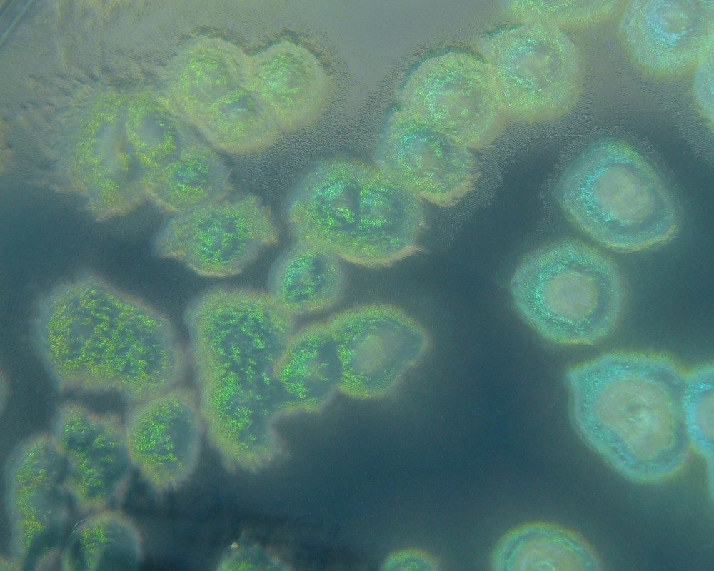 <b>شکل ۱۹.۰۸.</b> کلنی‌های <i>P. aeruginosa</i> روی آگار سترامید (۲۴ ساعت در ۳۷°C و ۲۴ ساعت در دمای اتاق) منبع: HansN.، <a href="https://commons.wikimedia.org/wiki/File:Pseudomonas_aeruginosa_on_cetrimide_agar.jpg">Wikimedia Commons</a>، <a href="https://creativecommons.org/licenses/by-sa/3.0">CC BY-SA 3.0</a></td></tr><tr><td align="center" width="50%">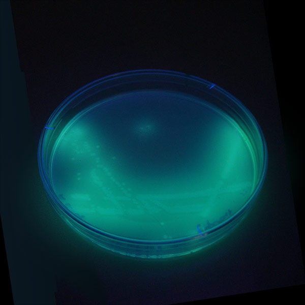 <b>شکل ۱۹.۰۹.</b> فلورسانس رنگدانهٔ <i>P. aeruginosa</i> زیر نور UV روی آگار سترامید منبع: BiotechMichael، <a href="https://commons.wikimedia.org/wiki/File:P-aeruginosa_fluoreszenz.jpg">Wikimedia Commons</a>، Public domain</td></tr></table>

## جدول ۳: سایر اکسیداز مثبت‌های مهم

| ارگانیسم | نکات کلیدی |
|---|---|
| ***Elizabethkingia*** | اکسیداز +، **ایندول +** (ضعیف؛ روش اِرلیخ)، بی‌حرکت، کلنی زرد کم‌رنگ، رشد ضعیف یا منفی روی MacConkey، DNase +؛ **مقاوم به کولیستین و بسیاری از بتالاکتام‌ها** |
| *Chryseobacterium indologenes* | مانند *Elizabethkingia* ولی کلنی **زرد-نارنجی** پررنگ (فلکسیروبین) |
| *Sphingomonas paucimobilis* | کلنی **زرد**، رشد کند، MacConkey −، اسکولین + |
| *Ralstonia pickettii* | محلول‌های «استریل» آلوده (سالین، آب، ضدعفونی‌کننده) ← **کاذب‌طغیان**؛ با BCC اشتباه می‌شود |
| *Shewanella* | اکسیداز +، **H₂S + در TSI (K/K)**، کلنی قهوه‌ای-صورتی؛ عفونت زخم و گوش با آب دریا |
| *Moraxella* (غیر *catarrhalis*) | کوکوباسیل چاق، اکسیداز **قوی** +، غیرواکنش‌گر، اغلب حساس به **پنی‌سیلین** (برخلاف سایر غیرتخمیری‌ها) |
| ***B. pseudomallei*** ☣️ | اکسیداز +، کلنی **خشک چروکیده** (۴۸–۷۲ ساعت)، بوی خاک؛ **جنتامایسین R + کولیستین R + آموکسی‌کلاو S** ← توقف و ارجاع |

**تصاویر:**

<table><tr><td align="center" width="50%">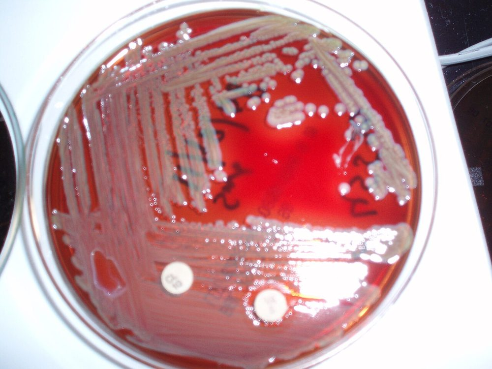 <b>شکل ۱۹.۱۰.</b> <i>Elizabethkingia meningoseptica</i> روی آگار خون‌دار (۶ روزه) با دیسک ونکومایسین ۵ µg (هالهٔ مهار) و دیسک کولیستین ۱۰ µg منبع: Dr.saptarshi، <a href="https://commons.wikimedia.org/wiki/File:Elizabethkingia_meningoseptica_Blood_agar_plate.JPG">Wikimedia Commons</a>، <a href="https://creativecommons.org/licenses/by-sa/3.0">CC BY-SA 3.0</a></td><td align="center" width="50%">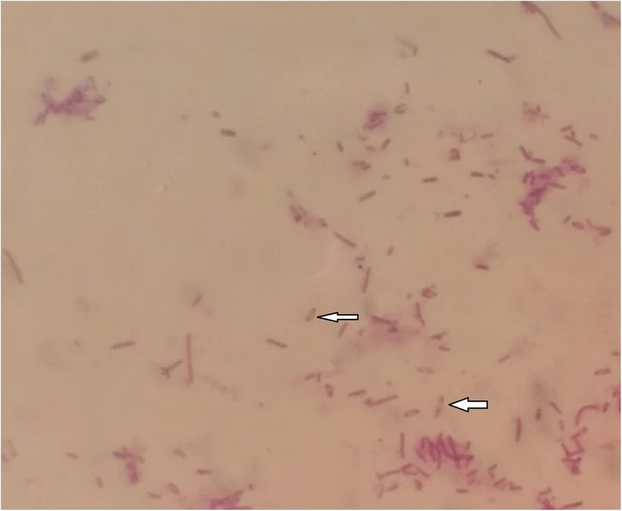 <b>شکل ۱۹.۱۱.</b> <i>Burkholderia pseudomallei</i> در رنگ‌آمیزی گرم: رنگ‌پذیری دوقطبی با نمای «سنجاق‌قفلی» (پیکان‌ها) منبع: Neha Shrestha, Mahesh Adhikari, Vivek Pant, Suman Baral, Anjan Shresth، <a href="https://commons.wikimedia.org/wiki/File:Burkholderia_pseudomallei_gram_stain_safety_pin_apperance.jpg">Wikimedia Commons</a>، <a href="https://creativecommons.org/licenses/by/4.0">CC BY 4.0</a></td></tr><tr><td align="center" width="50%">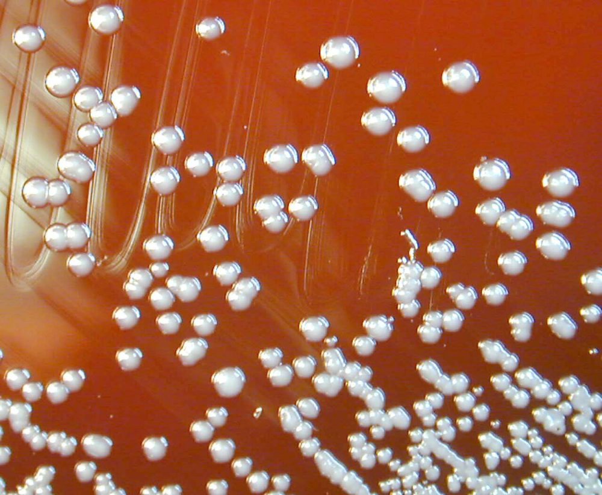 <b>شکل ۱۹.۱۲.</b> کلنی‌های <i>B. pseudomallei</i> روی آگار خون‌دار منبع: CDC/Larry Stauffer, Oregon State Public Health Laboratory (PHIL #1926)، <a href="https://commons.wikimedia.org/wiki/File:Burkholderia_pseudomallei_01.jpg">Wikimedia Commons</a>، Public domain</td><td align="center" width="50%">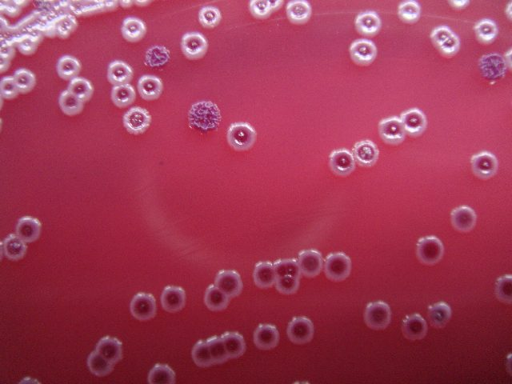 <b>شکل ۱۹.۱۳.</b> کلنی‌های <i>B. pseudomallei</i> روی آگار Ashdown پس از ۷۲ ساعت در ۳۷°C؛ تنوع ریخت کلنی (کلنی‌های صاف و کلنی چروکیده) منبع: Gak، <a href="https://commons.wikimedia.org/wiki/File:Bpseudomallei.JPG">Wikimedia Commons</a>، <a href="https://creativecommons.org/licenses/by-sa/4.0">CC BY-SA 4.0</a></td></tr></table>

## جدول ۴: مقاومت ذاتی (CLSI M100-Ed36 Appendix B2)

> اگر تست شود، **R گزارش شود**. همهٔ این غیرتخمیری‌ها ذاتاً R به: پنی‌سیلین G، سفالوسپورین نسل ۱ و ۲، سفامایسین‌ها، کلیندامایسین، داپتومایسین، فوزیدیک اسید، ونکومایسین، لینزولید، ماکرولیدها و ریفامپین.

| ارگانیسم | مقاومت ذاتی |
|---|---|
| ***A. baumannii*/*calcoaceticus* complex** | آمپی‌سیلین/آموکسی‌سیلین، آموکسی‌کلاو، **آزترئونام**، **ارتاپنم**، تری‌متوپریم، کلرامفنیکل، فسفومایسین |
| ***P. aeruginosa*** | آمپی‌سیلین، آمپی‌سیلین–سولباکتام، آموکسی‌کلاو، **سفوتاکسیم، سفتریاکسون**، **ارتاپنم**، **تتراسایکلین‌ها/تیگسایکلین**، تری‌متوپریم، **TMP-SMX**، کلرامفنیکل |
| ***S. maltophilia*** | تقریباً همهٔ بتالاکتام‌ها (آمپی‌سیلین، پیپراسیلین، تیکارسیلین، آمپی‌سیلین–سولباکتام، آموکسی‌کلاو، پیپ–تازو، سفوتاکسیم، سفتریاکسون، آزترئونام) + **همهٔ کارباپنم‌ها** (ایمی‌پنم، مروپنم، ارتاپنم)، **آمینوگلیکوزیدها**، **تتراسایکلین** (نه داکسی‌سایکلین، مینوسایکلین، تیگسایکلین)، تری‌متوپریم، فسفومایسین |
| ***B. cepacia* complex** | آمپی‌سیلین، پیپراسیلین، تیکارسیلین، آمپی‌سیلین–سولباکتام، آموکسی‌کلاو، **ارتاپنم**، **کولیستین/پلی‌میکسین B**، فسفومایسین |

> - **BCC، پانویس a (Ed36):** مقاومت ذاتی به پیپ–تازو، سفوتاکسیم، سفتریاکسون، سفپیم، آزترئونام، ایمی‌پنم، آمینوگلیکوزیدها و تری‌متوپریم **دیگر قابل تأیید نیست** (سویه‌های محیطی MIC پایین دارند؛ سویه‌های CF بالا) ← این داروها دیگر خودکار R گزارش نمی‌شوند.
> - **سفتازیدیم** و **مروپنم** در *P. aeruginosa* و *Acinetobacter* مقاومت ذاتی ندارند؛ **ارتاپنم** در هر چهار ارگانیسم R است (برای غیرتخمیری‌ها آزمون نشود).

