

# جدول‌های افتراقی: گرم منفی‌های سخت‌رشد

> نمادها: **+** (≥ ۹۰٪)، **−** (≥ ۹۰٪ منفی)، **v** متغیر، **w** ضعیف. شرح تست‌ها: [12_Identification_Tests/02](../12_Identification_Tests/02_Spot_Rapid_Tests.md) (اکسیداز، کاتالاز، اوره‌آز، ایندول)، [03 بخش ۳.۵](../12_Identification_Tests/03_Disk_and_Growth_Tests.md) (X، V، پورفیرین، اقمار).

## جدول ۱: *Haemophilus*

| گونه | هِمین | NAD | پورفیرین (ALA) | همولیز (خون اسب/خرگوش) | نکته |
|---|---|---|---|---|---|
| ***H. influenzae*** | **+** | **+** | − | − | کپسول a–f (تیپ b مهم)؛ NTHi بدون کپسول |
| *H. haemolyticus* | + | + | − | **+** | فلور حلق؛ **با NTHi در MALDI-TOF اشتباه می‌شود** |
| ***H. parainfluenzae*** | **−** | **+** | **+** | − | فلور؛ اندوکاردیت |
| *H. parahaemolyticus* | − | + | + | + | |
| ***H. ducreyi*** | + | − | − | − | محیط اختصاصی، **۳۰–۳۳°C**، تا ۷ روز؛ امروزه **NAAT** |

> - **رشد روی شکلات ولی نه آگار خون** + کوکوباسیل گرم منفی پلئومورف ← فکر *Haemophilus* (یا اقمار اطراف *S. aureus*).
> - **پورفیرین** قابل‌اعتمادتر از دیسک هِمین است (انتقال هِمین از شکلات ← خطا).
> - **سروتایپ** (آگلوتیناسیون لام) برای جدایه‌های تهاجمی؛ واکنش متقاطع و خودآگلوتیناسیون شایع ← PCR کپسول (*bexA*) در آزمایشگاه مرجع ← [12/04](../12_Identification_Tests/04_Antigen_Serology.md).

**تصاویر:**

<table><tr><td align="center" width="50%">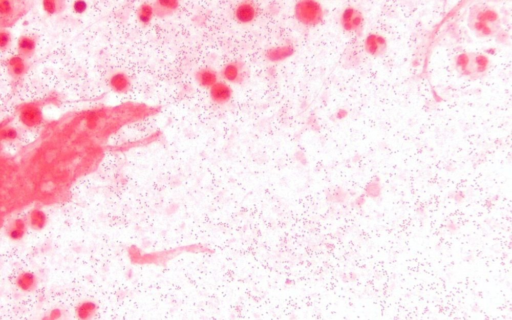 <b>شکل ۲۰.۰۱.</b> کوکوباسیل‌های گرم منفی <i>Haemophilus influenzae</i> در رنگ‌آمیزی گرم خلط (پنومونی) منبع: Microman12345، <a href="https://commons.wikimedia.org/wiki/File:Haemophilus_influenzae_sputum_1000x_edited.jpg">Wikimedia Commons</a>، <a href="https://creativecommons.org/licenses/by-sa/4.0">CC BY-SA 4.0</a></td></tr></table>

## جدول ۲: HACEK و *Capnocytophaga*

| ارگانیسم | اکسیداز | کاتالاز | ایندول | رشد روی MacConkey | ویژگی کلنی/میکروسکوپی |
|---|---|---|---|---|---|
| ***A. actinomycetemcomitans*** | w / − | **+** | − | − | کلنی چسبنده به آگار با **ستارهٔ داخلی** (پس از ۴۸ ساعت)؛ در براث دانه‌های چسبیده به دیواره |
| ***A. aphrophilus*** | w / − | **−** | − | v | (قبلاً *Haemophilus*)؛ نیاز هِمین و NAD ندارد |
| ***Cardiobacterium hominis*** | **+** | **−** | **+** (w) | − | باسیل پلئومورف در **روزت/خوشه** |
| ***Eikenella corrodens*** | **+** | **−** | − | − | **فرورفتن در آگار (pitting)**، **بوی سفیدکننده (کلر)**؛ اورنیتین +، نیترات + |
| ***Kingella kingae*** | **+** | **−** | − | − | β-همولیز باریک، گاه pitting؛ کوکوباسیل جفت/زنجیره |
| ***C. canimorsus*** | **+** | **+** | − | − | باسیل **دوکی** بلند؛ **حرکت لغزشی** (لبهٔ گسترده)؛ رشد کند در CO₂ (۲–۴ روز) |
| *Capnocytophaga* دهانی | − | − | − | − | مانند بالا؛ باکتریمی در **نوتروپنی** (موکوزیت) |

> **اندوکاردیت با کشت منفی:** HACEK، *Bartonella*، *Coxiella* (سرولوژی)، *Abiotrophia*/*Granulicatella*، *Tropheryma whipplei* ← PCR دریچه/۱۶S ← [12/06](../12_Identification_Tests/06_Molecular_ID.md).

**تصاویر:**

<table><tr><td align="center" width="50%">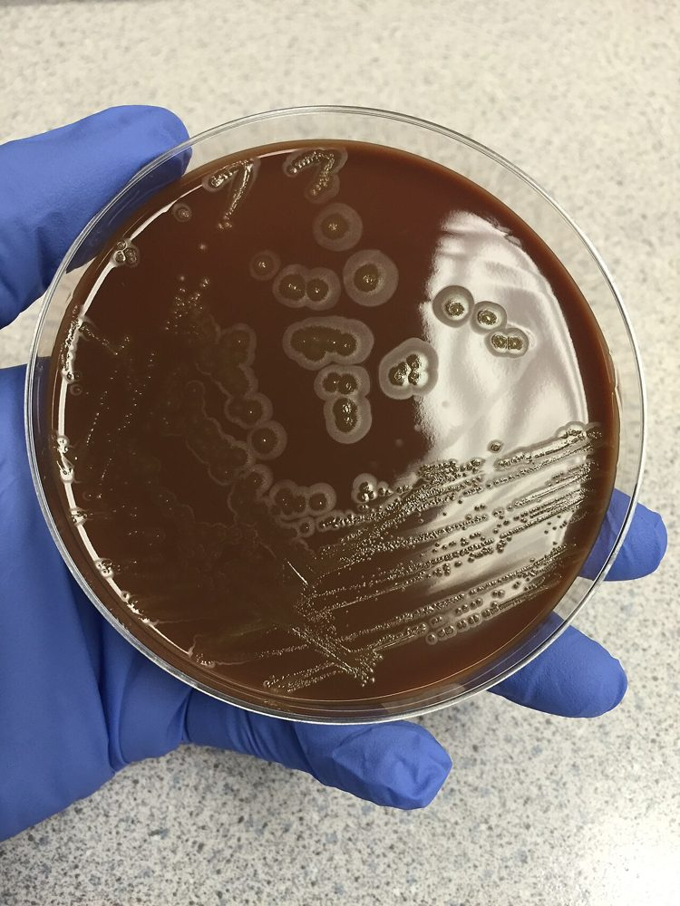 <b>شکل ۲۰.۰۲.</b> کلنی‌های <i>Eikenella corrodens</i> روی آگار شکلات پس از ۳۶ ساعت؛ فرورفتن کلنی‌ها در آگار (pitting) منبع: Deminorwood، <a href="https://commons.wikimedia.org/wiki/File:Eikenella_corrodens.jpg">Wikimedia Commons</a>، <a href="https://creativecommons.org/licenses/by-sa/4.0">CC BY-SA 4.0</a></td><td align="center" width="50%">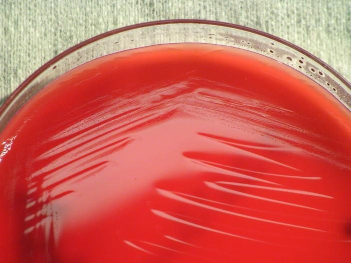 <b>شکل ۲۰.۰۳.</b> کلنی‌های <i>Kingella kingae</i> روی آگار خون گوسفند پس از ۲۴ ساعت در ۳۷°C منبع: CDC/ Amanda Moore, MT; Todd Parker, PhD; Audra Marsh، <a href="https://commons.wikimedia.org/wiki/File:Kingella_kingae_PHIL12451.jpg">Wikimedia Commons</a>، Public domain</td></tr><tr><td align="center" width="50%">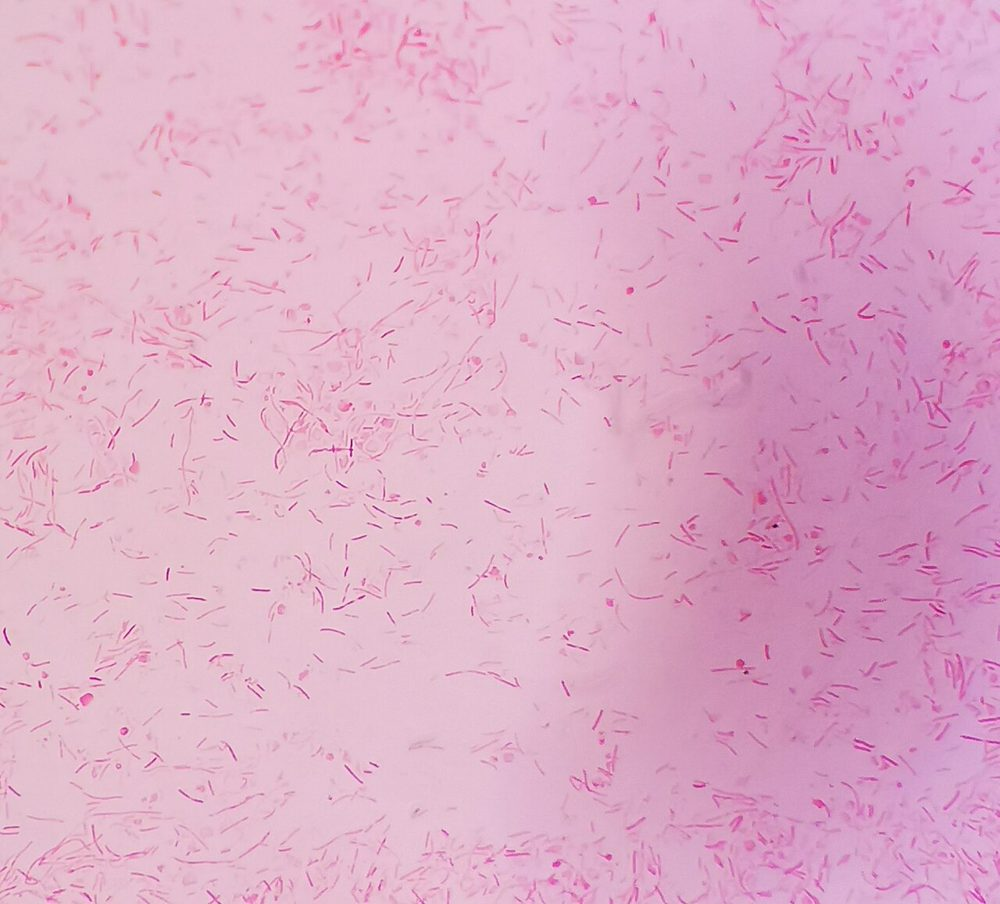 <b>شکل ۲۰.۰۴.</b> باسیل‌های گرم منفی باریک و دوکی <i>Capnocytophaga canimorsus</i> در رنگ‌آمیزی گرم منبع: Suryabrata Banerjee (microregistrar.com)، <a href="https://commons.wikimedia.org/wiki/File:Capnocytophaga_canimorsus_gram_stain.jpg">Wikimedia Commons</a>، <a href="https://creativecommons.org/licenses/by-sa/4.0">CC BY-SA 4.0</a></td><td align="center" width="50%">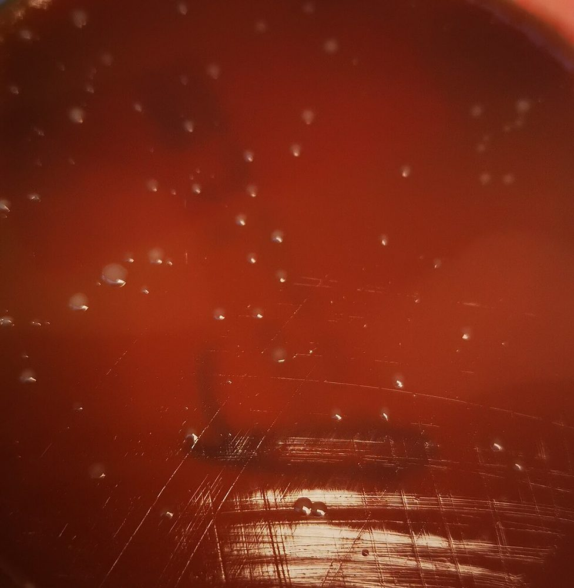 <b>شکل ۲۰.۰۵.</b> کلنی‌های <i>C. canimorsus</i> روی آگار خون‌دار منبع: Suryabrata Banerjee (microregistrar.com)، <a href="https://commons.wikimedia.org/wiki/File:Capnocytophaga_canimorsus_colony_on_blood_agar.jpg">Wikimedia Commons</a>، <a href="https://creativecommons.org/licenses/by-sa/4.0">CC BY-SA 4.0</a></td></tr></table>

## جدول ۳: *Bordetella*

| ویژگی | ***B. pertussis*** | *B. parapertussis* | *B. bronchiseptica* | *B. holmesii* |
|---|---|---|---|---|
| رشد روی آگار خون | **−** | + (۲–۳ روز) | **+** (۱–۲ روز) | + |
| رشد روی MacConkey | − | − (v) | **+** | v (اغلب + و کند) |
| کلنی روی ریگان–لو | **۳–۵ روز**، براق «**قطرهٔ جیوه**» | ۲–۳ روز | ۱–۲ روز | |
| **اکسیداز** | **+** | **−** | **+** | − |
| **اوره‌آز** | − | **+** (۲۴ ساعت) | **+** (سریع، ۴ ساعت) | − |
| **تحرک** | − | − | **+** | − |
| رنگدانهٔ قهوه‌ای | − | **+** | − | **+** |
| هدف PCR | **IS481** (در *B. holmesii* و برخی *B. bronchiseptica* هم!) ± **ptxP** | **IS1001** | IS481/IS1001 (برخی) | **IS481** + **hIS1001** |

**تصاویر:**

<table><tr><td align="center" width="50%">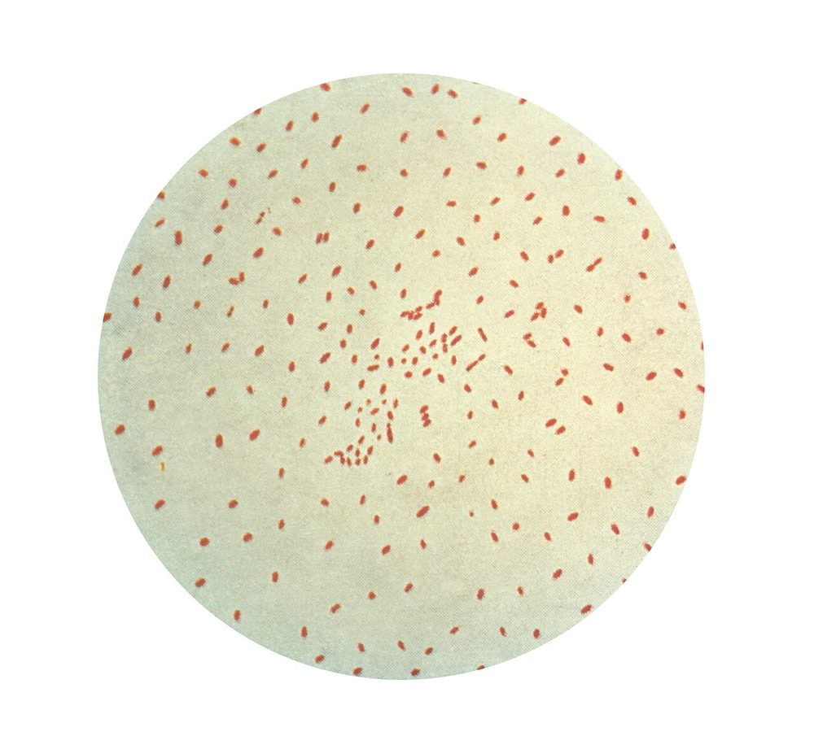 <b>شکل ۲۰.۰۶.</b> <i>Bordetella pertussis</i> در رنگ‌آمیزی گرم: کوکوباسیل‌های گرم منفی ریز منبع: CDC Public Health Image Library، <a href="https://commons.wikimedia.org/wiki/File:Bordetella_pertussis.jpg">Wikimedia Commons</a>، Public domain</td><td align="center" width="50%">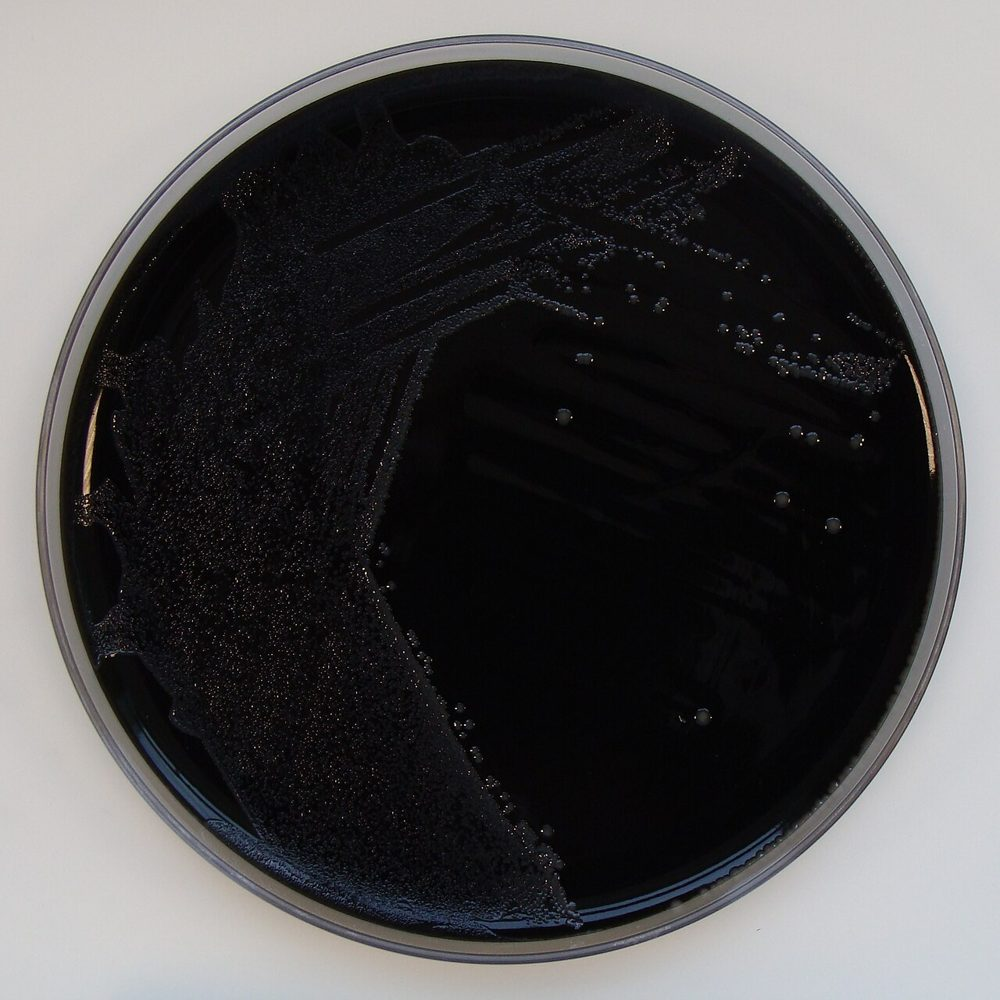 <b>شکل ۲۰.۰۷.</b> <i>B. pertussis</i> روی آگار زغال با سفالکسین (۷ روز، ۱۰٪ CO₂) منبع: Nathan Reading from Halesowen, UK، <a href="https://commons.wikimedia.org/wiki/File:Bordetella_pertussis_on_Charcoal_Agar_supplemented_with_Cephalexin.jpg">Wikimedia Commons</a>، <a href="https://creativecommons.org/licenses/by/2.0">CC BY 2.0</a></td></tr><tr><td align="center" width="50%">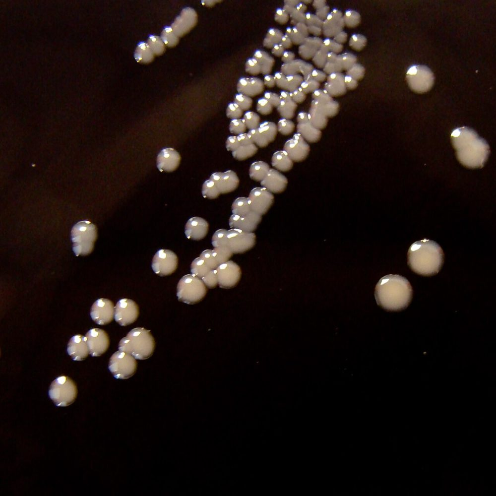 <b>شکل ۲۰.۰۸.</b> نمای نزدیک: کلنی‌های براق و گنبدی <i>B. pertussis</i> روی آگار زغال با سفالکسین منبع: Nathan Reading from Halesowen, UK، <a href="https://commons.wikimedia.org/wiki/File:Bordetella_pertussis_on_Charcoal_Agar_supplemented_with_Cephalexin_-_Detail.jpg">Wikimedia Commons</a>، <a href="https://creativecommons.org/licenses/by/2.0">CC BY 2.0</a></td></tr></table>

## جدول ۴: *Brucella* و *Francisella* در برابر شبیه‌ها ☣️

| ویژگی | ***Brucella*** | ***F. tularensis*** | *Ochrobactrum* | *Haemophilus* | *Psychrobacter* |
|---|---|---|---|---|---|
| رنگ گرم | کوکوباسیل **بسیار ریز** («دانهٔ شن») | کوکوباسیل **بسیار ریز**، کم‌رنگ | باسیل | کوکوباسیل پلئومورف | کوکوباسیل چاق |
| رشد آگار خون (۴۸ ساعت) | ریز، نقطه‌ای | **ضعیف یا هیچ** | خوب | − | + |
| رشد روی **MacConkey** | **−** | **−** | **+** | − | v |
| **اکسیداز** | **+** | **−** | + | + | + |
| کاتالاز | + | **w** | + | + | + |
| **اوره‌آز** | **+ (سریع)** | − | + | v | v |
| **تحرک** | − | − | **+** | − | − |
| **هِمین/NAD** | − | − | − | **+** | − |
| بتالاکتاماز (نیتروسفین) | − | **+** | | v | |
| MALDI-TOF (پایگاه IVD) | ⚠️ ممکن است **«*Ochrobactrum*»** | ⚠️ ندارد | | | |

> **قاعدهٔ عملی ایمنی:** کوکوباسیل گرم منفی **ریز**، رشد **کند** (۴۸–۷۲ ساعت) روی آگار خون/شکلات، **بدون رشد روی MacConkey**، که با رشد کند در بطری کشت خون همراه است ← تا رد *Brucella*/*Francisella* **کار باز ممنوع**.

**تصاویر:**

<table><tr><td align="center" width="50%">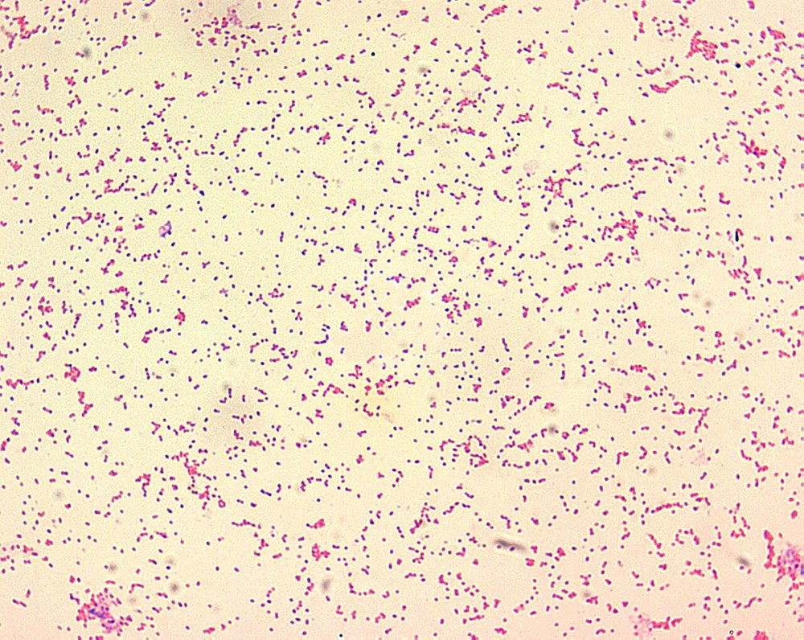 <b>شکل ۲۰.۰۹.</b> <i>Brucella</i> در رنگ‌آمیزی گرم: کوکوباسیل‌های گرم منفی بسیار ریز و کم‌رنگ («دانهٔ شن») منبع: CDC/Courtesy of Larry Stauffer, Oregon State Public Health Laboratory، <a href="https://commons.wikimedia.org/wiki/File:Brucella_spp.JPG">Wikimedia Commons</a>، Public domain</td><td align="center" width="50%">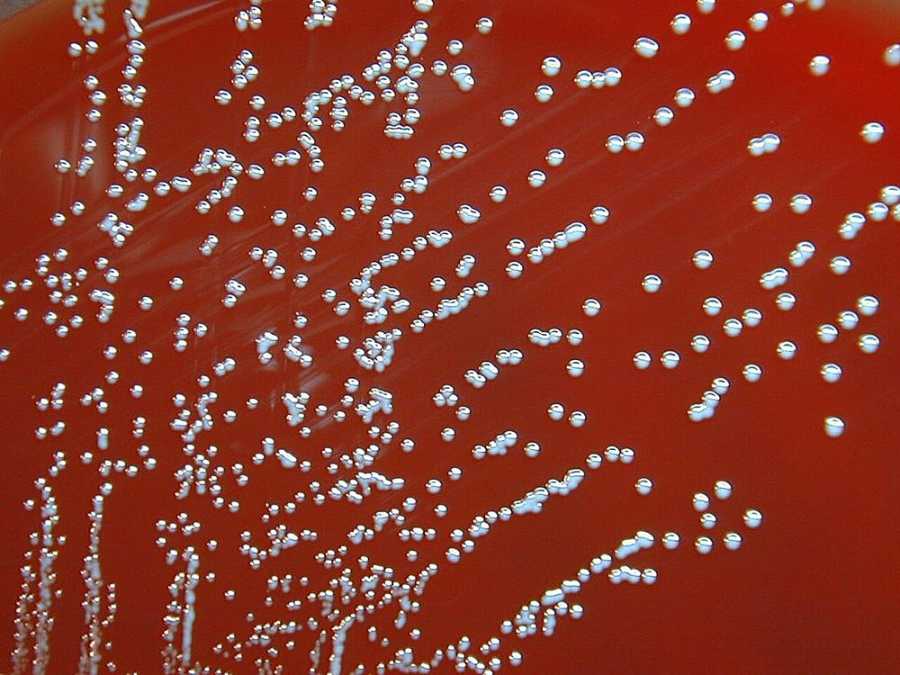 <b>شکل ۲۰.۱۰.</b> کلنی‌های ریز <i>Brucella melitensis</i> منبع: CDC PHIL #1902، <a href="https://commons.wikimedia.org/wiki/File:BrucellaMelitensis.jpg">Wikimedia Commons</a>، Public domain</td></tr><tr><td align="center" width="50%">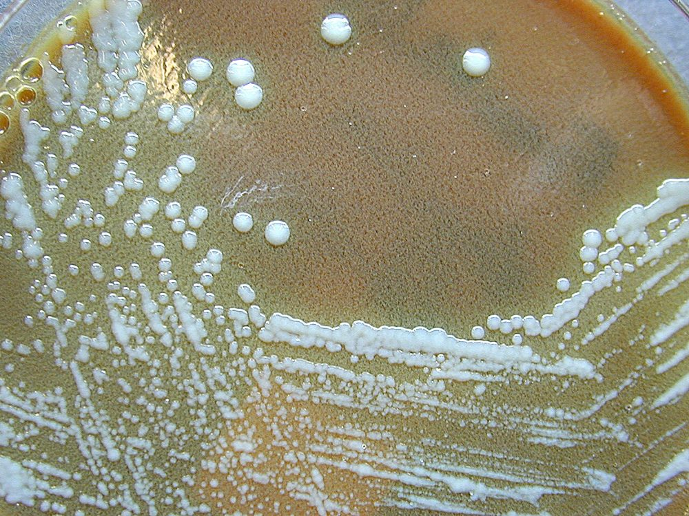 <b>شکل ۲۰.۱۱.</b> کلنی‌های <i>Francisella tularensis</i> روی آگار سیستئین–هارت (CHA) پس از ۷۲ ساعت منبع: CDC/Larry Stauffer, Oregon State Public Health Laboratory (PHIL #1910)، <a href="https://commons.wikimedia.org/wiki/File:Francisella_tularensis_01.jpg">Wikimedia Commons</a>، Public domain</td></tr></table>

## جدول ۵: سرولوژی بروسلوز (ایران: روش‌های رایج)

| آزمون | آنچه می‌سنجد | تفسیر |
|---|---|---|
| **رُز بنگال** | آگلوتیناسیون سریع روی لام | **غربالگری**؛ مثبت ← آزمون لوله‌ای |
| **رایت** (SAT، آگلوتیناسیون لوله‌ای) | آنتی‌بادی کل (عمدتاً IgM) | در مناطق آندمیک معمولاً **≥ ۱:۱۶۰** (یا افزایش **چهار برابری** در دو نمونه) ← همراه بالین |
| **2-ME** (۲-مرکاپتواتانول) | IgG (IgM غیرفعال می‌شود) | تیتر مثبت ← **عفونت فعال/مزمن**؛ کاهش پس از درمان |
| **کومبس رایت** | آنتی‌بادی‌های **ناقص** (غیرآگلوتینه‌کننده) | در **بروسلوز مزمن** و موارد با رایت منفی کاذب |
| **ELISA** IgM/IgG | | جایگزین/مکمل |

> ⚠️ **پدیدهٔ پروزون:** رایت منفی کاذب در تیتر بسیار بالا ← **رقت تا ۱:۱۲۸۰ یا بیشتر**.
> ⚠️ **واکنش متقاطع:** *Yersinia enterocolitica* O:9، *F. tularensis*، *V. cholerae*، *E. coli* O157.
> ⚠️ آزمون‌های رایج به *B. canis* (کلنی خشن) **حساس نیستند**.

