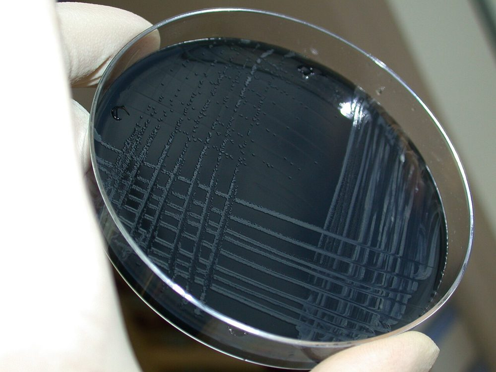
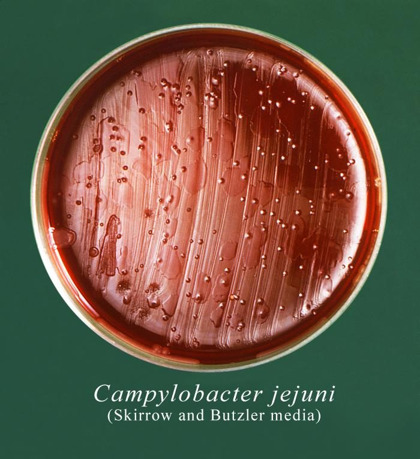
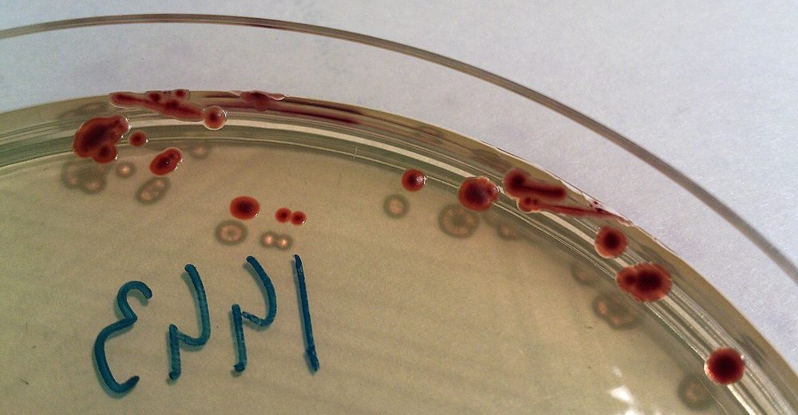
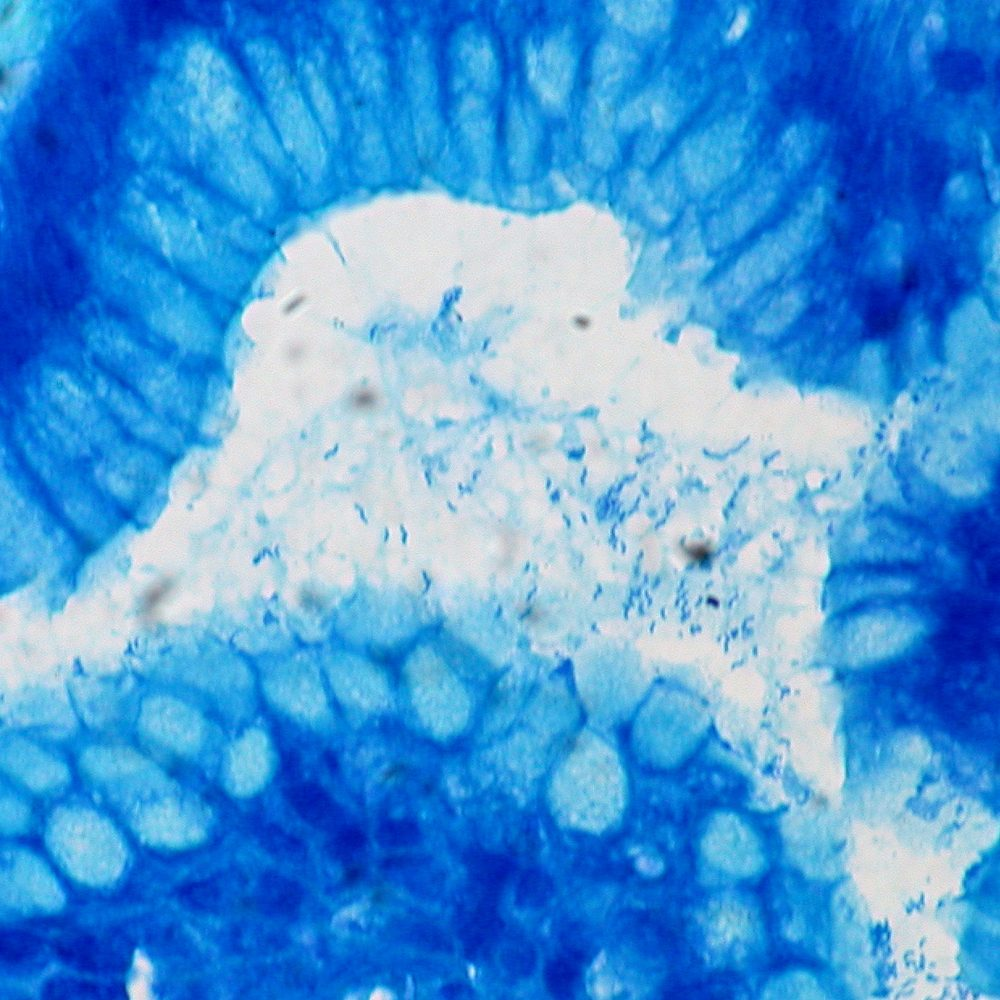
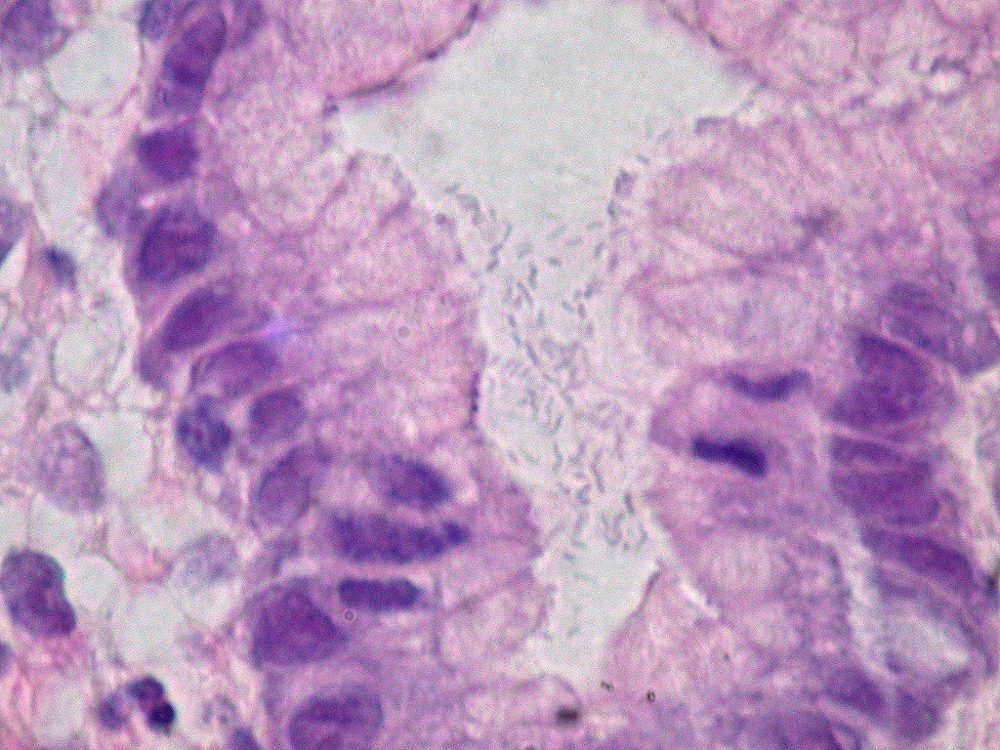
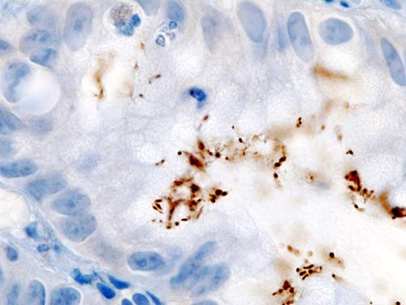
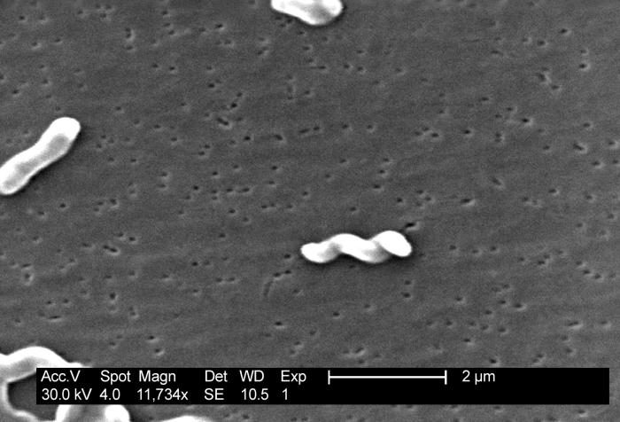
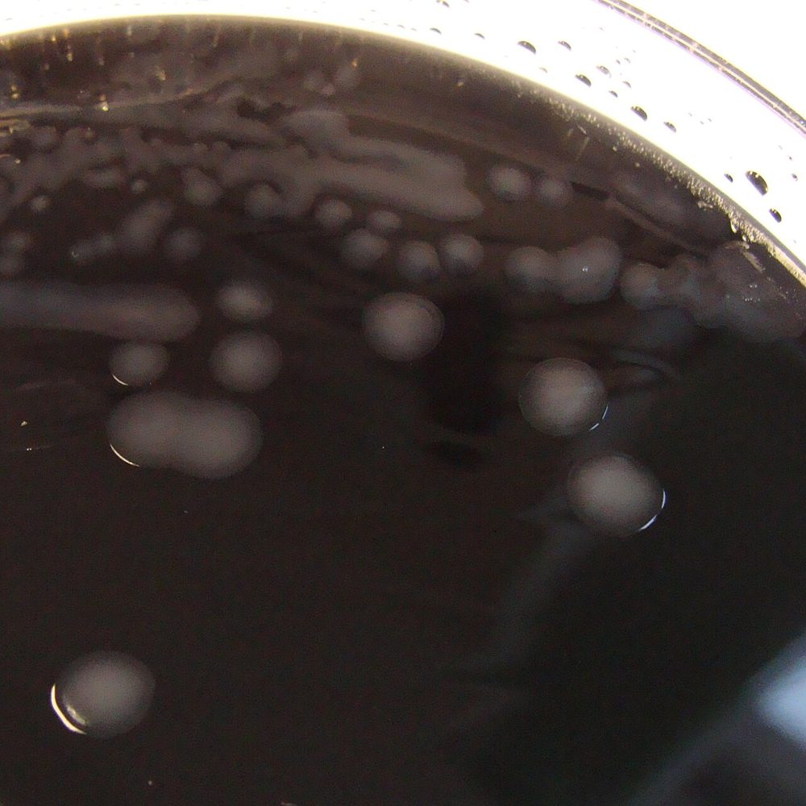

# جدول‌های افتراقی: باسیل‌های گرم منفی خمیده

> نمادها: **+** (≥ ۹۰٪)، **−** (≥ ۹۰٪ منفی)، **v** متغیر، **w** ضعیف. شرح تست‌ها: [12_Identification_Tests/02](../12_Identification_Tests/02_Spot_Rapid_Tests.md) (اکسیداز، کاتالاز، هیپورات، ایندوکسیل استات، اوره‌آز سریع)، [03](../12_Identification_Tests/03_Disk_and_Growth_Tests.md) (رشد در دما).

## جدول ۱: گونه‌های بالینی

| ویژگی | ***C. jejuni*** | ***C. coli*** | *C. lari* | *C. upsaliensis* | ***C. fetus*** | ***H. pylori*** | *H. cinaedi* | *A. butzleri* |
|---|---|---|---|---|---|---|---|---|
| اکسیداز | + | + | + | + | + | + | + | + |
| **کاتالاز** | + | + | + | **− / w** | + | + | + | v |
| **هیپورات** | **+** | **−** | − | − | − | − | − | − |
| **ایندوکسیل استات** | **+** | **+** | **−** | + | − | − | − | **+** |
| **اوره‌آز** | − | − | v | − | − | **+++ (دقیقه‌ها)** | − | − |
| نیترات ← نیتریت | + | + | + | + | + | **−** | + | + |
| رشد در **۲۵°C** | − | − | − | − | **+** | − | − | **+** |
| رشد در **۴۲°C** | **+** | **+** | + | + | **v / −** | v | v | − |
| رشد **هوازی** (۳۰°C) | − | − | − | − | − | − | − | **+** |
| سفالوتین (۳۰ µg) | R | R | R | **S** | **S** | S | — | — |

> - **هیپورات +** به‌تنهایی *C. jejuni* را از *C. coli* جدا می‌کند؛ ولی سویه‌های *C. jejuni* **هیپورات منفی** وجود دارند ← MALDI-TOF یا PCR. گزارش «*C. jejuni*/*C. coli*» برای اهداف درمانی کافی است.
> - **دیسک نالیدیکسیک اسید** (قدیمی) دیگر قابل اعتماد نیست (مقاومت فلوروکینولون شایع در *C. jejuni*/*C. coli*).
> - ***C. fetus*** و ***C. upsaliensis*** به **سفالوتین** حساس‌اند ← روی Campy-BAP (سفالوتین‌دار) و در **۴۲°C** از دست می‌روند ← **روش فیلتر** روی آگار خون در **۳۷°C**.
> - ***Arcobacter*** = «*Campylobacter* هوازی‌تحمل»: رشد در **۲۵–۳۰°C و هوا**.

**تصاویر:**

<table><tr><td align="center" width="50%"> <b>شکل ۲۱.۰۱.</b> کلنی‌های <i>Campylobacter jejuni</i> روی محیط انتخابی زغال‌دار بدون خون (CSM) منبع: Kubo (Dworaczek) Michal، <a href="https://commons.wikimedia.org/wiki/File:Campylobacter_jejuni.jpg">Wikimedia Commons</a>، <a href="https://creativecommons.org/licenses/by-sa/2.5">CC BY-SA 2.5</a></td><td align="center" width="50%"> <b>شکل ۲۱.۰۲.</b> کلنی‌های <i>C. jejuni</i> روی محیط Skirrow و Butzler منبع: CDC/ Sheila Mitchel، <a href="https://commons.wikimedia.org/wiki/File:15985_lores.jpg">Wikimedia Commons</a>، Public domain</td></tr><tr><td align="center" width="50%"> <b>شکل ۲۱.۰۳.</b> کلنی‌های قرمز <i>C. jejuni</i> روی محیط کروموژنیک CASA (جدایه از مدفوع سگ) منبع: Stefan Walkowski، <a href="https://commons.wikimedia.org/wiki/File:Campylobacter_jejuni_colonies.jpg">Wikimedia Commons</a>، <a href="https://creativecommons.org/licenses/by-sa/4.0">CC BY-SA 4.0</a></td></tr></table>

## جدول ۲: آزمون‌های تشخیص *H. pylori*

| آزمون | نوع | کاربرد | عوامل منفی کاذب |
|---|---|---|---|
| **UBT** (¹³C یا ¹⁴C اوره) | غیرتهاجمی | تشخیص و **تأیید ریشه‌کنی** | **PPI** (قطع ۲ هفته)، **آنتی‌بیوتیک/بیسموت** (قطع ۴ هفته)، خونریزی اخیر |
| **آنتی‌ژن مدفوع** (مونوکلونال EIA) | غیرتهاجمی | تشخیص و تأیید ریشه‌کنی | مانند بالا |
| **سرولوژی** IgG | غیرتهاجمی | فقط اپیدمیولوژی یا وقتی PPI قابل قطع نیست (خونریزی، آتروفی) | ⛔ **برای تأیید ریشه‌کنی** (ماه‌ها مثبت می‌ماند) |
| **RUT** (اوره‌آز سریع، بیوپسی) | تهاجمی | سریع، ارزان، اختصاصیت بالا | PPI، خونریزی؛ بیوپسی از **آنتروم و تنه** |
| **بافت‌شناسی** (H&E، گیمسا، IHC) | تهاجمی | تراکم، گاستریت، متاپلازی، لنفوم | PPI (جابجایی به تنه) |
| **کشت** | تهاجمی | **AST** پس از شکست درمان | انتقال (سرما، تأخیر)؛ حساسیت ۶۰–۹۰٪ |
| **PCR** (بیوپسی یا مدفوع) | تهاجمی/غیرتهاجمی | تشخیص + **جهش ۲۳S rRNA** (کلاریترومایسین) و *gyrA* (لووفلوکساسین) | |

> مقایسهٔ کامل و نمونهٔ گزارش ← [04_Gastrointestinal/02_Protocol/06 بخش ۶](../04_Gastrointestinal/02_Protocol/06_Interpretation.md).

**تصاویر:**

<table><tr><td align="center" width="50%"> <b>شکل ۲۱.۰۴.</b> <i>Helicobacter pylori</i> در بیوپسی معده، رنگ‌آمیزی گیمسا منبع: Ed Uthman from Houston, TX, USA، <a href="https://commons.wikimedia.org/wiki/File:Helicobacter_pylori,_Gastric_Biopsy,_Giemsa_Stain_(5517582111).jpg">Wikimedia Commons</a>، <a href="https://creativecommons.org/licenses/by/2.0">CC BY 2.0</a></td><td align="center" width="50%"> <b>شکل ۲۱.۰۵.</b> باسیل‌های خمیدهٔ <i>H. pylori</i> در مجرای فووئولای معده، رنگ‌آمیزی H&E (۱۰۰۰×) منبع: Ed Uthman from Houston, TX, USA، <a href="https://commons.wikimedia.org/wiki/File:Helicobacter_pylori,_Gastric_Mucosa,_H%26E_(390307642).jpg">Wikimedia Commons</a>، <a href="https://creativecommons.org/licenses/by-sa/2.0">CC BY-SA 2.0</a></td></tr><tr><td align="center" width="50%"> <b>شکل ۲۱.۰۶.</b> <i>H. pylori</i> در حفرهٔ فووئولار بیوپسی معده، ایمونوهیستوشیمی ضد <i>Helicobacter</i> (رنگ قهوه‌ای) منبع: KGH، <a href="https://commons.wikimedia.org/wiki/File:Immunohistochemical_detection_of_Helicobacter_pylori_histopathology.jpg">Wikimedia Commons</a>، <a href="http://creativecommons.org/licenses/by-sa/3.0/">CC BY-SA 3.0</a></td></tr></table>

## جدول ۳: ریخت‌شناسی

| ارگانیسم | رنگ گرم | لام مرطوب | کلنی |
|---|---|---|---|
| *Campylobacter* | خمیده، «S»، **بال مرغ دریایی**؛ کوکوئید در کشت پیر؛ با **فوشین بازی** بهتر | **تیرمانند/فنری** | خاکستری، مرطوب، **پهن‌شونده در امتداد خط** یا گرد |
| *H. pylori* | خمیده/مارپیچی، چاق‌تر؛ **کوکوئید** در کشت پیر یا پس از درمان | | **ریز، شفاف، قطره‌شبنمی** (۳–۷ روز) |
| *H. cinaedi* | مارپیچی باریک | | لایهٔ نازک پهن‌شونده (swarming)، مشاهده نشدن آسان |
| *Arcobacter* | خمیده | | مشابه *Campylobacter* |

**تصاویر:**

<table><tr><td align="center" width="50%"> <b>شکل ۲۱.۰۷.</b> میکروسکوپ الکترونی روبشی <i>C. jejuni</i>: باسیل‌های خمیده و S‌شکل منبع: CDC PHIL #5778، <a href="https://commons.wikimedia.org/wiki/File:Campylobacter_jejuni_5778_lores.jpg">Wikimedia Commons</a>، Public domain</td><td align="center" width="50%"> <b>شکل ۲۱.۰۸.</b> کلنی‌های خاکستری، مرطوب و پهن‌شوندهٔ <i>Campylobacter</i> روی آگار انتخابی CCDA (جدایه از بیمار با اسهال خونی) منبع: Nathan Reading from Halesowen, UK، <a href="https://commons.wikimedia.org/wiki/File:Campylobacter_jejuni_growing_on_CCDA_campylobacter_selective_agar_-_Detail.jpg">Wikimedia Commons</a>، <a href="https://creativecommons.org/licenses/by/2.0">CC BY 2.0</a></td></tr></table>

