

# جدول‌های افتراقی: باکتری‌های بی‌هوازی

> نمادها: **+** (≥ ۹۰٪)، **−** (≥ ۹۰٪ منفی)، **v** متغیر، **w** ضعیف. دیسک‌های ویژه (**ونکومایسین ۵ µg / کانامایسین ۱ mg / کولیستین ۱۰ µg**؛ هاله ≥ ۱۰ mm = S) و هوازی‌تحملی ← [12_Identification_Tests/03 بخش ۳.۴ و ۳.۸](../12_Identification_Tests/03_Disk_and_Growth_Tests.md)؛ محیط‌ها و جدول ست اولیه ← [11_Culture_Media/06](../11_Culture_Media/06_Anaerobic.md).

## جدول ۱: گروه‌بندی اولیه با رنگ گرم و دیسک‌های ویژه

| گروه | رنگ گرم | ونکومایسین | کانامایسین | کولیستین |
|---|---|---|---|---|
| **همهٔ گرم مثبت‌ها** (حتی گرم‌متغیرها) | + | **S** | v | **R** |
| **گروه *B. fragilis*** | باسیل − | R | **R** | **R** |
| ***Porphyromonas*** | کوکوباسیل − | **S** (استثنای گرم منفی) | R | R |
| ***Prevotella*** | کوکوباسیل − | R | R | v |
| ***Fusobacterium*** | باسیل − | R | **S** | **S** |
| ***Veillonella*** | کوکسی − | R | S | S |
| *Bilophila wadsworthia* | باسیل − | R | S | S |

**تصاویر:**

<table><tr><td align="center" width="50%">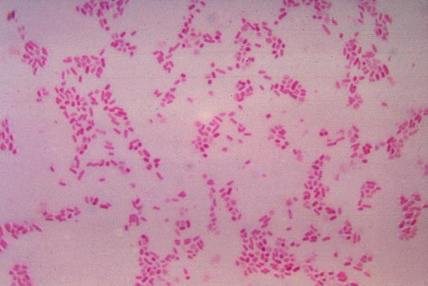 <b>شکل ۲۲.۰۲.</b> باسیل‌های گرم منفی بی‌هوازی (<i>Phocaeicola vulgatus</i>، پیشتر <i>B. fragilis</i> ss. <i>vulgatus</i>؛ آگار خون‌دار ۴۸ ساعته) منبع: Content Providers(s): CDC/Dr. V.R. Dowell, Jr.، <a href="https://commons.wikimedia.org/wiki/File:BacteroidesFragilis_Gram.jpg">Wikimedia Commons</a>، Public domain</td><td align="center" width="50%">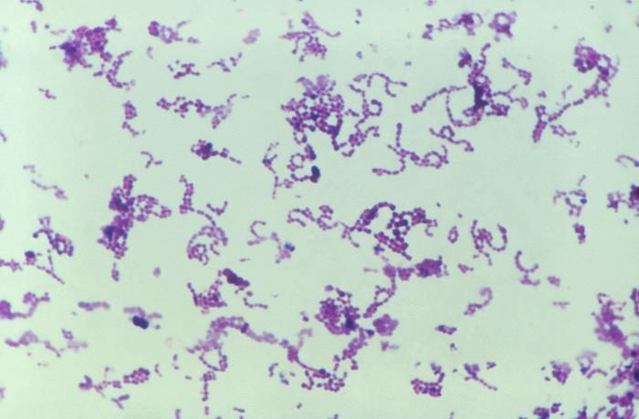 <b>شکل ۲۲.۰۳.</b> کوکسی گرم مثبت ریز در زنجیره و توده (<i>Peptostreptococcus anaerobius</i>) منبع: CDC/ Dr. Gilda Jones، <a href="https://commons.wikimedia.org/wiki/File:4347_lores.jpg">Wikimedia Commons</a>، <a href="http://creativecommons.org/publicdomain/zero/1.0/deed.en">CC0</a></td></tr><tr><td align="center" width="50%">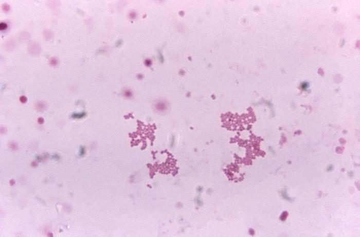 <b>شکل ۲۲.۰۴.</b> کوکسی گرم منفی ریز در توده (<i>Veillonella</i>) منبع: CDC/Gilda Jones، <a href="https://commons.wikimedia.org/wiki/File:Veillonella_spp._under_1125X_magnification.jpg">Wikimedia Commons</a>، <a href="https://creativecommons.org/licenses/by-sa/4.0">CC BY-SA 4.0</a></td></tr></table>

## جدول ۲: باسیل‌های گرم منفی بی‌هوازی

| ارگانیسم | رشد در **صفرای ۲۰٪** (BBE) | کاتالاز | **ایندول** | رنگدانهٔ سیاه / **فلورسانس قرمز آجری** (UV) | اسکولین | ریخت و نکات |
|---|---|---|---|---|---|---|
| ***B. fragilis*** | **+** (کلنی سیاه > ۱ mm) | + | **−** | − | + | باسیل پلئومورف با رنگ‌پذیری دوقطبی |
| ***B. thetaiotaomicron*** | **+** | + | **+** | − | + | |
| *Parabacteroides distasonis* | + | v | − | − | + | |
| ***Prevotella*** رنگدانه‌دار (*P. melaninogenica*، *P. intermedia*) | **−** | − | v (*P. intermedia* +) | **+** (سیاه در ۵–۷ روز؛ فلورسانس **قبل** از سیاه شدن) | v | ساکارولیتیک؛ کوکوباسیل |
| ***Porphyromonas*** | − | − | **+** | **+** | − | **غیرساکارولیتیک**؛ **ونکومایسین S** |
| ***F. nucleatum*** | − | − | **+** | − (کلنی در هوا **سبز** می‌شود) | − | باسیل **باریک دوکی با انتهای نوک‌تیز**؛ کلنی «خرده‌نان» |
| ***F. necrophorum*** | v | − | **+** | − | − | **پلئومورف**، گرد؛ **لیپاز +**؛ β-همولیز (خون اسب/خرگوش) |
| *Bilophila wadsworthia* | **+** (کلنی ریز با مرکز سیاه) | **+ قوی** | − | − | − | **اوره‌آز +**؛ رشد کند (۳–۴ روز) |
| *Veillonella* (کوکسی) | v | v | − | فلورسانس قرمز (برخی) | − | **نیترات +**؛ کوکسی ریز گرم منفی |

> **غربالگری سریع گروه *B. fragilis*:** رشد روی **BBE** + سیاه شدن (هیدرولیز اسکولین) + **R** به هر سه دیسک.

**تصاویر:**

<table><tr><td align="center" width="50%">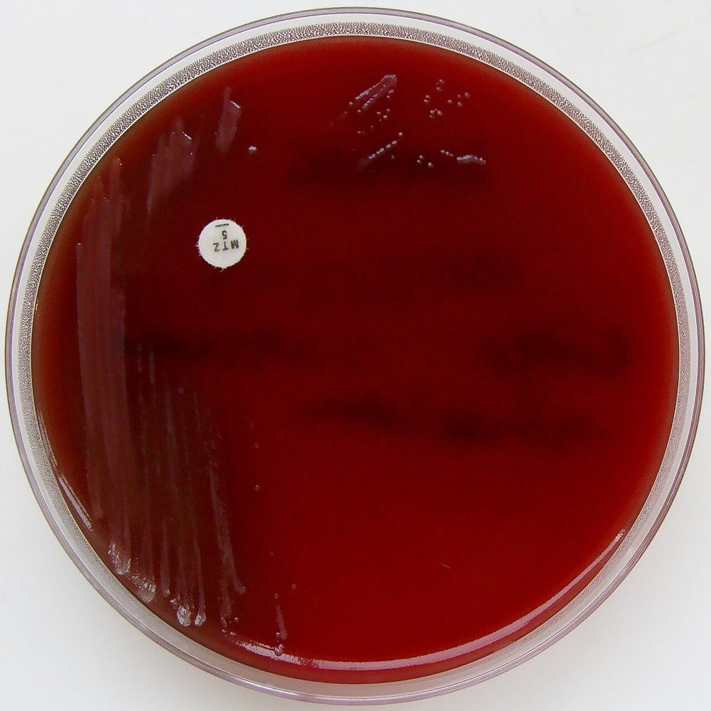 <b>شکل ۲۲.۰۵.</b> کشت <i>B. fragilis</i> (ایزولهٔ کشت خون) روی آگار بی‌هوازی سخت‌رشد (FAA) با دیسک مترونیدازول ۵ µg؛ ایزوله حساس بود منبع: Nathan Reading from Halesowen, UK، <a href="https://commons.wikimedia.org/wiki/File:Bacteroides_fragilis_on_Fastidious_Anaerobe_Agar_-_Sensitive_to_Metronidazole.jpg">Wikimedia Commons</a>، <a href="https://creativecommons.org/licenses/by/2.0">CC BY 2.0</a></td><td align="center" width="50%">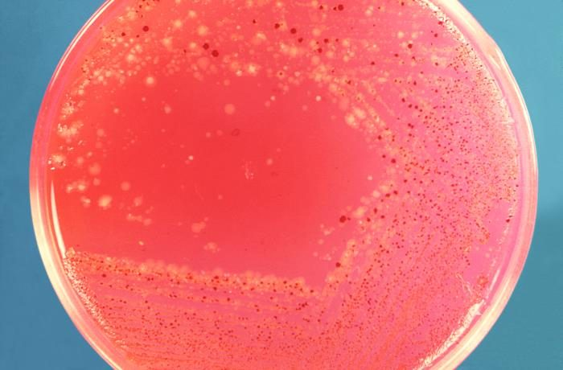 <b>شکل ۲۲.۰۶.</b> کشت مخلوط سواب رکتال روی آگار خون‌دار با غلبهٔ کلنی‌های سیاه <i>Prevotella melaninogenica</i> منبع: CDC/ Dr. V.R. Dowell، <a href="https://commons.wikimedia.org/wiki/File:15239_lores.jpg">Wikimedia Commons</a>، <a href="http://creativecommons.org/publicdomain/zero/1.0/deed.en">CC0</a></td></tr></table>

## جدول ۳: *Clostridium* و *Clostridioides*

| گونه | همولیز (آگار خون) | **لسیتیناز** | **لیپاز** | تحرک | اسپور | نکات کلیدی |
|---|---|---|---|---|---|---|
| ***C. perfringens*** | **هالهٔ دوگانه** (θ کامل + α ناقص) | **+** (ناگلر +) | − | **−** | **به‌ندرت مشاهده می‌شود** | باسیل **بزرگ مستطیلی («واگنی»)**؛ رشد بسیار سریع؛ **CAMP معکوس +** |
| ***C. septicum*** | β؛ **سوارم** | − | − | + | زیرانتهایی بیضی | **سرطان کولون**، نوتروپنی |
| ***C. tertium*** | − | − | − | + | انتهایی | **هوازی‌تحمل** (رشد هوازی **بدون اسپور**)؛ **کاتالاز −** (برخلاف *Bacillus*) |
| ***C. sordellii*** | − | **+** | − | + | زیرانتهایی | **اوره‌آز +**، ایندول +؛ سندرم شوک سمی پس از زایمان/سقط |
| ***C. difficile*** | − | − | − | + | زیرانتهایی | CCFA: کلنی **زرد، شیشه‌ای مات**، **بوی پهن اسب**، **فلورسانس زرد-سبز** |
| ***C. tetani*** | β؛ سوارم | − | − | + | **انتهایی گرد («چوب طبل»)** | تشخیص **بالینی**؛ کشت به‌ندرت مثبت |
| ***C. botulinum*** ☣️ | β | − | **+** | + | زیرانتهایی | **بدون کشت روتین**؛ توکسین در آزمایشگاه مرجع |
| *Thomasclavelia ramosa* (*C. ramosum*)، *Enterocloster clostridioformis* (*C. clostridioforme*) | − | − | − | − / + | به‌ندرت مشاهده می‌شود | **گرم منفی مشاهده می‌شوند** ← ونکومایسین **S** |
| *C. innocuum* | − | − | − | − | انتهایی | **ونکومایسین R سطح پایین** |

**تصاویر:**

<table><tr><td align="center" width="50%">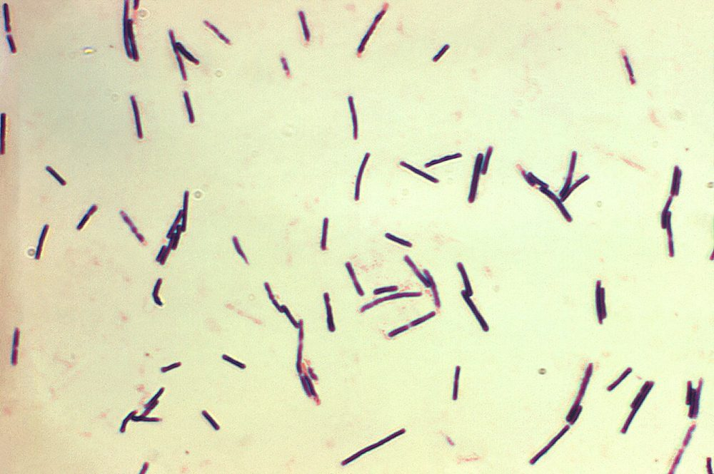 <b>شکل ۲۲.۰۷.</b> باسیل‌های گرم مثبت درشت و مستطیلی بدون اسپور (<i>C. perfringens</i>، کشت در براث شدلر) منبع: Content Providers(s): CDC/Don Stalons، <a href="https://commons.wikimedia.org/wiki/File:Clostridium_perfringens.jpg">Wikimedia Commons</a>، Public domain</td><td align="center" width="50%">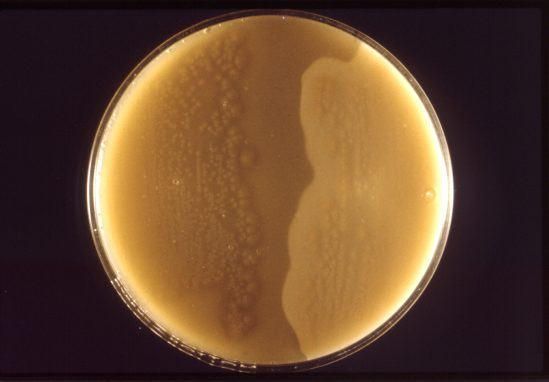 <b>شکل ۲۲.۰۸.</b> کلنی‌های <i>C. perfringens</i> روی پلیت نیمه‌آنتی‌توکسین (آزمون ناگلر) منبع: CDC/Dr. Stuart E. Starr، <a href="https://commons.wikimedia.org/wiki/File:Clostridium_perfringens_01.png">Wikimedia Commons</a>، Public domain</td></tr><tr><td align="center" width="50%">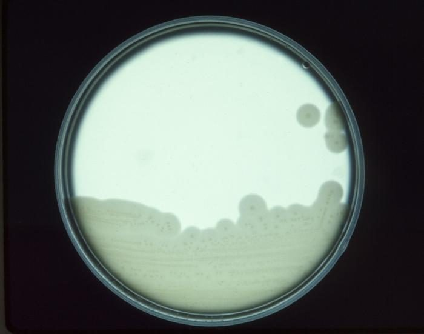 <b>شکل ۲۲.۰۹.</b> کشت <i>C. perfringens</i> روی آگار زردهٔ تخم‌مرغ منبع: CDC، <a href="https://commons.wikimedia.org/wiki/File:Clostridium_perfringens_CDC_3872.jpg">Wikimedia Commons</a>، Public domain</td><td align="center" width="50%">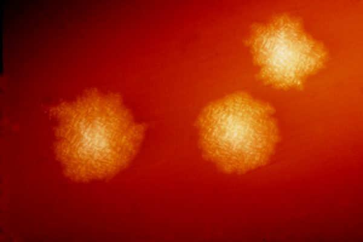 <b>شکل ۲۲.۱۰.</b> کلنی‌های <i>C. difficile</i> پس از ۴۸ ساعت روی آگار خون‌دار (بزرگ‌نمایی ۴٫۸×) منبع: Content Providers(s): CDC/Dr. Holdeman، <a href="https://commons.wikimedia.org/wiki/File:Clostridium_difficile_colonies.png">Wikimedia Commons</a>، Public domain</td></tr><tr><td align="center" width="50%">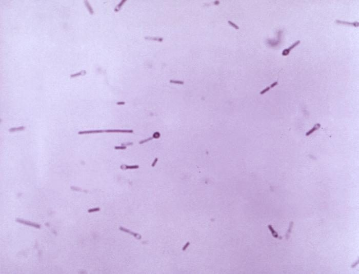 <b>شکل ۲۲.۱۱.</b> <i>C. tetani</i> در رنگ‌آمیزی گرم: اسپور انتهایی گرد («چوب طبل») در برخی سلول‌ها منبع: CDC/ Dr. Holdeman، <a href="https://commons.wikimedia.org/wiki/File:12056_lores.jpg">Wikimedia Commons</a>، Public domain</td><td align="center" width="50%">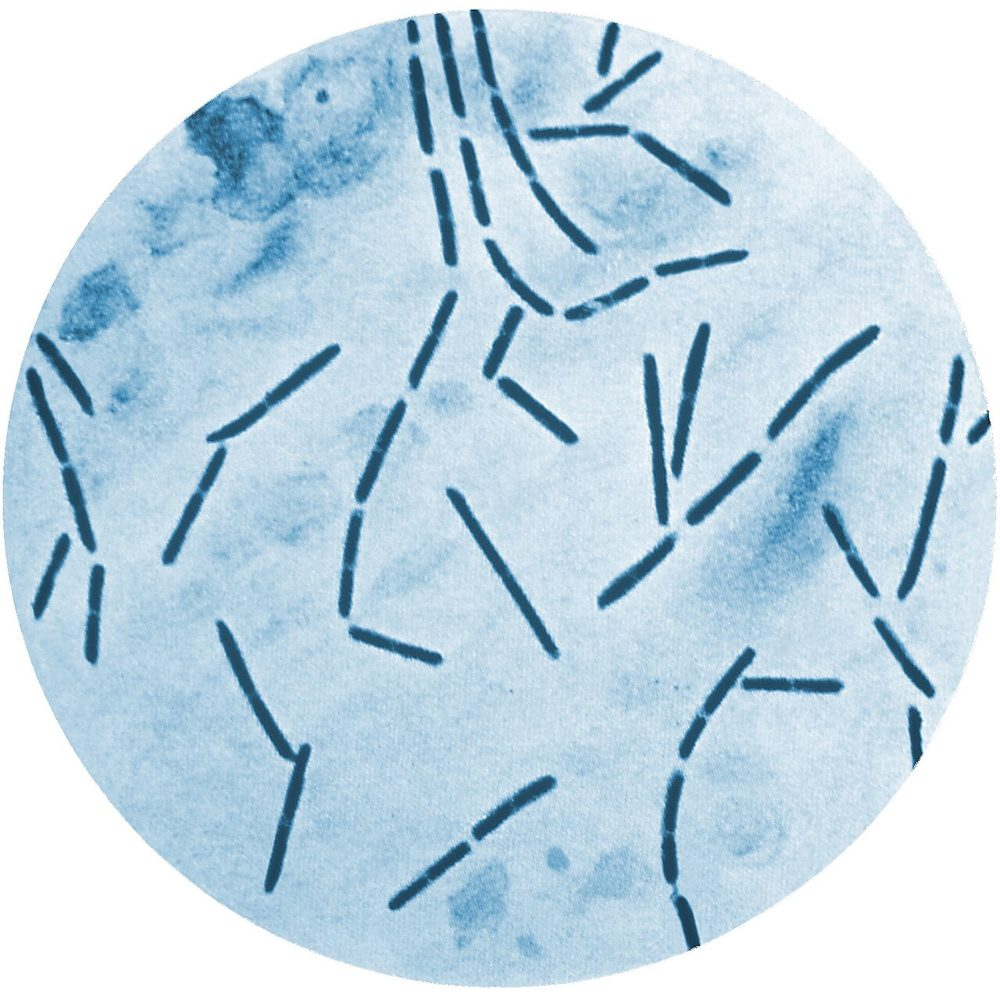 <b>شکل ۲۲.۱۲.</b> <i>C. septicum</i> در رنگ‌آمیزی متیلن بلو (کشت) منبع: Content Providers(s): CDC، <a href="https://commons.wikimedia.org/wiki/File:Clostridium_septicum_01.jpg">Wikimedia Commons</a>، Public domain</td></tr></table>

## جدول ۴: باسیل‌های گرم مثبت بدون اسپور و کوکسی گرم مثبت

| ارگانیسم | کاتالاز | ایندول | نیترات | نکات |
|---|---|---|---|---|
| ***Actinomyces israelii*** | **−** | − | v | باسیل **منشعب**؛ کلنی **«دندان آسیا»** (۷–۱۴ روز)؛ **گرانول گوگردی** در چرک؛ اغلب در **CO₂** رشد می‌کند |
| ***Cutibacterium acnes*** | **+** | **+** | **+** | دیفتروئید پلئومورف؛ رشد کند (تا **۱۴ روز** در نمونه‌های پروتز)؛ **مترونیدازول R** |
| *Eggerthella lenta* | **+** | − | **+** | آرژینین +؛ باکتریمی از منشأ روده |
| *Bifidobacterium* | − | − | − | اشکال **دوشاخه**؛ معمولاً بی‌اهمیت |
| *Mobiluncus* | − | − | v | خمیده، **گرم‌متغیر**؛ واژینوز باکتریایی |
| ***Finegoldia magna*** | v | − | − | کوکسی **درشت** در خوشه؛ عفونت استخوان، پروتز، دیابت |
| ***Parvimonas micra*** | − | − | − | کوکسی **ریز** در زنجیره؛ **هالهٔ شیری** اطراف کلنی؛ عفونت دهان و ستون فقرات |
| ***Peptostreptococcus anaerobius*** | − | − | − | **SPS حساس**؛ بوی **شیرین/میوه‌ای** |
| *Peptoniphilus asaccharolyticus* | v | **+** | − | |

**تصاویر:**

<table><tr><td align="center" width="50%">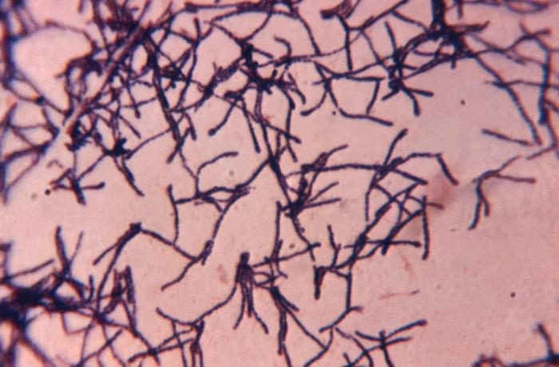 <b>شکل ۲۲.۱۳.</b> باسیل‌های گرم مثبت باریک و منشعب (<i>Actinomyces israelii</i>) منبع: CDC/ Dr. Lucille K. Georg، <a href="https://commons.wikimedia.org/wiki/File:22293_lores.jpg">Wikimedia Commons</a>، <a href="http://creativecommons.org/publicdomain/zero/1.0/deed.en">CC0</a></td><td align="center" width="50%">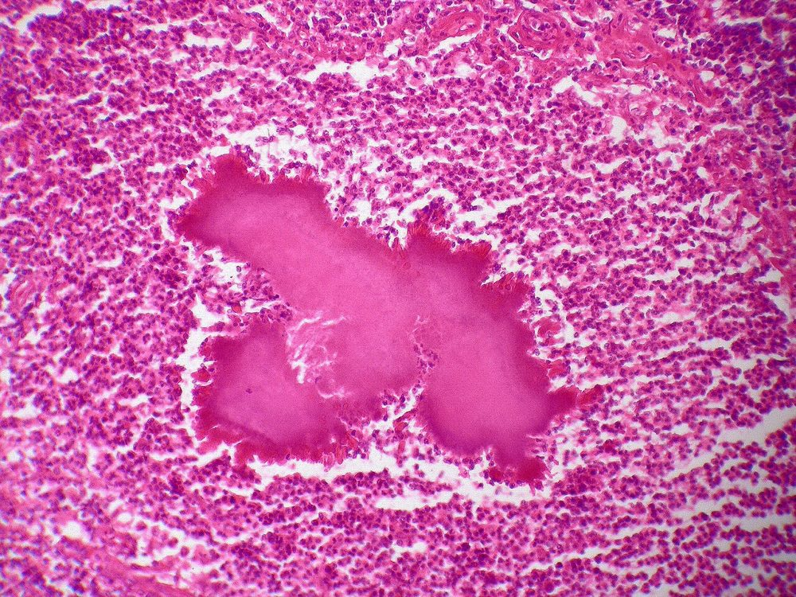 <b>شکل ۲۲.۱۴.</b> کلنی <i>Actinomyces</i> (گرانول گوگردی) درون آبسه؛ رنگ H&E منبع: Yale Rosen from USA، <a href="https://commons.wikimedia.org/wiki/File:Actinomycosis_(5287905500).jpg">Wikimedia Commons</a>، <a href="https://creativecommons.org/licenses/by-sa/2.0">CC BY-SA 2.0</a></td></tr><tr><td align="center" width="50%">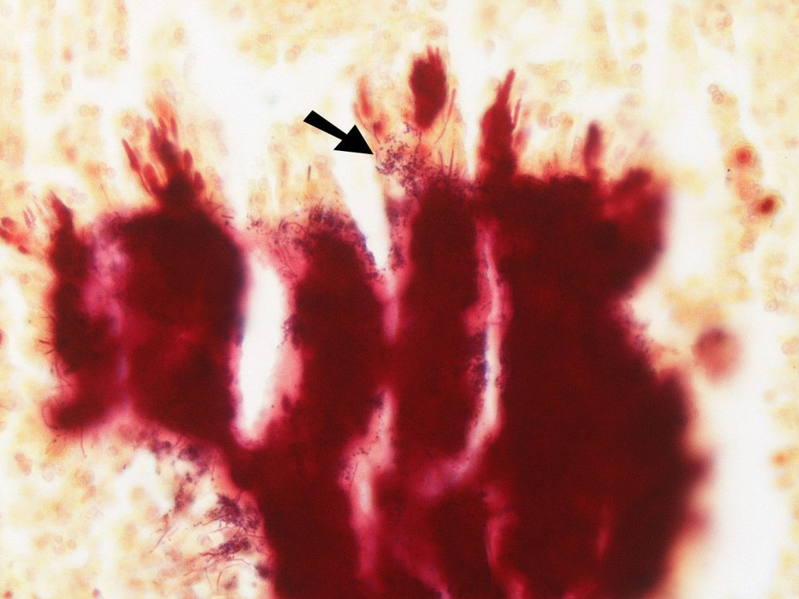 <b>شکل ۲۲.۱۵.</b> حاشیهٔ گرانول در رنگ گرم: رشته‌های باریک گرم مثبت <i>Actinomyces</i> منبع: Yale Rosen from USA، <a href="https://commons.wikimedia.org/wiki/File:Actinomycosis_-_Gram_stain_(5286050326).jpg">Wikimedia Commons</a>، <a href="https://creativecommons.org/licenses/by-sa/2.0">CC BY-SA 2.0</a></td><td align="center" width="50%">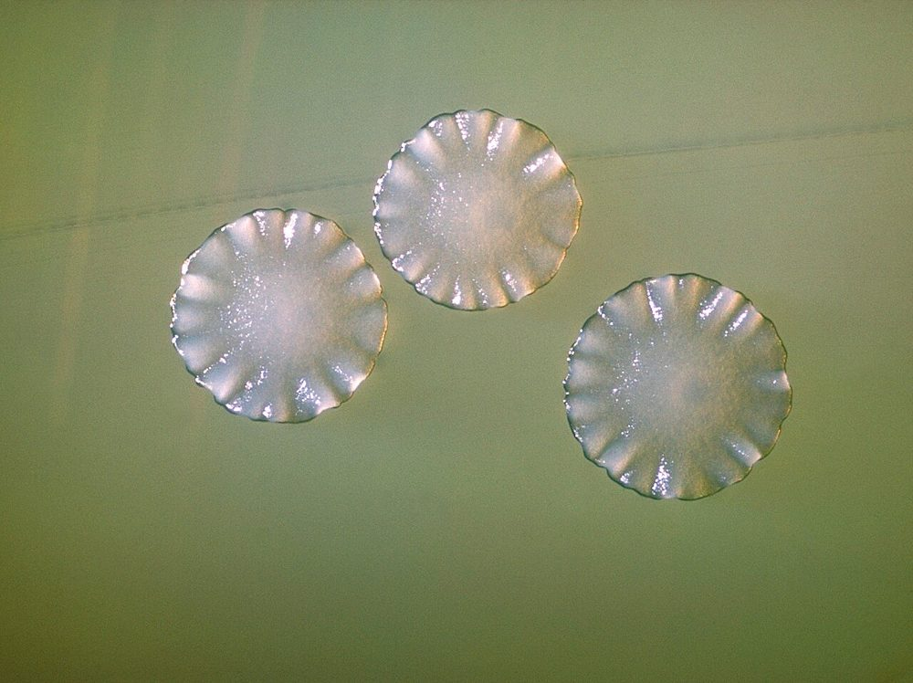 <b>شکل ۲۲.۱۶.</b> کلنی‌های <i>Actinomyces</i> روی آگار منبع: US gov، <a href="https://commons.wikimedia.org/wiki/File:Actinomyces_spp_01.jpg">Wikimedia Commons</a>، Public domain</td></tr><tr><td align="center" width="50%">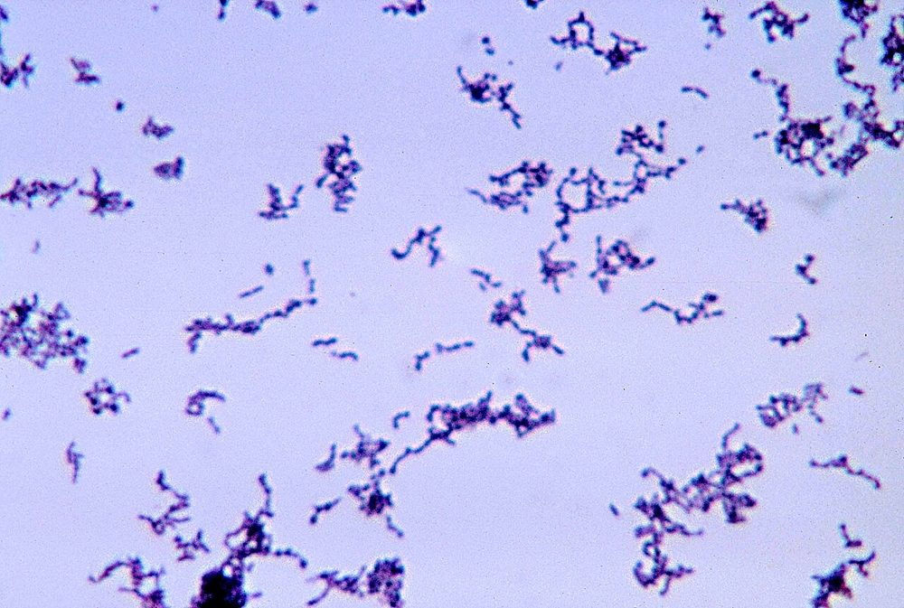 <b>شکل ۲۲.۱۷.</b> باسیل‌های گرم مثبت کوتاه و پلئومورف <i>Cutibacterium acnes</i> (پیشتر <i>Propionibacterium acnes</i>)، کشت در تیوگلیکولات منبع: CDC/Bobby Strong، <a href="https://commons.wikimedia.org/wiki/File:Propionibacterium_acnes.jpg">Wikimedia Commons</a>، Public domain</td></tr></table>

## جدول ۵: مقاومت ذاتی و نکات AST (خلاصه؛ مبنا: [AST/05 بخش ۴](../AST/05_Fastidious_Anaerobes/README.md))

| ارگانیسم | نکته |
|---|---|
| **همهٔ بی‌هوازی‌ها** | **آمینوگلیکوزیدها R** |
| **گروه *B. fragilis*** | **پنی‌سیلین و آمپی‌سیلین R** (بتالاکتاماز)؛ **کلیندامایسین R** شایع (۲۰–۴۰٪ یا بیشتر)؛ مقاومت به **کارباپنم** (*cfiA*) و **مترونیدازول** (*nim*) نادر ولی در حال افزایش |
| *Cutibacterium*، *Actinomyces*، برخی *Bifidobacterium* | **مترونیدازول R** |
| *C. innocuum* | **ونکومایسین** سطح پایین R |
| *Prevotella*، *Porphyromonas*، *Fusobacterium* | **نیتروسفین** (بتالاکتاماز در *Prevotella* شایع) |

