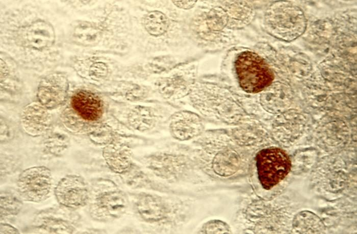
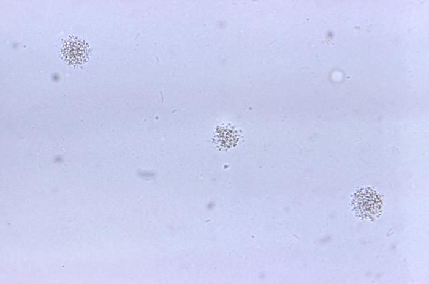
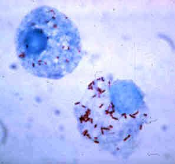
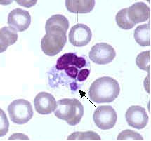
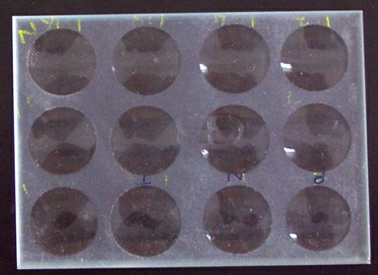
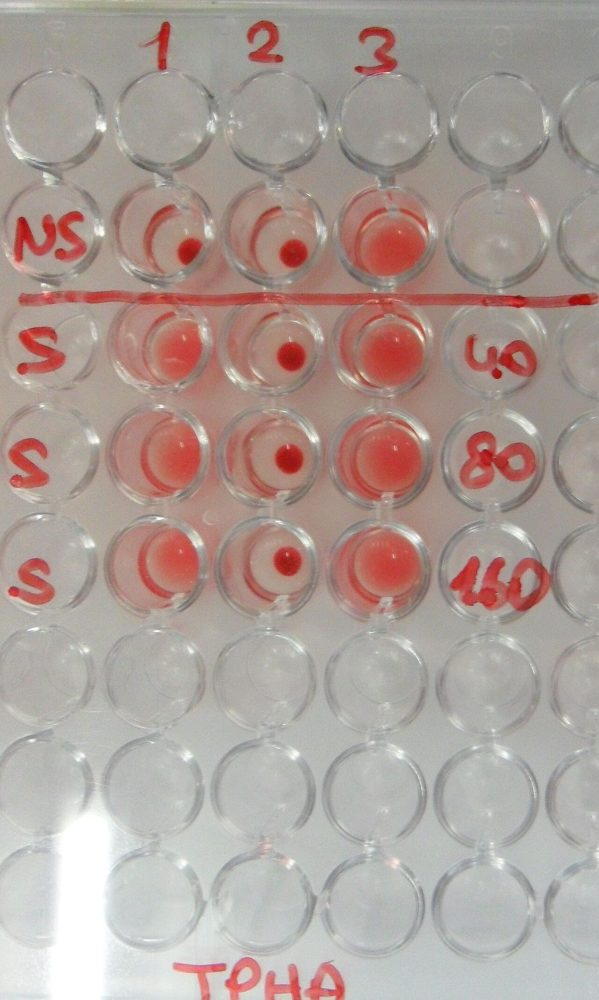
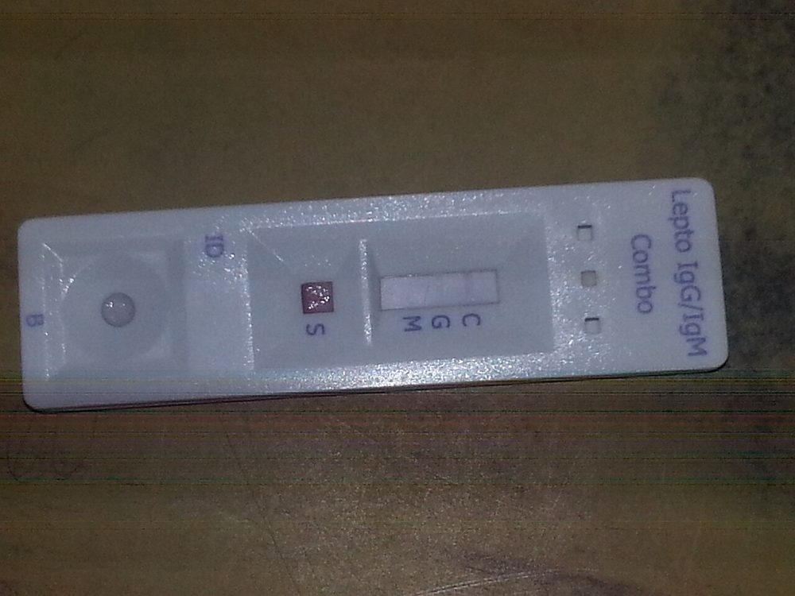
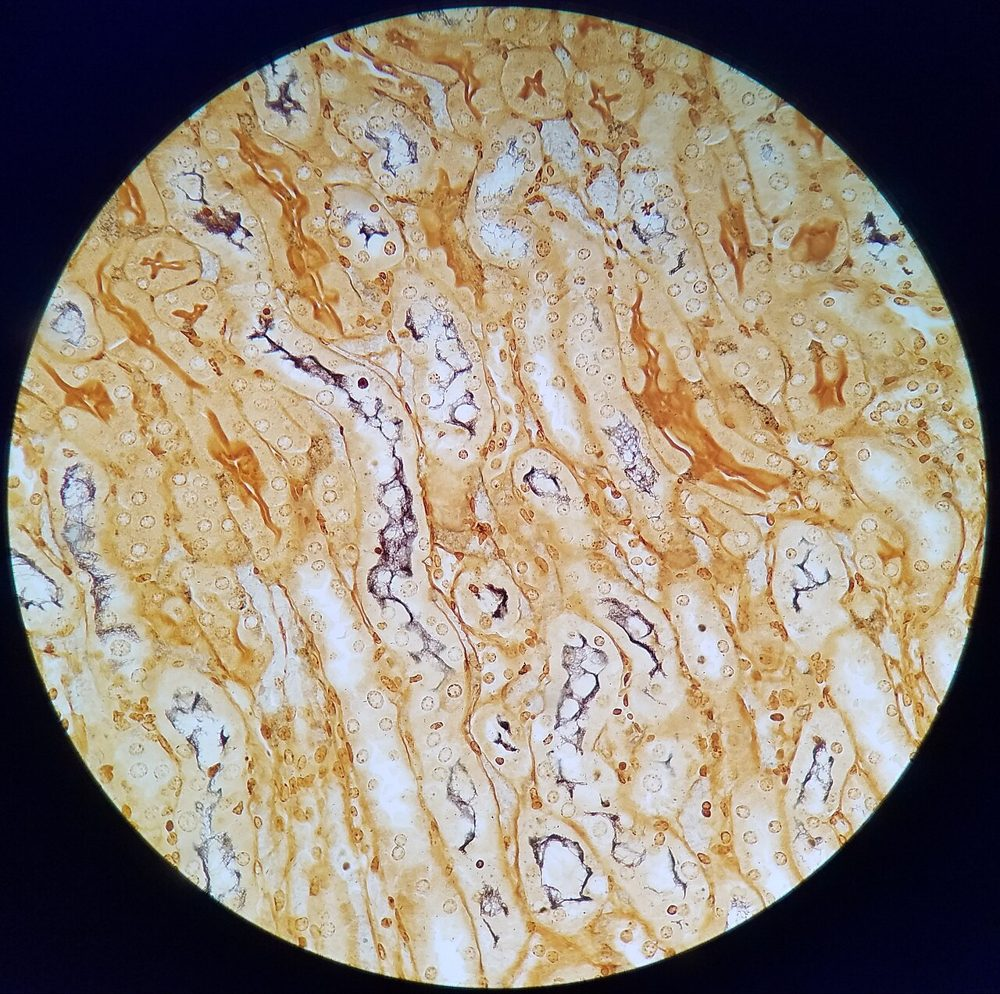
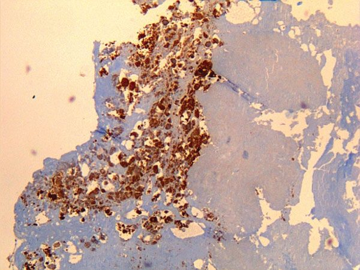
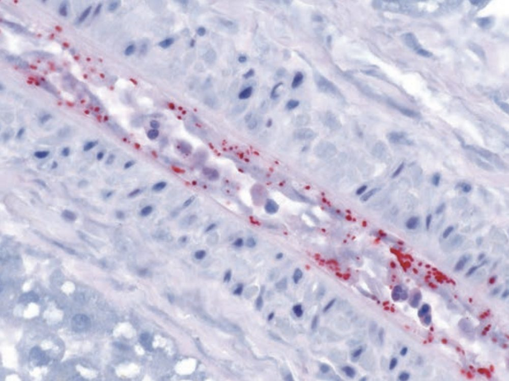

# جدول‌های افتراقی: باکتری‌های غیرقابل‌کشت یا دشوارکشت

## جدول ۱: ویژگی‌های گروه‌ها و پیامد آزمایشگاهی

| گروه | ویژگی زیستی | پیامد آزمایشگاهی |
|---|---|---|
| ***Chlamydia*** | درون‌سلولی اجباری؛ چرخهٔ **جسم ابتدایی (EB، عفونت‌زا)** ← **جسم مشبک (RB، تکثیری)** | کشت فقط در **سلول** (McCoy، HeLa)؛ امروزه **NAAT** |
| ***Rickettsia*، *Orientia*، *Ehrlichia*، *Anaplasma*** | درون‌سلولی اجباری؛ ناقل **کنه، شپش، کک، مایت** | **سرولوژی IFA** (جفت سرم) و **PCR**؛ *Ehrlichia*/*Anaplasma*: **مورولا** در لکوسیت (لام خون) |
| ***Coxiella*** | درون‌سلولی؛ **تغییر فاز** (فاز I: سویهٔ وحشی؛ فاز II: پس از کشت) | **IFA فاز I و II** |
| ***Mycoplasma*، *Ureaplasma*** | **بدون دیواره** ← رنگ گرم نمی‌گیرد؛ **مقاوم ذاتی به بتالاکتام‌ها و گلیکوپپتیدها** | NAAT؛ کشت اختصاصی (*M. hominis*: کلنی «**تخم‌مرغ نیمرو**»؛ *Ureaplasma*: اوره‌آز) |
| ***T. pallidum*** | اسپیروکت بسیار نازک؛ **غیرقابل‌کشت** در محیط مصنوعی | **سرولوژی**؛ میدان تاریک/PCR از ضایعه |
| ***Borrelia*** | اسپیروکت؛ تب راجعه: **باکتریمی زیاد حین تب** | **لام خون** (تب راجعه)؛ سرولوژی دومرحله‌ای (لایم) |
| ***Leptospira*** | اسپیروکت با انتهای **قلاب‌دار**؛ محیط **EMJH** (کشت کند، هفته‌ها) | **PCR** و **سرولوژی** (MAT) |

**تصاویر:**

<table><tr><td align="center" width="50%"> <b>شکل ۲۴.۰۳.</b> اجسام انکلوزیون <i>C. trachomatis</i> (قهوه‌ای) در کشت سلول McCoy منبع: User Marcus007 on de.wikipedia، <a href="https://commons.wikimedia.org/wiki/File:ChlamydiaTrachomatisEinschlussk%C3%B6rperchen.jpg">Wikimedia Commons</a>، Public domain</td><td align="center" width="50%"> <b>شکل ۲۴.۰۴.</b> کلنی‌های <i>Ureaplasma urealyticum</i> (بزرگ‌نمایی ۵۰۰×) منبع: CDC/ Dr. Francis Forrester، <a href="https://commons.wikimedia.org/wiki/File:10931_lores_(1).jpg">Wikimedia Commons</a>، <a href="http://creativecommons.org/publicdomain/zero/1.0/deed.en">CC0</a></td></tr><tr><td align="center" width="50%"> <b>شکل ۲۴.۰۵.</b> رنگ‌آمیزی گیمنز: <i>Rickettsia rickettsii</i> درون سلول‌های همولنف کنه منبع: CDC، <a href="https://commons.wikimedia.org/wiki/File:Rickettsia_rickettsii.jpg">Wikimedia Commons</a>، Public domain</td><td align="center" width="50%"> <b>شکل ۲۴.۰۶.</b> مورولا در سیتوپلاسم نوتروفیل در گسترش خون بیمار مبتلا به ارلیشیوز منبع: Lamiot, from US CDC، <a href="https://commons.wikimedia.org/wiki/File:EhrlichiaEwingiiUS_CDCMorulaInCytoplasmOfNeutrophil.jpg">Wikimedia Commons</a>، Public domain</td></tr></table>

## جدول ۲: آزمون‌های سرولوژیک سیفلیس

| نوع | آزمون‌ها | چه می‌سنجد | ویژگی‌ها |
|---|---|---|---|
| **غیرترپونمایی** | **RPR**، **VDRL** (و VDRL روی **CSF**) | آنتی‌بادی ضد **کاردیولیپین–لسیتین–کلسترول** | **کمّی** (تیتر) ← **پایش درمان** (کاهش **چهار برابری** = پاسخ)؛ پس از درمان معمولاً منفی می‌شود؛ **مثبت کاذب بیولوژیک**؛ **پروزون** |
| **ترپونمایی** | **TPPA**، FTA-ABS، **EIA/CLIA**، آزمون‌های سریع | آنتی‌بادی ضد آنتی‌ژن‌های **اختصاصی *T. pallidum*** | معمولاً **مادام‌العمر مثبت** ← برای پایش درمان **کاربرد ندارد** |

> **منفی کاذب:** سیفلیس اولیهٔ **بسیار زودرس** (قبل از تولید آنتی‌بادی)؛ **پروزون** در RPR با تیتر بسیار بالا (ثانویه) ← رقیق‌سازی.
> **مثبت کاذب غیرترپونمایی:** بارداری، بیماری خودایمنی (لوپوس، APS)، HIV، اعتیاد تزریقی، سن بالا، عفونت‌های حاد (مالاریا، EBV، واکسیناسیون).

**تصاویر:**

<table><tr><td align="center" width="50%"> <b>شکل ۲۴.۰۷.</b> لام حفره‌دار مخصوص آزمون VDRL منبع: Microrao، <a href="https://commons.wikimedia.org/wiki/File:VDRL_slide.jpg">Wikimedia Commons</a>، Public domain</td><td align="center" width="50%"> <b>شکل ۲۴.۰۸.</b> آزمون آگلوتیناسیون ذره‌ای <i>T. pallidum</i> در میکروپلیت منبع: Copacopac، <a href="https://commons.wikimedia.org/wiki/File:Treponema_pallidum-Partikelagglutinationstest.jpg">Wikimedia Commons</a>، <a href="https://creativecommons.org/licenses/by-sa/3.0">CC BY-SA 3.0</a></td></tr></table>

## جدول ۳: تفسیر الگوهای سرولوژی سیفلیس

| غیرترپونمایی (RPR) | ترپونمایی (EIA/TPPA) | تفسیر | اقدام |
|---|---|---|---|
| **+** | **+** | سیفلیس **فعلی** یا اخیر، یا درمان‌شده با تیتر باقیمانده | سابقهٔ درمان و تیتر قبلی؛ مرحله‌بندی بالینی |
| **−** | **+** | سیفلیس **درمان‌شدهٔ قبلی**؛ یا **اولیهٔ زودرس**/نهفتهٔ دیررس؛ یا ترپونمایی **مثبت کاذب** | در الگوریتم معکوس: **ترپونمایی دوم** (TPPA) ← اگر + ← سابقه/درمان؛ اگر − ← احتمالاً مثبت کاذب |
| **+** | **−** | **مثبت کاذب بیولوژیک** غیرترپونمایی | بررسی علت؛ تکرار |
| **−** | **−** | بدون سیفلیس؛ یا **دورهٔ نهفتهٔ** اولیه | در شک بالا: تکرار **۲–۴ هفته** بعد؛ میدان تاریک/PCR ضایعه |

> **نوروسیفلیس:** **VDRL مایع مغزی** (اختصاصی، حساسیت کم) + شمارش سلول و پروتئین CSF؛ **FTA-ABS منفی CSF** نوروسیفلیس را تقریباً رد می‌کند.
> **سیفلیس مادرزادی:** RPR کمّی **نوزاد و مادر** با **یک روش و در یک آزمایشگاه**؛ تیتر نوزاد **≥ ۴ برابر** مادر ← به نفع سیفلیس مادرزادی؛ آنتی‌بادی ترپونمایی IgG مادر از جفت عبور می‌کند.

## جدول ۴: لپتوسپیروز، تب Q و ریکتزیوزها — انتخاب آزمون بر اساس زمان

| بیماری | هفتهٔ اول بیماری | هفتهٔ دوم به بعد | نکات |
|---|---|---|---|
| **لپتوسپیروز** | **PCR خون** (یا CSF) | **PCR ادرار**؛ **IgM ELISA**؛ **MAT** (مرجع؛ پانل سرووارهای محلی) | MAT: افزایش **چهار برابری** بین دو نمونه یا تیتر منفرد بالا (آستانه طبق آزمایشگاه مرجع و منطقهٔ آندمیک)؛ آنتی‌بیوتیک را برای انتظار نتیجه به تأخیر نیندازید |
| **تب Q** | **PCR سرم/خون** | **IFA**: **فاز II** (IgM و IgG) ← **حاد** | **IgG فاز I بالا** (آستانه طبق آزمایشگاه) ← عفونت **پایدار/مزمن** (اندوکاردیت، عفونت عروقی)؛ PCR بافت دریچه |
| **ریکتزیوز** (تب منقوط، تیفوس) | **PCR** از **اسکار** یا بیوپسی پوست (حساس‌تر از خون) | **IFA IgG**: افزایش **چهار برابری** بین سرم حاد و نقاهت (۲–۴ هفته) | **وایل–فلیکس** (آگلوتیناسیون *Proteus* OX) **منسوخ** است (حساسیت و ویژگی پایین)؛ درمان تجربی با داکسی‌سایکلین منتظر آزمایش نمی‌ماند |
| **تب راجعه** (*B. persica*) | **لام خون ضخیم و نازک** حین **تب** (گیمسا/رایت) | | بین حملات لام **منفی**؛ PCR؛ **واکنش جاریش–هرکسهایمر** پس از درمان |

**تصاویر:**

<table><tr><td align="center" width="50%"> <b>شکل ۲۴.۰۹.</b> کاست سریع IgG/IgM لپتوسپیرا: IgG مثبت و IgM منفی منبع: Ajay Kumar Chaurasiya، <a href="https://commons.wikimedia.org/wiki/File:Leptospira_IgG_rapid_test_positive_and_IgM_negative.jpg">Wikimedia Commons</a>، <a href="https://creativecommons.org/licenses/by-sa/4.0">CC BY-SA 4.0</a></td><td align="center" width="50%"> <b>شکل ۲۴.۱۰.</b> وارتین–استاری: تجمع <i>Leptospira</i> (سیاه) در لومن توبول‌های مدولای کلیه منبع: Marie Moinet، <a href="https://commons.wikimedia.org/wiki/File:Leptospira_in_kidney.jpg">Wikimedia Commons</a>، <a href="https://creativecommons.org/licenses/by-sa/4.0">CC BY-SA 4.0</a></td></tr><tr><td align="center" width="50%"> <b>شکل ۲۴.۱۱.</b> ایمونوهیستوشیمی: <i>Coxiella burnetii</i> (قهوه‌ای) در دریچهٔ قلب برداشته‌شده از بیمار با اندوکاردیت تب Q منبع: Mahamat A, Edouard S, Demar M, Abboud P, Patrice J-Y, La Scola B, et a، <a href="https://commons.wikimedia.org/wiki/File:Immunohistochemical_detection_of_Coxiella_burnetii_in_resected_cardiac_valve_of_a_60-year-old_man_with_Q_fever_endocarditis.jpg">Wikimedia Commons</a>، Public domain</td><td align="center" width="50%"> <b>شکل ۲۴.۱۲.</b> ایمونوهیستوشیمی: <i>R. rickettsii</i> (قرمز) در سلول‌های اندوتلیال عروق منبع: US Centers of Disease Control، <a href="https://commons.wikimedia.org/wiki/File:Immunohistochemical_Stain_of_Rickettsia_rickettsii.png">Wikimedia Commons</a>، Public domain</td></tr></table>

## جدول ۵: *C. trachomatis*، *M. genitalium*، *M. pneumoniae*

| ویژگی | *C. trachomatis* | *M. genitalium* | *M. pneumoniae* |
|---|---|---|---|
| روش اصلی | NAAT | NAAT + **جهش ۲۳S** (ماکرولید) | NAAT (± جهش ۲۳S **A2063G**) |
| نمونهٔ بهینه | ادرار اول جریان (مرد)؛ **سواب واژن** (زن) | مانند *C. trachomatis* | سواب حلق/نازوفارنکس، خلط |
| سرولوژی | ارزش محدود (فقط LGV/پنومونی نوزادی) | — | IgM در کودکان (دیر مثبت؛ تا ماه‌ها مثبت) |
| **آزمون پس از درمان** | روتین نه (به‌جز **بارداری**: حدود ۴ هفته)؛ NAAT تا **۳ هفته** پس از درمان ممکن است مثبت بماند | در صورت پایداری علائم | — |
| نکته | **LGV**: ژنوتیپ L1–L3 (پروکتیت در MSM) ← آزمایشگاه مرجع | مقاومت بالا به **آزیترومایسین** و رو به افزایش به **موکسی‌فلوکساسین** | مقاومت به ماکرولید (به‌ویژه شرق آسیا) |

